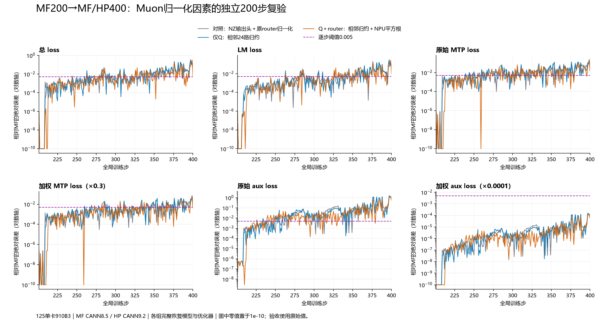
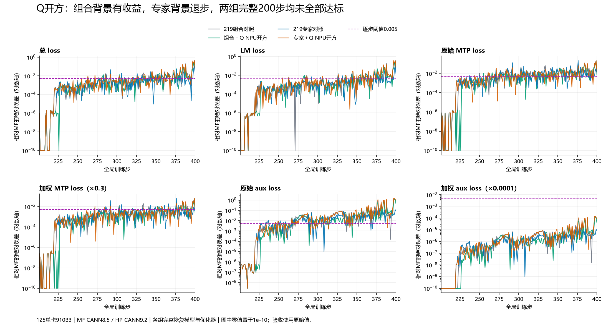

# JT单卡200→400步公开实验记录

截至2026年10月16日，89组独立完整200步实验尚无全部六项指标通过者。参考值替换诊断不纳入验收。本目录发布指标、状态哈希、配置、观测/比较脚本，不包含训练数据、模型或优化器大数组。

- `evidence/completed-cann92-inventory.csv`：89组逐项统计、源码版本和比较文件。
- `runs/`：原始未截断指标、实际恢复清单、源码标识和因素范围。
- `configs/`：实际配置；环境路径需映射到复现环境。
- `scripts/`：共同观察/比较程序。`scripts/latest-jt-f637`对应远端`/alignment/phase12/tools-f637`；源清单校验固定49份依赖，新增因素另记运行时SHA256。
- `evidence/optimizer-restore-independent-reaudit.json`：28份Muon动量、18份AdamW一阶矩、18份二阶矩的独立恢复审计。

前71组使用JT_dev521d3a8a＋PR192；第72–76组使用f637ef7＋PR192（集成9213a971）。硬件Ascend910B3，HP CANN9.2.0-beta.2/MF CANN8.5，MF原包未编辑。第72组与第71组完整200步逐值相同；只改embedding/全部AdamW的第73/74组仍未通过，全部范围反而恶化。

真实坐标探针、同输入重放、矩公式/分母2×2、80位精度比较、业界源码清单和三组范围消融形成分层证据。head连续转置六步无收益，12次实际反向已核验。坐标文件仅保留索引和原始证据SHA256；原始坐标值、操作数列和大数组保留在125，不在公开包内。

此目录是实验记录而非环境镜像；框架依赖按总issue固定版本安装，初始状态必须来自同一MF200完整checkpoint。局部正确性与全段兼容性分别判断，不将各因素的效果简单相加。

本次补充将证据仓库设置为保留文件字节；最新JT的49份探针已按实际运行清单逐一核验原始SHA256，避免Windows自动换行转换造成源码守卫误报。`文件校验.json`按Git提交blob字节核验。

## 输出头实际反向边界补充

新增六步探针均通过各自原生轨迹的loss、范数、恢复和输入核验。首步主/MTP分支的实际x和dy采样完全一致；541个选定权重坐标的40处差异已定位到分支GEMM，FP32共享累加精确。FP64参考下HP更近18个分支坐标、MF更近22个，尚无普遍错误证据。

205步所选裁剪前head梯度541/541精确，裁剪后540处差异由范数2个FP32 ULP完全解释，最大仅2.91e-11。进一步核验完整4096×5120输入/返回梯度：两分支输入全等、MTP返回梯度全等，主返回梯度仅1处差7.28e-12。继续定位更早层的205反向边界，不能将局部精确当作200步验收。

新增报告为`head-*-comparison.json`、`head-full-input-gradient-boundaries.json`和`head-gemm-industry-correctness-assessment.json`。首个多层继承观察器编译停滞，终止后改为直接继承，保真重跑成功；失败记录与数值结论分开。完整数组、梯度坐标值不发布；125仅保留必要定位步。

随后只读审计全部204步模型：48张量中47张量逐元素精确，仅lm_head.weight有32,242个FP32/65个BF16差异；六步观察器保真通过，未保存额外模型。证据`adamw-all-post204-model-fidelity.json`及对应完整逐张量表。后续已排除205最终RMSNorm与共享合并，见下文。

## 第205步归一化与MoE因果定位

新增完整数组核验排除了最终RMSNorm及LM/MTP共享梯度合并点：在相同dtype边界上20,971,520元素全等。统一裁剪系数的只读回放将44个非词表参数梯度中的24个恢复精确，剩余20个集中于主模型。

主第1层MoE的x/dy完整相同，BF16输入梯度仅49处不等，最大约1.16e-10。仅替换这49点的明确标记诊断组使205实际44参数梯度全部精确、梯度范数精确，并把206总loss/LM误差恢复为0，MTP raw和aux raw误差降至约7.95e-7和5.93e-7。这是当前优先追查边界的因果依据，仍不是独立200步验收，也未证明某方数学错误。完整分析、保真、失败及清理记录见《阶段记录-205归一化共享合并与梯度审计.md》。

## 共享SwiGLU单点因果与第75/76组完整回归

已将MoE49个差异追溯为共享分支360个dx，再定位到共享FC1上游1个BF16梯度。相同输入下，FP32 SiLU后乘梯度在受影响整行3072个up导数上匹配MF；提前转BF16反而造成826处不一致。90位参考在此临界点略偏向MF，不推广为整个CANN算子错误。CANN和Megatron固定源码依据及运行二进制对应的限制已记录。

无参考值注入、无步数/坐标特判的独立公式，使205完整44/44梯度和范数精确，206 total/LM精确。两组200步已完成且恢复/源码/200输入审计通过。第75组相对兼容AdamW控制的total max/MAE下降65.56%/46.49%，首次任一项超限207→226；第76组相对原生AdamW控制亦有均值收益，但两组原始MTP超限步均增加。仍无全部六项通过。

206哈希审计43/44组梯度精确，仅MTP最终norm权重不等；此项尚无误差量级和因果依据，不提前认定需要修复。详见《阶段记录-205共享SwiGLU单点因果与消融.md》、`shared-up-full200-two-by-two.json`和对应完整逐步记录。原始大数组不发布，公开报告删除原始坐标示例，保留源报告SHA。

## 206 极小差异的降级与 router 更新负面消融

MTP 最终 norm206 梯度只差1个元素、约5.73e-11；只消除该点的诊断组201–226全部loss、范数及每步48个模型哈希与控制精确一致，首次超限仍226，因此该点降级。原生MF和HP两组26步哈希观察均通过保真，206首先新增主router权重差异，207扩散。

router206实际梯度、动量均相同，12个更新权重差异被定位到原生NS初始归一化的1个BF16元素。只消除这12个权重差异后首次超限反而提前到209；不读参考值的square-sum-sqrt公式也在205引入新偏差，26步原始MTP最大误差0.00510→0.00841，暂不采用。MF该单点更接近FP64参考不等于整条训练更正确。真实kernel边界、独立公式、失败消融、行业参考和所有配置见《阶段记录-206极小差异降级与router更新消融.md》。累计完整200步实验仍76组，均未全部通过。

## 第206步输出头与router交互：新的优先级依据

完整输出头仅49,942个FP32/131个BF16元素不同，最大差8.28e-7。一次输出头替换的26步诊断六项均未超0.005，但total/LM最大差和部分均值并未全面改善；同时替换router虽使206全部48个模型精确，221步原始MTP仍超限。双干预后的207步47/48模型精确，仅输出头重新不同，支持继续量化输出头的完整窗口作用。所有替换均明确排除在独立实现验收之外。

独立DVM归约公式在205/206同输入匹配MF，也在实际训练消除206 router差异，但26步首次超限226→221，暂不采用。两组完整200步输出头诊断已完成并通过保真审计，但均未通过全窗口标准。详细量级、六指标、2×2交互、失败观察器、正确性依据和清理收据见《阶段记录-206输出头与router交互消融.md》。已清理冗余HP头数组，保留MF数组和约0.8MB差异补丁，并在清理后分块验证两侧完整哈希可精确重建。

## 完整200步诊断的最终负面结果

仅输出头一次干预首次超限226→231，但total平均差0.008806082→0.014424486（增大63.80%）；输出头＋router一次干预首次超限221，平均差0.009425644（增大7.04%）。部分指标改善不构成稳定收益，不开默认产品修复PR。由于只改模型值、未同步累积AdamW矩，不能据此断言输出头源头不重要；下一步把新梯度与累积状态分开测量。独立完整实验仍76组；另外3组完整参考值干预诊断不计验收。最终全部六项、逐步误差、200输入/恢复/源码核验见`head206-full200-causal-audit.json`和《阶段记录-206输出头完整200步诊断补充.md》。

## 206输出头矩与207同输入GEMM因果定位

[详细中文阶段记录](阶段记录-206输出头矩消融与207梯度因果.md)。三组26步矩干预无稳定总体收益；同206状态下207两支GEMM的完整x/dy相同，dweight不同。后续累加/裁剪完整重建、实际AdamW函数回放均通过；50,439个不同坐标的FP64核验显示两侧各有更准的点。76组独立完整200步仍未通过，禁止将这些诊断计入验收。

本阶段保留一条失败观察器运行及修正后的r2，分析入口使用`compare_head_branches207_r2.py`。大数组按完整重建证据去重，仅公开指标、配置、源码与哈希。

## 输出头 GEMM 路径筛选与独立短窗口

详见[阶段记录](阶段记录-输出头GEMM路径筛选与续训.md)。两支实际207输入各完成七种GEMM路径筛选；普通mm包装保真通过，BMM和FP32输入两项独立26步消融分别在209、207首次超限，控制为226，均降级为负面消融。MF图模式和PyNative最小MatMul均完整复现原生两支输出。此阶段不增加76组完整200步计数，也没有新的通过结论或默认产品修复。源码、配置、实际52次backward标记、完整26步指标、输入/恢复审计及清理收据均已收录。

## 输出头CANN派发、NZ精确重放与独立2×2消融

详见[中文完整阶段记录](阶段记录-输出头GEMM内核派发与NZ精确重放.md)。HP保持CANN9.2，显式MatMulV2的NZ输入/输出使两支实际207GEMM完整精确MF；仅头独立26步仍无总体收益。与router DVM组合后206/207全部48模型精确，total/LM改善，原始MTP最大差低于0.005，但226原始aux仍差0.006847945，整体未通过。控制、两个单项和组合的完整六项/逐步结果、恢复/源码/输入审计、失败探针和报告恢复过程均保留。

后续十步只读打点保真通过：208仅首层linear_qkv和主router新增不同；下一步先量化并区分优化器累积状态、新梯度与更新。这里没有新增完整200步实验，既有76组仍未全部通过。原始成功Profiler/CSV、21份源文件一致性与清理收据可核对，不发布模型和训练数据。

## 2026-10-16：208 Muon归一化与79组完整实验

[详细中文阶段记录](阶段记录-208Muon归一化首差与因果排序.md)给出状态排除、原生融合kernel、FP64参考和逐因素干预；[三组独立200步审计](evidence/frontier208-independent200-audit.json)通过保真但未通过六项loss验收。累计79组独立完整200步，3组完整参考值干预另列排除。仅Q的短窗收益未延续到全窗，Q＋router均值改善但最大误差及aux超限步数退步；均未作为无条件默认修复。

原生kernel数组及模型/数据保留在任务私有目录；本仓库只含源码、配置、标量、哈希和图。清理映射见[本阶段清理证据](evidence/frontier208-cleanup.json)，复现旧孤立NS分析时从canonical数组恢复所需NPY。

## 2026-10-16：212专家权重梯度首差与独立归约

[完整中文阶段记录](阶段记录-212Router反向首差与消融.md)给出22个参数梯度差的因果链：1个专家系数梯度→2个router logit梯度→6个主MoE BF16输入梯度。所有乘法输入完整一致，图模式归约与PyNative路径有别；该坐标HP更近FP64，兼容旧图不等于数学修复。

独立64路归约在NPU重建全部8208项FP32中间输出。仅主MoE、主MoE＋MTP的两组26步因素消融均完成审计，201–216全部48模型精确，首差推迟到217；total平均误差下降46.45%、原始aux下降76.19%，原始MTP最大差略增。两组曲线和模型状态相同，不能据短窗口替代完整验收。两个完整201–400复验正在运行，完成计数仍79。

本阶段45份部署源核对本机与125SHA，保留无效重放、负面候选、全部六项图表、实际调用次数及清理收据；新增去重合计8,497,729,536物理字节。各必要产品修复继续在总issue关联的独立中文子issue/PR追踪。

## 第80／81组：专家权重梯度归约完整200步复验

两组均完成且通过输入、完整恢复、源码与前26步保真审计；主MoE和主MoE＋MTP的200步指标及范数逐值相同。total最大误差下降，但均值和首次超限反而恶化；仍未通过全部六项标准，累计81组独立完整实验。详见[中文阶段记录](阶段记录-212Router反向首差与消融.md)、[完整审计](evidence/weighted212-independent200-audit.json)、[六项曲线](evidence/weighted212-independent200-loss-errors.png)。

## 第217步分段语义：完整200步消融与首差推进

[详细中文阶段记录](阶段记录-217分段批次前向首差.md)。三组独立200步已完成，累计84组仍无全部六项通过；新的三组为归档兼容语义消融。位置与MTP同时统一后，217全部46裁剪前梯度精确、模型精确至218，219仅两项权重首差。五组完整同输入重放排除本例CANN注意力前向差异。组合均值改善但最大误差恶化，正负结果、当前MF/Megatron来源和无损清理回执全部保留。

[200步逐项审计](evidence/packed217-independent200-audit.json) · [模型哈希与梯度证据](evidence/packed217-model-frontier-audit.json) · [注意力同输入重放](evidence/attention217-same-input-replay.json)

## 第85–87组：219归一化首差、完整200步和222下一边界

[完整中文阶段记录](阶段记录-219归一化首差与消融.md)包含完整状态恢复排除、有效/失败回放、dense开方与专家分母舍入的单因素因果、FP64及现代MF/NVIDIA正确性对照。三组完整200步均通过保真审计但未通过六项阈值，累计87组未全部通过。仅专家因素有部分全窗收益：总loss最大/平均误差0.324404716/0.008340808→0.112088203/0.004717957；原始MTP有退步，dense及组合的总loss均值也恶化，均完整保留。

组合使48个模型哈希精确至221；222的主/MTP Q权重首差已由真实状态和梯度回放定位到归一化开方位置。该结论不等于CPU sqrt错误，下一独立续训另计。必要产品问题继续保持中文总issue→独立子issue→独立PR链路，兼容浮点次序不混作默认修复。

[六项完整200步审计](evidence/norm219-independent200-audit.json) · [26步模型首差](evidence/norm219-independent26-audit.json) · [222完整状态](evidence/frontier222-state-comparison.json)

## 第88／89组：Q开方完整窗口的背景依赖与226新首差

[详细中文阶段记录](阶段记录-222Q开方与226梯度首差.md)。实际222两项Q的旧状态、裁剪梯度和新动量精确，仅CPU→NPU开方就完整复现MF更新；高精度比较却显示主Q原CPU更近、MTP Q为NPU更近，不能将兼容性当数学正确性。

两组独立200步均已完成、保真通过，累计89组仍无六项全过。Q因素在219组合背景使total均值0.011918712→0.008506739，在expert背景反而0.004717957→0.012623570；首次超限后移均不代表通过。组合背景模型精确推进到225，226首次43项FP32/30项BF16不同且梯度范数分开，正在核对裁剪前梯度。

[完整200步审计](evidence/qsqrt222-independent200-audit.json) · [26步全部模型哈希审计](evidence/qsqrt222-independent26-audit.json) · [同输入及FP64比较](evidence/frontier222-q-ns-comparison.json)

