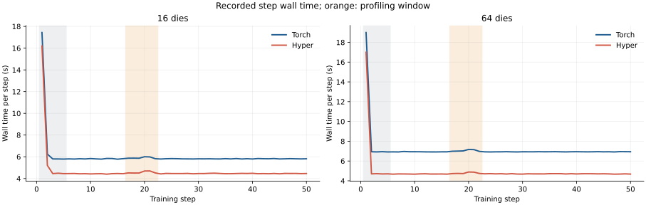
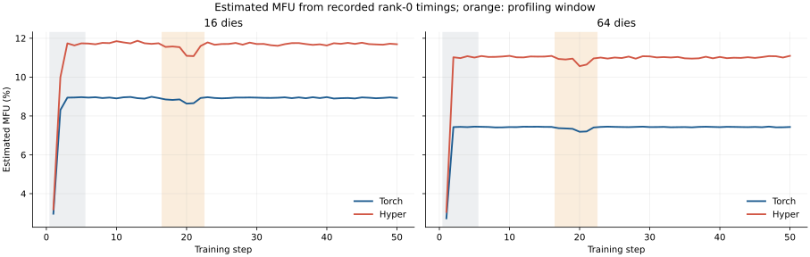
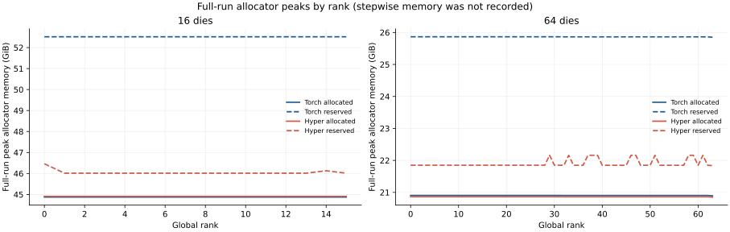

# Qwen3.5-35B-A3B：FSDP2 与 Hyper FSDP＋AdamW 对比

> **WIP：逐步显存数据缺失。** 原始运行记录了每步耗时和每个 rank 的整轮显存峰值，
> 没有持久化每步 allocated / reserved 或 MFU。下方 MFU 曲线是按已记录耗时重算的估算值；
> 逐步 CSV 中缺失的显存列留空，不能从整轮峰值还原。

## 配置和结果

加载 Qwen3.5-35B-A3B 完整权重，使用 VeOmni 原生多模态数据流程和落盘的均衡假数据。
每个样本为 8192 tokens，含两张图和一个 20 帧视频，经处理后每个样本有 8 个图像 token、
40 个视频 token。所有样本的文本与媒体内容相同；各组对应 rank、step 的输入指纹一致。
该数据适合观察均衡负载，不能代表真实混合数据分布。

VeOmni commit `4ea85e7d85365482c4e40d20deb481248a8d28c7`；HyperParallel commit
`d4b0d47231cce85d38095406832bd664b2ae45da`。两组均使用原生 AdamW、GA=1、完全重算、
SP=CP=EP=1、FSDP replicate=1、BF16 参数和 FP32 归约，训练 50 步。16 die 的 shard=16，
64 die 的 shard=64。`comm_fusion` 与 `comm_fusion_vit` 均关闭；两组统一使用 Triton GDN。
Hyper 的 AdamW 由 HyperOptimizerAdapter 包装。

单机两组在不同服务器并行，四机两组在同一组服务器顺序运行；每个 rank 固定到相同映射的两个逻辑 CPU。
PCI NUMA 信息不可用，无法验证 CPU 与 NPU 的物理 NUMA 最优性。四机中的一台驱动为
26.0.rc1，其余为 25.5.2；同规模 Torch / Hyper 的对应服务器与驱动相同。

平均耗时使用 rank 0 `train_step` wall time 的第 6–16、23–50 步，排除前 5 步、
profiling 预热及采集步骤和解析后的第 22 步。显存是每个 rank 整轮峰值中的最大值。

| die | 方案 | 平均耗时（s/步） | 耗时下降 | Allocated 峰值（GiB） | Reserved 峰值（GiB） |
| --- | --- | ---: | ---: | ---: | ---: |
| 16 | VeOmni FSDP2 | 5.813949 | — | 44.875 | 52.514 |
| 16 | Hyper FSDP2 | 4.452709 | 23.41% | 44.908 | 46.463 |
| 64 | VeOmni FSDP2 | 6.931622 | — | 20.906 | 25.865 |
| 64 | Hyper FSDP2 | 4.697235 | 32.23% | 20.865 | 22.162 |

## 逐步耗时和 MFU

灰色区域为前 5 步，橙色区域为 profiling 预热、采集及解析后的第 22 步。MFU 使用原始
`BENCH_STEP.seconds` 和该 commit 的 VeOmni FLOPs 估算器重算：按本次模型配置及视觉网格
`[[1,4,4],[1,4,4]]`、`[[10,4,4]]` 得到每 rank 每步约 180.2444 TFLOP，设备
`Ascend910_9392` 在该估算器中的 BF16 理论峰值为 354 TFLOP/s。图中数值为
`100 × 180.2444 / (354 × rank 0 计时秒数)`，并非设备计数器实测值，也不等于原运行中
各 rank 时长归约后得到的原始 MFU。FLOPs 模型不把全量重算当作额外有效模型 FLOPs。

[逐步对比 CSV](original_step_diff.csv) 包含 16 die 和 64 die 各 50 步；差值统一为
**Hyper − Torch**，MFU 绝对差单位是百分点。CSV 同时给出 wall time 和 MFU 使用的计时，
以及是否计入平均耗时。逐步显存列为空，`memory_step_data_status=not_recorded`。

## 现有显存记录

横轴是 rank，图中并非逐步显存曲线。Allocated 和 reserved 是各自整轮累计峰值，
二者及不同 rank 的峰值可能发生在不同时间。
[逐 rank 峰值和差值 CSV](original_rank_peak_memory.csv) 保留所有 rank 的值；
无法据此推导任一步的 allocated / reserved 或其差值。

## Profiling：通信与拷贝

每组只采 rank 0：CPU＋NPU、Level 0，训练第 17–19 步预热，第 20、21 步采集，
不开 stack、shapes 和 memory，在线解析。原生 trace 完整可读。训练步骤 20、21
分别对应 `ProfilerStep#19`、`ProfilerStep#20` 和数据库 `STEP_TIME.id` 19、20。
实际 mesh 和 profiling 元数据确认 `group_name_0` 为对应的 16 或 64 rank FSDP 组，
本实验 EP=SP=1。下表为这两步的平均值，不等同于非 profiling 步的平均耗时。

| die | 方案 | Profiling 步耗时（ms） | FSDP 组通信时间并集（ms） | 未掩盖通信（ms） | 通信掩盖率 | AllGather（ms） | ReduceScatter（ms） |
| --- | --- | ---: | ---: | ---: | ---: | ---: | ---: |
| 16 | Torch | 5996.063 | 4858.143 | 1141.294 | 76.51% | 2337.331 | 2506.895 |
| 16 | Hyper | 4694.436 | 3264.527 | 615.208 | 81.16% | 1412.758 | 1839.693 |
| 64 | Torch | 7160.669 | 6224.575 | 2390.446 | 61.60% | 2951.609 | 3268.562 |
| 64 | Hyper | 4881.491 | 3989.164 | 905.611 | 77.30% | 1774.406 | 2207.771 |

通信掩盖率按 `1 − 未掩盖通信时间 / FSDP 通信时间并集` 计算；未掩盖时间为 profiler 的
`COMM_NOT_OVERLAP_COMP` 与该组通信区间的交集。AllGather 和 ReduceScatter 是各自
HCCL 操作区间并集，不是各 rank 相加，也不是通信字节或链路纯传输时间。这两步中，
16 die 的未掩盖通信减少约 526 ms，64 die 减少约 1485 ms；通信等待和其他执行区间
可能相互影响，不能据此将整步收益完全归因于通信。

FSDP 组的总时间还包含每步 8 次 AllReduce，不能全部归属于参数的 AllGather 或
ReduceScatter。两种规模下，Torch 每步记录到 189 次 AllGather、68 次 ReduceScatter；
Hyper 分别记录到 2706 次和 1026 次。调用次数与每次数据量的差异会影响这些总时长。

### 主计算流上的 FSDP 拷贝

通过 CPU FSDP scope → 算子 correlation ID → CANN task 关联设备事件，并只统计承载模型
MatMul 的主计算流 `stream 47`。Torch 的 `fsdp::split_with_sizes_copy` 位于
`FSDP::all_gather_copy_out` 内；`fsdp::chunk_cat` 位于 `FSDP::post_backward_reduce` 内。
以下是关联到的设备任务时间并集，两步平均；它们不是 CPU scope 的等待时间。

| die | Torch AllGather copy-out（ms） | Torch ReduceScatter chunk-cat（ms） | Hyper 中对应的 Torch FSDP 算子 |
| --- | ---: | ---: | --- |
| 16 | 358.993 | 470.414 | 未观察到 |
| 64 | 307.914 | 580.821 | 未观察到 |

每步匹配到全部 189 个 copy-out scope 和 68 个 chunk-cat scope。Torch copy-out 每步
2688 个设备任务中，64 die 第 20 步有一个缺少可关联的 connection ID，因此这一步为
2687 个；其他均成功关联。Hyper 的轨迹没有这些同名 Torch FSDP scope / 算子，但仍存在
其他 copy 和 cast，不能因此认定其所有 FSDP 相关拷贝为零。主流任务可与通信重叠，
上述拷贝时长不能直接与未掩盖通信差值相加，也不能全部视为端到端节省。

[Profiling 汇总 CSV](profile_summary.csv) 保存表中数值。原始 profiling、日志和配置见实验归档
`obs://m00897430/mxy/qwen35-native8k-fsdp-16-64-profile-20261120.tar.gz`（需要对应桶访问权限）。
