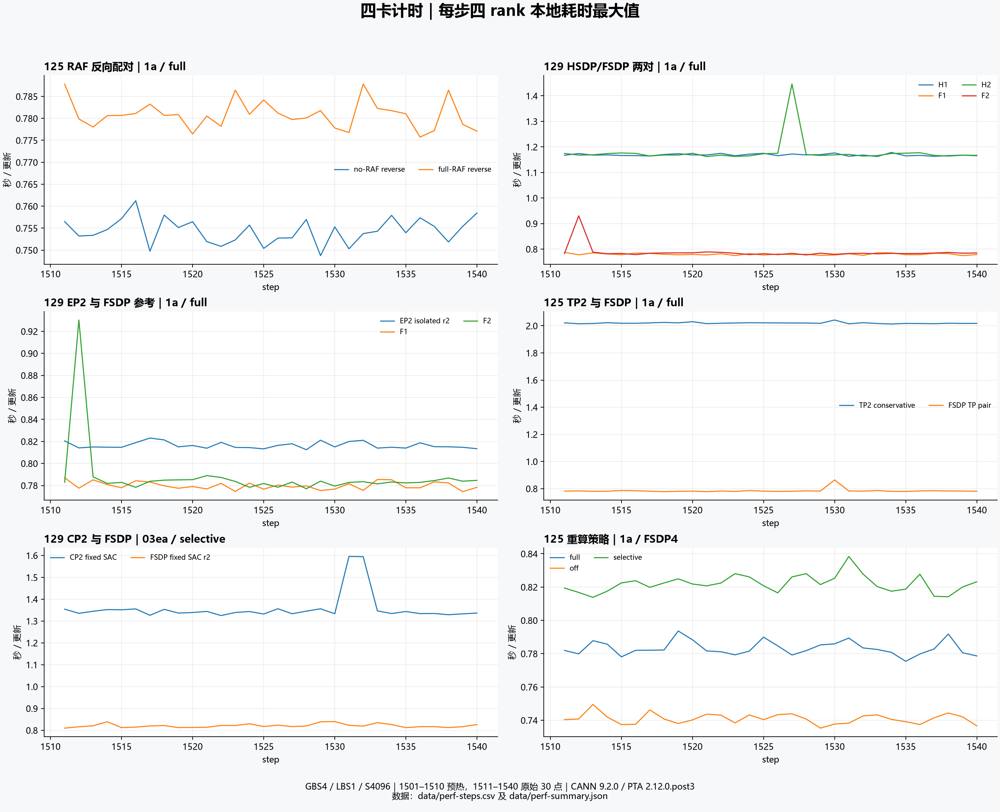
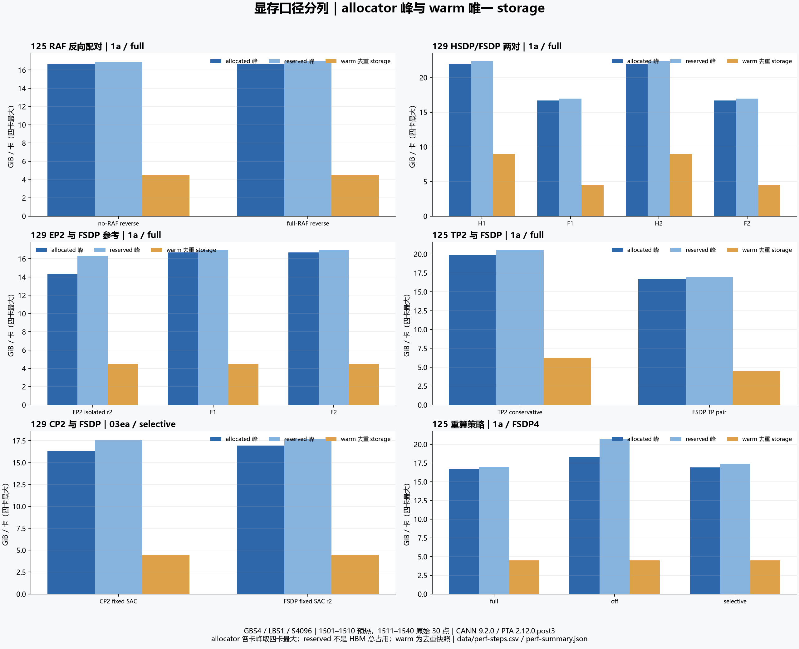
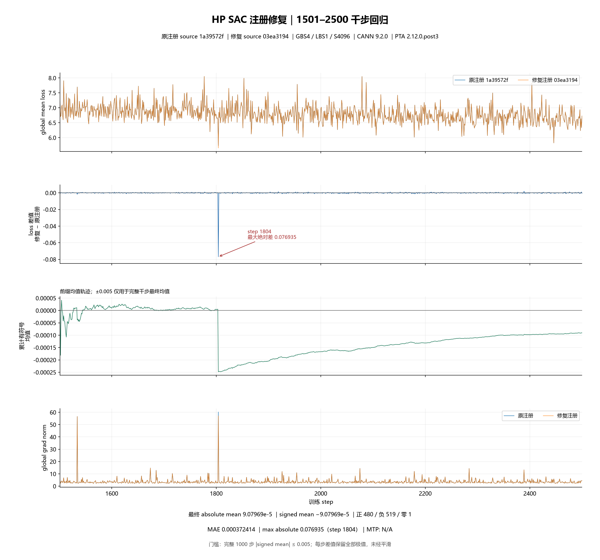

# [草稿] HP 四卡性能、显存与 SAC 千步回归

本归档对应 [总 issue #304](https://github.com/hf1s/hyper-parallel/issues/304) 和 [Draft PR #1358](https://github.com/mindspore-ai/hyper-parallel/pull/1358)。统计与图来自实际 NPU 训练；SAC 千步图比较 HP 原注册与修复注册。MF/HP 既有精度基线、原始图和历史记录保留在总 issue。

## 本模型上的结果

| 同条件集合 | 测得的计时窗口平均秒/步 | 含义与边界 |
|---|---:|---|
| 125 FSDP4，反向顺序 no-RAF → full-RAF | 0.754402 / 0.780831 | 前向后保留参数本次降低耗时 3.385%，名义吞吐 21717.9 / 20982.8 token/s；各30点CV约0.382% / 0.406% |
| 129 HSDP2×2 → FSDP4，两对 | 1.168668 / 0.779871；1.178738 / 0.788007 | 两对比约1.50；保留全部尖峰，属于该配置与机器的观察 |
| 129 EP2 复测 | 0.816409 | CV 0.354%，20068.4名义token/s；与上列FSDP为非同时参考，首轮0.815058另有I/O限制 |
| 125 保守 TP2 / FSDP4 配对 | 2.019936 / 0.784551 | 仅部分attention分片；Dense/MoE/shared仍TP复制，DP2下每卡2micro，复制路径每卡输入工作增加 |
| 129 CP2+fixed SAC / 同源 FSDP4+fixed SAC | 1.357785 / 0.820776 | 03ea/selective、非同时参考；CP局部2048×2micro，每更新仍全局4个4096样本 |
| 125 原策略 full / off / selective 重算 | 0.783251 / 0.740971 / 0.822024 | 1a源码；这是原policy，不能把它当修复版结果 |

no-RAF首轮0.758296s、早先同机full参考0.784551s与反向配对方向一致。反向配对的timed allocated四卡范围为16.625064–16.625071 / 16.688892–16.688899 GiB，reserved为16.865234 / 16.962891 GiB。本模型没有观察到峰值惩罚；这不意味着其他规模保留参数也没有显存代价。EP2复测allocated约14.30073GiB、reserved16.30664GiB，体现本次显存与耗时取舍。

## 配置、分组与统计口径

固定3层（2 Dense+1 MoE）、MTP关闭、S4096、GBS4/LBS1、原优化器和精度、原2500步日程。短跑只提前结束。从同一native1500完整状态独立恢复，1501–1510预热，1511–1540计时。每步用四rank本地同步耗时最大值，未建立跨rank公共时钟makespan；名义吞吐为16384/平均秒数，非有效mask token数。CSV包含四rank原值，可复算max；预热和更详细的原始日志另保留在任务证据。

FSDP4参数为Shard(0)的[4]网格；HSDP为[R2,S2]，网格给出shard组[0,1]/[2,3]、replica组[0,2]/[1,3]。TP2使用DP2×TP2；CP2使用DP2×CP2，但本模型参数实采仍为[4,1]的FSDP shard/TP网格。EP2的expert mesh为[EDP2,EP2]，EP组[0,1]/[2,3]、EDP shard组[0,2]/[1,3]，专家参数采用StridedShard与Shard组合；四rank局部16专家，offset依次0/32/16/48。完整状态恢复检查含模型、main绑定、slots、组、调度/适用随机状态、loader与actual layout；各新run均核258个role视图。role数量不是独立storage数量。

57个全局参数合计1,940,967,847元素，FP32逻辑量7.230669GiB；86个optimizer slots逻辑量10.730777GiB。观测的57组model/main为别名，不重复计数。FSDP/HSDP/EP2的warm去重storage约4.49036/8.98072/4.49036GiB每卡。各卡allocator峰和warm原值在[data/perf-summary.json](data/perf-summary.json)的56条memory记录；reserved不是HBM总使用量，peak减warm不能当activation。梯度、full/cast参数、CE临时（1024token FP32 logits块约0.5GiB及full-head FP32梯度条件项1.75GiB）、Muon与通信buffer生命周期不同，不能静态相加为实际峰值。

环境：Python3.12.14、PyTorch2.12.0+cpu、PTA2.12.0.post3、Transformers5.21.0、CANN toolkit9.2.0，安装内部版V100R001C12SPC001B237。env fingerprint为e14f2704e4d568d79ef9df15546f3ed82e0613455ccb512f8c9e8c8b14b948cc；安装信息不证明所有已加载组件的构建。性能source为1a39572fef23819a2d2651b4bd53047a05a4892f；fixed为仅叠加SAC注册修复及必要UT的03ea31945303bf8dca37d319a737f1f05596474b；checkpoint producer为33096a1030012777a5f71502dee009a7dd409bf9，三者不能混淆。每run配置SHA及源码/环境pin在JSON。最新核验的上游master为96143af9b4ea12ddf0bd3854fc521ca86df7cc90。

数据前缀为mmap_deepseekv3_datasets_text_document；bin SHA256为6b925f342504c3eae80c5bde3163ff5924ad36b262bc6a276839a6f3f817ea3c，idx为d535e502d62368e7a195b27a9a717543534ee1eaa9b4f9ce45f4d08d746cb5cd。实际训练切片S4096；不把原始文档长度表误称为每条定长4096。

## SAC修复的千步结果与限制

原版125、修复版129各独立续训1501–2500共1000步，从同一受审native1500状态开始；不据两个host的耗时比较补丁性能。原/修复唯一生产文件变化为算子注册，修复树另加UT。两端config SHA相同：1643450890283aa811b9243d4e6d9ffee5b4b56bdae517c7cc3030b88cd0a7ea。LOSS取rank0 trainer已经global-mean的返回值，不二次归约，差为修复−原版。

| 全1000步统计 | 真实值 |
|---|---:|
| signed mean / abs(signed mean) | −0.0000907969475 / 0.0000907969475 |
| 正 / 负 / 零步数 | 480 / 519 / 1 |
| MAE | 0.0003724141121 |
| 最大绝对差 | 0.07693529129，step1804 |

满足完整窗口abs(mean ΔLOSS)≤0.005；0.005不约束单步或每个前缀均值。MTP遵循YAML关闭，MTPLOSS为N/A。所有1000点、极值和正负号保留，没有平滑。1804四rank均可见差异，sample索引7212–7215、loader更新后7216，两边grad norm均为峰值；该步没有保存运行时四字段完整hash，根因未确定，不能用均值通过解释它。其余999步最大绝对差0.001842499仅为诊断，不改变验收窗口。

两端完整初态258-role审计通过，全部1000样本索引与进度已核，首两步实际四字段hash一致，post1000全258-role有限性/hash、57binding、groups/loader及观察前后状态记录已核。末态原tensor没有落盘，不能声称已计算全权重跨策略误差。SAC修复依据是实际PTA dispatcher overload与原策略意图；独立NPU模块/replay证明重算覆盖变化，不能以loss更接近证明正确。同129的两对短测没有证明端到端加速。Attention无checkpoint基线梯度重复本身存在波动，严格模块数值结论保留inconclusive；compile和GMM.List未独立设备验收。PR保持Draft，不声称CI或完整功能门禁通过。

## HSDP归因证据

独立插桩profile中F/H四rank×三步的分类均值差为Stage+397.983ms、Computing+68.838ms、未重叠通信+316.176ms；字段不作可加的因果分摊。新标签profile只分析rank0/2，各567个事件经唯一设备端点、唯一标签flow和唯一CSV匹配；额外无标签transport flow保留，原阶段unknown不按邻近时间猜测。Muon广播直接确认PG[0,2]、src0/input_numel234881024与src2/input_numel117440512、FP32/async；pack成员/FQN和完整critical path仍未证明。input_numel不等于wire字节数。

源码已有逐module RS→AR流水，post_backward的RS/AR设备区间可相交，不能把HSDP较慢归因于所有AR拖到root。HSDP本地持久状态增加也不等于Muon NS算力翻倍：replica owner与NS shard compute owner不同。非owner动量可stale是当前所有权设计，正常state_dict导出先同步后保存；没有证据表明正常checkpoint路径错误。

参考固定源码：[TorchTitan FSDP](https://github.com/pytorch/torchtitan/blob/09c98e528f3f2b69214894823d91c8475a54dd01/torchtitan/distributed/FSDP.md)、[Megatron FSDP/HSDP](https://github.com/NVIDIA/Megatron-LM/blob/7196f838952b1ae51dca1d1a1a585847f1655a60/docs/user-guide/features/megatron_fsdp.md)。其GPU通信、优化器及外层optimizer-shard方式与本次Ascend/Muon不完全相同，只作设计/归因参考，不拿异条件性能排优劣。

## 可复核数据、复现与归档

[逐步性能CSV](data/perf-steps.csv)、[版本/配置SHA/56条各卡显存JSON](data/perf-summary.json)、[SAC1000逐步CSV](data/sac1000-paired.csv)、[SAC审计JSON](data/sac1000-audit.json)和两份原值格式[original](data/sac1000-original.log)/[fixed](data/sac1000-fixed.log)均在本目录。`plot_cpu.py`只读这些相对路径，可用Python与Matplotlib3.11.2离线重画三张图；在归档目录执行`python plot_cpu.py`会重写figures中的预览。NPU复现argv、完整日志、关键checkpoint、source及trace保留在任务工作区；YAML归档是[个人私仓21run/105角色](https://github.com/xingleixu123/mindformers-private/tree/e3f6f182e05bd6dde80f635c75c1455d20b329a3/private_review/archives/performance-final-20261030)，未更改访问设置，既有MF/HP归档保留。

所有计时点保留。各run离散占卡查询及unknown/incomplete原样留存，不能证明连续独占；新复测release前结束大hash/DCP I/O，另节点末期小JSON可能重叠，未声称零干扰。EP/CP参考和少量短窗不作普适排名。图为标准绘图库本地渲染，尚非log.javazero.top网站导出；本轮网站工具因URL安全核验终止，未绕过限制。统计日志已准备供后续导入。Terra medium实际委派，接口无Fast选择器。

历史证据：[两对H/F、两对SAC及旧profiler](https://github.com/xingleixu123/hyper-parallel/tree/4eac5f2d06bf78d720e6599af8b1473f026e7a8b/docs/validation/hp-fourcard-performance-pairs-20261030)、[模块NPU及replay](https://github.com/xingleixu123/hyper-parallel/tree/8c79b8ca54ce5829e877b8ae444e96a315fdcccc/docs/validation/hp-fourcard-npu-evidence-20261030)。

## 新增收尾验证（2026-10-30）

[四卡HSDP归一化NPU实测](hsdp-normalization/README.md)和[独立验收范围复核](acceptance-review.md)补充本归档：FP32直接通信算术完全一致，融合开/关AVG模块梯度最大误差各1.79e-7。该结果不解释性能差异或1804异常。表中的“计时窗口平均”指10步预热后的30点均值，未主张已完成长时间平稳性检验。用户最新明确暂不画图；网站输入、现有页面和配置保留，未继续网站导出。

另见[GMM整数序列接口兼容修复及NPU回归](gmm-sequence/README.md)：该问题独立于SAC注册，32项输出/梯度与未改Tensor控制逐位一致；完整小tensor在本机保留，公开投影不替代原值。
