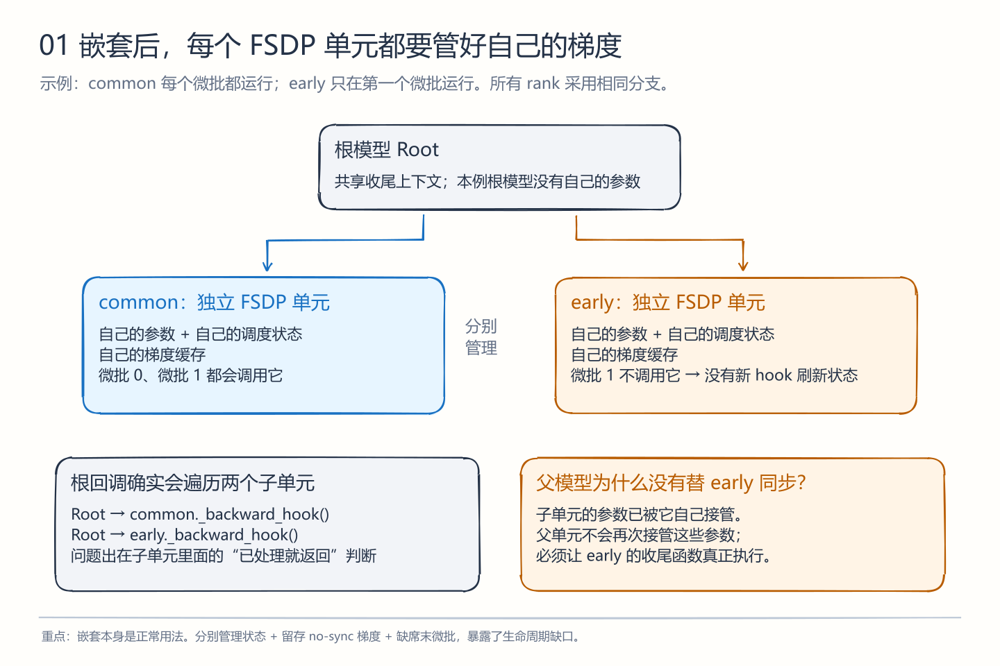
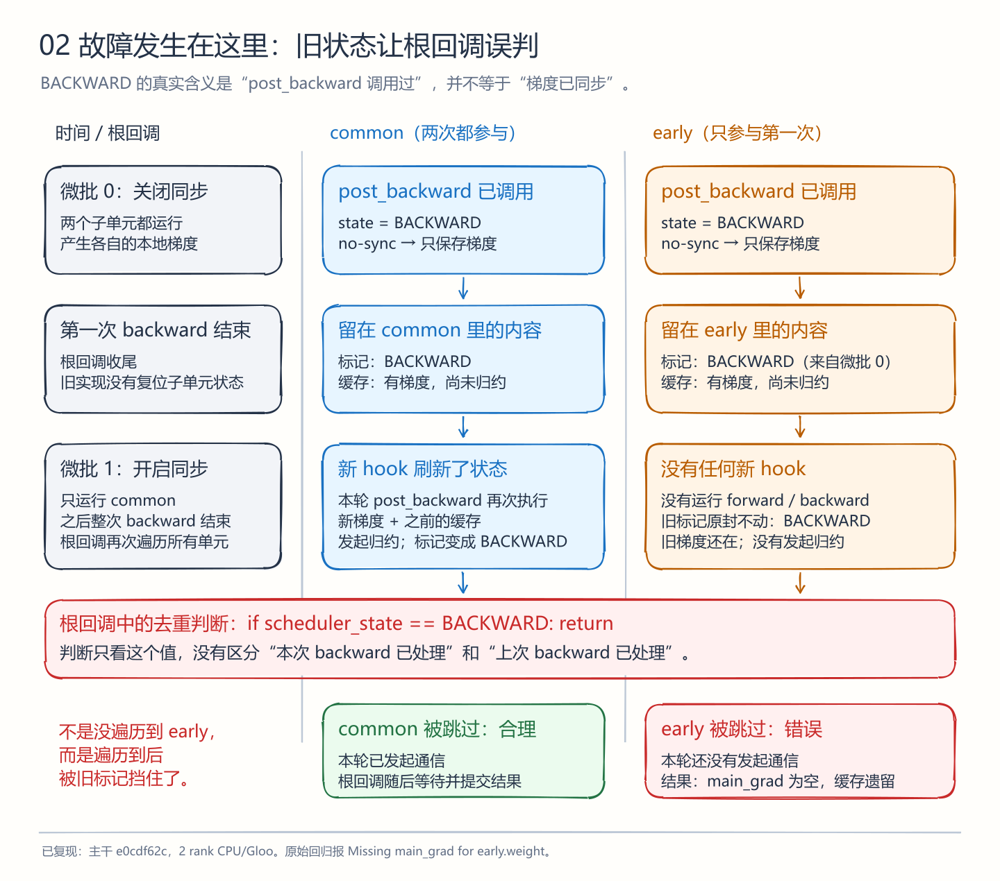
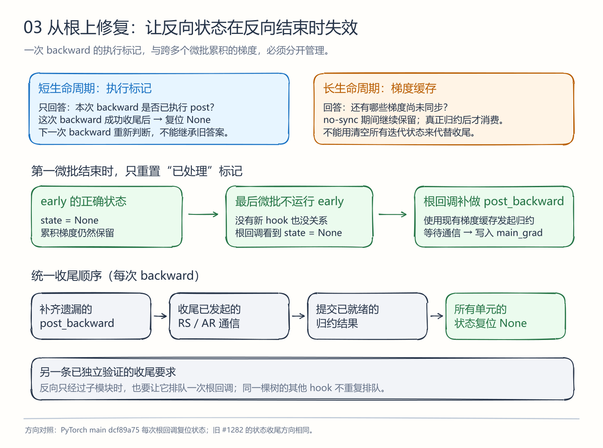

# PR #1369：为什么嵌套 FSDP 会漏梯度，以及怎样修复生命周期

[打开 Excalidraw 在线画布](https://excalidraw.com/#json=2tWS6nOmrWkA2kS3Ka-NJ,VhO33hGvtRjvsqjN7Rcx5g) · [完整可编辑源](FSDP-嵌套根因-完整画布.excalidraw)

这是 Excalidraw 原生图形：111 个独立的圆角框、箭头、文字元素。在线画布已实际导入并生成分享链接；链接保存的是此时的画布快照。三张独立源文件也可在 Excalidraw 的“打开”中导入。在线截图见 [实际网页画布](Excalidraw-在线根因时间线.png)。PNG/SVG 预览由同一几何数据离线渲染，在线截图才是网站实际显示结果。

## 先抓住一句话

**上一轮“处理过”的标记没有失效，下一轮就把一个还欠着梯度的子模块跳过去了。**

这里的 `BACKWARD` 表示“post_backward 已调用”，不表示“梯度已同步”。no-sync 时，这个函数做的事恰恰是保存梯度，暂时不发通信。把这个执行标记留到下一次 backward，就混淆了两件不同的事。

## 1. 为什么嵌套会暴露问题



设模型有两个分别 fully_shard 的子模块：

- common：每个微批都用。
- early：只在第一个微批用。
- Root：包住两者，维护共享上下文；本例没有直接属于根单元的参数。

嵌套包装之后，两个子单元各管自己的参数、调度状态和梯度缓存。父单元初始化参数时会跳过已由子单元接管的参数。因此，父单元的正常归约不会顺便把 early 的参数再归约一遍。

**根回调实际上会遍历 early。漏掉的环节，是 early 内部的去重判断直接返回。** 所以，补一个“遍历所有孩子”的循环不能解释或修复这个问题——循环本来就存在。

这不是“只要嵌套就会错”。同一个单元每次都有新 forward/backward 时，新 hook 会覆盖旧状态，缺陷容易被掩盖。独立的子单元缺席末微批时，旧状态才会完整保留下来。条件分支本身是合法的模型写法；这里的验证要求各 rank 使用相同分支与执行顺序，没有声称任意跨 rank 分歧都能自动处理。

## 2. 两轮 backward 怎样把梯度漏掉



第一微批关闭同步，common 和 early 都运行。early 的 post-backward 将状态置为 BACKWARD；随后发现 reduce_grads=False，保存 `unsharded_accumulated_grad`，不发起归约。

第一轮 backward 结束时，根回调完成当时已有的工作，但原实现没有把各单元的 scheduler_state 复位。early 此时同时具有：

```text
执行标记：BACKWARD       ← 这是上一轮留下的
梯度缓存：非空           ← 这是真实尚未同步的梯度
```

第二微批开启同步，但只运行 common。common 的新 hooks 刷新状态，正常归约两次累积的梯度。early 没有新 hooks，继续留着上一轮 BACKWARD。

本次根回调仍然调用 early._backward_hook()，但命中：

```python
if scheduler_state == BACKWARD:
    return
```

这个判断原本用来防止“同一次 backward 重复执行 post”。现在却把“上一次已处理”当成“这一次已处理”。

因此 early 没有发起 reduce-scatter；后续等待通信的函数也无法等待一笔根本未提交的工作。最终 FP32 `main_grad` 仍为空，完整梯度仍留在缓存里，不能参与预期的优化更新。

源代码位置：[主干 scheduler](https://github.com/mindspore-ai/hyper-parallel/blob/e0cdf62c9d66f1f9ec48c6f15df87dcf4ce80a5f/hyper_parallel/core/fully_shard/hsdp_scheduler.py)、[梯度处理](https://github.com/mindspore-ai/hyper-parallel/blob/e0cdf62c9d66f1f9ec48c6f15df87dcf4ce80a5f/hyper_parallel/core/fully_shard/hsdp_state.py)。相关设计讨论：[仓库 RFC #229](https://github.com/mindspore-ai/hyper-parallel/issues/229)。

## 3. 原 PR 的办法为什么显得像“特定场景修复”

原提交 b5839efa 在 set_requires_gradient_sync 的 False→True 转换处，再检查状态是 BACKWARD 且有完整累积梯度，满足时复位状态。这个条件确实能修好已复现的反例；问题在于，把“上一轮执行状态应该结束”的职责塞进了“设置同步策略”的接口。

更合理的职责分配是：**执行状态由每次 backward 的结束边界统一管理；梯度缓存按是否已经完成归约来管理。**

判断问题不在于是否出现 if。每次只登记一次回调、避免本轮重复 post，都需要条件判断。关键是条件表达通用生命周期规则，还是把一个复现过程的细节硬编码到不负责收尾的接口里。

## 4. 现在的修复



当前实现提交：`388ec460a163ae06e18b9189c490cf37da460f8a`，基于官方主干 `e0cdf62c9d66f1f9ec48c6f15df87dcf4ce80a5f`。

第一处：根回调完成 fallback post、既有 fusion/per-parameter 通信收尾、TP 归约及梯度应用后，把整棵树的 scheduler_state 复位为 None。no-sync 的完整梯度缓存不清空。这样下一次即使 early 缺席，根回调也能实际进入它的 post_backward，消费以前保存的梯度。

第二处：使用已有共享 root_bp_state 去重，让任一参与反向的单元登记根回调。原来只有根模块输出上的 backward pre-hook 可以登记；如果初始化之后直接对 model.early(...) 做 backward，反向图里没有根模块输出，就可能没有全树收尾。这是单独复现出的另一处生命周期缺口，不应混成原 no-sync 反例的唯一原因。

这两处都不增加新的梯度算法，不改 SUM/AVG、精度或通信算子。保留既有通信次序。若通信收尾抛出异常，不将上下文伪装成已经成功复位；这并不代表支持异常后自动恢复训练。

不能简单在每个微批调用 reset_iter_state：那会连需要跨微批保存的梯度和通信状态一起处理。这里仅复位执行标记。

## 5. #1282 到底能不能修 #1369

必须区分版本：

| 对象 | 结论 |
|---|---|
| #1282 旧提交 8acb37a3 中的根回调复位方向 | 能修原 #1369 反例的关键正是“每轮末尾复位状态” |
| #1282 当前 head 40ee600c | 当前差异已不包含 scheduler 的收尾复位，不能说当前版已经解决此问题 |
| 本次在 e0 上只加“末尾复位”，不改回调登记 | 原 #1369 worker 和 16 组生命周期组合通过；独立的 child-only backward 仍失败 |
| 本次完整的两个生命周期修改 | 上述测试与 child-only backward 全部通过 |

“只加复位”的消融实验把因果关系单独隔离出来，比把一个包含多种修改的旧 PR 整体跑绿更能说明根因。

[PR #1282](https://github.com/mindspore-ai/hyper-parallel/pull/1282) · [旧提交](https://github.com/mxysfive/hyper-parallel/commit/8acb37a3cede42e68c5963b1fd14131141c77353) · [当前提交](https://github.com/mxysfive/hyper-parallel/commit/40ee600c4cb3a8e150b6b7472a0a64ae8cecb39d)

## 6. 最新 PyTorch 与业界做法

按本次最后一次查询，PyTorch main 为 `ce6ff46d8ca967ef333ba9b804e081f26b432796`。相关 `_fsdp_state.py` blob 为 `f41510fb26fc703dc635a932030d29c66051744e`，与图中较早标注的 dcf89a75 相同，结论未变。

PyTorch 的 _pre_backward 会调用共享的根回调登记函数；并不要求只有根模块输出的 hook 才能触发。根回调遍历状态，补做尚未执行的 post_backward，再将每个 param group 和 state 的训练状态复位为 IDLE。它还有 manual finalization、is_last_backward 等独立策略，因此这里只借鉴职责与生命周期，不声称两个实现的每个操作位置相同。

[PyTorch 当前主干状态机](https://github.com/pytorch/pytorch/blob/ce6ff46d8ca967ef333ba9b804e081f26b432796/torch/distributed/fsdp/_fully_shard/_fsdp_state.py#L406-L460) · [参数组及梯度处理](https://github.com/pytorch/pytorch/blob/ce6ff46d8ca967ef333ba9b804e081f26b432796/torch/distributed/fsdp/_fully_shard/_fsdp_param_group.py)

Megatron-LM 的固定主干样本 58124853 也将 no_sync 期间的 bucket/microbatch 策略，与 finish_grad_sync / finalize_model_grads 的最终收尾分开。它的调度模型不同，不能据此声称其 DDP 路径自动支持与这里完全相同的动态嵌套场景。

[Megatron DDP](https://github.com/NVIDIA/Megatron-LM/blob/581248531984920e92f076946ad4629d359442a4/megatron/core/distributed/distributed_data_parallel.py) · [最终梯度收尾](https://github.com/NVIDIA/Megatron-LM/blob/581248531984920e92f076946ad4629d359442a4/megatron/core/distributed/finalize_model_grads.py)

以上属于源码对照。实际本地测试使用 Torch 2.12.0+cpu，没有编译运行最新 PyTorch main。

## 7. 本次实际验证

环境：WSL Linux、Python 3.12.3、Torch 2.12.0+cpu、真实双 rank Gloo、FP32 SUM。沿用仓库已有的 CPU scheduler 测试入口，没有放宽公共 fully_shard 的设备限制。每个分布式 worker 使用独立 torchrun 进程组。

- e0 原实现：原 #1369 worker 在 early.weight 缺少 main_grad 处失败，两个 rank 均复现。
- 只复位状态的消融：原 worker 通过；16 个生命周期配置通过；独立 child-only worker 仍在 early 缺少 main_grad 处失败。
- 完整修复：外层 launcher 3 passed，实际启动原 worker、生命周期 worker、child-only worker。
- 生命周期 worker：16 配置，每配置在同一对象上跑 2 个累积窗口 × 3 个微批；覆盖 single/nested/grouped、输入需要/不需要梯度、两种 fusion，以及 nested 下的 reentrant/non-reentrant checkpoint。逐边界检查状态复位、no-sync 缓存保留、根回调次数和准确梯度。
- child-only worker：2 fusion × 2 输入梯度设置，各两次连续 backward；未使用的 common 不生成伪梯度。
- FSDP UT：224 passed、38 subtests passed。既有真实两 rank hook-state worker 的 normal/non-reentrant/reentrant 三场景通过，结束态断言同步改为 NONE。
- 新文件 code-style guard 通过；git diff --check 通过。整文件 pylint 在 e0 和当前版各报告 33 个同一问题，新增为 0；不能把这说成整仓 lint 已全绿。

测试日志与消融原件见 [evidence](evidence/)。首次将两个红色测试放在同一 worker 进程组生命周期内时，第二项出现 Gloo 重新初始化连接错误；该项不作为 child-only 根因证据，独立进程重跑的 reset-only-child.log 才是有效证据。最终 launcher 将两项隔离。

本次最后的纯文档字符串及类型注解补充不改变已验证的计算和调度逻辑。当前修复没有重新执行 NPU/HCCL、四 rank HSDP 或真实训练；原 PR 的这些历史验证对应的是旧 setter 补丁，不能移植成新提交的验收结论。

已 RS、仅剩 AR 的 partial-only 梯度属于另一种 pending 数据。复位执行状态不能自动替代它的参数选择和提交逻辑，继续关联 [RFC #1105](https://github.com/mindspore-ai/hyper-parallel/issues/1105#issuecomment-6516038348)。本 PR 不宣称解决它，也不宣称验证跨 rank 不同分支、并发独立反向图、编译或 offload 的所有组合。

## 复现入口

在已安装仓库所需依赖的 Linux 环境中：

```bash
HYPER_PARALLEL_PLATFORM=torch TORCH_DEVICE_BACKEND_AUTOLOAD=0 \
  python -m pytest -q tests/torch/fully_shard/test_fully_shard_gradient_accumulation.py

HYPER_PARALLEL_PLATFORM=torch TORCH_DEVICE_BACKEND_AUTOLOAD=0 \
  python -m pytest -q tests/ut/core/fully_shard
```

[PR #1369](https://github.com/mindspore-ai/hyper-parallel/pull/1369) · [issue #1368](https://github.com/mindspore-ai/hyper-parallel/issues/1368)

