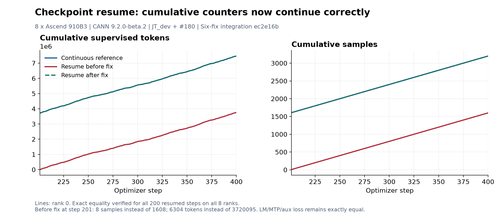
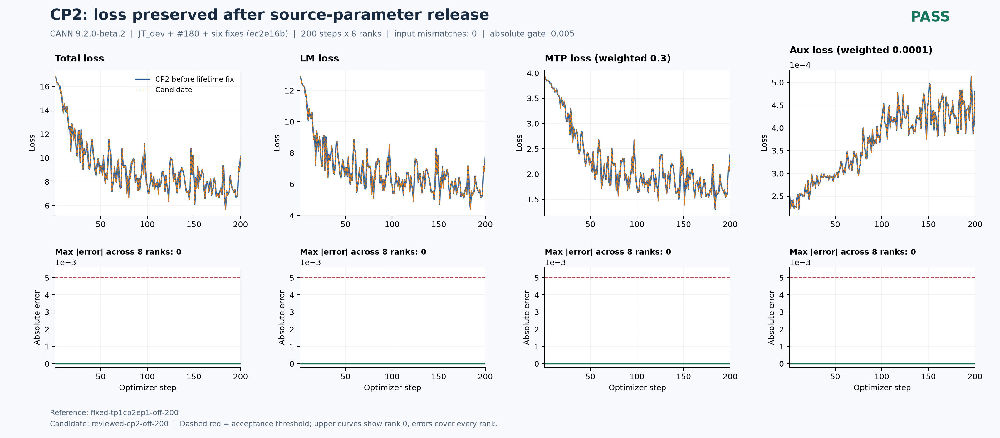

# JT八卡验证证据索引

[详细中文总问题单#202](https://github.com/hf1s/hyper-parallel/issues/202)关联14个独立子问题及各自单提交PR；#230已合入，其余13组PR仍为草稿。[当前中文报告](REPORT_ZH.md)是最新结论入口。当前固定源544526f7的FSDP基线、续训对独立连续400及off/full/SAC selective重算均已通过完整200步×8rank验收；[重算精度、显存与性能三图](reports/a1e6-recompute-200/README_ZH.md)记录新增两次独立运行。[当前TP2](reports/a1e6-tp2-200/README_ZH.md)及[当前TP4/CP2](reports/a1e6-tp4-cp2-200/README_ZH.md)及[当前CP4/EP2](reports/a1e6-cp4-ep2-200/README_ZH.md)均各完整200步×8rank，主LM最大差分别0.01203537@97、0.01165390@193、0.01872301@188、0.00969219@148、0.00931740@200，均FAIL，根因尚未定位；输入/CPU构造初态/LR一致不能替代精度通过。其余EP及组合继续待验收。18602c4及更早结果仅作历史。后续仅用125/129，201已取消；用户2026-10-18已把逐轮20分钟改为连续实验约2小时、释放后休息10分钟，入口已有部署及实际激活证据。

下方为按当时状态保留的早期原始索引，其中英文和旧的待验证描述不覆盖上述当前中文报告；历史数据不能移用为新基点验收。

# JT DeepSeek V3: eight-910B validation evidence

Experiments resumed with explicit authorization on 2026-10-15, using idle devices on hosts 125 or 129, a global minimum 20-minute interval after each release, and bounded per-run containers. Other jobs are never stopped. This snapshot records completed measurements and known failures; the complete parallel matrix remains unaccepted.

- Base: hf1s/hyper-parallel JT_dev at ad1c55379767d63ece7e084b0623340b37b83d93.
- Included PR #180 head: 5de3cceab094bbed18915d1a9c9231ca220629ca (integration 81f141d).
- Four-fix integration: 6e762bec039ced4e2fc5cdcfbf6326a179810e03 (whole-step token normalization, CP chunked projection loss, complete recompute coverage, replay-safe routing counts). Each fix is tracked separately; these multi-fix integration measurements are not isolated per-PR tests.
- CANN 9.2.0-beta.2 V100R001C12B086, PyTorch 2.12.0, torch_npu 2.12.0, Python 3.12.14, transformers 5.13.1; eight Ascend910B3 64GiB.
- Sequence length4096, global batch8, micro batch1, seed42, constant LR0.0001, unchanged Muon/AdamW recipe and initialization. Every compared step verifies canonical input hashes; complete native initial-state hashes match before partitioning.

## 129 jt_image baseline and issue #211 follow-up (2026-10-15)

The final offline image `jt-clean:hp-910b-20261009` (ID `5f9e677f…`) was found in the existing `/home/jt_image/four-images-clean-20261009/HP-910B/hp-910b-arrow.tar.gz` package and verified before loading. It provides CANN 9.2.0-beta.2, Torch/TorchNPU 2.12.0 and working Arrow datasets. The experiment imports the mounted editable current source, not the image's older checkout: latest JT_dev `521d3a8` includes #180; integrated source `a345081` plus the recorded #200/#201 patch is pinned.

The new FSDP steps 1–200 completed on all eight ranks in 383.54 seconds, then released all devices and removed the owned container. Median measured step time after 20 warmup steps is 1.170481 s; peak allocated/reserved memory is 22.282196/27.503906 GiB. Checkpoint200 is retained for restore. These are **run-integrity and file-header checks only**, not resumed-loss acceptance. The next run is checkpoint200 to 400, followed by an independent continuous400 reference. At the next resource check, 129 had eight foreign workers and 125 had one occupied device; no training was launched. Host-specific references are required because driver/firmware revisions differ.

See [baseline integrity](reports/jtclean-fsdp8-baseline-integrity.json), [all-rank scalar data](scalars/jtclean-fsdp8-baseline-200.csv), [checkpoint inventory](reports/jtclean-checkpoint200-inventory.json), [CPU dependency/data preflight](reports/jtclean-cpu-preflight.json) and [source provenance](reports/resume-129-source-provenance.json).

[Issue #211](https://github.com/hf1s/hyper-parallel/issues/211) now has an optimizer-independent two-rank CPU/Gloo reproduction: ordinary Shard rows1/3 fail reconstruction, while rows2 is an exact control. The proposed guard rejects unsupported source/target geometry before redistribution or explicit partial-reduction collectives. Final CPU checks: 457 DTensor unit tests and 41 subtests passed; 96 pre-existing DeviceMesh tests remain skipped. Two distributed launchers passed (two-rank FP32/BF16 reconstruction and four-rank explicit Partial reduction). The four-rank case also fails without the direct reduction guard, proving the review-discovered bypass is covered. No Ascend regression or performance improvement is claimed for this fix yet. [Review and exact source hashes](reports/issue211/issue211-review.json), [UT output](reports/issue211/issue211-cpu-v3-ut.log), [distributed output](reports/issue211/issue211-cpu-v3-st.log), [standalone reproduction](reports/issue211/probe_uneven_full_tensor_cpu.py).

## Evidence semantics

Loss errors are absolute maxima over every measured step and all eight ranks. The threshold is0.005 for each model-logged component and total. MTP is weighted by0.3 and aux by0.0001; reports also expose unweighted error diagnostics. The curves above show rank0; lower panels show the maximum error across ranks at every step. A completed process is not a passing alignment result.

Step time is the median after excluding the first20 steps of that measured run. Allocated and reserved memory are the maximum reported per-device peaks. The original comparison tables use matching scalar/input observations, including per-microbatch NPU-to-CPU input copies and hashing. These are not raw Trainer-only timings. The later FP32-NS diagnostic jobs use runtime parameter/gradient probes; their raw timing and memory must be excluded from uninstrumented performance comparisons. These are single-run comparisons, not confidence intervals.

## Completed checks

| Run | LM max error | MTP max error | Aux max error | Median seconds | Peak allocated GiB | Alignment |
|---|---:|---:|---:|---:|---:|---|
| FSDP8 off0-200 |0|0|0|0.939278|22.633759|PASS|
| FSDP8 resume200-400 versus continuous400 |0|0|0|0.938972|22.633759|PASS|
| FSDP8 full recompute |0|0|0|1.025728|19.538601|PASS|
| FSDP8 selective recompute |0|0|0|1.019489|20.227203|PASS|
| TP2+EP2 before token fix |0.922379971|0.290920973|0.000037092|1.407143|21.334600|FAIL|
| TP2+EP2 after token fix |0.012481689|0.004909277|0.000013115|1.404477|21.334347|FAIL|
| EP2 original |0.014165878|0.003723621|0.000012476|1.019160|30.605194|FAIL|
| CP2 after chunk support |0.022237778|0.005699873|0.000021477|1.283979|31.183506|FAIL|

Remaining TP/CP/EP drift is unresolved; investigation continues under the resource-sharing policy. The six-fix follow-up is documented below; EP/CP same-topology memory regressions have passed and are documented below. Module cost ablations and the MLP+norm 200-step check are documented below; additional hybrids remain pending.

Figures are available as PNG and editable SVG; JSON contains all-rank step errors and provenance names. CSV contains scalar measurements and input hashes only, with no training text, weights, checkpoints, or credentials.

## Six-fix FSDP and resumed-counter regression

The follow-up source is `ec2e16bce26e497519c573f0a8d87a538a329197`: the four fixes above plus cumulative metric restore and initialization-parameter lifetime cleanup. The baseline runs steps 1-200, saves a complete checkpoint at 200, and the next process resumes steps 201-400. The reference is an independent uninterrupted 400-step run with #180 included.

Both baseline and resume match every LM/MTP/aux/total loss and gradient norm exactly on all eight ranks. Baseline/resume median step times are 0.937752/0.937632 seconds; maximum allocated memory is 22.633759 GiB for both. Inputs, initialization, learning rate, and coverage are checked separately.

The old resume reset cumulative counters: at step 201 it logged 8 samples and 6304 supervised tokens, compared with the continuous reference's 1608 samples and 3720095 tokens. The fix has zero mismatches in cumulative and per-step sample/token counters across all 200 resumed steps and eight ranks. This reporting defect did not cause a loss mismatch. Old checkpoints without meter state remain loadable and cannot reconstruct unavailable historical counts; weights-only restore does not apply meter state.

`scalars/resume-counter-evidence.csv` contains the exact all-rank source measurements for these comparisons. The large checkpoint was removed only after loss and counter comparisons passed; compact metadata and the file-size inventory are retained locally.

## Initialization parameter lifetime: EP2 and CP2

The scheduler and HSDP state retained full original Parameter objects through source-metadata dictionary keys and explicit replicate-parameter sets after shard construction replaced those parameters. CPU weak-reference tests cover the real shard cloning path, caller-container preservation, and tied aliases. All six old-code lifetime cases fail; the revised five-file CPU suite passes 112 tests and 12 subtests. The new test has no pylint findings; 15 production-file findings and two complexity warnings are unchanged from the base.

| Configuration | Allocated before / after GiB | Saved GiB | Reserved before / after GiB | Median seconds before / after | Same-topology loss and gradient errors |
|---|---:|---:|---:|---:|---:|
| EP2 | 30.605194 / 21.183023 | 9.422171 | 36.138672 / 26.724609 | 1.019160 / 1.020075 | exactly 0 |
| CP2 | 31.183506 / 21.058210 | 10.125296 | 36.394531 / 26.021484 | 1.283979 / 1.285255 | exactly 0 |

Each comparison covers 200 steps and all eight ranks. Time medians exclude 20 warmup steps. The actual saved memory agrees with the independently estimated retained parameter storage. Timing differences below 0.1% in these single runs are not evidence of a throughput change. FSDP8 allocated memory remains 22.633759 GiB.

The EP2 pre-fix source is the #180 integration `81f141d`; the CP2 pre-fix source is the four-fix integration `6e762be`. Both follow-ups use `ec2e16b`. Other integrated fixes are disclosed above; exact same-topology loss equality does not mean EP2 or CP2 now meets the cross-topology FSDP tolerance. Those outstanding errors remain listed in the earlier table.

## CP chunked-loss distributed regression

The four-process NPU launcher `tests/torch/context_parallel/test_jt_mla_cp.py` passed in 47.19 seconds on `ec2e16b` (four inherited unknown-pytest-marker warnings). Worker output records 16 steps: two steps for each of six existing CP strategy/TP/SP combinations, plus two steps each for chunk size 48 under TP1+CP4 and TP2+SP+CP2. The latter also uses EP4 for fused experts. Existing ST relative tolerances are distinct from the 200-step absolute loss gate; no stricter claim is inferred from this test.

The ordinary CP2 training demo with chunk size 4096 now completes 200 steps without the previous configuration rejection. Its remaining cross-topology loss error is still a failure and is under numerical diagnosis.

## Ranked findings, recompute costs and precision diagnostics

[中文问题排序与完整曲线](REPORT_ZH.md) distinguishes completed fixes from the outstanding cross-topology gate. The eight draft PRs each have one commit; [current-head receipts](reports/pr-verification.json) do not establish CI success.

Seven recompute policies were compared over 40 steps, with events collected in separate 12-step runs. Every observed loss and gradient matches the off reference exactly on all eight ranks. MLP+norm additionally completed 200 exact steps, saving 1.1654 GiB for about 2% additional step time. Full/selective cost about 9.13%/8.50% in the same-source 40-step study. Module paths are experimental wrappers, not an existing JT YAML feature. [Measurement definitions](reports/recompute-cost-analysis.md) and [pinned current MF/Megatron source comparison](reports/recompute-reference-comparison.md) document the boundaries.

FP32 expert weight gradients plus the complete FP32 NS pipeline do **not** resolve the gate. Completed EP2 and CP2 diagnostics use a matching 200-step FSDP reference; all input, initialization, LR and coverage checks pass, but LM maxima are 0.0194788 and 0.0152731. The recorded FSDP median of6.39175s includes runtime parameter/gradient observations, unlike the original build-only baseline. The earlier6.8x attribution to FP32 NS is withdrawn; the matching-build comparison below measures the two production precision options together at +24.25% step time, not the isolated NS cost. TP2+EP2 has now completed: maximum LM/MTP/aux errors are 0.014967918/0.005714297/0.0000107335; the 200-step gate still fails. The separately implemented production precision options have passed their focused NPU ST and four three-step integration runs, not the full training gate.

The additional raw-component audit divides logged MTP/aux by their verified weights0.3/0.0001 and applies0.005 separately. EP2 raw maxima are0.0301822/0.128801; CP2 raw maxima are0.0355840/0.170822. The original weighted reports remain intact. [Detailed diagnostic evidence](reports/parallel-numerical-diagnosis.md) states which findings are sampled and which cover every step/rank.

The [precision CSV](scalars/precision-diagnostics.csv) contains14400 scalar rows from nine completed runs, with a distinct diagnostic-hook flag. No training text or weight tensors are published.

## First-forward localization and precision-option ST

The first TP divergence occurs after the first attention output projection. Complete Q/KV outputs and o_proj inputs match in all 4,608 whole-sequence feature-block digests. Numerical output charts use sampled coordinates and do not establish complete tensor equality. [Input audit](reports/first-step-projection-input-audit.json) and [localization record](reports/precision-localization-plan-v5.md) describe coverage.

FP32 reduction alone leaves the BF16 local projection error unchanged. Using FP32 local math reduces first-attention sampled error substantially against a matching FP32 reference; later norm/MLP still amplify residual differences. This changes backward as well and is only a first-forward causal ablation.

The expert-gradient production patch passes its two-NPU shared-weight/accumulation/recompute ST. The Muon precision option passes eight-NPU full/hybrid updates and two-NPU missing-gradient/empty-shard tests. [Exact patch receipts](reports/precision-production-st-receipt.json) retain test retry and file-mode details. The combined production source passes four three-step smoke runs; no 200-step production-option pass or performance advantage is claimed.

## Measurement correction and expanded topology evidence

The earlier attribution of a roughly 6.8x slowdown to FP32 NS is withdrawn. Those four 200-step diagnostic runs used `model_integration: runtime`, while the original BF16 baseline used `build`. The original timings remain in the evidence, with explicit exclusion reasons. Numerical failures are unaffected. A new production-option baseline, resume, continuous reference and topology matrix with matching build-mode observations are in progress; no completed performance attribution is claimed here.

Pure TP2 with replicated experts completes 200 steps but fails: maximum LM/weighted-MTP/weighted-aux errors are 0.014084816/0.006210327/0.0000172808. This run also uses runtime observations; its 7.13563 seconds per step is excluded from comparison with the build reference. EP4 completes with build observations and fails at 0.015380383/0.005264282/0.0000185563. The additional unweighted MTP/aux maxima are 0.02070109/0.17280778 for TP2 and 0.01754761/0.18556311 for EP4. All eight ranks, every step, inputs, initialization and LR are checked. EP4 records 1.02918 seconds per step and 21.32290 GiB allocated with the common input-evidence overhead.

For the current expanded-Ulysses CP2 strategy, first-step loss derivatives for LM/MTP/aux match the FSDP reference exactly. The original first sampled backward difference is at the MTP output; fixed 512-position loss chunks remove that sampled difference and the trunk final-norm output difference. Earlier layers still differ: embedding-output gradient relative L2 decreases from 0.00633 to 0.00532. These are sampled first-step observations, not whole-tensor equality or a 200-step pass. [Scalar derivative audit](reports/cp-first-loss-derivatives.json), [head backward samples](reports/cp-first-head-backward-comparison.json), and [512-chunk samples](reports/cpchunk512-first-backward-comparison.json) retain the boundaries and missing-coordinate checks.

The performance audit now rejects runtime/unknown modes, explicit profiling, and eleven types of diagnostic trace markers, including nested files. A CPU fixture verifies these exclusions and rejects an incorrect rank-7 start step. Stage profiling initially failed because a wrapper changed a static method's binding; that failed attempt is retained and a descriptor-preserving retry has been queued.

## Pause handoff: completed follow-up measurements

The 200-step CP4 run fails the absolute gate (LM0.013643265, weighted MTP0.006476164). TP2 with replicated experts in build mode also fails (LM0.014084816, weighted MTP0.006210327); all its losses and gradient norms exactly match the corresponding runtime-mode run. The build run takes1.416853 seconds/step rather than7.13563 seconds/step with runtime observation. This is observation overhead, not a Muon precision speed ratio.

[Matching-build cost table](reports/matching-build-topology-costs.md) and [machine-readable table](reports/matching-build-topology-costs.json) report time and allocated memory for six layouts. Each uses input CPU-copy/hash observations; no uninstrumented throughput or confidence interval is claimed. Inclusive [stage observations](scalars/tp2-stage-profile.csv) and [rank aggregation](reports/tp2-stage-profile-rank-aggregation.json) retain all8 ranks and sampled steps4–6; nested event names must not be added.

The production FP32 expert-weight-gradient plus FP32 NS recipe completed a new FSDP0–200 baseline:1.165173 seconds/step and22.282196GiB allocated, +24.25% time against the original matching-build FSDP baseline. This measures both options together. Its [self-audit](reports/production-fp32-baseline-self-audit.json) is an integrity check, not independent numerical acceptance. Its resumed201–400 run, continuous400 reference and200-step cross-layout runs have not started. The required step200 checkpoint is retained; no automatic resume is authorized.

[Additional scalar data](scalars/pause-additional-200-step-runs.csv) contains4800 rows (three cases × eight ranks ×200 steps), including patch SHA256 and input identity. [Manifest](reports/pause-additional-runs-manifest.json) and saved YAML configs distinguish the production patch from clean ec2e16b runs. No training text, weights or checkpoint payload is published.

An unresolved uneven-shard reconstruction failure is retained separately: for a logical[1,64] tensor sharded on two ranks, full_tensor returned[2,64] on rank0 and[0,64] on rank1 in the original Muon missing-gradient ST. [Rank0 log](reports/dtensor-full-tensor-uneven-rank0.log), [rank1 log](reports/dtensor-full-tensor-uneven-rank1.log) and the [actual historical worker](reports/uneven-full-tensor-observed-worker.txt) retain the failure. The final Muon ST checks local shards against tensor_split with zero tolerance; it does not fix or validate full_tensor reconstruction. A standalone optimizer-free reproduction remains unverified.
