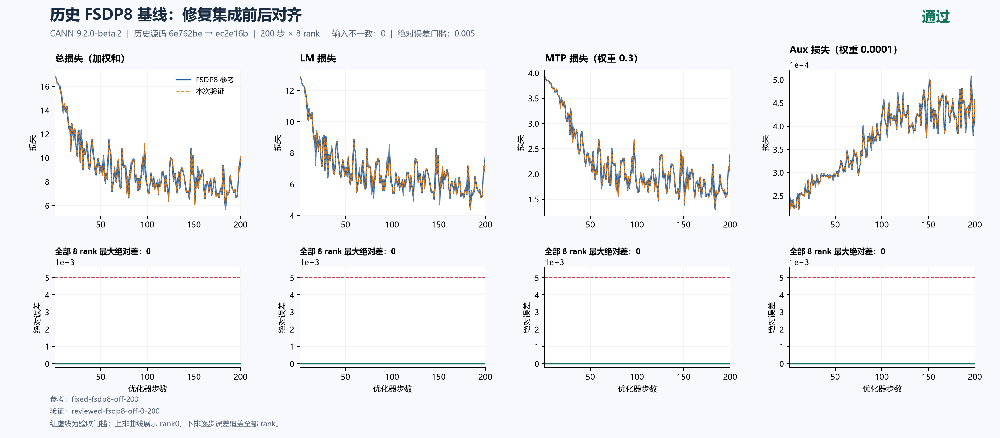
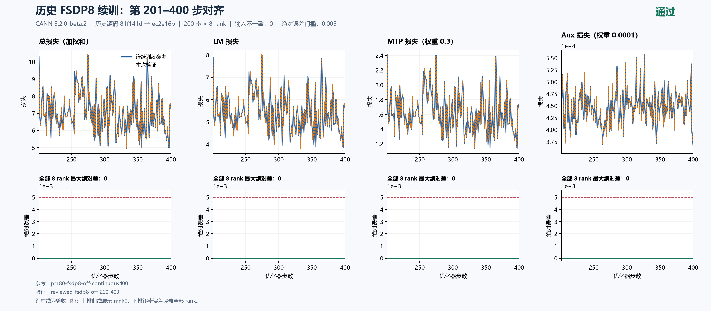
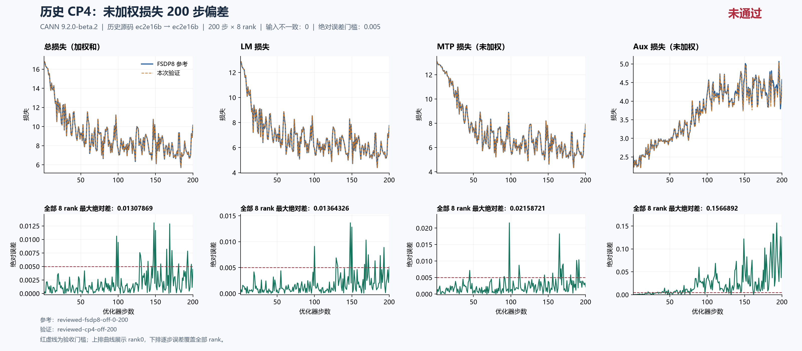
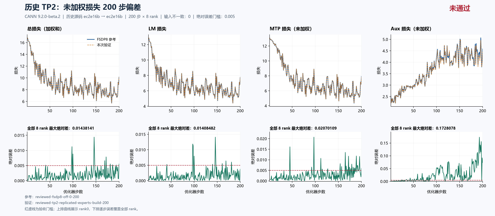
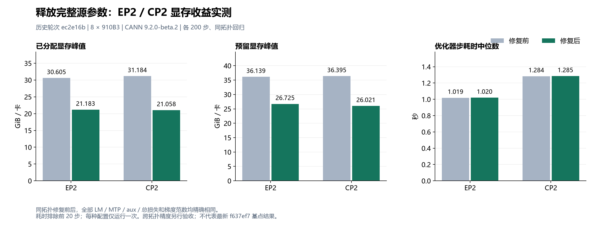
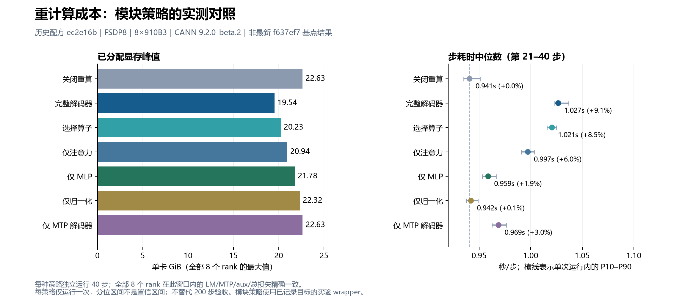
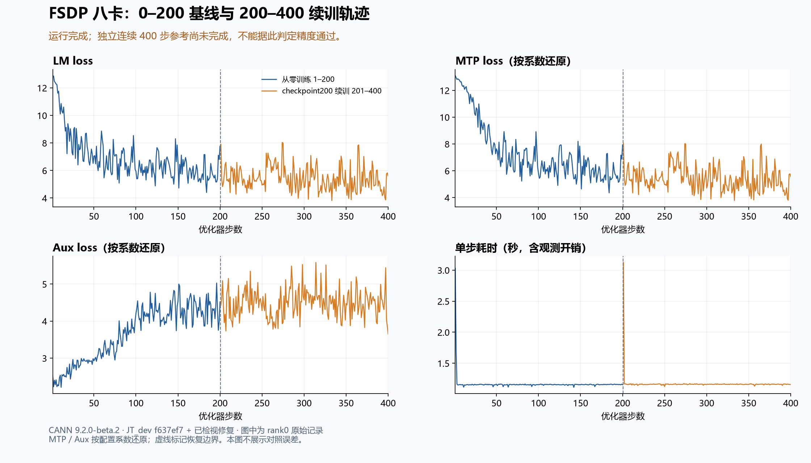
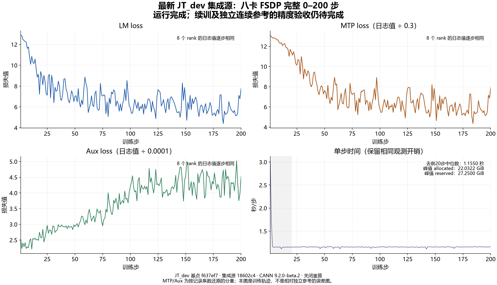
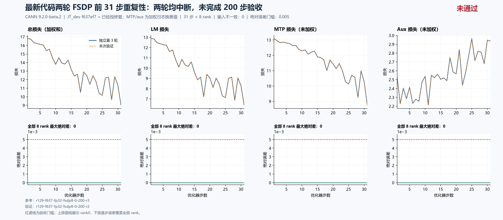

# JT八卡验证：问题排序、独立PR与证据总览

## 总体目标与当前结论

本单是 JT DeepSeek V3 八卡验证的**总问题单**，统一关联所有已拆分的小问题及独立 PR，维护优先级、复现证据、精度曲线、显存/性能、重计算与续训验收状态。每个已确认的独立缺陷或接口需求各用一个小问题单和一个单提交 PR，两个方向均能回到本单；不把多个缺陷混入同一个修复提交。

**当前总体尚未验收通过；最新固定配方的FSDP基线与续训已通过。** JT_dev `f637ef7`加已检视修复源`18602c4`，FSDP1–200和checkpoint200恢复后的201–400分别对独立连续400参考：8rank全部LM、加权及按系数还原的MTP/aux、总loss和梯度范数最大差均为0。当前配方EP2、CP2、TP2均已完整跑完200步，但三者精度均失败；完全和选择重算均完整200步×8rank与off基线逐步一致，其他合法组合仍待完成同配方200步验收；旧配方的跨拓扑超阈值和重算零误差证据单独保留，不能直接转作当前配方结论。

当前阶段推荐优先检视#194的训练目标归一化修复和#198的源参数释放修复。全部14个已确认独立问题均有中文小问题单、独立单提交PR与原生父子关联；持续补充真实证据，问题保持开启，PR保持草稿。

## 按影响排序的问题、子问题与独立 PR

排序依据依次是训练目标正确性、运行阻断、资源浪费、重算与恢复语义、精度配置和诊断可靠性。表中的“测试通过”不代表问题已合入或完整 CI 已通过；所有小问题保持开启，PR 保持草稿。

| 排序 | 问题与影响 | 小问题单 | 独立单提交 PR | 已有证据及剩余边界 |
|---|---|---|---|---|
| Top1 | 当前配方EP2、CP2、TP2完整200步精度失败，组合矩阵仍待完成 | 本总单的整体验收缺口 | 根因确认后继续拆分 | 旧配方全rank误差超阈值，见历史数据；EP2为0.007523/0.015433/0.138989，CP2为0.011062/0.022786/0.204605（LM/还原MTP/aux）；TP2完整200步为0.021448/0.024670/0.155838；余下矩阵待完成 |
| Top2 | 梯度累积按微批有效 token 归一化，改变整步目标 | [#203](https://github.com/hf1s/hyper-parallel/issues/203) | [#194](https://github.com/hf1s/hyper-parallel/pull/194) | 实际 Trainer 的不等长监督样例，正确梯度 14、旧行为 10；TP2×EP2 LM 误差显著下降但仍未过 0.005 |
| Top3 | FSDP 分片后仍持有完整源参数，显存不能释放 | [#204](https://github.com/hf1s/hyper-parallel/issues/204) | [#198](https://github.com/hf1s/hyper-parallel/pull/198) | EP2/CP2 分别减少 9.422/10.125 GiB；同拓扑 200 步 loss/梯度零误差 |
| Top4 | 测试调度器覆盖上层NPU可见列表，使设备分配越界 | [#223](https://github.com/hf1s/hyper-parallel/issues/223) | [#224](https://github.com/hf1s/hyper-parallel/pull/224) | 单提交2文件；无设备回归10测试/18子测试通过、两轴检视通过；不等同实际多卡训练验证 |
| Top5 | CP 分块输出损失的支持与回归覆盖 | [#205](https://github.com/hf1s/hyper-parallel/issues/205) | [#199](https://github.com/hf1s/hyper-parallel/pull/199) | 功能已由上游 #186 合入；#199 收敛为独立回归，新基点 CPU20项/25子测试及129四卡短步ST通过；每组2步，不代替200步验收 |
| Top6 | 完整重计算漏掉独立 MTP 解码器 | [#206](https://github.com/hf1s/hyper-parallel/issues/206) | [#195](https://github.com/hf1s/hyper-parallel/pull/195) | 实际重放及覆盖用例通过；当前配方full200步×8rank全部loss/梯度范数零误差，两个主干层和一个MTP层均包裹；selective第三轮完整200步×8rank全部loss及梯度范数零误差，未拼接旧前缀 |
| Top7 | 重计算重放重复提交专家路由 token 计数 | [#207](https://github.com/hf1s/hyper-parallel/issues/207) | [#196](https://github.com/hf1s/hyper-parallel/pull/196) | 保留必要张量运算，只约束持久副作用；均匀重复计数未必改变 sign 型 bias 更新，不能虚构旧 loss 漂移 |
| Top8 | checkpoint 续训后累计样本/token 指标清零 | [#208](https://github.com/hf1s/hyper-parallel/issues/208) | [#197](https://github.com/hf1s/hyper-parallel/pull/197) | 最新固定配方201–400×8rank累计/逐步计数与独立400参考一致；各loss与梯度最大差0；集成结果不全部归因于本PR |
| Top9 | 专家局部 BF16 权重梯度舍入不能由后续 FP32 归约恢复 | [#209](https://github.com/hf1s/hyper-parallel/issues/209) | [#200](https://github.com/hf1s/hyper-parallel/pull/200) | 默认关闭的 FP32 主梯度累加选项；CPU 与真实 2 卡累积/共享权重/重算 ST 通过，200 步组合验证仍待完成 |
| Top10 | Muon NS 精度无法显式配置并从 checkpoint 恢复 | [#210](https://github.com/hf1s/hyper-parallel/issues/210) | [#201](https://github.com/hf1s/hyper-parallel/pull/201) | 保留 BF16 默认；CPU、8 卡和 2 卡 ST 通过；可选 FP32 成本须匹配配方评估 |
| Top11 | Trainer向NPU写入无效CUDA属性，不能关闭预先开启的HF32 | [#227](https://github.com/hf1s/hyper-parallel/issues/227) | [#228](https://github.com/hf1s/hyper-parallel/pull/228) | 单提交2文件；真实TorchNPU选项及3项CPU测试/2项子测试通过，两轴检视通过；默认HF32关闭，未证明是CP/EP漂移根因，硬件训练未验 |
| Top12 | 非整除普通 Shard 重建返回错误形状或通信不一致 | [#211](https://github.com/hf1s/hyper-parallel/issues/211) | [#214](https://github.com/hf1s/hyper-parallel/pull/214) | 优化器无关的 Gloo 复现；入口一致拒绝不支持布局，457 项 UT/41 项子测试、2/4 进程 ST 通过；Ascend两卡各2项、四卡各1项通过，原提交未改；不代替200步训练验收 |
| Top13 | CPU 后端返回字符串设备索引，JT 模型构建报 TypeError | [#218](https://github.com/hf1s/hyper-parallel/issues/218) | [#219](https://github.com/hf1s/hyper-parallel/pull/219) | 单提交3文件；真实 CPU 路径修复前5失败，修复后20测试/7子测试通过；不代表125 NPU发现问题已修复 |
| Top14 | 资源MAX仅覆盖DP+CP，漏报其他TP/PP rank的耗时或显存峰值 | [#225](https://github.com/hf1s/hyper-parallel/issues/225) | [#226](https://github.com/hf1s/hyper-parallel/pull/226) | 单提交2文件；受控回归修复前4项子测试失败、修复后5测试/7子测试通过；旧69步前缀确认耗时及reserved漏报；新完整200步有51步时间漏报；真实8进程CPU/Gloo资源偏差64→0，NPU/PP训练通信仍待回归 |
| Top15 | FSDP动态派生的重算wrapper被覆盖报告漏计 | [#229](https://github.com/hf1s/hyper-parallel/issues/229) | [#230](https://github.com/hf1s/hyper-parallel/pull/230) | 真实三处区域报告为一处；单提交2文件，CPU62测试/2子测试、两轴检视及lint通过；仅修报告，NPU训练与性能无新增结论 |

目前优先推荐审阅 #194 的训练目标修复和 #198 的源参数释放修复：前者有明确的数学反例，后者有显著且可解释的实测显存收益。#200/#201 是显式可选数值配方，尚无足够证据默认启用。#214 的边界是明确拒绝尚不支持的普通非整除分片，不是实现其收集算法。

已固定的独立提交：#194 `bad2550`、#195 `00ae8a7`、#196 `d1f5213`、#197 `bd18261`、#198 `b948684`、#199 `e9fc94d`（旧提交 `d86b74e` 保留备份）、#200 `630d543`、#201 `59a03c6`、#214 `453618a`、#219 `86930dd`、#224 `a37d6bc`、#226 `b58fed7`、#228 `453fe57`、#230 `b540051`。各 PR 的完整 SHA、文件范围和定向测试以对应 PR 及回读凭据为准；集成测试含多个修复，不能全部归功于单一 PR。

## 当前资源总览与重计算接口复核（2026-10-16，UTC+8）

六组完整200步的资源结果已从48份原始rank日志、9600行逐项复算，60项输入SHA及图表数字经独立审计通过。绿色重算配置的精度已通过；红色斜线的EP/CP/TP仍未通过0.005，图中资源下降不能当成已验收的优化推荐。

当前FSDP完全/选择重算分别节省约11.98%/9.79% allocated显存，步时增加6.94%/6.68%；两者仅3.069ms的单次中位时间差不能排稳定速度名次。图中每组均为独立完整200步；耗时先逐步取8rank MAX再去前20步，显存含warmup且截至训练采样，不含末次checkpoint保存。保留相同输入采集开销，非无插桩或端到端性能。

JT底层已有checkpoint、exclude及策略接口；当前YAML的off/full/selective可以直接使用。按层安全子区域尚缺JT adapter声明，任意模块路径、排除和通信组合也未完整映射。full覆盖两个主干decoder和一个MTP decoder，off仍保留独立chunked head/CE重算。MF PyNative与Megatron按最新固定官方提交逐项核对；模块成本复测已定义精确FQN与pre-FSDP安装点，尚未执行的新策略不冒称通过。

[中文详细说明、数据、SVG及独立审计](reports/f637-resource-overview/README_ZH.md) · [MF/Megatron能力与接口缺口](reports/f637-resource-overview/f637-recompute-flexibility-gap-review-v2.md) · [当前版本模块复测计划](reports/f637-resource-overview/f637-module-cost-current-plan.md)。

## 最新完整结果：TP2也完成200步，跨并行精度仍未通过（2026-10-16，UTC+8）

TP2第四轮`r129-f637-fp32-tp2-200-r4`完整完成200步×8rank，退出0，517.637332秒后释放八卡，无本任务残留。与FSDP8基线的输入、初态、计数、源码、镜像及数值配方检查通过；独立数值与资源复算也确认原始证据有效，**训练精度FAIL**。LM/还原MTP/aux最大差分别为**0.0214481354/0.0246699651/0.1558382064**，首次超过0.005分别是111/45/19步。旧中断轮共同1–69步的全部loss和梯度范数与本轮差0，未拼接前缀。

| 当前配方完整200步 | LM最大差 | 还原MTP最大差 | 还原aux最大差 | 验收 |
|---|---:|---:|---:|---|
| EP2 | 0.007523060 | 0.015432835 | 0.138989417 | 未通过 |
| CP2 | 0.011061668 | 0.022786458 | 0.204604585 | 未通过 |
| TP2 | 0.021448135 | 0.024669965 | 0.155838206 | 未通过 |

TP2 allocated/reserved峰值17.294672/18.638672GiB，allocated较FSDP8节省4.737524GiB（21.5027%）；逐步8rankMAX、去前20步后的中位步时1.857553秒（+60.8268%），监督token吞吐9957.676842/s（-37.7972%）。实际布局DP4×TP2，开启SP/loss_parallel、每步两个微批并保持路由/专家权重TP复制；不是仅改tp_size。显存下降方向符合分片预期，但本次没有吞吐提升；通信/矩阵尺寸的各自份额尚无profile证明。单次观测含输入采集开销，精度FAIL的配置不能推荐为已验收方案。

rank0有51/200步漏报最慢TP lane时间，最大1.213431毫秒；本轮allocated/reserved没有rank0峰值漏报，与旧69步记录分开。离线汇总已校正，进一步补充#225/PR#226的真实修复前证据；该PR原单提交不变，真实NPU修复后通信成本仍待测。

76份原始文件SHA全部核验，传输重复包两端清理，checkpoint200保留。后续设备实验继续遵守释放后至少20分钟及空卡复查；FSDP/CP2×原生/FP32输入梯度的四臂三步诊断保持LR、数据和0.005门槛，不替代200步验收。

[详细配置、复现和资源解释](reports/f637-tp2-r4-complete/README_ZH.md) · [严格全rank比较](reports/f637-tp2-r4-complete/f637-tp2-r4-strict-comparison.json) · [数值独立复算](reports/f637-tp2-r4-complete/f637-tp2-r4-precision-independent-review.json) · [资源与释放独立审计](reports/f637-tp2-r4-complete/f637-tp2-r4-resource-independent-review.json)。

## 补充验证：资源统计 PR #226 的真实八进程 CPU 通信

在固定基点`f637ef7`与单提交修复`b58fed7`上，使用真实八进程Gloo，分别检查DP2×CP2×TP2、DP2×CP2×PP2对应的进程组边界及DP8 world控制组，每组两步。最终v2两侧各48条观测、合计1152个指标值：基点64项资源偏差（两种分组各32）逐项符合旧代码的组内MAX，修复版全部为0；数据、loss、累计计数及world控制均无非预期差异。

通信函数和进程组未mock，时钟及显存读数使用人工哨兵。这证明CPU/Gloo的归约域修复，不是TP/PP模型训练、NPU/HCCL性能或200步验收。两轴独立检视均通过，原始逐rank数据、两个版本的精确Git归档指纹、退出码与无设备容器移除凭据一起公开；PR #226保持原来的一个提交。

[中文详细记录和复现入口](reports/pr226-gloo-8cpu/README_ZH.md) · [基点结果](reports/pr226-gloo-8cpu/raw/evidence/pr226-gloo-8cpu-v2/base-summary.json) · [修复结果](reports/pr226-gloo-8cpu/raw/evidence/pr226-gloo-8cpu-v2/head-summary.json) · [全部原始文件SHA](reports/pr226-gloo-8cpu/pr226-gloo-evidence-manifest.json)。

## 最新完整结果：关闭、完全、选择重算200步均已对齐（2026-10-16，UTC+8）

选择重算第三轮`r129-f637-fp32-fsdp8-selective-200-r3`完整完成200步×8rank，退出0，运行394.861022秒并释放八卡，无本任务PID残留。与关闭重算FSDP8基线相比，LM、日志加权及按系数还原的MTP/aux、总loss和梯度范数最大绝对差全部为**0**，输入和初态检查也通过。由此当前固定配方的off/full/selective三种重算均完成200步精度对齐；这不替代EP/CP/TP矩阵验收。

| 同129、同配方、同输入采集开销 | 关闭重算 | 完全重算 | 选择重算 |
|---|---:|---:|---:|
| 去前20步后，逐步8rank MAX中位秒/步 | 1.155003 | 1.235180 | 1.232111 |
| 全200步累计allocated峰值GiB | 22.032196 | 19.392933 | 19.875641 |
| 全200步累计reserved峰值GiB | 27.250000 | 24.320313 | 24.789063 |
| 有效监督token/s，逻辑数据只计一次 | 16008.407 | 14969.751 | 15011.921 |

选择重算相对关闭节省2.156555 GiB allocated（9.7882%），中位步时增加6.6760%，监督吞吐下降6.2248%。完全重算再多省0.482708 GiB，而本次步时仅比选择重算多0.2491%；单次观测不能证明稳定速度差异。在当前两主干层加一MTP层配置中，选择重算尚未显示明显更好的性价比。模块消融继续按实际配方/步数注明，旧结果不直接转作当前结论。

76份原始文件SHA核验完成，重复归档已清理；精度与资源由两轴独立复算。MTP/aux为日志按0.3/0.0001系数还原，不是额外采集的加权前张量；梯度结论限于范数。此后TP2-r4已完成200步，见本单新增完整结果；每轮仍需释放后至少20分钟并检查空闲。

[完整中文说明](reports/f637-fsdp8-selective-r3-complete/README_ZH.md) · [严格比较](reports/f637-fsdp8-selective-r3-complete/f637-fsdp8-selective-r3-strict-comparison.json) · [76份原始文件清单](reports/f637-fsdp8-selective-r3-complete/f637-fsdp8-selective-r3-complete-evidence-manifest.json) · [资源逐步结果](reports/f637-fsdp8-selective-r3-complete/f637-fsdp8-selective-r3-all-rank-resources.json) · [数值独立审计](reports/f637-fsdp8-selective-r3-complete/f637-fsdp8-selective-r3-precision-independent-review.json) · [资源独立审计](reports/f637-fsdp8-selective-r3-complete/f637-fsdp8-selective-r3-resource-independent-review.json)。

两次旧重试分别完成109/48步后因外部实验使用卡4/卡5而仅停止本任务，原始严格结果仍为未完成；第三轮从step0独立跑满200步，**未拼接前缀**。旧记录与匿名归属审计保留：[第一轮109步](reports/f637-fsdp8-selective-prefix109/README_ZH.md)、[第二轮48步](reports/f637-fsdp8-selective-r2-prefix48/README_ZH.md)。启动前约10分钟各次样本均空闲，手动接续最大间隔约94.565秒，不冒称自动观察器的90秒约束已通过；最终仍由原守卫两次当前空卡检查。当前step200 checkpoint保留。

## 最新离线定位与数据清理

本轮CPU通信回归临时源树、venv、传输归档已清理：129释放86,505,126字节，本地释放16,855,633字节；全部原始证据与最终源码保留。[清理凭据](reports/pr226-gloo-8cpu/pr226-gloo-temporary-cleanup.json)。

实际CP投影损失CPU探针完成80例并独立复核：局部均值再缩放可造成很小的FP32舍入，BF16返回梯度在本样例中没有差异；CPU使用BF16 BLAS回退，不能当作NPU漂移根因。未由此新增缺陷PR。125五份旧200步参数探针已逐字节无损gzip读回校验后移除未压缩文本，释放6,136,618,679字节；当前step200 checkpoint保留。[狭义结论、全部记录与清理凭据](reports/cp-denominator-cpu-and-cleanup/README_ZH.md)。

2026-10-16 02:57再次核对官方入口：JT_dev及MF提交不变，Megatron推进到`3914483`，相关变更只涉及推理CUDA Graph允许条件，重算字段和实现结论未变。[最新源码差异与能力比较](reports/recompute-reference-comparison.md)。

## 最新完整结果：完全重算200步精度通过及性价比（2026-10-16，UTC+8）

`r129-f637-fp32-fsdp8-full-200-r4`在全局冷却与八卡空闲复查后启动，完整完成200步×8rank，退出0，383.775899秒后释放设备，无本任务PID残留。保持源码`18602c4`、JT_dev基点`f637ef7`、CANN9.2.0-beta.2、同一镜像/数据/全局batch/优化器与FP32专家主梯度及NS配方；归一化数值配方SHA为`c51ed8ff345759c96f9dce13c47f2531b4a5cdb0c487bc5164d01ba926919af5`。比较对象是独立进程完成的同配方off基线，不是本轮自比较。

| 全部8rank、完整200步最大绝对差 | LM | 日志MTP（×0.3） | 按系数还原MTP | 日志aux（×0.0001） | 按系数还原aux | 总loss | 梯度范数 |
|---|---:|---:|---:|---:|---:|---:|---:|
| full 对 off | 0 | 0 | 0 | 0 | 0 | 0 | 0 |

全部初态、输入身份、步/rank覆盖、有限值、LR/计数、源码/镜像与配方检查通过。还原分量由加权日志除以配置系数得到，**没有额外采集加权前张量**；因此不把日志还原冒称独立原始张量观测。严格比较及两项独立原始证据复算均保留供复核。

| 同129主机、同配方、同build采集口径 | off 基线 | full 完全重算 | full相对off |
|---|---:|---:|---:|
| 逐步全部rank MAX、去20步后中位秒/步 | 1.155002654 | 1.235179961 | +6.9417% |
| 有效监督token/s，数据只计一次 | 16008.406569 | 14969.751192 | -6.4882% |
| 全200步累计峰值allocated GiB | 22.032196045 | 19.392932892 | -2.639263153（-11.9791%） |
| 全200步累计峰值reserved GiB | 27.250000000 | 24.320312500 | -2.929687500 |

重放增加计算、减少保留激活，与此处步时上升和显存下降的方向一致；这只是本小层数模型的一次匹配观测，不能外推完整模型，也不是重复实验置信区间或无插桩端到端吞吐。时间观测保留输入身份及指标采集，显存数值是整轮累计峰值，allocated与reserved分别报告。selective已补齐相同口径完整200步比较，见上方最新结果，模块消融另注明实测步数，不能用旧配方模块数据替代当前结果。

实际构建日志与模块清单覆盖两个主干解码层及一个MTP解码层。当前固定源码未集成仅修报告的#230，旧报告仍可能把两个动态派生wrapper漏计为总计1；这是#229中已独立复现的统计问题，不能反推本轮只重算了一个区域。该训练结果属于修复集成源，不把全部零误差或全部显存收益归因于单个PR。

76份原始文件逐一验证大小/SHA，两端重复压缩包均已清理。该轮释放后20分钟门槛为2026-10-16 02:29:49.787256（UTC+8）；后续selective已遵守该间隔，当前等待时间见上方最新记录。

[严格精度比较](reports/f637-fsdp8-full-200-complete/f637-fsdp8-full-200-strict-comparison.json) · [完整分析](reports/f637-fsdp8-full-200-complete/f637-fsdp8-full-200-complete-analysis.json) · [76份采集清单](reports/f637-fsdp8-full-200-complete/f637-fsdp8-full-r4-complete-evidence-manifest.json) · [8rank原始证据](reports/f637-fsdp8-full-200-complete/raw/runs/r129-f637-fp32-fsdp8-full-200-r4) · [全rank资源](reports/f637-fsdp8-full-200-complete/f637-fsdp8-full-200-all-rank-resources.json) · [匹配off资源](reports/f637-fsdp8-full-200-complete/f637-fsdp8-r4-all-rank-resources.json) · [SHA与清理凭据](reports/f637-fsdp8-full-200-complete/f637-fsdp8-full-r4-complete-local-verification.json) · [精度独立复算](reports/f637-fsdp8-full-200-complete/f637-fsdp8-full-200-independent-evidence-review.json) · [资源独立复算](reports/f637-fsdp8-full-200-complete/f637-fsdp8-full-200-resource-independent-review.json)。

## 最新补充：重算覆盖报告的独立修复及第三次让卡（2026-10-16，UTC+8）

新增中文小问题[#229](https://github.com/hf1s/hyper-parallel/issues/229)及单提交草稿PR[#230](https://github.com/hf1s/hyper-parallel/pull/230)，提交`b54005154e8d9ae3b2e1728ba106d2d628e6053e`，两文件。原报告按实例类名识别wrapper，遗漏FSDP动态生成的`HSDPCheckpointWrapper`。真实八rank构建日志和最终模块树均显示3处区域，报告却只计MTP一处。修复按完整基类身份检查MRO，保持报告结构与训练数学。

同一新增回归在基点有2个测试及1个子测试失败，修复后完整model_integration目录62测试、2子测试通过。lint返回0且诊断为空，规范/需求两轴检视分别PASS；当前PR head暂无check run、combined status为pending。首版包级导入测试假设错误导致超时的日志保留，已按函数执行边界纠正后重新完成红绿对照。无设备CPU回归不等同NPU性能或200步验收。

[复现、完整测试及检视](reports/checkpoint-wrapper-inventory/README_ZH.md) · [真实三处/报告一处证据](reports/checkpoint-wrapper-inventory/checkpoint-inventory-real-run-observation.json) · [文件SHA](reports/checkpoint-wrapper-inventory/manifest.json) · [当前head CI原始状态](reports/checkpoint-wrapper-inventory-publication/checkpoint-inventory-current-head-ci.json)。

`full-200-r3`在前轮释放满20分钟后启动，初始化后4号卡出现不同namespace/cgroup的外部进程，守卫仅停止本任务容器；0个完整步、exit137、115.91秒释放，设备上无本任务PID残留。60份原始文件全部核验，公开59份，外部身份明细仅留本地；两端重复归档已删。新的`full-200-r4`保留已验证数值文本，实际Trainer和模型配置解析通过；2026-10-16 02:03（UTC+8）在复查125/129空卡后启动129的守卫重试，现已完成200步，结果与证据见本单最新完整重算一节；保留前三轮原始失败或让卡记录。

[中断采集与清理](reports/f637-fsdp8-full-r3-interrupted/f637-fsdp8-full-r3-interrupted-local-verification.json) · [公开原始文件清单](reports/f637-fsdp8-full-r3-interrupted/public-manifest.json) · [r4实际镜像预检](reports/f637-fsdp8-full-r3-interrupted/f637-yaml-config-preflight-r4.json)。本阶段CPU临时checkout、专用venv、输入归档及暂存文件共88,781,402字节已清理，保留最终源码、测试证据、当前step200 checkpoint及用户镜像：[清理凭据](reports/checkpoint-wrapper-inventory-publication/checkpoint-inventory-scratch-cleanup.json)。

## 前期执行记录：第二次重试的配置类型错误已修正（2026-10-16，UTC+8）

`r129-f637-fp32-fsdp8-full-200-r2`在129空卡并满足20分钟间隔后启动，但在模型配置构造时报`rms_norm_eps`需要float却收到字符串，0步、退出1，37.01秒后释放全部设备。原因是我重新生成重试配置时，用JSON序列化把`1.0e-06/1.0e-07/1.0e-08`写成`1e-06/1e-07/1e-08`，被实际YAML解析器作为字符串读取；同时影响RMSNorm、Muon NS和AdamW的epsilon字段。这是本任务实验配置生成错误，没有作为新的库缺陷提交PR。

新的`full-200-r3`保留原配置数值文本，仅替换未启用的checkpoint输出目录中的case名。无设备CPU预检使用同一镜像、固定源`18602c4`、实际`yaml.safe_load`、`parse_training_args`和`JTDeepseekV3Config`：27份配置中26份通过，唯一失败为保留的r2反例，r3通过；未初始化NPU，容器退出0并移除。早期CPU预检容器遗漏源码bind、读到镜像内旧配置类的问题也已修正，现在核对mount、源提交及4个实际导入文件的SHA；这些错误及修正不改变已完成NPU实验的原始记录。

[失败分析与边界](reports/f637-fsdp8-full-r2-incomplete/analysis.json) · [31份原始文件指纹](reports/f637-fsdp8-full-r2-incomplete/f637-fsdp8-full-r2-incomplete-evidence-manifest.json) · [采集核验与归档清理](reports/f637-fsdp8-full-r2-incomplete/f637-fsdp8-full-r2-incomplete-local-verification.json) · [27份实际配置预检](reports/f637-fsdp8-full-r2-incomplete/f637-yaml-config-preflight-verified.json) · [源码导入指纹](reports/f637-fsdp8-full-r2-incomplete/validation-import-probe-source-bound.json) · [无设备容器退出0凭据](reports/f637-fsdp8-full-r2-incomplete/f637-config-preflight-v3.receipt.json)。配置预检不替代完整训练验收，下一次NPU启动须在2026-10-16 01:36:58（UTC+8）之后重新确认空卡。

目前13个中文小问题与13个单提交草稿PR已完成原生父子关系、双向正文链接及27项回读核验：[关联审计](reports/f637-fsdp8-full-r2-incomplete/github-chinese-full-link-audit.json)。本轮另清理本机/129已用完的CPU源码、专用venv、归档和lint暂存共88,761,978字节：[清理凭据](reports/f637-fsdp8-full-r2-incomplete/npu-precision-scratch-cleanup.json)。保留最终源码、原始证据、当前step200 checkpoint及用户镜像。

## 最新补充：NPU精度开关独立修复与完全重算让卡记录（2026-10-16，UTC+8）

新增小问题[#227](https://github.com/hf1s/hyper-parallel/issues/227)和独立单提交草稿PR[#228](https://github.com/hf1s/hyper-parallel/pull/228)，提交`453fe5723429b0e45ee6f0236d6e262cbe58b04f`。Trainer此前向NPU matmul对象写入CUDA风格属性，实际TorchNPU2.12.0静默忽略；先开启HF32再调用高精度函数，旧版仍为true。修复改用`allow_hf32=False`，真实选项读回变为false，NPU运行时始终未初始化；CUDA与CPU策略保持。

同一CPU用例旧版两项NPU子测试失败，修复版3项测试/2项子测试通过；规范与需求两轴检视通过。初版批次尾部JSON读取被驱动stdout文本干扰而退出1，UT已完成；独立JSON输出的后续probe退出0，原始失败与修正均保留。修改后4项lint诊断均为基点继承，不宣称完整lint或CI通过；当前head无check run、combined status为pending。

默认HF32实际读回为关闭，**不能把本缺陷当作当前CP2/EP2数值漂移的已确认根因**。本修复不控制NPU BF16累加，也没有单独的硬件算子/200步训练/性能结论。现有固定源`18602c4`继续用于重算对照；需要改变数值策略时将另建完整参考。

[中文证据与复现边界](reports/npu-precision-switch/README_ZH.md) · [真实后端选项读回](reports/npu-precision-switch/npu-precision-option-after-verified.json) · [修复前UT](reports/npu-precision-switch/npu-precision-ut-before.log) · [修复后UT](reports/npu-precision-switch/npu-precision-ut-after.log) · [规范轴](reports/npu-precision-switch/npu-precision-standards-review.json) · [需求轴](reports/npu-precision-switch/npu-precision-spec-review.json) · [全部文件指纹](reports/npu-precision-switch/manifest.json)。

完全重计算尝试`r129-f637-fp32-fsdp8-full-200`满足全局20分钟间隔及两次空卡检查后启动，0号卡随后出现其他宿主进程。守卫刷新namespace/cgroup确认归属不同，只停止本任务容器；35.41秒后退出137并释放，训练0步、无本任务设备PID残留。31份原始文件逐一核验，公开30份，其他任务归属明细只留本地；两端重复归档已删除。此尝试没有loss、显存或性能验收结果。

[31份采集指纹](reports/f637-fsdp8-full-200-interrupted/f637-fsdp8-full-200-interrupted-evidence-manifest.json) · [SHA核验与归档清理](reports/f637-fsdp8-full-200-interrupted/f637-fsdp8-full-200-interrupted-local-verification.json) · [不含他人身份的归属摘要](reports/f637-fsdp8-full-200-interrupted/ownership-summary.json) · [释放凭据](reports/f637-fsdp8-full-200-interrupted/raw/scheduling/r129-f637-fp32-fsdp8-full-200.receipt.json)。重试须在本地协调器记录的释放时刻之后满20分钟，即2026-10-16 01:15:48（UTC+8）之后重新确认空卡；其他实验同样受此全局间隔约束。

## 最新完整结果：CP2的200步精度未通过（2026-10-16，UTC+8）

`r129-f637-fp32-cp2-200`完成200步×8rank，退出0，462.81秒后释放全部8卡，无本任务设备PID残留。启动满足前轮释放后的全局20分钟间隔，源`18602c4`、镜像、CANN9.2.0-beta.2和归一化数值配方与FSDP基线一致。76份原始文件大小/SHA逐一核验，两端重复归档已删除；全部输入、48项记录初态、计数和LR检查通过，精度门槛失败。

| 完整200步、全8rank最大绝对差 | LM | 日志MTP（×0.3） | 按系数还原MTP | 日志aux（×0.0001） | 按系数还原aux |
|---|---:|---:|---:|---:|---:|
| CP2 对同配方FSDP8 | 0.0110616684 | 0.0068359375 | 0.0227864583 | 0.0000204605 | 0.2046045847 |

LM最大差出现在第148步，MTP第98步，aux第172步。总loss最大差0.0140056610，梯度范数最大差0.6418290138；未加权量是日志标量按真实配置系数还原，不是额外采集的加权前张量。这里确认的是跨拓扑精度失败，尚未确定新的独立根因；继续在Top1追踪，不能用资源统计修复解释这些数值差异。

| 同主机同配方资源观测 | FSDP8 | CP2 |
|---|---:|---:|
| 每步全部rank MAX、去20步后中位秒/步 | 1.155003 | 1.596322 |
| 监督token/s，实际有效token只计一次 | 16008.4066 | 11586.1031 |
| 全程累计峰值allocated GiB | 22.032196 | 20.706646 |
| 全程累计峰值reserved GiB | 27.250000 | 25.982422 |

allocated减少1.325550 GiB，约6.02%；中位步时增加约38.21%。CP2在本配置中将逻辑序列分段由4096降为2048，dense FSDP仍为8路，优化器步由1个变为2个微步；参数与优化器持久状态没有CP倍数的分片收益。通信及微步变化是需要关注的成本，但本轮没有算子级归因。精度未通过，且只测了一次，这些数据只用于诊断，不能推荐为达到精度目标后的最优方案。

[严格精度比较](reports/f637-cp2-200-complete/f637-cp2-200-strict-comparison.json) · [完整分析](reports/f637-cp2-200-complete/f637-cp2-200-complete-analysis.json) · [76份采集清单](reports/f637-cp2-200-complete/f637-cp2-200-complete-evidence-manifest.json) · [原始8rank记录](reports/f637-cp2-200-complete/raw/runs/r129-f637-fp32-cp2-200) · [全rank资源观测](reports/f637-cp2-200-complete/f637-cp2-200-all-rank-resources.json) · [匹配参考资源](reports/f637-cp2-200-complete/f637-fsdp8-r4-all-rank-resources.json) · [SHA及清理凭据](reports/f637-cp2-200-complete/f637-cp2-200-complete-local-verification.json) · [完整结果独立复算检视](reports/f637-cp2-200-complete/f637-cp2-200-independent-evidence-review.json)。

CP2结束后已完成当前配方FSDP8完整重计算200步，详见本单最新结果；selective和TP2现已完成；TP2精度仍失败，接续优先做当前配方单变量短步定位，再补齐其余并行矩阵。任何新实验仍须等待上一轮释放后至少20分钟并重新确认空卡。

## 最新完整结果：EP2的200步精度未通过（2026-10-16，UTC+8）

`r129-f637-fp32-ep2-200`在满足全局20分钟间隔后，完成200步×8rank，退出0，407.33秒后释放全部8卡。76份文件大小/SHA逐一核验，两端重复压缩包已删除。固定源仍为`18602c4`、CANN9.2.0-beta.2；本轮运行完整，源码/配方/镜像、输入、初态、计数与LR等完整性检查无不一致，但精度门槛失败。

| 全8rank、完整200步最大绝对差 | LM | 日志MTP（×0.3） | 还原MTP | 日志aux（×0.0001） | 还原aux |
|---|---:|---:|---:|---:|---:|
| EP2 对同配方FSDP8 | 0.0075230598 | 0.0046298504 | 0.0154328346 | 0.0000138989 | 0.1389894169 |

加权MTP单项小于0.005，不能掩盖还原分量超阈值；LM也超过0.005。原始误差与完整性检查均由未修改的严格比较器重新计算，根因仍在定位，不能把这些差异归因于新资源统计修复。

| 同主机、同配方资源观测 | FSDP8 | EP2 |
|---|---:|---:|
| 逐步全部rank MAX、去20步后中位秒/步 | 1.155003 | 1.317435 |
| 监督token/s，实际有效token只计一次 | 16008.4066 | 14034.3284 |
| 累计峰值allocated GiB | 22.032196 | 20.928654 |
| 累计峰值reserved GiB | 27.250000 | 26.275391 |

本次allocated减少1.103542 GiB，约5.01%；中位步时增加约14.06%。FSDP已分片整模型状态，且该小层数模型的embedding/输出头占保存模型载荷57.29%、路由专家仅占13.89%，不能期待EP2使整步显存减半。额外通信可能增加耗时是配置/源码预期，此轮未做算子归因；单次观测且精度失败，尚不能称为达到目标后的并行收益。

离线资源工具补齐了逐步全rank MAX、单次数据计数和累计峰值边界。独立两轴检视发现的输出覆盖、路径别名及非法计数问题已修正，9项CPU反例通过；输出使用排他创建，输入解析与SHA共用同一字节快照，严格loss比较器及训练源码未改。工具复核不替代多卡训练验证。

[完整运行分析](reports/f637-ep2-200-complete/f637-ep2-200-complete-analysis.json) · [严格精度比较](reports/f637-ep2-200-complete/f637-ep2-200-strict-comparison.json) · [76份采集清单](reports/f637-ep2-200-complete/f637-ep2-200-complete-evidence-manifest.json) · [8rank原始证据](reports/f637-ep2-200-complete/raw/runs/r129-f637-fp32-ep2-200) · [EP2逐步全rank资源](reports/f637-ep2-200-complete/f637-ep2-200-all-rank-resources.json) · [FSDP同窗口资源](reports/f637-ep2-200-complete/f637-fsdp8-r4-all-rank-resources.json) · [离线工具两轴复核](reports/f637-ep2-200-complete/all-rank-resources-two-axis-review.json) · [完整结果独立复算检视](reports/f637-ep2-200-complete/f637-ep2-200-independent-evidence-review.json)。

该阶段12组独立问题/PR的中文正文、单提交、双向链接及原生父子关系已全部回读核验（当前已增至14组，见首节），[25项核验记录](reports/f637-ep2-200-complete/github-chinese-full-link-audit.json)。本轮另清理54,872,986字节已用完的本机/129临时输入、CPU源码副本及专用venv，[清理凭据](reports/f637-ep2-200-complete/global-resource-metrics-cleanup.json)；最终源码、原始证据、当前step200 checkpoint和用户镜像保留。后续CP2已按间隔完成，结果见前文；此处保留EP2完成时的阶段记录。

## 已完成阶段记录与未完成边界

- TP2第三轮只有69步×8rank：LM/还原MTP/aux最大差为0.004503/0.022318/0.016616，尚未完成200步；遇到其他任务后只停止本任务。125另一次尝试在0步退出，不能据此判定125环境已经恢复。
- #226 的资源统计修复有5项CPU测试/7项子测试和真实69步漏报反例；修复后的NPU/PP通信仍待回归。
- #214 在原单提交上完成Ascend两卡FP32/BF16、四卡Partial定向回归；#199完成四卡8组短步组合、每组2步。两者均不替代200步训练验收。
- #224 的选卡隔离有10项CPU测试/18项子测试和两轴检视；未停止或修改其他任务。

[完整阶段记录、精度图、原始日志和当时的回读凭据](reports/phase-history-through-20261015.md)已归档保留。各独立缺陷的当前状态仍以本单顶部排序表和对应小问题/PR为准。

## 统一验收标准与执行顺序

1. 固定源码、镜像、CANN、数据及优化器配方，先跑 **FSDP8 的 step1–200**，保存 step200 checkpoint；另起进程加载后跑 **step201–400**，再与独立连续 step1–400 参考比较。
2. 固定全局 batch8、微批1、序列4096、seed42、输入顺序、学习率与初始化。合法 TP、CP、EP 及混合策略各跑 200 步，与同精度配方的 FSDP8 比较。改变精度选项必须重新建立基线、续训与连续参考。
3. 检查全部 8 rank、全部 step 的最大绝对差，LM、MTP、aux 均须 ≤0.005；同时保存并检查日志加权量和未加权量。日志 MTP 系数为 0.3，aux 为 0.0001，不能用系数掩盖原始分量误差。
4. 初始化/输入身份、步数、rank 覆盖、LR、有限值、退出码、完成标记、恢复计数另外验收。输入哈希相同不能替代 loss 验收；运行完成和自比较零误差也不能替代独立参考。
5. 关闭、完整、选择重算各跑 200 步；模块选择消融注明步数和测量边界。报告 allocated/reserved 峰值及预热后中位步时，数据采集开销保持一致。
6. 每个修复以独立最小回归、相应分布式用例和规范/验收条件两轴检视作为证据；保留首次失败与修复后结果。开放问题不能仅靠 PR 已创建或某个标签关闭。

## 历史固定配方长跑精度数据

以下是 125 六项修复集成源 `ec2e16b` 的旧配方，所有误差取全 rank、全 step 最大值：

| 策略，均 200 步 | LM 最大差 | 日志 MTP 最大差（×0.3） | 日志 aux 最大差（×0.0001） | 结论 |
|---|---:|---:|---:|---|
| FSDP 0–200 对连续参考 | 0 | 0 | 0 | 通过 |
| FSDP checkpoint200→400 对连续参考 | 0 | 0 | 0 | 通过，含原始分量和累计计数 |
| 完整/选择重算对关闭重算 | 0 | 0 | 0 | 通过 |
| TP2，复制专家 | 0.014084816 | 0.006210327 | 0.0000172808 | 未通过 |
| EP2 | 0.014165878 | 0.003723621 | 0.0000124761 | 未通过 |
| EP4 | 0.015380383 | 0.005264282 | 0.0000185563 | 未通过 |
| CP2 | 0.022237778 | 0.005699873 | 0.0000214768 | 未通过 |
| CP4 | 0.013643265 | 0.006476164 | 0.0000156689 | 未通过 |
| TP2×EP2，整步 token 分母修复后 | 0.012481689 | 0.004909277 | 0.000013115 | 未通过 |

例如 CP4 未加权 MTP/aux 最大差为 0.021587213/0.156689202，TP2 为约 0.02070109/0.17280778。未加权 aux 也未达标。新生产 FP32 配方的 3 步集成通过仅证明短跑路径；早期诊断包装器的 200 步仍失败且梯度布局不同，不能当作生产补丁验收。

## 数值定位进展与未确认事项

- 梯度累积分母错误已单独修复，但不能解释全部剩余漂移。源参数释放前后同拓扑 200 步 loss/梯度范数完全一致，显存修复没有改变数值轨迹。
- TP 首步 Q/KV 投影和输出投影完整输入共 4608 个哈希块相同，首次已定位的输出偏离在第一层输出投影。局部投影使用 FP32 后，采样最大差从 0.015625 降至 0.0009765625，后续 MLP 仍放大残差；该消融改变数值配方，不能直接与旧 BF16 基线混比。
- EP/CP 的四个 NS 参数从单矩阵变为矩阵批次2。逐矩阵 NS 和 CPU FP64 范数的三步消融仍有非零差异；首步 28 个被观测参数哈希相同不代表全部专家参数相同。
- CP 首步仅有采样边界证据，不能称已定位完整根因。固定 512 位置 loss 分块使部分反向边界一致，但 embedding 梯度相对 L2 仍约 0.00532；只跑一步，不能替代 200 步验收。
- 重算灵活性评估结论：当前 JT YAML 尚未提供 MF 式任意模块路径/层范围、排除及通信重算配置。已有模块消融使用实验包装器；不能将 `selective` 名称视作相同接口。

## 显存、吞吐与重计算性价比

下表为已归档旧基点/配方的同一build观测口径、预热20步后中位时间，保留输入身份采集开销；最新固定配方FSDP数值见前文。这里的小层数配置尚未从并行切分取得吞吐收益，内存收益也随策略而异；不能外推完整 DeepSeek 模型。

| 策略 | 秒/步 | allocated 峰值 GiB |
|---|---:|---:|
| FSDP8 | 0.937752 | 22.633759 |
| EP2 | 1.020075 | 21.183023 |
| EP4 | 1.029181 | 21.322903 |
| CP2 | 1.285255 | 21.058210 |
| CP4 | 1.670697 | 20.217754 |
| TP2，复制专家 | 1.416853 | 17.771236 |
| FSDP8，FP32 专家梯度＋FP32 NS | 1.165173 | 22.282196 |

#198 的同拓扑前后比较：EP2 从 30.605194 降至 21.183023 GiB，CP2 从 31.183506 降至 21.058210 GiB；约 0.1% 的步时变化不足以证明吞吐收益。#200+#201 合用步时增加 24.25%，这是组合成本；此前约 6.8 倍的 NS 成本归因混入运行时观测，已撤回。

重算独立40步消融：full 节省约3.095 GiB、步时增加9.13%；selective 节省2.407 GiB、增加8.50%；单独 MLP 节省0.853 GiB、增加1.91%；只重算 MTP 未降低整步峰值、时间增加约2.99%。MLP＋norm 另有200步全 rank 零误差，节省约1.165 GiB、步时增加约2%。模块事件时间为含子调用的时间，不能嵌套相加；进入/退出 allocated 差也不能当作保存激活大小。

[同口径时间与显存原始记录](https://github.com/xingleixu123/hyper-parallel/blob/2f5ba55838338dcb5c37c9cd44a958586da2e89a/docs/validation/jt-dev-8npu-20261014/reports/matching-build-topology-costs.md)；[重算成本与口径](reports/recompute-cost-analysis.md)；[MF/Megatron 固定源码对照](reports/recompute-reference-comparison.md)。

## 固定环境、复现入口与证据

此前已测固定基点 `JT_dev@521d3a8a9aa62353327093ab1258ca2c22006e8b` 已合入 #180（head `5de3cceab094bbed18915d1a9c9231ca220629ca`）。旧八卡测量从 `ad1c553`＋#180 开始，四项修复集成源 `6e762be`、六项源 `ec2e16b`；129 该历史轮次整合源 `a3450812a3bb737e74b8433928acc6fc18374433`，再应用 #200/#201 生产补丁，补丁 SHA256 `803107108b505cd7ab7eafb7c625eb125ae0679e97cb1482f0914f3b3213f784`。

硬件：8×Ascend 910B3 64 GiB。CANN 9.2.0-beta.2 / V100R001C12B086，Python 3.12.14，Torch 2.12.0+cpu，TorchNPU 2.12.0，transformers 5.13.1。129 镜像 `jt-clean:hp-910b-20261009`，ID `sha256:5f9e677f439d11ab4e7c888f54b142335a27eee7411cbd2ce894a4798a70146d`，从 `/home/jt_image/four-images-clean-20261009/HP-910B/hp-910b-arrow.tar.gz` 校验后载入。镜像内原代码较旧，实际导入的是挂载并验证过的 editable checkout。

模型：两层主干＋一层 MTP、8个路由专家，序列4096、全局 batch8、微批1、seed42、固定 LR0.0001，Muon/AdamW 原有优化配方。真实 Arrow 数据4710行，原数据留在实验机，公开证据只包含配置、标量和身份哈希，不上传训练文本。

训练入口为 `examples/training_demo/jt_deepseek_v3`，使用证据中的完整 YAML、8进程启动及固定环境；逐步标量、输入哈希和退出标记必须一起采集。可复现配置示例：[CP4 200步](https://github.com/xingleixu123/hyper-parallel/blob/2f5ba55838338dcb5c37c9cd44a958586da2e89a/docs/validation/jt-dev-8npu-20261014/configs/reviewed-cp4-off-200.yaml)、[TP2 复制专家200步](https://github.com/xingleixu123/hyper-parallel/blob/2f5ba55838338dcb5c37c9cd44a958586da2e89a/docs/validation/jt-dev-8npu-20261014/configs/reviewed-tp2-replicated-experts-build-200.yaml)。[配置、原始标量、曲线和脚本索引](https://github.com/xingleixu123/hyper-parallel/blob/2f5ba55838338dcb5c37c9cd44a958586da2e89a/docs/validation/jt-dev-8npu-20261014/README.md)、[完整中文报告](https://github.com/xingleixu123/hyper-parallel/blob/2f5ba55838338dcb5c37c9cd44a958586da2e89a/docs/validation/jt-dev-8npu-20261014/REPORT_ZH.md)、[CP4 全步比较](https://github.com/xingleixu123/hyper-parallel/blob/2f5ba55838338dcb5c37c9cd44a958586da2e89a/docs/validation/jt-dev-8npu-20261014/reports/reviewed-cp4-off-200-comparison.json)。各小问题提供其专用最小复现和回归命令。

与 #145 的旧源码、单卡参考、100步问题以及 #190 的 MF 单卡对齐范围不同；本单固定 FSDP8、200步和恢复参考。尚没有能解释全部跨拓扑200步偏差的单一最小根因，后续证据确认后继续拆单。

## 待完成清单与资源约束

- [x] 已确认14个独立问题，各有中文小问题单与独立单提交 PR，正文双向关联并具有原生父子关系。
- [x] 旧六项修复配方 FSDP0–200、200→400 与连续参考全 rank 零误差；关闭/完整/选择重算200步已完成。
- [x] 129 固定旧基点 `521d3a8` 的 FP32 配方 FSDP0–200 及200→400按顺序运行完成，数据完整、计数连续；未完成独立连续400参考。
- [x] 最新 `f637ef7` 集成源的 FSDP0–200 运行完成，8rank数据完整，checkpoint200文件清单齐全。
- [x] 从本轮checkpoint200完整续训至400，8rank各200步、退出0、输入与累计计数连续。
- [x] 完成本轮独立连续400参考；基线及续训各200步×8rank，LM和加权/还原MTP/aux最大差均为0。
- [ ] 新配方 TP/CP/EP 及合法组合200步全部达到相同门槛，剩余根因分别修复并建单。
- [x] #214 的 Ascend/HCCL 两卡与四卡定向补丁回归通过；不替代完整训练验收。
- [x] 完成 MF / Megatron 重算配置能力对照，明确当前 JT 与 MF 式模块/层范围、排除及通信配置的差距。
- [x] 当前固定配方关闭与完全重算200步×8rank严格通过，完整重算allocated减少2.639263 GiB，步时增加6.9417%。
- [x] 当前固定配方关闭/完全/选择重算均完成200步对齐及资源复算。
- [ ] 补齐当前配方的模块选择消融，按实际步数和采集范围报告。
- [ ] 外部维护者评审、当前提交对应的完整 CI、最终回归与合入确认。

仅在125/129获准的空闲设备上运行，优先保证其他实验；任何两轮 NPU 实验之间全局至少间隔20分钟，等待期间不占卡，冲突只释放本任务容器，不停止他人进程。八卡训练每轮有900秒上限，不常驻排队占卡。清理仅限本任务已核验无用的临时数据和重复压缩包，当前checkpoint200继续用于跨拓扑step200参数/优化器差异定位，确认不再需要后清理；原始镜像、共享数据和其他任务文件不删除。
# 历史过程记录

以下按当时状态保留，历史“待验证”不覆盖前文最新验收结果。

## 独立连续参考第二轮让卡（2026-10-15）

129在满足全局20分钟间隔、八卡连续两次空闲检查后启动第二轮独立0–400参考。初始化阶段0号卡出现宿主机其他用户的Python进程，其UID、PID命名空间及控制组均与本任务不同，刷新后仍在。本任务约35.45秒后只停止并删除自己的容器，退出137，无本任务设备PID残留。结束采样时该外部进程已不在设备PID列表；没有向它发送终止信号。

**本轮8rank均无训练指标，也无start/complete标记，不能作为400步参考，不能判为loss精度失败，更不能纳入性能收益。** 之前完整的基线1–200和续训201–400证据及checkpoint200保持保留，独立精度仍待验证。下一次最早2026-10-15 20:50:42（UTC+8）再检查资源，使用同源同镜像同配置的第三轮请求；没有提前启动或保留设备排队。

[第二轮中断及归属摘要](reports/f637-fsdp8-continuous400-r2-interrupted/f637-fsdp8-continuous400-r2-interrupted-analysis.json) · [释放凭据](reports/f637-fsdp8-continuous400-r2-interrupted/r129-f637-fp32-fsdp8-continuous400-r2.receipt.json) · [31份采集文件校验](reports/f637-fsdp8-continuous400-r2-interrupted/f637-fsdp8-continuous400-r2-interrupted-local-verification.json) · [初始化日志](reports/f637-fsdp8-continuous400-r2-interrupted/rank0-stderr.log)。两端重复压缩包均已删除，原始进程身份保留本地排障。

## 125 设备命名空间占用核实（2026-10-15）

125只读复查得到新的环境侧证据：`/proc/uda/namespace_node`中`ns_id=0`映射全部8卡，`root_tgid`与另一个仍运行的普通容器init PID一致，该容器不属于本任务；其mount namespace与宿主机PID1不同。采样时卡6、7另有外部设备进程。这个事实与[昇腾官方针对训练服务器的-8020占用故障诊断](https://www.hiascend.com/document/caselibrary/detail/topic_0000002238354198)相符，解释了为什么宿主机的低利用率或某一时刻无训练PID，仍不足以证明新容器可取得设备。

没有停止持有设备映射的容器、进入其环境运行实验、更改驱动或全局共享配置。因此尚未验证释放后的因果反转，也没有宣称125恢复可用；继续优先使用129满足空闲条件的窗口。该环境观察与CPU接口缺陷#218/#219分开，不新增没有代码修复的重复PR。公开记录仅包含设备范围、匹配关系和原始证据SHA，其他任务的容器身份细节保留在本地。[只读环境核对摘要](reports/f637-environment-followup/r125-namespace-occupancy-summary.json)。

北京时间20:27再次读取上游，JT_dev仍是`f637ef7ee4d4b416800716f1ebaaae7709b8a06a`；10个独立PR的head及单提交约束均未改变。当前head的check-runs和status上下文均为空，组合状态pending，不能当作完整CI通过。[当前提交及CI读取结果](reports/f637-environment-followup/github-current-head-checks-20261015-1228.json)。

## 独立参考等待资源、证据复审与清理（2026-10-15）

FSDP基线1–200和checkpoint200续训201–400均已完整完成，详见下一节。独立连续0–400参考在满足全局20分钟间隔后首次检查发现3号卡占用，没有启动；随后再次确认八卡空闲才启动，初始化阶段再次发现3号卡外部进程，整轮约41.64秒后因让卡结束。其PID命名空间及控制组与本任务不同，刷新进程清单后仍存在；守卫只释放本任务容器，退出137，无本任务设备PID残留。**8rank均为0训练步，既不能作为独立参考，也不属于loss精度失败。** 当时规定下次最早于2026-10-15 20:29:37（UTC+8）后检查空卡；随后第二轮记录和当前窗口见本文首节，源码、镜像和配置未变。

[参考中断及归属摘要](reports/f637-fsdp8-continuous400-interrupted/f637-fsdp8-continuous400-interrupted-analysis.json) · [释放凭据](reports/f637-fsdp8-continuous400-interrupted/r129-f637-fp32-fsdp8-continuous400.receipt.json) · [31份文件采集校验](reports/f637-fsdp8-continuous400-interrupted/f637-fsdp8-continuous400-interrupted-local-verification.json)。重复压缩包两端已删除，原始进程身份仅保留本地。

完成两轴复审，其中验收轴独立重算完整基线和续训的8rank逐步数据，确认报告数值、计数边界和图示还原系数正确，明确保留精度UNVERIFIED。验收轴同时发现两个离线辅助工具缺口：摘要只绑定续训采集清单，绘图只凭rank0记录便标为运行完成。现已让摘要同时核对两侧采集SHA、完整窗口、源码/patch/执行凭据/退出码、镜像与数值配方；绘图复用同一摘要检查。11项有效输入及反例全部通过，独立复审确认两处缺口已关闭。**重算后真实摘要所有字段和PNG字节均与原版相同，没有改动原始训练证据或生产训练源码。**

[两轴最终复审](reports/f637-resume-review/resume-evidence-helper-review.json) · [11项反例回归](reports/f637-resume-review/resume-evidence-helper-validation.json) · [真实结果及图像字节一致性](reports/f637-resume-review/resume-evidence-helper-result-equivalence.json) · [中文总单/子问题/PR最新关联核对](reports/f637-resume-review/github-chinese-full-link-audit.json)。关联核对绑定本次追加前的已发布总单正文；10个子问题和10个单提交草稿PR关系不变。

经来源、完整运行记录、当前容器及文件使用检查，125的旧`production-fp32-fsdp8`和129的旧`r129-jtclean-fp32-fsdp8` checkpoint已被最新源码实验取代，不再用于后续恢复；保留逐文件清单、小元数据、张量头和原始运行证据后，清理共55,946,525,680字节（约55.95GB）。最新checkpoint200的25个文件大小、修改时间及小文件SHA与基线保存时一致，继续完整保留；这不宣称大张量文件全量哈希校验。[清理范围摘要](reports/f637-resume-review/f637-checkpoint-cleanup-summary.json) · [最新checkpoint保留核对](reports/f637-resume-review/f637-checkpoint-retained-after-complete-resume.json)。

## 最新进展：完整完成 FSDP 0–200 与 200–400 续训（2026-10-15）

北京时间19:37再次核对，JT_dev仍为`f637ef7ee4d4b416800716f1ebaaae7709b8a06a`；本轮沿用含#180和已检视修复的固定集成源码`18602c4524dc664b81b2bad9a7b624455ce1494f`、同一镜像及CANN 9.2.0-beta.2。满足全局20分钟间隔且129八卡两次空闲检查通过后，第二次恢复完整完成step201–400：**8个rank各200条记录、退出码0、376.91秒内正常释放全部设备，无本任务残留PID。** 没有改动本轮数值配方或占用别人正在使用的卡。

checkpoint实际加载日志记录`global_step=200, start_epoch=0, start_step=200`。step201累计1608样本/3720095监督token，step400累计3200样本/7467738监督token；8rank逐步计数衔接、输入全局摘要、有限值和完成标记检查通过。本轮LM、MTP、aux及梯度范数的跨rank日志差均为0，**这只是本轮rank记录一致，不能代替与独立连续400步参考的逐步精度比较**。

| 完整运行 | 每rank步区间 | 峰值 allocated / reserved | 排除本轮前20步的中位步时 | 当前验收边界 |
|---|---|---|---|---|
| FSDP基线第四轮 | 1–200 | 22.032196 / 27.25 GiB | 1.155003秒 | 已完整运行，独立对照待完成 |
| 从checkpoint200恢复第二轮 | 201–400 | 22.032196 / 25.316406 GiB | 1.160107秒 | 已完整恢复并训练，独立对照待完成 |

表内步时包含相同的指标及输入身份观测开销；两行数据步区间不同，不能据此宣称吞吐提升或下降。图中仅展示rank0轨迹，MTP/aux按配置系数0.3/0.0001还原；它不是误差对齐图。**这是独立连续400参考完成前的阶段记录，当时精度为UNVERIFIED。当前已完成同源连续400，基线及续训两个200步窗口均逐步零误差，详见首节。** 首次参考尝试曾因资源冲突退出，原始记录保留，不再将该阶段状态用作当前结论。

[全rank完整性及恢复边界摘要](reports/f637-fsdp8-resume-r2-complete/f637-fsdp8-resume-r2-complete-analysis.json) · [恢复原始日志](reports/f637-fsdp8-resume-r2-complete/rank0-stdout.log) · [逐步指标示例](reports/f637-fsdp8-resume-r2-complete/metrics-rank0.jsonl) · [独立执行及释放凭据](reports/f637-fsdp8-resume-r2-complete/r129-f637-fp32-fsdp8-200-400-r2.receipt.json) · [76份采集文件校验](reports/f637-fsdp8-resume-r2-complete/f637-fsdp8-resume-r2-complete-local-verification.json)。完整8rank指标、起始/结束标记和配置均保留在同目录；重复采集压缩包已在本机及129两端删除。

恢复前另做只读CPU元数据检查，未加载27.97GB模型张量正文：8rank的训练步200、数据游标1600样本、累计token3713791和两个调度器步数均与保存位置一致；CPU、NPU及Python三类RNG状态均已保存；46个优化器标量步数为200，28项Muon NS dtype均记录float32。该检查与实际恢复结果分开记录，不能把元数据存在当作数值恢复证明。[CPU检查摘要](reports/f637-checkpoint-metadata/f637-checkpoint-metadata-cpu-summary.json) · [完整小元数据摘要](reports/f637-checkpoint-metadata/f637-checkpoint-metadata-cpu.json)。

总单仍关联10个独立小问题和10个单提交草稿PR；新增训练证据不改变PR代码提交，也不将多修复集成结果全部归因于其中一个PR。完整跨拓扑及重计算矩阵继续按原门槛验证。

## 前次续训让卡与完整关联核验（2026-10-15）

最新基点的FSDP0–200已经完成，仍保留下一节的完整基线证据。随后满足全局20分钟间隔、129八卡连续两次确认空闲后启动200–400续训；在模型初始化阶段，3号卡出现PID命名空间与控制组均不同的外部进程，刷新进程清单后仍在。本任务仅释放自己的容器，约78.98秒后退出137，8rank均尚无训练步，无本任务设备PID残留。**这不是续训精度失败，也不能算恢复成功；最新基点的200–400数值验收仍未完成。** 原checkpoint200的25个文件大小、修改时间和已记录小文件哈希均保持不变，保留用于下一次恢复。当时规定下一次最早于2026-10-15 19:39:27（UTC+8）之后重新检查空卡；后续完整恢复结果见本文首节。

[中断及归属差异摘要](reports/f637-fsdp8-resume-interrupted/f637-fsdp8-resume-interrupted-analysis.json) · [释放凭据](reports/f637-fsdp8-resume-interrupted/r129-f637-fp32-fsdp8-200-400.receipt.json) · [checkpoint保留核对](reports/f637-fsdp8-resume-interrupted/f637-checkpoint-retained-after-resume-interruption.json)。31份运行证据逐文件校验通过，重复压缩包两端删除；原始进程身份留在本地。

总单、10个小问题及10个独立PR共21项已重新回读，10个GitHub原生父子关系、问题与PR双向链接、每PR单提交均核对通过；问题保持开启、PR保持草稿。[完整关联核验](reports/f637-matrix-preflight/github-chinese-full-link-audit.json) · [发布回读凭据](reports/f637-matrix-preflight/github-chinese-publication-receipt.json)。核验记录绑定更新前一版总单正文摘要；本次只追加续训与预检证据，不改变问题对应关系或代码提交。

等待期间已准备14组TP/CP/EP及重算配置，全部经过真实配置解析器并核对数值配方与基线一致。首次预检发现指数浮点被YAML解析为字符串，已修正序列化并重新检查；没有使用错误配置启动NPU。离线比较器仅精确允许CP必需的默认通信包装规则（含解析器补入的`overlap:false`），未知目标、策略、额外数值选项及`overlap:true`仍拒绝。29项合成CPU检查及规范/验收两轴复审通过；其他200步、8rank、证据完整性及原始分量门槛未变。**这些属于配置与工具预检，不是14组训练已通过。**

[待运行矩阵与优先顺序](reports/f637-matrix-preflight/f637-matrix-plan.json) · [真实配置解析核验](reports/f637-matrix-preflight/f637-matrix-preflight-validation.json) · [29项检查](reports/f637-matrix-preflight/strict-loss-gate-validation.json) · [两轴复审与函数一致性](reports/f637-matrix-preflight/strict-loss-gate-cp-review.json)。

## 最新完整基线与问题关联（2026-10-15）

129第四轮已完整完成FSDP0–200：8个rank各200条记录，退出码0，376.65秒后正常释放全部设备，无本任务残留PID。输入全局哈希跨rank一致，逐步及累计计数核对通过，全部数值有限；step200累计1600样本、3713791个监督token。峰值allocated/reserved为22.032196/27.25 GiB，排除前20步后中位步时1.155003秒，包含固定观测开销；单轮测量不证明性能收益。

checkpoint200包含完整25个文件、27973262840字节，文件均在本轮时间窗口写入；小文件哈希已记录，未对大张量文件宣称全量哈希校验。76份运行证据逐文件验证通过，重复压缩包两端已清理。**该基线完成时尚未做恢复；当前200–400实际续训、独立连续400参考及两窗口精度验收均已完成并通过，结果见首节。** 该基线释放后满足20分钟间隔再启动的首轮续训结果见本文最前面的更新。

[200步全rank核验](reports/f637-fsdp8-r4-complete/f637-fsdp8-r4-complete-analysis.json) · [checkpoint清单](reports/f637-fsdp8-r4-complete/f637-fsdp8-r4-checkpoint-inventory.json) · [释放凭据](reports/f637-fsdp8-r4-complete/r129-f637-fp32-fsdp8-0-200-r4.receipt.json) · [采集校验](reports/f637-fsdp8-r4-complete/f637-fsdp8-r4-complete-local-verification.json)。

本阶段记录当时汇总10个已确认独立问题和10个单提交PR（当前为14组，见首节），另将尚未拆出单一根因的跨拓扑200步精度缺口列为Top1。新增CPU设备索引问题为[#218](https://github.com/hf1s/hyper-parallel/issues/218)→[#219](https://github.com/hf1s/hyper-parallel/pull/219)；服务端已核对该PR基点JT_dev、fork、3个文件和单提交`86930ddc7263f6ff53a79b504b9e8db33dc83e3b`，当前没有完整CI通过证据。详细根因、复现、修复前后回归、风险边界及证据链接均以中文填写，机器检查要求的PR模板标题保持原文。[PR核对凭据](reports/cpu-device-index/pr-219-receipt.json)。

## 最新八卡基线执行与让卡记录（2026-10-15）

最新上游 `f637ef7` 加已检视修复的集成源为 `18602c4524dc664b81b2bad9a7b624455ce1494f`。129第三轮从0启动，全部8个rank记录step1–150，有限值检查通过；step150累计1200个样本、2780930个监督token。约307.33秒后3号卡出现其他容器进程，PID命名空间和控制组不同，刷新后仍存在。本任务只释放自己的容器，退出137、无本任务残留设备PID；外部进程仍在。**本轮未完成200步，没有checkpoint200，不能开始本轮200–400续训或声明精度达标；冲突轮次不作为性能收益依据。**

[150步全rank核验与归属摘要](reports/f637-fsdp8-r3-interrupted/f637-fsdp8-r3-interrupted-analysis.json)、[设备释放凭据](reports/f637-fsdp8-r3-interrupted/r129-f637-fp32-fsdp8-0-200-r3.receipt.json)、[逐文件校验](reports/f637-fsdp8-r3-interrupted/f637-fsdp8-r3-interrupted-local-verification.json)。68份采集文件全部校验，重复压缩包两端已清理。公开证据保留必要身份差异，原始进程身份信息留在本地排障资料中。

上一轮同源、同镜像、同数值配方的独立启动记录了31步，随后因外部任务占卡被释放。[两轮共有step1–31的比较](reports/f637-fsdp8-r3-interrupted/f637-fsdp8-prefix31-comparison.json)显示，全部8rank的LM、日志MTP、日志aux、总loss和梯度范数最大绝对差均为0，数据计数与输入哈希一致。MTP/aux按记录系数0.3/0.0001还原后的差也为0；这不是直接采集加权前张量。**两轮均中断，比较总体仍为FAIL，未加权验收为UNVERIFIED，不能把31步重复性写成200步通过。**

离线比较入口新增完整200步、8rank、独立执行容器凭据、源码/镜像/数值配方一致性、rank/输入身份和累计数据计数检查，同时检查加权日志与还原后的LM/MTP/aux绝对差≤0.005；输出禁止覆盖输入证据。20个合成CPU反例检查通过，[工具验证记录](reports/f637-fsdp8-r3-interrupted/strict-loss-gate-validation.json)明确标注非训练结果。新增文件SHA绑定、参考轨迹连续性和跨rank全局摘要一致性核验；[两轴复审均通过](reports/f637-fsdp8-r3-interrupted/strict-loss-gate-final-review.json)，不改变此前原始训练日志。

此前总单、9个小问题及9个独立单提交PR共19项已回读核对，[双向关联与提交数](reports/f637-fsdp8-r2-interrupted/github-chinese-full-link-audit.json)完整。上一轮[31步全rank摘要](reports/f637-fsdp8-r2-interrupted/f637-fsdp8-r2-interrupted-analysis.json)和[释放凭据](reports/f637-fsdp8-r2-interrupted/r129-f637-fp32-fsdp8-0-200-r2.receipt.json)保留。125已准备匹配基线、续训和连续参考配置；每轮结束后至少间隔20分钟再检查空卡，全部资源操作只针对本任务容器。

## 125 初始化失败与独立 CPU 接口缺陷（2026-10-15）

125在满足20分钟间隔、宿主机八卡空闲后尝试匹配基线，约94.34秒后退出1，尚无训练步。8卡已全部释放、无本任务残留设备PID；36份采集文件校验后删除两端重复压缩包。日志先报告无法取得ascend_hal设备数，随后JT模型构造出现字符串索引TypeError。[启动失败摘要](reports/cpu-device-index/r125-f637-fsdp8-startup-failure-analysis.json)、[原始rank3异常](reports/cpu-device-index/startup-rank3-stderr.log)、[释放凭据](reports/cpu-device-index/r125-f637-fp32-fsdp8-0-200.receipt.json)。

这涉及两个不同边界。第一，已单独提交 [小问题 #218](https://github.com/hf1s/hyper-parallel/issues/218) 与 [PR #219](https://github.com/hf1s/hyper-parallel/pull/219)，单提交 `86930dd`。CPU后端的`torch.cpu.current_device()`返回`"cpu"`，`get_device_id()`直接转交给`torch.device(type,index)`，使JT的CPU构建失败；不挂NPU的最小复现已确认。修复使CPU返回无索引`None`，CUDA/NPU仍保留当前整数索引；JT测试不再把该API固定mock为0，改走真实CPU分支。修复前5失败/17通过/5子测试通过，修复后**20项测试和7项子测试通过，19.06秒**；最小复现也通过，规范/验收条件两轴检视通过，静态检查基点和补丁均6条既有告警、无新增。第一次测试容器缺pytest、未收集测试，单独保存失败记录；安装隔离测试依赖后才取得以上结果。[修复与检视](reports/cpu-device-index/cpu-device-index-review.json)、[红回归](reports/cpu-device-index/r125-cpu-device-index-red-r2.log)、[绿回归](reports/cpu-device-index/r125-cpu-device-index-green.log)。

第二，125同挂载方式的只读npu-smi查询返回`device is used / -8020`，129相同查询正常；驱动主库解析均指向各自主机的挂载库。当时证据只能说明125的新容器不可用；后续只读namespace核对发现其他普通容器登记全部8卡，见本文环境核实节，仍未进行释放后的因果反转验证，也未认定驱动版本为根因。没有停止其他容器、修改全机共享开关或升级驱动。**CPU修复不代表NPU发现问题已解决，也不产生八卡训练或性能结论。**

## 上游更新与资源进展（2026-10-15）

上游随后合入 #186，JT_dev 推进到 `f637ef7ee4d4b416800716f1ebaaae7709b8a06a`，包含 CP 分块损失支持、MLA 布局调整和 `enable_chunk_loss`/`chunk_loss_size` 配置。此前 `521d3a8` 的基线与续训证据属于固定旧轮次，不能改写为新基点结论。该轮连续400参考在 step168 出现外部设备进程，本任务已释放容器，保留中断日志，不计为完整参考，也没有停止他人任务。新基点已集成完成；接下来按0–200→checkpoint200–400→独立连续400的顺序重建匹配参考。

原 #199 与 #186 的生产功能重叠，现已保留上游实现并收敛为 #205 的独立回归测试：两个文件、单提交 `e9fc94d376ca7380c13a5e09c0020b34a75dc1d2`。新基点 CPU 20项测试、25项子测试通过，两轴检视通过；新基点四卡 ST 已尝试但中断，尚待完整回归，不沿用旧 NPU 通过结论。所有资源操作继续遵守空闲检查和全局20分钟间隔。

上一轮公开证据：[详细中文总报告](https://github.com/xingleixu123/hyper-parallel/blob/3781c38e91aa73baf84942ff3d4cd459ead758a2/docs/validation/jt-dev-8npu-20261014/REPORT_ZH.md)、[本次 CPU 原始日志](https://github.com/xingleixu123/hyper-parallel/blob/3781c38e91aa73baf84942ff3d4cd459ead758a2/docs/validation/jt-dev-8npu-20261014/reports/pr199-f637/pr199-f637-cpu-ut.log)、[隔离容器凭据](https://github.com/xingleixu123/hyper-parallel/blob/3781c38e91aa73baf84942ff3d4cd459ead758a2/docs/validation/jt-dev-8npu-20261014/reports/pr199-f637/pr199-f637-cpu-receipt.json)、[源码与单提交重写记录](https://github.com/xingleixu123/hyper-parallel/blob/3781c38e91aa73baf84942ff3d4cd459ead758a2/docs/validation/jt-dev-8npu-20261014/reports/pr199-f637/pr199-f637-rewrite.json)。以上链接固定到证据提交，不随分支后续更新漂移。

## 最新基点组合回归与 CPU 测试隔离补充（2026-10-15）

最新上游 `f637ef7` 的集成源 `18602c4524dc664b81b2bad9a7b624455ce1494f` 已通过 **82项测试、120项子测试，36.98秒**。最初组合运行出现8项失败：`torch_npu` 导入会把 checkpoint 默认设备改成 NPU，而 CPU 重计算回放会查询该设备的 autocast 能力。一个 CPU 张量的最小复现证实，PyTorch 原生与 Hyper 两条路径都受影响；显式设为 CPU 后两者梯度均精确通过。

修正仅落在相应 PR 的 CPU 测试 fixture：先登记 `addCleanup` 恢复旧设备，再设为 CPU。全部 loss、梯度、重放和路由计数断言保持原样，生产设备推断未改。#195 独立回归21项测试/16项子测试通过（31.02秒），#196 为2项/4项（31.96秒），#200 为13项/14项（0.78秒）。三个独立 PR 各自仍为一个提交；规范与验收条件两轴增量复审通过，修改文件 pylint 修正前后均零告警（本机缺 Torch，明确排除 import-error/no-member）。#200 第一次独立运行因测试路径不存在而未收集测试，修正入口后的结果单独记录。

本轮 CPU 容器未挂载 NPU，完成后已移除；这些结果不代替 NPU ST。旧源码与数值配置已保存在独立备份分支，新基点源码和 0–200、200–400、连续400 三份配置已部署并校验。第一次八卡0–200启动前发现外部任务占卡，因此没有启动。其后八卡空闲并通过两次复查，于2026-10-15 16:30:07+08:00启动新基点FSDP0–200；约30.32秒后3号卡出现外部进程，本任务容器已退出137、全部设备释放，未产生有效训练步。此轮记为资源冲突中断，下一轮最早16:50后重新检查。仍按空闲资源、全局20分钟间隔推进，不停止他人实验。

[回归汇总与限定条件](reports/cpu-fixtures/cpu-fixture-validation.json)、[组合回归原始日志](reports/cpu-fixtures/latest-f637-cpu-fixtures-ut.log)、[修正前失败日志](reports/cpu-fixtures/latest-f637-cpu-ut.log)、[最小复现记录](reports/cpu-fixtures/checkpoint-device-minimal-npu-import.container.log)。

## 两台服务器的匹配环境与中文图（2026-10-15）

125 的独立 Docker 环境中已核对到与 129 相同的镜像 ID `5f9e677f439d11ab4e7c888f54b142335a27eee7411cbd2ce894a4798a70146d`。两台训练源码均为 `18602c4524dc664b81b2bad9a7b624455ce1494f`，树 `825a2bbc68e5d72f2ebaa4af85ae0066d61cce97`；125 以新建隔离 venv 完成 editable 安装、真实配置解析与 4710 行数据读取，未挂载 NPU。两台 Arrow 文件 SHA256 同为 `cb7e146388ff5de09cafe50bb57c060265038ecabd2f343fa9114c05f3b678f1`。旧源码保存在各自备份分支，未删除共享镜像或数据。

总单与 PR 使用的图新增中文版本，并保留英文原件与原始数值。每张图标明历史来源、完整/未加权分量及实际比较对象；中文化不改变验收结论。14张图的生成输入、输出哈希和脚本见 [绘图记录](reports/chinese-figure-rendering.json)。MF 官方入口与镜像已核对到 `5089da308ebcc146d0cbe32180c209c4f1d39d77`，Megatron 到 `0101df91e5f86acb26a03bd8ad2361f3113476a6`；重计算相关实现变化已逐文件核对，详见 [能力对照](reports/recompute-reference-comparison.md)。

## #199 四卡短回归的中断证据（2026-10-15）

独立源码 `e9fc94d376ca7380c13a5e09c0020b34a75dc1d2` 在129的空闲0–3卡运行。约67.78秒后，资源守卫报告四个 PID 不属于当时容器进程清单，随后只释放本任务容器，退出137。事后相关 PID 已退出，现有记录不足以确证其外部归属或排除检测时序问题；下一轮需补齐事件时的进程归属证据。没有停止其他任务。

rank0 已输出8种配置各2步的16条损失记录，其中包含新增的 `chunk_size=48`、TP1×CP4 和 TP2×CP2×SP。观测到的 LM/MTP/aux 日志最大绝对差分别为0.000682831、0.000119448、9.10368e-8，最大梯度相对L2为0.0140618。**这些仅是中断前的局部观察：没有全部4rank的pytest完成摘要、退出0或完整结束标记，因此不能记作ST通过，更不能代替200步验收。** 参考 [局部分析](reports/latest-f637-preparation/pr199-f637-st4-partial-analysis.json)、[资源释放记录](reports/latest-f637-preparation/r129-pr199-f637-st4.receipt.json) 和 [逐文件哈希](reports/latest-f637-preparation/pr199-f637-st4-interrupted-evidence-manifest.json)。重复采集压缩包已校验后删除。
