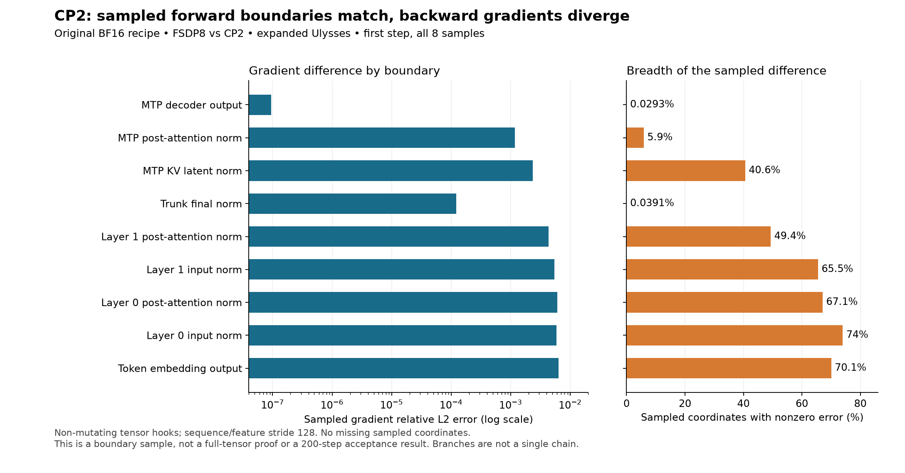
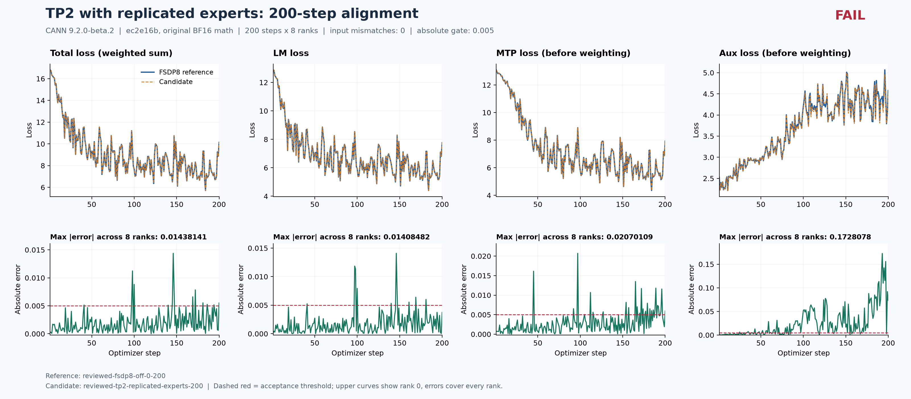
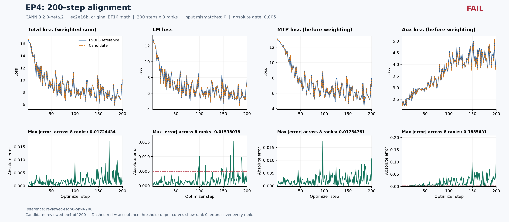
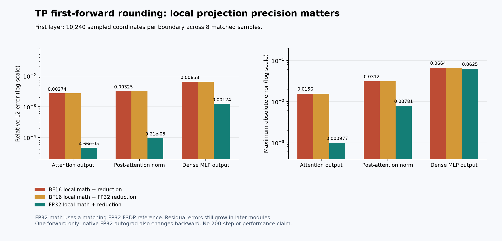
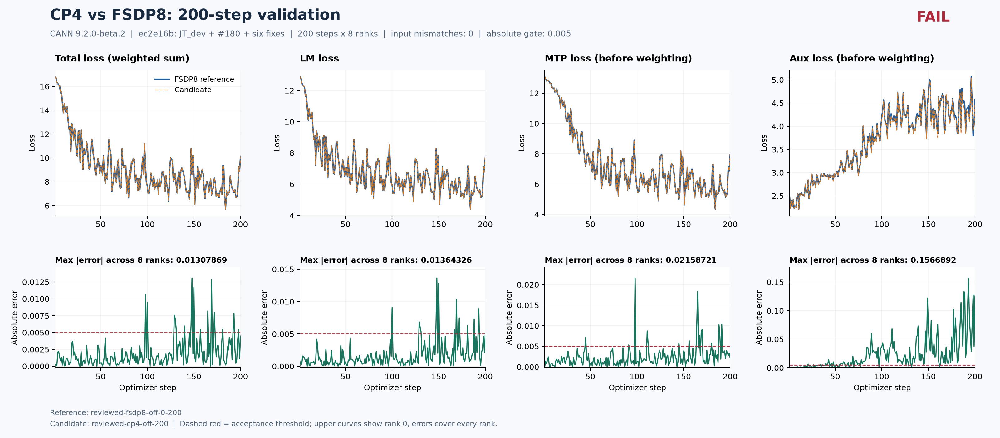
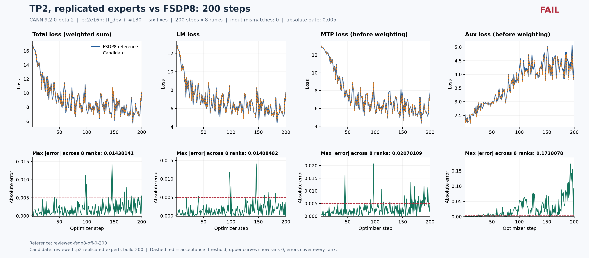

# JT DeepSeek-V3：当前结果与问题排序

**2026-10-15 已获授权在 125/129 空闲时恢复；每轮释放设备后至少间隔 20 分钟，不停止其他人的实验。** 以下已完成结果来自此前 125 的固定环境：FSDP 的 0→200、checkpoint200→400 已通过，跨拓扑精度仍有失败，不能宣布整体完成。最新 JT_dev 为 `521d3a8`，已合入用户指定的 [PR #180](https://github.com/hf1s/hyper-parallel/pull/180)。129 已使用 `/home/jt_image` 中经校验的 `jt-clean:hp-910b-20261009`（CANN 9.2.0-beta.2）完成新的 FSDP 0–200：8 rank 全步数、初始状态和输入记录完整，退出成功；尚待 200–400 续训及独立连续 400 步参考，不能把完整性通过当作跨运行精度通过。

[PR/Issue 双向索引](https://github.com/hf1s/hyper-parallel/issues/202)。公开总问题单：[#202](https://github.com/hf1s/hyper-parallel/issues/202)。

## 129 新镜像基线进展

源代码为最新 JT_dev `521d3a8`（含 #180）集成既有六项修复及 #200/#201，固定源 `a345081`、补丁 SHA256 `80310710…`。镜像 ID `5f9e677f…`；未使用镜像内旧 checkout。`r129-jtclean-fp32-fsdp8-build-0-200` 于 2026-10-15 完成，实验耗时 383.54 秒，去掉前 20 步后中位步时 1.17048 秒，峰值 allocated 22.28220 GiB / reserved 27.50391 GiB。保留 checkpoint200 共 27.973 GB 供续训，当前仅做了文件与 safetensors 头部完整性校验，恢复加载尚未验证。

八卡已释放且实验容器已删除；全局冷却结束时间不早于 2026-10-15T14:44:05（Asia/Shanghai），随后仍须重新确认八卡空闲。81 个日志及配置证据已下载并逐文件校验 SHA256；详见 [基线完整性](reports/jtclean-fsdp8-baseline-integrity.json)、[checkpoint 清单](reports/jtclean-checkpoint200-inventory.json)、[镜像与依赖预检](reports/jtclean-cpu-preflight.json)。129 与 125 驱动/固件不同，精度和性能对比使用各自同机参考。

## 按影响排序的问题

| Top | 问题与影响 | 当前证据与处理 |
|---|---|---|
| 1 | 跨 FSDP/TP/CP/EP 的 200 步精度仍超出 0.005 | 专家 BF16 权重梯度分区舍入和 Muon 更新敏感性已有独立算子及首步证据；TP 还有上游差异。FP32 专家梯度加完整 FP32 NS 的 EP2、CP2、TP2×EP2 长跑仍失败。生产补丁在125仅完成新的FSDP基线200步，完整矩阵未验收；现按新的资源间隔恢复定位。 |
| 2 | 梯度累积时使用错误的有效 token 分母 | [PR #194](https://github.com/hf1s/hyper-parallel/pull/194)。改为整步有效 token 数。TP2+EP2 的 LM 最大偏差由 0.92238 降至 0.01248，仍需处理 Top1。CPU 重现与真实 200 步对照均已保留。 |
| 3 | FSDP 初始化后保留完整源参数，浪费大量显存 | [PR #198](https://github.com/hf1s/hyper-parallel/pull/198)。释放已经消费的初始化容器引用。EP2 节省 9.422 GiB，CP2 节省 10.125 GiB；各 200 步、8 rank 同拓扑 loss/梯度误差均为 0。约 0.1% 的步时变化视为噪声。 |
| 4 | CP 拒绝分块输出 loss，阻断低显存训练 | [PR #199](https://github.com/hf1s/hyper-parallel/pull/199)。实现全 CP 有效 token 分母，重放不重复 collective。4 卡 ST 通过；demo 的 CP2 已能完成 200 步，跨拓扑数值问题仍单独跟踪。 |
| 5 | full 重算未覆盖完整 MTP decoder | [PR #195](https://github.com/hf1s/hyper-parallel/pull/195)。补齐 trunk/MTP block 识别、幂等与 JT 重入路径约束。旧配置 loss 相同并不能证明重算覆盖正确。 |
| 6 | 重算重放再次提交 MoE 路由计数 | [PR #196](https://github.com/hf1s/hyper-parallel/pull/196)。保留张量计算，只禁止重放的持久统计更新。覆盖 full/selective、不同 loss 路径及多微批；修复后 FSDP full/selective 200 步误差均为 0。 |
| 7 | 续训后累计 token/sample 监控从零开始 | [PR #197](https://github.com/hf1s/hyper-parallel/pull/197)。保存并恢复 meter 累计量，兼容旧 checkpoint。真实续训 200 步、8 rank 的 loss/梯度/累计计数与连续参考均一致。 |
| 8 | 专家局部权重梯度先舍入到BF16，FP32归约不能恢复 | [PR #200](https://github.com/hf1s/hyper-parallel/pull/200)。提供默认关闭的FP32累加选项，显式参数归属及FSDP消费。CPU与真实2卡累积/共享权重/重算ST通过；尚不代表跨拓扑200步达标。 |
| 9 | Muon NS输入、计算及更新传输的精度无法配置和恢复 | [PR #201](https://github.com/hf1s/hyper-parallel/pull/201)。保留BF16默认，新增可持久化的FP32选项和旧checkpoint兼容。CPU及真实8卡/2卡ST通过；原成本归因已撤回，保留BF16默认；两项精度选项合用在相同观测设置下步时增加24.25%，不能单独归因于NS。 |
| 10 | 普通 Shard 非整除重建错误，可能导致 rank 间通信不一致 | [Issue #211](https://github.com/hf1s/hyper-parallel/issues/211)。独立双进程 Gloo 已重现；补丁在 redistribution 与直接 reduce_partial 入口一致拒绝不支持的普通分片。DTensor UT 457 passed、41 subtests，双/四进程 ST 2 passed；Ascend 补丁回归待空闲设备，独立 PR 正在提交。 |

八个 PR 均为独立单提交，并经过 Standards / Spec 两轴检视及相应测试。当前仍为 draft，GitHub 没有已验证的完整 CI 成功结果；详细状态见 `evidence/pr-*-receipt.json`。目前修复中，#194 的正确性优先级最高，#198 的实测显存收益最明确。

## FSDP 顺序与验收口径

先从 step0 训练至 step200，落 checkpoint，再加载它完成 step201–400，并与独立连续400步参考逐步比较。含 #180 的原版本和六项修复集成都已完成这一顺序。

六项修复源 `ec2e16bce26e497519c573f0a8d87a538a329197` 的基线和续训，全部8rank的 LM、MTP、aux、total loss 及梯度范数最大绝对差均为0。续训累计 token/sample 也逐步相同。曲线误差取所有rank最大值，不使用平均误差代替门槛。

模型日志中的 MTP 带0.3权重，aux带0.0001权重。证据同时保留日志值和去权重后的分量；新补充检查也对未加权分量使用0.005。已有全部误差为0的通过项不受口径影响。原始完整性检查仍验证8rank、全部步骤、初始张量、逐步输入身份、LR、退出状态和完成标记。

## 当前数值诊断

以下为明确标记的诊断插桩，比较双方使用相同数值配方。它们不能代替生产实现验收。

| FP32专家梯度 + 完整FP32 NS（含runtime观测） | LM最大差 | 日志MTP最大差 | 日志aux最大差 | 未加权MTP最大差 | 未加权aux最大差 | 观测含开销秒/步 | 观测峰值allocated GiB |
|---|---:|---:|---:|---:|---:|---:|---:|
| FSDP8参考，200步 | — | — | — | — | — | 6.39175 | 22.28220 |
| EP2，200步 | 0.0194788 | 0.00905466 | 0.0000128801 | 0.0301822 | 0.128801 | 6.59964 | 21.18306 |
| CP2，200步 | 0.0152731 | 0.0106752 | 0.0000170822 | 0.0355840 | 0.170822 | 7.06310 | 20.70665 |
| TP2+EP2，200步 | 0.0149679 | 0.00571430 | 0.0000107335 | 0.0190477 | 0.107335 | 7.46236 | 15.93807 |

性能口径修正：上表四次诊断都开启了`model_integration: runtime`，原始性能基线使用`build`。此前把约6.8倍时间差归因于FP32 NS不成立，现撤回该归因；同口径数据现见下方成本记录；两项生产精度选项合用步时增加24.25%。EP/CP/TP的200步精度仍未达标。专家梯度补丁、Muon精度选项分别通过独立检视和CPU回归；两者合并后的定向CPU回归为133 passed、83 subtests。修正测试清理接口和空分片观察方式后，专家梯度真实2卡ST为1 passed，Muon真实8卡/2卡ST为2 passed，数值容差未放宽；首次失败证据保留。生产配置FSDP8、EP2、CP2、TP2×EP2各3步集成已完成，全部8rank退出成功且短跑误差小于0.005；不作为200步通过结论。

TP 首步的完整分块哈希已将首次偏离定位到第一层输出投影：Q/KV投影输出与 `o_proj` 完整输入共4,608块完全一致，而attention输出采样最大差0.015625。只升高归约精度没有改善；局部投影也使用FP32时，匹配FP32参考的最大差降为0.0009765625，非零采样点比例从38.4%降到0.039%，但后续MLP仍放大残差。FP32投影会改变基线配方，不能与旧BF16基线混用。

FSDP/TP的实际NS矩阵批次一致；EP/CP有4个参数从singleton变为batch2。逐矩阵NS以及叠加CPU FP64范数的三步消融均完成，仍存在非零差异。稳定范数使EP首步28个受观测参数在裁剪前后和更新后的摘要一致；该覆盖未包含全部专家参数，且CPU拷贝仅用于定位。

纯TP首次测试被融合gate/up连续切分保护拒绝。随后合法的“TP2稠密层、复制专家”配置完成3步：LM最大差0.0004425048828125、加权MTP 0.0002281665802001953、加权aux 5.0320522859692574e-8，全rank初始状态/输入/LR/步骤检查通过。该纯TP配置和EP4均已完成200步，仍未通过：LM最大差分别为0.014084816和0.015380383，未加权MTP为0.02070109和0.01754761，未加权aux为0.17280778和0.18556311。纯TP长跑继承runtime参数观测，7.13563秒/步不用于同原始build基线的性能比较；build模式200步现已完成，loss/梯度与runtime逐步完全相同；步时1.41685秒。成对阶段计时已保留。EP4使用build模式，记录1.02918秒/步、21.32290GiB allocated；该口径仍含输入身份采集。CP4已完成200步，LM最大差0.013643265、加权MTP 0.006476164，仍失败；步时1.67070秒，allocated 20.21775GiB。稠密层FP32权重梯度消融未消除CP首步的小参数梯度差异。CP首步所有采样前向边界相同；MTP输出梯度最早出现3.64e-12差异，embedding返回梯度的采样相对L2达到0.00633。该结果限于已采样坐标。进一步检查确认LM/MTP/aux的首步loss标量梯度相同；固定512位置的loss分块使MTP decoder输出和主干最终norm输出采样梯度一致，但更早层仍有差异，embedding梯度相对L2从0.00633降至0.00532。该分块消融只跑首步，未达到200步验收。详见[定位记录](reports/precision-localization-plan-v5.md)。

完整阶段证据：[并行数值诊断](reports/parallel-numerical-diagnosis.md)。

## 重计算性价比与灵活度

在本任务小模型、GBS8、seq4096下，关闭重算吞吐最高。40步独立A/B中，full节省3.095GiB、增加9.13%步时；现有selective节省2.407GiB、增加8.50%；单独MLP节省0.853GiB、增加1.91%。单独MTP block重算没有降低整步峰值，却增加约2.99%步时。norm的小幅时间差接近噪声。

MLP+norm组合另有200步验证，全部8rank的loss/梯度差为0，节省1.165GiB，步时增加约2%。这些模块选择为实验wrapper。JT当前YAML尚不具备MF的任意模块路径/层范围、排除及通信重算配置能力，不能把现有`selective`名称当作同等接口。

模块events是inclusive时间；进入/退出allocated差含输出和临时分配，不是保存激活大小。不能相加嵌套时间，也不能把单次运行的步间分布称为重复实验置信区间。完整口径及最新MF/Megatron固定源码引用见[成本分析](reports/recompute-cost-analysis.md)、[接口与源码对照](reports/recompute-reference-comparison.md)。

## 环境与数据保留

125的隔离目录为 `/home/xxl/jt-dev-8npu-20261014`，8×Ascend910B3 64GiB。CANN为9.2.0-beta.2 / V100R001C12B086，torch/torch_npu 2.12.0，Python3.12.14。最新核对JT_dev为`ad1c553`，#180 head为`5de3cce`。本任务模型为示例的两层trunk、一层MTP、8个路由专家，不能外推为完整DeepSeek模型的性能结论。

所有比较保留配置、源码提交/patch、editable导入路径、全rank标量、初始化及输入哈希、清单和可编辑SVG。完成续训对照后，按清单清理四份大型checkpoint，累计约104GiB；仅处理本任务文件。现已停止全部四条本任务队列及容器，未影响其他任务；保留生产FP32配方的step200 checkpoint约26GiB供后续明确恢复时使用。

## 暂停时补充证据

[同口径时间与显存](reports/matching-build-topology-costs.md)：本两层主干加一层MTP配置中，EP2/EP4/CP2/CP4/TP2均未获得吞吐收益；不同并行切分降低显存但增加通信或微批开销。比较保留输入CPU拷贝/哈希开销，单次结果不能外推完整DeepSeek模型。

另发现空分片下 `DTensor.full_tensor()` 重建形状异常：逻辑[1,64]在两rank分别返回[2,64]和[0,64]，原始失败日志已保留。独立修复尚未实现；Muon ST最终对本地分片进行零容差比较，不能视为此重建问题已解决。

新的生产FP32专家权重梯度＋FP32 NS配方完成FSDP 0–200及完整性自检，但续训200–400、独立连续400参考和生产配方跨拓扑200步均未开始。当前暂停不是完整目标验收通过。
