# JT八卡验证：问题排序、独立PR与证据总览

## 总体目标与当前结论

本单是 JT DeepSeek V3 八卡验证的**总问题单**，统一关联所有已拆分的小问题及独立 PR，维护优先级、复现证据、精度曲线、显存/性能、重计算与续训验收状态。每个已确认的独立缺陷或接口需求各用一个小问题单和一个单提交 PR，两个方向均能回到本单；不把多个缺陷混入同一个修复提交。

**当前源码FSDP基线、续训及off/full/selective重算已通过；TP2、TP4、CP2、CP4、EP2、EP4、EP8、TP2+EP2、TP4+EP4、CP2+EP2、TP2+CP2+EP2、TP2+CP2+EP4完整200步主LM均未过0.005；预定第一轮矩阵已采集完，精度目标仍未达成。** 最新固定上游为 `a1e6c222`，集成源为 `544526f7`，含用户指定#180及#230/#232。129的FSDP8基线0–200、checkpoint200恢复200–400分别对独立连续400的两个200步×8rank窗口，主LM及已有其余loss/梯度范数差全0，恢复计数6400项0差异；2026-10-18新增full和SAC selective各完整200步×8rank，也均零差、三处wrapper覆盖正确。当前TP2/TP4/CP2均从初态完成200步×8rank，主LM最大差分别为0.012035369873046875@97、0.011653900146484375@193、0.018723011016845703@188，分别12/14/13步超过0.005。输入、CPU构造初态及LR一致，具体根因尚待定位。CP4、EP2也已各完整200步×8rank，主LM最大差分别0.009692192077636719@148、0.009317398071289062@200，分别10/9步超0.005；EP2首步四项loss零差而梯度范数差1.9073486328125e-6，尚不能定位反向函数。EP4与EP8各完整200步×8rank的主LM最大差分别0.024294376373291016@188、0.013500690460205078@148，分别15/7步超0.005；首步loss相同但梯度范数已不同。新增TP2+EP2完整200步×8rank的主LM最大差为0.012468338012695312@146，共13步超0.005。TP4+EP4的新v3和CP2+EP2也各完整200步×8rank，主LM最大差分别0.012454986572265625@193、0.013238906860351562@97，分别3/7步超阈。最后两种组合TP2+CP2+EP2与TP2+CP2+EP4也各完整200步×8rank，主LM最大差分别0.017648696899414062@188、0.01790332794189453@97，分别7/16步超阈。预定14组矩阵（两种重算和12种并行拓扑）已完成第一轮采集；加上FSDP基线、续训与连续400，共十七次完整运行均exit0并释放。并行对齐仍未通过，后续继续具体根因定位和修复后完整回归。此前TP4+EP4的v2只完成169步×8rank即出现外部占卡，本任务停止并释放自有容器；该前缀不作完整验收或性能比较。v3从原初态独立新跑，其前169步各标量和输入与v2完全重现。历史结果不转写为当前通过。[续训验收](reports/a1e6-fsdp-resume-400/README_ZH.md)；[重算验收及成本三图](reports/a1e6-recompute-200/README_ZH.md)；[当前TP2失败及逐rank证据](reports/a1e6-tp2-200/README_ZH.md)；[当前TP4/CP2失败、两图与全rank资源](reports/a1e6-tp4-cp2-200/README_ZH.md)；[当前CP4/EP2两图与逐rank证据](reports/a1e6-cp4-ep2-200/README_ZH.md)；[当前EP4/EP8两图与逐rank证据](reports/a1e6-ep4-ep8-200/README_ZH.md)；[TP2+EP2完整失败及TP4+EP4中断边界](reports/a1e6-tp2ep2-200-tp4ep4-interrupted/README_ZH.md)；[TP4+EP4新完整结果及CP2+EP2两图](reports/a1e6-tp4ep4-cp2ep2-200/README_ZH.md)；[TP2+CP2+EP2/EP4最后两组完整结果](reports/a1e6-tp2cp2-ep2-ep4-200/README_ZH.md)。

**当前前向定位新增了真实使用点的局部因果证据。** 首个已观测完整边界差异在第0层q_b_proj输出：实际X/W逐字节相同，全宽N=24576的重算R与生产P全字节一致；两个N=12288权重行视图各重复两次，均精确重现此前实际TP2对应半片。与P对应片的全元素运行时最大差为0.015625/0.0078125、非零元素3976/3798。该旁路未回填训练，3步×8rank所测训练标量、输入和计数与原FSDP零差；科学证据和图已独立复核。结论只限一个真实投影使用点的形状效应，底层kernel与完整200步漂移根因仍未确认。[完整中文报告、两图及无Torch复算](reports/a1e6-qb-native-width-cause/README_ZH.md)。

**201后续工作已取消，仅保留历史跨机结果。** 同源129与201完整0–200比较的主LM最大绝对差为 **0.009525299072265625**（第189步），首超0.005为第125步，共8个超阈值步。源码、初态、数据、输入、runtime flags与完成/释放证据通过核验，但精度未通过。按用户2026-10-17最新指示，后续仅在125/129实验，不再排查或准备201迁移。[完整跨机结果、曲线与公开逐rank证据](reports/a1e6-cross-host-200/README_ZH.md)。

**历史固定配方 `18602c4` 的结果仍保留：**FSDP1–200及checkpoint200恢复后的201–400分别对独立连续400参考，8rank全部LM、日志及还原MTP/aux、总loss与梯度范数最大差均为0；off/full/selective三种重算也逐步一致。该版本EP2、CP2、TP2各自完整200步的主LM最大差为0.007523、0.011062、0.021448，均超过0.005。#232取消强制设置 `CLOSE_MATMUL_K_SHIFT=1`，会影响数值执行路径，历史结果不能重标为最新源码结果。

**当前执行顺序以用户最新目标为准：先解决主LM loss的完整200步对齐。主loss全部达到0.005以内后先停下来汇报，由用户决定是否继续MTP/aux专项；已有MTP/aux观测保留，但不把它们作为当前主loss排查的额外优化目标。**

当前阶段推荐优先检视#194的训练目标归一化修复和#198的源参数释放修复。全部14个已确认独立问题均有中文小问题单、独立单提交PR与原生父子关联；持续补充真实证据；#230已于2026-10-16 14:28（UTC+8）合入，#229随之关闭，其余13组问题保持开启、PR保持草稿。

**具体定位与参考实现已补核：**14组问题逐项列出固定PR提交的函数行锚、触发条件和两侧正确性依据；数值、重算与Muon另核对2026-10-16查询到的MF官方GitCode master `1c9258ca`、Megatron官方main `3e2807ce`及其实际Muon依赖。43个源码文件、211条函数/类声明和54处引用范围已复核。MF GitHub镜像当时仍为旧`5089da3`，不能作为最新官方master。Muon现有NPU ST比较的是同实现的分片/未分片实例；当前JT FP32 NS与MF的BF16 NS迭代也不是同一配方，均未包装成跨框架数学等价或长步漂移根因。[14组定位表、六类源码契约与消融后定位要求](reports/localization-contracts-20261016/README_ZH.md)。

**历史跨机环境与性能观测：**129（8×910B3 64GiB）与201（8×910B4 32GiB）的同源完整200步现已比较，该次主LM准入未通过；用户现已取消201后续工作。129原采集91文件及4份补充、201原采集92文件及6份补充均核验，实际八卡已释放。129/201预热后中位步时为1.1563/1.7298秒，allocator allocated同为22.0322GiB，reserved为27.25/26.78125GiB；这是跨硬件观测，不是并行策略收益。201物理HBM采样最高31,393MiB、最低采样余量1,375MiB，不能当作瞬时峰值；129本轮没有完整物理HBM采样。该历史阶段共享125/129按实际空卡与全局1200秒间隔调度；当前规则见文末最新资源说明。[完整新结果](reports/a1e6-cross-host-200/README_ZH.md)；[此前201单次运行证据](reports/a1e6-201-admission/README_ZH.md)。

201的step200 checkpoint另已完成CPU完整读回：25文件共27,973,262,840字节复核SHA，882个物理tensor分片全部有限，8rank的步数、两个scheduler、累计样本/token和保存的数据迭代计数与训练末步一致。读回容器限4CPU/8GiB、没有NPU映射，90.93秒后退出0并确认移除。设备RNG仅检查保存格式，未应用到NPU；**本检查没有执行DCP恢复、优化器更新或201–400步训练，不能替代续训及跨机精度验收**。[完整读回证据与实际检查源码](reports/a1e6-checkpoint-cpu/README_ZH.md)。

上一源码 `558eff5` 的三步head输入梯度局部替换改变了96次反向中的77,814个dX坐标，最大差1.1920928955078125e-7；主LM差第2步变大、第3步变小，不能宣称修复有效或完整200步达标。[三步定位历史证据](reports/e213-head-pad-dx/README_ZH.md)。

## 按影响排序的问题、子问题与独立 PR

排序依据依次是训练目标正确性、运行阻断、资源浪费、重算与恢复语义、精度配置和诊断可靠性。表中的“测试通过”不代表问题已合入或完整 CI 已通过；#230已合入、#229已关闭，其余小问题保持开启、PR保持草稿。

| 排序 | 问题与影响 | 小问题单 | 独立单提交 PR | 已有证据及剩余边界 |
|---|---|---|---|---|
| Top1 | 跨拓扑完整200步精度尚未通过 | 本总单的整体验收缺口 | 根因确认后继续拆分 | 当前544526f7的TP2/TP4/CP2/CP4/EP2/EP4/EP8/TP2+EP2/TP4+EP4/CP2+EP2/TP2+CP2+EP2/TP2+CP2+EP4各完整200步×8rank，主LM最大差分别0.01203537/0.01165390/0.01872301/0.00969219/0.00931740/0.02429438/0.01350069/0.01246834/0.01245499/0.01323891/0.01764870/0.01790333，分别12/14/13/10/9/15/7/13/3/7/7/16步超0.005。预定首轮矩阵已采集完，12种并行拓扑均FAIL，继续因果定位；不能把运行完成写成目标达成。TP4+EP4旧v2的169步中断记录另存，新v3从原初态完整执行并重现前169步。首个完整前向差异已缩到layer0 q_b输出，半宽旁路在一个真实使用点重现旧TP2原生字节；具体kernel与200步根因仍未确认。全局输入/CPU构造初态/LR一致；EP2/EP4/EP8首步loss相同仍不能排除内部前向差。当前FSDP基线、续训及full/SAC selective均零差；历史18602c4结果不混用，201已取消 |
| Top2 | 梯度累积按微批有效 token 归一化，改变整步目标 | [#203](https://github.com/hf1s/hyper-parallel/issues/203) | [#194](https://github.com/hf1s/hyper-parallel/pull/194) | 实际 Trainer 的不等长监督样例，正确梯度 14、旧行为 10；TP2×EP2 LM 误差显著下降但仍未过 0.005 |
| Top3 | FSDP 分片后仍持有完整源参数，显存不能释放 | [#204](https://github.com/hf1s/hyper-parallel/issues/204) | [#198](https://github.com/hf1s/hyper-parallel/pull/198) | EP2/CP2 分别减少 9.422/10.125 GiB；同拓扑 200 步 loss/梯度零误差 |
| Top4 | 测试调度器覆盖上层NPU可见列表，使设备分配越界 | [#223](https://github.com/hf1s/hyper-parallel/issues/223) | [#224](https://github.com/hf1s/hyper-parallel/pull/224) | 单提交2文件；无设备回归10测试/18子测试通过、两轴检视通过；不等同实际多卡训练验证 |
| Top5 | CP 分块输出损失的支持与回归覆盖 | [#205](https://github.com/hf1s/hyper-parallel/issues/205) | [#199](https://github.com/hf1s/hyper-parallel/pull/199) | 功能已由上游 #186 合入；#199 收敛为独立回归，新基点 CPU20项/25子测试及129四卡短步ST通过；每组2步，不代替200步验收 |
| Top6 | 完整重计算漏掉独立 MTP 解码器 | [#206](https://github.com/hf1s/hyper-parallel/issues/206) | [#195](https://github.com/hf1s/hyper-parallel/pull/195) | 定向重放用例通过；历史18602c4及当前544526f7的full/SAC selective均各完整200步×8rank全部所测loss/梯度范数零差，两个主干层和一个MTP内部decoder实际wrapper覆盖正确；不代表整个MTP外围都重算 |
| Top7 | 重计算重放重复提交专家路由 token 计数 | [#207](https://github.com/hf1s/hyper-parallel/issues/207) | [#196](https://github.com/hf1s/hyper-parallel/pull/196) | 保留必要张量运算，只约束持久副作用；均匀重复计数未必改变 sign 型 bias 更新，不能虚构旧 loss 漂移 |
| Top8 | checkpoint 续训后累计样本/token 指标清零 | [#208](https://github.com/hf1s/hyper-parallel/issues/208) | [#197](https://github.com/hf1s/hyper-parallel/pull/197) | 18602c4历史及当前544526f7均已完成201–400×8rank对独立400参考；当前四项恢复计数6400项零差，主LM及已有其余loss/梯度差全0；集成结果不全部归因于本PR |
| Top9 | 专家局部 BF16 权重梯度舍入不能由后续 FP32 归约恢复 | [#209](https://github.com/hf1s/hyper-parallel/issues/209) | [#200](https://github.com/hf1s/hyper-parallel/pull/200) | 默认关闭的 FP32 主梯度累加选项；CPU 与真实 2 卡累积/共享权重/重算 ST 通过，200 步组合验证仍待完成 |
| Top10 | Muon NS 精度无法显式配置并从 checkpoint 恢复 | [#210](https://github.com/hf1s/hyper-parallel/issues/210) | [#201](https://github.com/hf1s/hyper-parallel/pull/201) | 保留 BF16 默认；CPU、8 卡和 2 卡 ST 通过；可选 FP32 成本须匹配配方评估 |
| Top11 | Trainer向NPU写入无效CUDA属性，不能关闭预先开启的HF32 | [#227](https://github.com/hf1s/hyper-parallel/issues/227) | [#228](https://github.com/hf1s/hyper-parallel/pull/228) | 单提交2文件；真实TorchNPU选项及3项CPU测试/2项子测试通过，两轴检视通过；默认HF32关闭，未证明是CP/EP漂移根因，硬件训练未验 |
| Top12 | 非整除普通 Shard 重建返回错误形状或通信不一致 | [#211](https://github.com/hf1s/hyper-parallel/issues/211) | [#214](https://github.com/hf1s/hyper-parallel/pull/214) | 优化器无关的 Gloo 复现；入口一致拒绝不支持布局，457 项 UT/41 项子测试、2/4 进程 ST 通过；Ascend两卡各2项、四卡各1项通过，原提交未改；不代替200步训练验收 |
| Top13 | CPU 后端返回字符串设备索引，JT 模型构建报 TypeError | [#218](https://github.com/hf1s/hyper-parallel/issues/218) | [#219](https://github.com/hf1s/hyper-parallel/pull/219) | 单提交3文件；真实 CPU 路径修复前5失败，修复后20测试/7子测试通过；不代表125 NPU发现问题已修复 |
| Top14 | 资源MAX仅覆盖DP+CP，漏报其他TP/PP rank的耗时或显存峰值 | [#225](https://github.com/hf1s/hyper-parallel/issues/225) | [#226](https://github.com/hf1s/hyper-parallel/pull/226) | 单提交2文件；受控回归修复前4项子测试失败、修复后5测试/7子测试通过；旧69步前缀确认耗时及reserved漏报；新完整200步有51步时间漏报；真实8进程CPU/Gloo资源偏差64→0，NPU/PP训练通信仍待回归 |
| Top15 | FSDP动态派生的重算wrapper被覆盖报告漏计 | [#229](https://github.com/hf1s/hyper-parallel/issues/229) | [#230](https://github.com/hf1s/hyper-parallel/pull/230) | 真实三处区域报告为一处；采用真实基类isinstance，单提交2个已有文件；只新增1个回归，现有模块59项通过，lint通过；不新增测试文件；仅修报告；2026-10-16 14:28已合入JT_dev，#229随之关闭 |

目前优先推荐审阅 #194 的训练目标修复和 #198 的源参数释放修复：前者有明确的数学反例，后者有显著且可解释的实测显存收益。#200/#201 是显式可选数值配方，尚无足够证据默认启用。#214 的边界是明确拒绝尚不支持的普通非整除分片，不是实现其收集算法。

已固定的独立提交：#194 `bad2550`、#195 `00ae8a7`、#196 `d1f5213`、#197 `bd18261`、#198 `b948684`、#199 `e9fc94d`（旧提交 `d86b74e` 保留备份）、#200 `630d543`、#201 `59a03c6`、#214 `453618a`、#219 `86930dd`、#224 `a37d6bc`、#226 `b58fed7`、#228 `453fe57`、#230 `85b091b`。各 PR 的完整 SHA、文件范围和定向测试以对应 PR 及回读凭据为准；集成测试含多个修复，不能全部归功于单一 PR。

## 当前固定环境

最新固定 JT_dev 为 `a1e6c222eab097c9609d6e744a3c5f98aeed6bdc`，集成验证源为 `544526f7db8342c607244fd41009b2a74adb84c8`，当前只在125/129继续实验并核对editable导入；201部署与运行记录保留为历史。它在上一集成源 `558eff5` 上加入#232：不再强制 `CLOSE_MATMUL_K_SHIFT=1`，配套3项UT通过。#180、#186及#230均已包含。2026-10-18 06:29UTC再次只读查询，官方JT_dev仍为a1e6c222，#180合入提交521d3a8为544526f7祖先，固定工作树保持干净。#214/#219/#224/#226/#228仍是独立验证，不冒称全部进入训练源。[历史源码与环境证据](reports/a1e6-201-admission/README_ZH.md)；[上一e213阶段记录](reports/latest-jt-e213-sync/README_ZH.md)。

| 项目 | 固定值 |
|---|---|
| 训练资源 | 仅125/129实际空闲八卡；用户2026-10-18改为连续实验约2小时、当前轮释放后休息10分钟，取消逐轮20分钟；新本机周期入口已部署并用于TP4/CP2及后续原生短步诊断；201已取消 |
| CANN | 9.2.0-beta.2 / V100R001C12B086 |
| Python / Torch / TorchNPU | 3.12.14 / 2.12.0+cpu / 2.12.0；PTA Git `fa0f83fe49d309dcbc31e264e9e6ed6e5dc49d2d` |
| Transformers / datasets | 5.13.1 / 4.8.5 |
| 镜像 | `jt-clean:hp-910b-20261009`，ID `sha256:5f9e677f439d11ab4e7c888f54b142335a27eee7411cbd2ce894a4798a70146d` |
| 用户镜像原文件 | `/home/jt_image/four-images-clean-20261009/HP-910B/hp-910b-arrow.tar.gz`，保留不删 |
| 代码导入 | `/workspace/hyper-parallel` 的挂载editable checkout，启动时核验，不使用镜像内旧代码 |
| 模型 / 数据 | 2层主干＋1层MTP，8专家/top2，hidden5120、vocab152064；Arrow4710行，seq4096、GBS8/MBS1 |
| 数值配方 | BF16参数、FP32归约和主参数，专家FP32权重梯度及Muon NS FP32；不是全模型FP32 |
| 固定训练项 | seed42、dataloader seed1234、constant LR0.0001、整步token目标、MTP0.3/aux0.0001、chunk loss4096 |

训练入口为 `examples/training_demo/jt_deepseek_v3`。下列原始证据目录含完整YAML、解析配置、启动代码、初态/输入哈希、逐rank标量和退出/释放凭据；原训练文本不上传。复现需要同时保留这些身份与数值记录。

## 统一验收标准

1. 固定源码、镜像、CANN、数据及优化器配方，先跑 **FSDP8 的 step1–200**，保存 step200 checkpoint；另起进程加载后跑 **step201–400**，再与独立连续 step1–400 参考比较。
2. 固定全局 batch8、微批1、序列4096、seed42、输入顺序、学习率与初始化。合法 TP、CP、EP 及混合策略各跑 200 步，与同精度配方的 FSDP8 比较。改变精度选项必须重新建立基线、续训与连续参考。
3. 当前先验收全部8rank、全部200步主LM loss最大绝对差≤0.005；主loss全矩阵通过后先停下来汇报，由用户决定是否继续MTP/aux专项。MTP/aux既有观测继续保留，同时列出日志加权量和按0.3/0.0001系数还原的未加权量，不改变系数掩盖误差。
4. 初始化/输入身份、步数、rank 覆盖、LR、有限值、退出码、完成标记、恢复计数另外验收。输入哈希相同不能替代 loss 验收；运行完成和自比较零误差也不能替代独立参考。
5. 关闭、完整、选择重算各跑 200 步；模块选择消融注明步数和测量边界。报告 allocated/reserved 峰值及预热后中位步时，数据采集开销保持一致。
6. 每个修复以独立最小回归、相应分布式用例和规范/验收条件两轴检视作为证据；保留首次失败与修复后结果。开放问题不能仅靠 PR 已创建或某个标签关闭。
7. 消融结果必须继续定位到具体函数/算子、源码行和触发条件。核验FSDP基线与并行两侧的目标函数、前向/局部VJP、归约与优化器状态；比较前还原逻辑tensor、token和参数身份，不直接比较同编号物理rank。可控局部替换只能作为因果实验，不能靠强制复制loss、整层梯度或参数制造对齐。每个确认问题的小issue/单commit PR须同时交代根因、数学或接口契约、MF官方master PyNative及Megatron主线的固定源码依据、修复前后定向回归和完整200步的实际覆盖范围。尚未定位的漂移和已被否决的候选继续在总单追踪，不冒充已确认的新缺陷。

## 544526f7前向定位：q_b半宽旁路重现真实TP2输出

在实际UNSHARDED参数使用点，按全局逻辑坐标比较首步8个batch：linear_qkv与kv_b的W/X/Y全字节相同，q_b的W/X相同但输出4722/12288块不同；648个网格点恰好零差，不能把采样相等当完整张量一致。o_proj的原始输出是不同K分区贡献，未离线求和或强配；完成原生产归约后的attention出口仍不同。具体固定源码、native元数据及两图见[完整报告与可复算包](reports/a1e6-qb-native-width-cause/README_ZH.md)。

进一步在batch SHA `17c01af6…`、第1步micro0观察FSDP rank2，对应旧TP2 rank4/5及全局输出feature两半。实际M/K固定4096/1536，N为24576或12288；原生产P在任何旁路执行前完整哈希，随后全宽R与P全部1536块相同。两个原W行视图各重算两次，每次半片768块均与旧实际TP2对应输出相同，两次重复自身也零差。

| 本次真实P与旁路对比 | 全元素比较范围 | 非零元素 | 全元素最大差 | 半宽重复与旧TP2字节关系 |
|---|---:|---:|---:|---|
| 全宽P对全宽R | 100663296 | 0 | 0 | 全宽校准全部原生块相同 |
| P半0对V0，两次 | 每次50331648 | 各3976 | 0.015625 | 两次各768块均与旧TP2半0相同 |
| P半1对V1，两次 | 每次50331648 | 各3798 | 0.0078125 | 两次各768块均与旧TP2半1相同 |

非零数和最大差来自本次生命周期内的全元素slab比较；旧TP2只保存native SHA与稀疏网格，不能从旧哈希离线恢复全部数值。半宽还改变权重视图的形状及第二半storage offset；本次未观测具体kernel、tiling或内部格式。数据支持该使用点的局部形状效应，尚不能外推为完整训练漂移的唯一原因。

本次FSDP旁路3步×8rank的total/LM/加权MTP/aux、日志梯度范数、LR、四项计数与input_identity，对原FSDP200步前三步全部零差；旧attention FSDP/TP2也各自对原拓扑前缀零差。全部原件SHA、实际X/W、逻辑rank配对、11项原状态不变量、退出与自有容器释放已独立核验。真实CPU13项通过只验证小矩阵与观察契约；短步透明性不代替200步验收。

显式预算为CPU Tensor52MiB（48MiB slab加4MiB scratch）、额外活跃NPU输出192MiB，未计未知workspace/allocator缓存；它们不是实测CPU/HBM峰值或训练性能收益。后续用带梯度的原宽控制与补零短臂量化首步主LM贡献，保留autograd与FSDP hook边界；当前还没有新的200步修复结论。

## 544526f7当前结果：TP2完整200步失败与定位入口

129的 `r129-a1e6-tp2-200-v2` 已完成200步×8rank、exit0并释放。主LM最大差 **0.012035369873046875@97**，超阈值步为97、98、100、148、154、157、167、169、173、181、188、193，共12步。逐步输入哈希、CPU构建初态、数值配方和LR一致；这些检查不证明切分、设备搬运后全部参数与内部状态字节相同。第一步LM已经差0.0004949569702148438，发生在首次优化器更新前；当前前向定位已缩到q_b实际输出及上述半宽旁路，具体底层kernel与完整200步根因仍未确认，不把漂移归咎于优化器或某个既有PR。[完整中文报告、四列精度图及公开证据](reports/a1e6-tp2-200/README_ZH.md)。

相同8卡/GBS8下，DP8变成DP4×TP2，微步由1变2。全rank MAX、去前20步中位步时为1.855199秒，监督token/s为9975.38；allocator allocated/reserved累计峰值为17.294672/18.638672GiB。对off连续参考前200步，allocated减少4.737524GiB（21.50%），步时增加60.51%、吞吐下降37.65%。43步rank0计时低报，资源采用逐步全8rank MAX重算；精度未过，因此此表仅作诊断，不能推荐为已验收的收益。TP复制权重在FSDP4下反而有更大的持久分片，不能按TP2宣称参数或全部显存减半。单次观测、输入哈希开销和allocator累计峰值边界详见报告。

## 544526f7当前结果：TP2+CP2+EP2与TP2+CP2+EP4完整200步均失败

两组均从原初态完成200步×8rank、exit0并释放；对FSDP基线与连续400前200步的独立比较得到相同结论。主LM最大差分别为 **0.017648696899414062@188**、**0.01790332794189453@97**；EP2组合超阈步骤为91、112、148、164、188、189、200，共7步，EP4组合为81、83、97、98、126、127、130、146、148、164、167、181、188、191、193、200，共16步。两者首步主LM差均0.0005435943603515625。全局输入哈希、LR与6400项计数一致；每步微批数从1变4，因此不要求包含微批划分的整个input_identity对象与基线相同。CPU构造初态一致不能代替设备使用点权重与优化器内部状态一致。[详细中文报告、两图和可复算逐rank证据](reports/a1e6-tp2cp2-ep2-ep4-200/README_ZH.md)。

两组都是DP2×CP2×TP2、每步4微批，dense42项走FSDP4×TP2，expert4项分别为EDP4×EP2、EDP2×EP4。本地FP32 main总元素同为362170368，其中28项TP复制dense参数导致总量比FSDP8多22422528；CP和EP不能再乘成额外的dense参数分片倍数。

对照同配方off连续参考前200步，两组候选的全rank MAX、去前20步中位步时分别为2.385694/2.377774秒，监督token/s为7741.50/7768.78；allocator allocated为12.693195/12.678276GiB，reserved为15.515625/15.224609GiB。相对off参考，allocated少42.39%/42.46%，步时增加106.41%/105.72%，吞吐下降51.61%/51.44%；两组rank0时间分别有16/150步低报，均用全8rank逐步MAX重算。约0.332%的步时差来自各一次运行，不能判定EP4优于EP2，也无算子级耗时归因；精度失败配置仅记录诊断成本。

## 544526f7当前结果：TP4+EP4新v3与CP2+EP2完整200步均失败

TP4+EP4 v3和CP2+EP2均从原初态独立完成200步×8rank、exit0并释放，全部输入、CPU构造初态、runtime配方、LR与6400项计数检查一致。主LM最大差分别为 **0.012454986572265625@193**、**0.013238906860351562@97**。TP4+EP4超阈步骤为146、179、193，共3步；CP2+EP2为97、98、146、164、167、172、193，共7步。首步主LM差分别0.0005884170532226562、0.00013446807861328125，具体根因仍未定位。[详细中文报告、两张精度曲线与公开逐rank证据](reports/a1e6-tp4ep4-cp2ep2-200/README_ZH.md)。

v3仅相对TP4+EP4旧v2更换输出目录，从step0执行、没有恢复checkpoint。前169步×8rank的全部loss、梯度范数、LR、4项计数和input_identity均与旧中断v2零差；该重现不把旧169步升级为完整验收。旧中断原件、外部冲突释放事实和此前发布快照均保留。

对off连续参考前200步，TP4+EP4/CP2+EP2全rank MAX、去前20步中位步时为2.135075/1.622048秒，监督token/s为8645.72/11406.57，allocator allocated为11.149884/19.535376GiB，reserved为11.710938/25.572266GiB。allocated分别少49.39%/11.33%，步时增加84.72%/40.34%，吞吐下降45.96%/28.71%；这些是未通过精度配方的单次诊断成本，不是已验收收益。TP4+EP4有146步rank0时间低报，统一采用每步8rank MAX；CP2+EP2无该低报。

实际TP4+EP4为dense FSDP2×TP4、expert EDP2×EP4，28项TP复制参数使本地FP32 main总元素407015424，比基线多67267584；allocated下降不能解释为持久参数全部除4。CP2+EP2为DP4×CP2、dense42项FSDP8×TP1、expert4项EDP4×EP2，本地FP32 main总元素339747840逐项与基线相同，不能将CP或EP再乘作额外参数分片倍数。尚无算子级耗时归因。

## 544526f7当前结果：TP2+EP2完整失败与TP4+EP4旧v2中断记录

TP2+EP2从原初态独立完成200步×8rank、exit0并释放，输入、CPU构造初态、计数、LR与执行核验通过。主LM最大差 **0.012468338012695312@146**，共13步超过0.005，步骤为81、83、97、126、130、134、135、146、148、153、189、193、200。首步主LM差0.0004949569702148438，具体函数根因未确认。[完整曲线、逐rank证据及中断说明](reports/a1e6-tp2ep2-200-tp4ep4-interrupted/README_ZH.md)。

同条件off连续参考前200步比较，TP2+EP2全rank MAX、去前20步中位步时为1.837146秒，监督token/s为10065.69；allocator allocated/reserved累计峰值为15.812039/17.175781GiB。allocated少28.23%，步时增加58.95%、吞吐下降37.09%，只作失败配方的单次诊断成本。实际28项TP复制dense参数由FSDP8变FSDP4，本地FP32 main总元素362170368，比基线多22422528，不能沿用纯EP的总持久参数不变结论。

TP4+EP4原v2运行在全部rank记录到169步后出现真实他人计算进程。守护器先核实外部进程不属本任务，再停止、释放并移除自有容器，最终退出137；这是外部冲突中断，不能仅凭137归因为OOM。75份私有原件完整核验，公开包只收录脱敏的39份实际存在运行文件及中断摘要，没有伪造EXIT_CODE、完成标记或最终显存。169步×8rank前缀的输入、计数、LR和CPU初态检查零不一致，主LM前缀最大差0.008181571960449219@146；这不是完整200步验收，不发布性能收益或完整训练结论。随后独立v3 case已从原初态完成200步，完整结果见上节；v2原始记录继续保留，不能称为从169步续训。

## 544526f7当前结果：EP4与EP8完整200步均失败

EP4与EP8均独立完成200步×8rank、exit0并释放；逐步输入、CPU构造初态、计数、数值配方和LR核验一致。主LM最大差分别为 **0.024294376373291016@188** 与 **0.013500690460205078@148**，分别15/7步超过0.005，尚未通过。EP4超阈值步为130、146、148、157、158、167、172、173、181、188、189、193、198、199、200；EP8为97、126、146、148、173、181、193。[详细中文报告、两张完整曲线和公开逐rank证据](reports/a1e6-ep4-ep8-200/README_ZH.md)。

两者首步主LM、总loss、加权MTP与aux日志均与FSDP8相同，裁剪前梯度范数却已差1.9073486328125e-6，loss从第2步出现非零差；这些末端标量不能证明全部前向或梯度相同，也不能直接归咎于某个优化器函数。CPU构造初态一致的边界仍是JT MLA替换后、设备搬运/TP/FSDP之前，实际使用点的NPU权重与内部状态仍须核验。

对off连续参考前200步，EP4/EP8全rank MAX、去前20步中位步时为1.320180/1.326078秒，监督token/s为13967.11/13899.69，allocator allocated为21.080860/21.100903GiB，reserved同为26.333984GiB。allocated仅少4.32%/4.23%，步时增加14.22%/14.73%；这是单次失败配方的诊断成本，不是已验收性能收益或显著性结论。实际dense42项仍为FSDP8，expert4项分别为EDP2×EP4、EDP1×EP8；FP32 main本地元素总和339747840与基线一致，不能按EP4/EP8将总持久参数再除4/8。未做算子级耗时归因。

## 544526f7当前结果：CP4与EP2完整200步均失败

CP4与EP2均从初态独立完成200步×8rank、exit0并释放，输入、CPU构造初态、计数、LR与执行核验通过。主LM最大差分别为 **0.009692192077636719@148** 与 **0.009317398071289062@200**，分别10/9步超过0.005；完整曲线、其他日志loss及按系数还原观测见[详细中文报告](reports/a1e6-cp4-ep2-200/README_ZH.md)。这两项仍未通过，未新增未经定位的产品修复PR。

CP4首步LM差0.00012874603271484375，仍优先核查首次更新前前向。EP2首步四项loss全部相同，但梯度范数已有1.9073486328125e-6差，四项loss从第2步出现差异；范数差不能定位到某个反向算子，loss标量相同也不证明完整前向张量相同。48项CPU初态是在JT MLA替换后、设备搬运/TP分片/FSDP之前采集，不能代替实际NPU权重与内部状态验证。

对off连续参考前200步，CP4/EP2全rank MAX中位步时分别1.993121/1.318687秒，监督token/s为9275.45/13990.34，allocated为19.866190/20.929016GiB，reserved为24.828125/26.255859GiB。allocated分别少9.83%/5.01%，步时增加72.44%/14.09%；单次失败配方只作诊断。CP4仍为dense FSDP8、每步4微批；EP2为dense42项FSDP8及expert4项EDP4×EP2，FP32 main局部元素合计339747840与基线相同，不能把EP2当作总参数再减半。

## 544526f7当前结果：TP4与CP2完整200步均失败

TP4（DP2×TP4、FSDP2、SP/loss parallel、每步4微批）与CP2（DP4×CP2、FSDP8、每步2微批）均独立完成200步×8rank、exit0并释放。两者逐步输入、CPU构造初态、计数、数值配方与LR检查通过；主LM仍分别为0.011653900146484375@193和0.018723011016845703@188，超过0.005的步骤分别14和13个。两个首步LM差为0.0005884170532226562和0.00013446807861328125，先做首次更新前的原生前向定位，不将完整性通过、CPU初态一致或历史消融当作具体算子已定位。[详细中文报告、两张精度图与四次运行公开证据](reports/a1e6-tp4-cp2-200/README_ZH.md)。

| 全rank资源，21–200步时间 | FSDP8 off连续参考 | TP4 | CP2 |
|---|---:|---:|---:|
| 中位秒/步 | 1.155826 | 2.354883 | 1.593995 |
| 有效监督token/s | 15999.35 | 7845.77 | 11604.90 |
| Allocated峰值GiB | 22.032196 | 13.556466 | 20.706646 |
| Reserved峰值GiB | 27.171875 | 14.386719 | 25.943359 |

TP4 allocated少38.47%，中位步时增加103.74%；CP2 allocated少6.02%，中位步时增加37.91%。TP4的复制权重走FSDP2，初始FP32 main布局2.043594GiB高于基线1.265659GiB，不能按TP4宣称持久参数全部缩小四倍。CP2的dense FSDP仍为8路，持久参数不因序列切分减半。不同微批数、通信和临时materialize会影响资源；没有算子级profile归因，精度失败配置不能推荐为已验收优化。TP4有95步rank0计时低报，表中统一采用每步8rank MAX。MTP/aux日志与按系数还原值详见报告，仅保留诊断范围。

## 544526f7当前结果：完整200步重算与成本

2026-10-18，129的full与默认SAC selective各自从初态独立完成200步×8rank，exit0并释放；两种策略的主LM、日志与按系数还原MTP/aux、总loss、梯度范数、LR和输入与off基线均零差，三处wrapper覆盖两个主干decoder及MTP内部decoder。四次原manifest共364文件经独立SHA核验。[完整报告及三图](reports/a1e6-recompute-200/README_ZH.md)。

| 同配方、每步全部8rank MAX | off连续参考前200 | full | selective（SAC） |
|---|---:|---:|---:|
| 去前20步中位秒/步 | 1.155826 | 1.234299 | 1.231250 |
| 有效监督token/s | 15999.35 | 14947.21 | 14972.48 |
| Allocated累计峰值GiB | 22.032196 | 19.392933 | 19.875641 |
| Reserved累计峰值GiB | 27.171875 | 24.320313 | 24.789063 |

Full与selective分别少用2.639263/2.156555GiB allocated，步时增加6.79%/6.53%。二者步时仅差0.247%，单次观测不能判定稳定性能胜负；full在本样本提供更多显存余量。off仍保留chunked head/CE内置重算，步时含标量/输入哈希采集，显存不是物理HBM瞬时峰值。当前SAC不等于MF式模块路径选择；JT缺少adapter-safe provider，模块ROI尚未硬件实测。[最新MF/Megatron固定源码、边界与候选方案](reports/a1e6-recompute-200/flexibility/README_ZH.md)。

## 18602c4历史结果：FSDP基线与续训两个独立200步窗口通过

以下至“待完成项”之前的长跑、资源表与定位记录均注明对应源码，主要为18602c4阶段证据；不作为最新544526f7的验收结果。

基线 `r129-f637-fp32-fsdp8-0-200-r4` 完成1–200，保留step200 checkpoint；新进程 `r129-f637-fp32-fsdp8-200-400-r2` 从该checkpoint恢复至400。比较参考是从初始化独立连续跑400步的 `r129-f637-fp32-fsdp8-continuous400-r3`。

| 全8rank、全200步最大绝对差 | LM | 日志及还原MTP | 日志及还原aux | total loss | 梯度范数 | 结论 |
|---|---:|---:|---:|---:|---:|---|
| 基线1–200 vs 连续参考1–200 | 0 | 0 | 0 | 0 | 0 | 通过 |
| 续训201–400 vs 连续参考201–400 | 0 | 0 | 0 | 0 | 0 | 通过 |

源码、镜像、数值配方、初始化、输入、LR、逐步和累计计数、退出码/完成标记均核验。还原MTP/aux由日志除以0.3/0.0001得到，没有额外采集加权前张量；梯度结论只涉及范数。

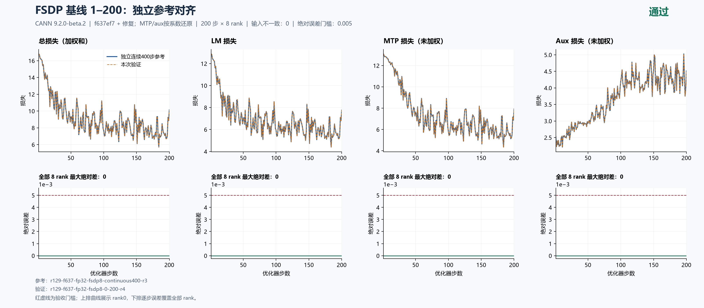

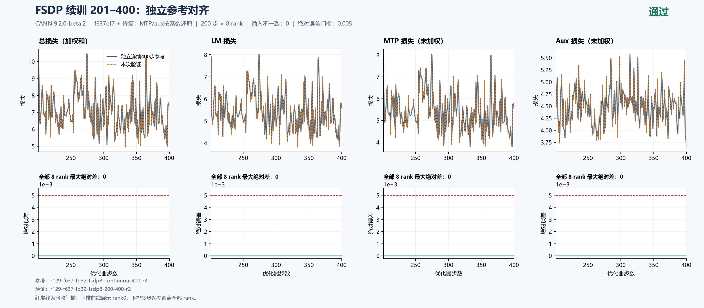

[基线严格比较](reports/f637-fsdp8-continuous400-r3-complete/f637-fsdp8-baseline-independent-comparison.json) · [续训严格比较](reports/f637-fsdp8-continuous400-r3-complete/f637-fsdp8-resume-independent-comparison.json) · [独立连续参考全部证据](reports/f637-fsdp8-continuous400-r3-complete)。

## 18602c4历史结果：TP2完整200步

TP2第四轮`r129-f637-fp32-tp2-200-r4`完整完成200步×8rank，退出0，517.637332秒后释放八卡，无本任务残留。与FSDP8基线的输入、初态、计数、源码、镜像及数值配方检查通过；独立数值与资源复算也确认原始证据有效，**训练精度FAIL**。LM/还原MTP/aux最大差分别为**0.0214481354/0.0246699651/0.1558382064**，首次超过0.005分别是111/45/19步。旧中断轮共同1–69步的全部loss和梯度范数与本轮差0，未拼接前缀。

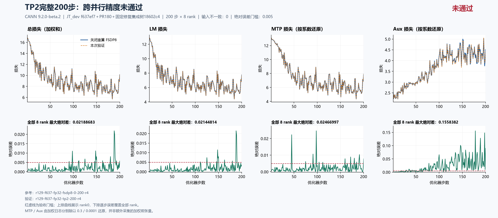

| 当前配方完整200步 | LM最大差 | 还原MTP最大差 | 还原aux最大差 | 验收 |
|---|---:|---:|---:|---|
| EP2 | 0.007523060 | 0.015432835 | 0.138989417 | 未通过 |
| CP2 | 0.011061668 | 0.022786458 | 0.204604585 | 未通过 |
| TP2 | 0.021448135 | 0.024669965 | 0.155838206 | 未通过 |

TP2 allocated/reserved峰值17.294672/18.638672GiB，allocated较FSDP8节省4.737524GiB（21.5027%）；逐步8rankMAX、去前20步后的中位步时1.857553秒（+60.8268%），监督token吞吐9957.676842/s（-37.7972%）。实际布局DP4×TP2，开启SP/loss_parallel、每步两个微批并保持路由/专家权重TP复制；不是仅改tp_size。显存下降方向符合分片预期，但本次没有吞吐提升；通信/矩阵尺寸的各自份额尚无profile证明。单次观测含输入采集开销，精度FAIL的配置不能推荐为已验收方案。

rank0有51/200步漏报最慢TP lane时间，最大1.213431毫秒；本轮allocated/reserved没有rank0峰值漏报，与旧69步记录分开。离线汇总已校正，进一步补充#225/PR#226的真实修复前证据；该PR原单提交不变，真实NPU修复后通信成本仍待测。

76份原始文件SHA全部核验，传输重复包两端清理，checkpoint200保留。当时设备实验按释放后至少20分钟及空卡复查策略执行；FSDP/CP2×原生/FP32输入梯度的四臂三步诊断保持LR、数据和0.005门槛，不替代200步验收。

[详细配置、复现和资源解释](reports/f637-tp2-r4-complete/README_ZH.md) · [严格全rank比较](reports/f637-tp2-r4-complete/f637-tp2-r4-strict-comparison.json) · [数值独立复算](reports/f637-tp2-r4-complete/f637-tp2-r4-precision-independent-review.json) · [资源与释放独立审计](reports/f637-tp2-r4-complete/f637-tp2-r4-resource-independent-review.json)。

## 18602c4历史结果：CP2完整200步

`r129-f637-fp32-cp2-200`完成200步×8rank，退出0，462.81秒后释放全部8卡，无本任务设备PID残留。启动满足前轮释放后的全局20分钟间隔，源`18602c4`、镜像、CANN9.2.0-beta.2和归一化数值配方与FSDP基线一致。76份原始文件大小/SHA逐一核验，两端重复归档已删除；全部输入、48项记录初态、计数和LR检查通过，精度门槛失败。

| 完整200步、全8rank最大绝对差 | LM | 日志MTP（×0.3） | 按系数还原MTP | 日志aux（×0.0001） | 按系数还原aux |
|---|---:|---:|---:|---:|---:|
| CP2 对同配方FSDP8 | 0.0110616684 | 0.0068359375 | 0.0227864583 | 0.0000204605 | 0.2046045847 |

LM最大差出现在第148步，MTP第98步，aux第172步。总loss最大差0.0140056610，梯度范数最大差0.6418290138；未加权量是日志标量按真实配置系数还原，不是额外采集的加权前张量。这里确认的是跨拓扑精度失败，尚未确定新的独立根因；继续在Top1追踪，不能用资源统计修复解释这些数值差异。

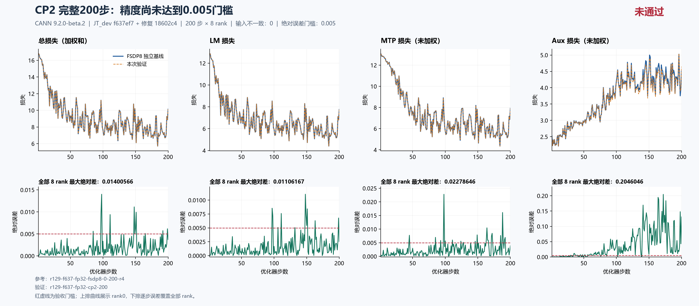

| 同主机同配方资源观测 | FSDP8 | CP2 |
|---|---:|---:|
| 每步全部rank MAX、去20步后中位秒/步 | 1.155003 | 1.596322 |
| 监督token/s，实际有效token只计一次 | 16008.4066 | 11586.1031 |
| 全程累计峰值allocated GiB | 22.032196 | 20.706646 |
| 全程累计峰值reserved GiB | 27.250000 | 25.982422 |

allocated减少1.325550 GiB，约6.02%；中位步时增加约38.21%。CP2在本配置中将逻辑序列分段由4096降为2048，dense FSDP仍为8路，优化器步由1个变为2个微步；参数与优化器持久状态没有CP倍数的分片收益。通信及微步变化是需要关注的成本，但本轮没有算子级归因。精度未通过，且只测了一次，这些数据只用于诊断，不能推荐为达到精度目标后的最优方案。

[严格精度比较](reports/f637-cp2-200-complete/f637-cp2-200-strict-comparison.json) · [完整分析](reports/f637-cp2-200-complete/f637-cp2-200-complete-analysis.json) · [76份采集清单](reports/f637-cp2-200-complete/f637-cp2-200-complete-evidence-manifest.json) · [原始8rank记录](reports/f637-cp2-200-complete/raw/runs/r129-f637-fp32-cp2-200) · [全rank资源观测](reports/f637-cp2-200-complete/f637-cp2-200-all-rank-resources.json) · [匹配参考资源](reports/f637-cp2-200-complete/f637-fsdp8-r4-all-rank-resources.json) · [SHA及清理凭据](reports/f637-cp2-200-complete/f637-cp2-200-complete-local-verification.json) · [完整结果独立复算检视](reports/f637-cp2-200-complete/f637-cp2-200-independent-evidence-review.json)。

CP2结束后已完成当前配方FSDP8完整重计算200步，详见本单最新结果；selective和TP2现已完成；TP2精度仍失败，接续优先做当前配方单变量短步定位，再补齐其余并行矩阵。该阶段采用释放后至少20分钟及空卡复查策略；后续按本单末尾的最新资源策略执行。

## 18602c4历史结果：EP2完整200步

`r129-f637-fp32-ep2-200`在满足全局20分钟间隔后，完成200步×8rank，退出0，407.33秒后释放全部8卡。76份文件大小/SHA逐一核验，两端重复压缩包已删除。固定源仍为`18602c4`、CANN9.2.0-beta.2；本轮运行完整，源码/配方/镜像、输入、初态、计数与LR等完整性检查无不一致，但精度门槛失败。

| 全8rank、完整200步最大绝对差 | LM | 日志MTP（×0.3） | 还原MTP | 日志aux（×0.0001） | 还原aux |
|---|---:|---:|---:|---:|---:|
| EP2 对同配方FSDP8 | 0.0075230598 | 0.0046298504 | 0.0154328346 | 0.0000138989 | 0.1389894169 |

加权MTP单项小于0.005，不能掩盖还原分量超阈值；LM也超过0.005。原始误差与完整性检查均由未修改的严格比较器重新计算，根因仍在定位，不能把这些差异归因于新资源统计修复。

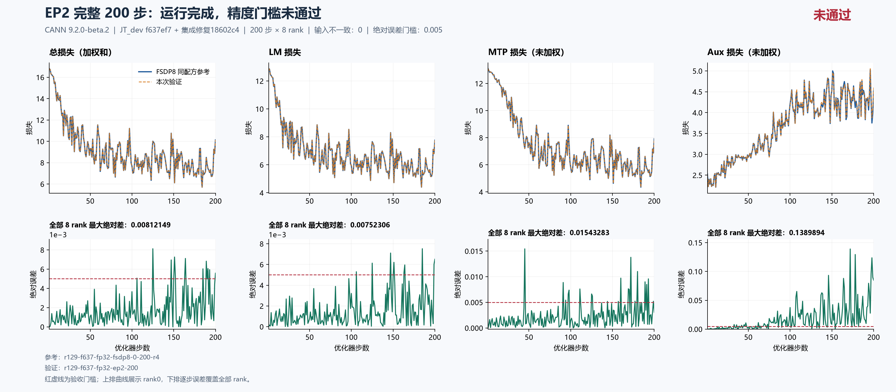

| 同主机、同配方资源观测 | FSDP8 | EP2 |
|---|---:|---:|
| 逐步全部rank MAX、去20步后中位秒/步 | 1.155003 | 1.317435 |
| 监督token/s，实际有效token只计一次 | 16008.4066 | 14034.3284 |
| 累计峰值allocated GiB | 22.032196 | 20.928654 |
| 累计峰值reserved GiB | 27.250000 | 26.275391 |

本次allocated减少1.103542 GiB，约5.01%；中位步时增加约14.06%。FSDP已分片整模型状态，且该小层数模型的embedding/输出头占保存模型载荷57.29%、路由专家仅占13.89%，不能期待EP2使整步显存减半。额外通信可能增加耗时是配置/源码预期，此轮未做算子归因；单次观测且精度失败，尚不能称为达到目标后的并行收益。

离线资源工具补齐了逐步全rank MAX、单次数据计数和累计峰值边界。独立两轴检视发现的输出覆盖、路径别名及非法计数问题已修正，9项CPU反例通过；输出使用排他创建，输入解析与SHA共用同一字节快照，严格loss比较器及训练源码未改。工具复核不替代多卡训练验证。

[完整运行分析](reports/f637-ep2-200-complete/f637-ep2-200-complete-analysis.json) · [严格精度比较](reports/f637-ep2-200-complete/f637-ep2-200-strict-comparison.json) · [76份采集清单](reports/f637-ep2-200-complete/f637-ep2-200-complete-evidence-manifest.json) · [8rank原始证据](reports/f637-ep2-200-complete/raw/runs/r129-f637-fp32-ep2-200) · [EP2逐步全rank资源](reports/f637-ep2-200-complete/f637-ep2-200-all-rank-resources.json) · [FSDP同窗口资源](reports/f637-ep2-200-complete/f637-fsdp8-r4-all-rank-resources.json) · [离线工具两轴复核](reports/f637-ep2-200-complete/all-rank-resources-two-axis-review.json) · [完整结果独立复算检视](reports/f637-ep2-200-complete/f637-ep2-200-independent-evidence-review.json)。

该阶段12组独立问题/PR的中文正文、单提交、双向链接及原生父子关系已全部回读核验（当前已增至14组，见首节），[25项核验记录](reports/f637-ep2-200-complete/github-chinese-full-link-audit.json)。本轮另清理54,872,986字节已用完的本机/129临时输入、CPU源码副本及专用venv，[清理凭据](reports/f637-ep2-200-complete/global-resource-metrics-cleanup.json)；最终源码、原始证据、当前step200 checkpoint和用户镜像保留。后续CP2已按间隔完成，结果见前文；此处保留EP2完成时的阶段记录。

## 18602c4历史结果：重计算200步对齐

选择重算第三轮`r129-f637-fp32-fsdp8-selective-200-r3`完整完成200步×8rank，退出0，运行394.861022秒并释放八卡，无本任务PID残留。与关闭重算FSDP8基线相比，LM、日志加权及按系数还原的MTP/aux、总loss和梯度范数最大绝对差全部为**0**，输入和初态检查也通过。由此当前固定配方的off/full/selective三种重算均完成200步精度对齐；这不替代EP/CP/TP矩阵验收。

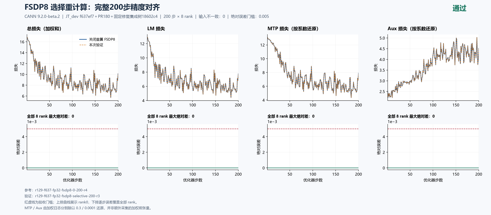

| 同129、同配方、同输入采集开销 | 关闭重算 | 完全重算 | 选择重算 |
|---|---:|---:|---:|
| 去前20步后，逐步8rank MAX中位秒/步 | 1.155003 | 1.235180 | 1.232111 |
| 全200步累计allocated峰值GiB | 22.032196 | 19.392933 | 19.875641 |
| 全200步累计reserved峰值GiB | 27.250000 | 24.320313 | 24.789063 |
| 有效监督token/s，逻辑数据只计一次 | 16008.407 | 14969.751 | 15011.921 |

选择重算相对关闭节省2.156555 GiB allocated（9.7882%），中位步时增加6.6760%，监督吞吐下降6.2248%。完全重算再多省0.482708 GiB，而本次步时仅比选择重算多0.2491%；单次观测不能证明稳定速度差异。在当前两主干层加一MTP层配置中，选择重算尚未显示明显更好的性价比。模块消融继续按实际配方/步数注明，旧结果不直接转作当前结论。

76份原始文件SHA核验完成，重复归档已清理；精度与资源由两轴独立复算。MTP/aux为日志按0.3/0.0001系数还原，不是额外采集的加权前张量；梯度结论限于范数。此后TP2-r4已完成200步，见本单新增完整结果；这些已完成轮次遵守当时的20分钟间隔并检查空闲。

[完整中文说明](reports/f637-fsdp8-selective-r3-complete/README_ZH.md) · [严格比较](reports/f637-fsdp8-selective-r3-complete/f637-fsdp8-selective-r3-strict-comparison.json) · [76份原始文件清单](reports/f637-fsdp8-selective-r3-complete/f637-fsdp8-selective-r3-complete-evidence-manifest.json) · [资源逐步结果](reports/f637-fsdp8-selective-r3-complete/f637-fsdp8-selective-r3-all-rank-resources.json) · [数值独立审计](reports/f637-fsdp8-selective-r3-complete/f637-fsdp8-selective-r3-precision-independent-review.json) · [资源独立审计](reports/f637-fsdp8-selective-r3-complete/f637-fsdp8-selective-r3-resource-independent-review.json)。

两次旧重试分别完成109/48步后因外部实验使用卡4/卡5而仅停止本任务，原始严格结果仍为未完成；第三轮从step0独立跑满200步，**未拼接前缀**。旧记录与匿名归属审计保留：[第一轮109步](reports/f637-fsdp8-selective-prefix109/README_ZH.md)、[第二轮48步](reports/f637-fsdp8-selective-r2-prefix48/README_ZH.md)。启动前约10分钟各次样本均空闲，手动接续最大间隔约94.565秒，不冒称自动观察器的90秒约束已通过；最终仍由原守卫两次当前空卡检查。当前step200 checkpoint保留。

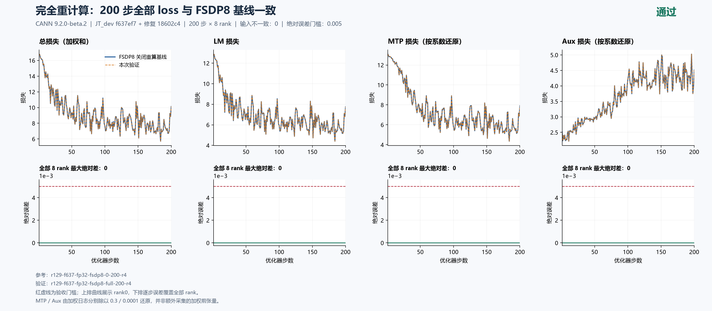

## 18602c4资源总览与重计算接口评估

六组完整200步的资源结果已从48份原始rank日志、9600行逐项复算，60项输入SHA及图表数字经独立审计通过。绿色重算配置的精度已通过；红色斜线的EP/CP/TP仍未通过0.005，图中资源下降不能当成已验收的优化推荐。

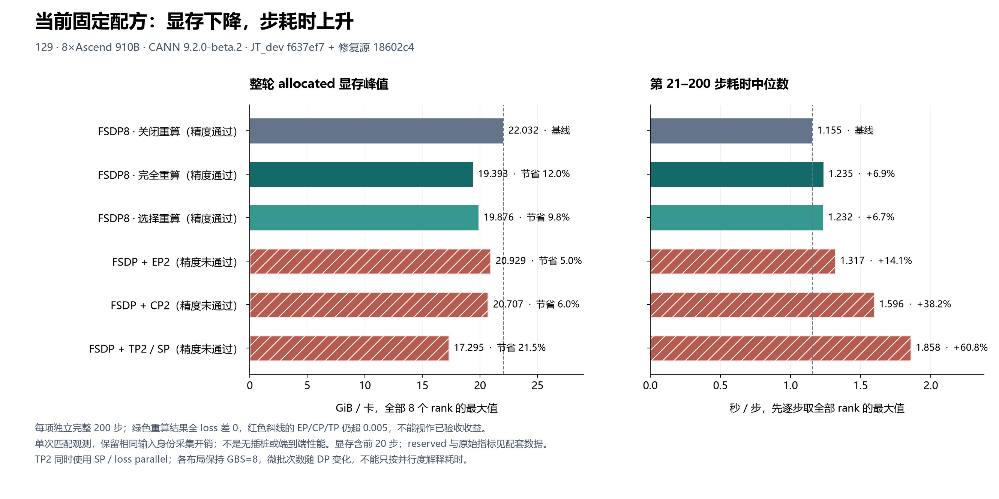

当前FSDP完全/选择重算分别节省约11.98%/9.79% allocated显存，步时增加6.94%/6.68%；两者仅3.069ms的单次中位时间差不能排稳定速度名次。图中每组均为独立完整200步；耗时先逐步取8rank MAX再去前20步，显存含warmup且截至训练采样，不含末次checkpoint保存。保留相同输入采集开销，非无插桩或端到端性能。

JT底层已有checkpoint、exclude及策略接口；当前YAML的off/full/selective可以直接使用。按层安全子区域尚缺JT adapter声明，任意模块路径、排除和通信组合也未完整映射。full覆盖两个主干decoder和一个MTP decoder，off仍保留独立chunked head/CE重算。MF PyNative与Megatron按最新固定官方提交逐项核对；模块成本复测已定义精确FQN与pre-FSDP安装点，尚未执行的新策略不冒称通过。

[中文详细说明、数据、SVG及独立审计](reports/f637-resource-overview/README_ZH.md) · [MF/Megatron能力与接口缺口](reports/f637-resource-overview/f637-recompute-flexibility-gap-review-v2.md) · [当前版本模块复测计划](reports/f637-resource-overview/f637-module-cost-current-plan.md)。

| 当前完整200步策略 | allocated峰值GiB | reserved峰值GiB | 中位秒/步 | 监督token/s | allocated节省 | 步时变化 |
|---|---:|---:|---:|---:|---:|---:|
| FSDP8 off | 22.032196 | 27.250000 | 1.155003 | 16008.407 | 基准 | 基准 |
| FSDP8 full | 19.392933 | 24.320313 | 1.235180 | 14969.751 | 11.98% | +6.94% |
| FSDP8 selective | 19.875641 | 24.789063 | 1.232111 | 15011.921 | 9.79% | +6.68% |
| EP2，精度未通过 | 20.928654 | 26.275391 | 1.317435 | 14034.328 | 5.01% | +14.06% |
| CP2，精度未通过 | 20.706646 | 25.982422 | 1.596322 | 11586.103 | 6.02% | +38.21% |
| TP2，精度未通过 | 17.294672 | 18.638672 | 1.857553 | 9957.677 | 21.50% | +60.83% |

本轮尚未观察到TP/CP/EP吞吐收益，精度未通过的配置只作诊断。模块策略先以同配方40步off分别对照六个decoder norm、一个dense MLP和两个完整MoE，精确验证目标与重放，再筛选候选进入200步。进入/退出allocated差不是保存激活量；嵌套模块时间和单模块节省量不可相加。具体FQN、pre-FSDP接入和旧工具限制见前述模块计划。

## 补充验证：资源统计 PR #226 的真实八进程 CPU 通信

在固定基点`f637ef7`与单提交修复`b58fed7`上，使用真实八进程Gloo，分别检查DP2×CP2×TP2、DP2×CP2×PP2对应的进程组边界及DP8 world控制组，每组两步。最终v2两侧各48条观测、合计1152个指标值：基点64项资源偏差（两种分组各32）逐项符合旧代码的组内MAX，修复版全部为0；数据、loss、累计计数及world控制均无非预期差异。

通信函数和进程组未mock，时钟及显存读数使用人工哨兵。这证明CPU/Gloo的归约域修复，不是TP/PP模型训练、NPU/HCCL性能或200步验收。两轴独立检视均通过，原始逐rank数据、两个版本的精确Git归档指纹、退出码与无设备容器移除凭据一起公开；PR #226保持原来的一个提交。

[中文详细记录和复现入口](reports/pr226-gloo-8cpu/README_ZH.md) · [基点结果](reports/pr226-gloo-8cpu/raw/evidence/pr226-gloo-8cpu-v2/base-summary.json) · [修复结果](reports/pr226-gloo-8cpu/raw/evidence/pr226-gloo-8cpu-v2/head-summary.json) · [全部原始文件SHA](reports/pr226-gloo-8cpu/pr226-gloo-evidence-manifest.json)。

## 其他独立修复及回归边界

#228真实TorchNPU选项及CPU定向测试通过，修复预先开启HF32后Trainer不能关闭的问题；镜像默认HF32关闭，尚未证明是本轮漂移根因。[复现、修复前后与两轴检视](reports/npu-precision-switch/README_ZH.md)。#230按评审建议改用真实基类isinstance识别FSDP动态派生wrapper，已squash为`85b091b`，仅改两个已有文件。移除独立测试文件，在现有模块只新增1个必要回归，同时检查动态/普通wrapper和无关对象；基点该用例失败，修复后59项测试通过（原有58项＋新增1项），lint通过。只修报告，已于2026-10-16 14:28（UTC+8）合入；合并commit为`e21302f9e7b47d41b61f5f4987fc34c000f7c978`，#229自动关闭。合并事实不等同于本任务观测到完整CI通过。[精简版原始证据与复现](https://github.com/xingleixu123/hyper-parallel/blob/c437ca6e050d64f2c9614e759950ad21c00bf40f/README_ZH.md)。

#214保持一个提交，在Ascend完成两卡FP32/BF16及四卡Partial回归，普通非整除Shard的行为为明确拒绝不支持布局。#199功能由上游#186提供，该PR保留独立回归并完成四卡短步ST。各PR的测试范围与剩余限制见顶部排序表及对应中文小问题；短回归和CPU通过不代替200步训练或完整CI。

## 历史精度定位：Linear输入梯度FP32的三步主loss改善证据

2026-10-16（UTC+8）完成四组独立3步：A=FSDP8原生、B=CP2原生、C=FSDP8 FP32 dgrad、D=CP2 FP32 dgrad。全部8rank完成、退出0并释放，各轮间隔至少1200秒；固定源码/镜像/初态/输入及实际反向分支均有原始记录和独立审计。

| 同配方跨布局的全8rank三步最大绝对差 | LM | 还原MTP | 还原aux |
|---|---:|---:|---:|
| A−B：原生Linear dgrad | 0.000398635864258 | 0.000425179799398 | 0.000477448338643 |
| C−D：FP32 dgrad后转BF16 | 0.000271797180176 | 0.000952879587809 | 0.000898871803656 |

LM最大差缩小，但MTP、aux分别变为原来的2.241/1.883倍。首步1,747,200个前向采样坐标均相同；1,138,944个梯度采样坐标中的不同数量从193,767增至200,825，最大差3.4332275390625e-5→3.814697265625e-5。C实际576次、D实际1152次FP32输入梯度计算（CP2每步两个microbatch）。

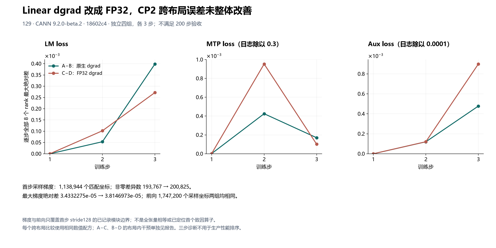

**结论：不据此提交Linear FP32输入梯度的生产修复PR。** A/B采集相对原生200步参考的前三步loss/梯度范数差0；C/D是不同数值配方。各布局内的A−C/B−D效应单独保存，不能混作跨布局收益。首步只观察stride128的有限模块边界，不能认定完整张量相同或唯一致因算子；200步门槛未放宽。

[详细设计、四种比较、限制与复算方式](reports/f637-dgrad-four-arm/README_ZH.md) · [原始四臂无损包及SHA](reports/f637-dgrad-four-arm/four-arm-inputs-manifest.json) · [独立逐值/执行审计](reports/f637-dgrad-four-arm/analysis/f637-dgrad-four-arm-independent-review.json)。原字节206.59MB压缩为32.43MB，本机恢复554文件并重算后逐SHA核验，临时恢复副本已清理。

模块成本四组已通过固定镜像parser4/4与CPU7项合约。新增off控制组完整40步×8rank对原基线前40步的各loss/梯度范数误差均为0，9个模块边界的前三步计数和hook移除已验证；norm/dense/MoE成本消融尚未执行，暂优先排查主loss。单卡PTA探针v1因诊断器venv路径问题在算子执行前失败；后续v2的level1完整，level2遇外部任务后让卡，v3在完整20分钟间隔后仅重跑level2并正常释放。[原始130文件、40步审计及探针失败说明](reports/f637-module-off-and-probe-preflight/README_ZH.md)。

## 单卡确定性探针与输入梯度候选结果

固定PTA/CANN和相同合成BF16输入下，level1/2的RMSNorm `[1,4096,5120]` 与Linear `[1,4096,1536]→[1,4096,24576]`，重复、行二分、行置换及置换后二分的前向/dX最大差均为0；两级别参考字节SHA相同。所测形状没有level2收益证据，不据此修改训练确定性级别。这里没有真实LM head、wgrad、通信或200步训练覆盖。

v2单卡50.154秒，另一容器在同卡出现后只停止自有容器；level2中断记录保留。释放后完整等待1200秒，再以v3单卡30.814秒重跑level2，exit0且释放。两轮22份原始文件、冻结依赖、真实所有权凭据及自审结果见[单卡探针完整报告与无损包](reports/f637-pta-levels12/README_ZH.md)。未把主代理自审标为独立检视。

FP32 Linear输入梯度候选已进入长跑：新FSDP8参考在163步后遇外部任务而让卡；CP2第一轮在初始化期间让卡，第二轮完整完成200步、退出0且释放。只比较双方共有1–163步、全部8rank，**主LM loss最大差0.0120849609375（第151步），第112步首次超过0.005**；原生输入梯度配方在相同窗口最大差0.011061668395996094。该候选已被当前主loss证据否决，不把三步改善外推为200步通过，也不拼接中断前缀。MTP/aux还原后最大差0.0092581908/0.0671809539保留作观测，当前否决依据是主LM loss。

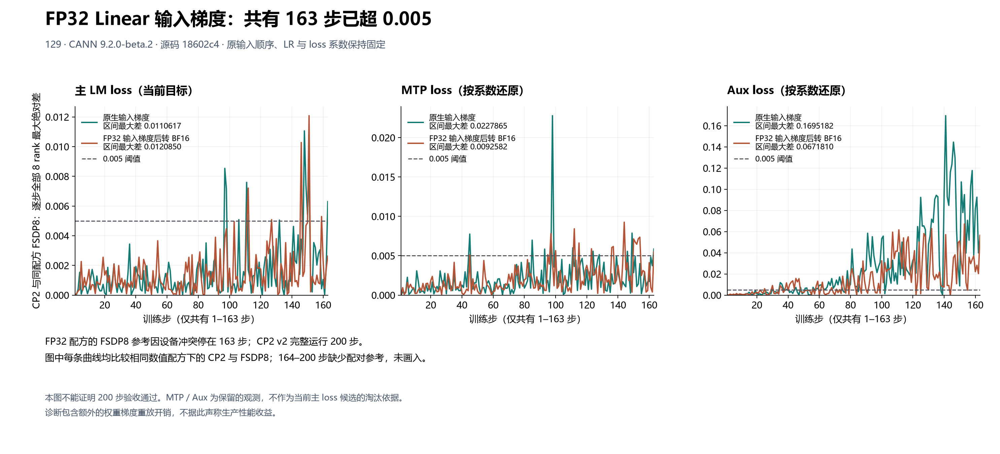

两布局数值helper字节一致，CP2实际记录76,800次FP32输入梯度调用；各自前三步与此前C/D短臂的全部loss和梯度范数差0，初始化和输入核验通过。未修改的严格比较器仍返回FAIL并保留中断参考的完整性问题，未将前缀审计转换为200步验收。额外原生wgrad重放不作生产性能收益。723份原始文件恢复后逐SHA核验，离线分析精确复现，临时恢复目录已删除；这是主代理自审及离线复算，未冒称独立审阅者。[长前缀详细结果、完整原始包及复算方法](reports/f637-dgrad-long-prefix/README_ZH.md)。

普通Linear的FP32权重梯度候选也已完成筛查：保持原生BF16前向/dX，新的FSDP8参考完整200步，CP2在159步后因其他任务出现而让卡。共有1–159步、全部8rank的**主LM loss最大差0.0178985595703125（第98步），第36步首次超0.005**；原配方同窗口最大差0.011061668395996094。已有前缀否决该候选，不补跑拼接缺失窗口，不作为完整200步验收。MTP/aux还原后最大差0.0244148572/0.1048651757保留作观测，当前失败依据仍为主LM loss。

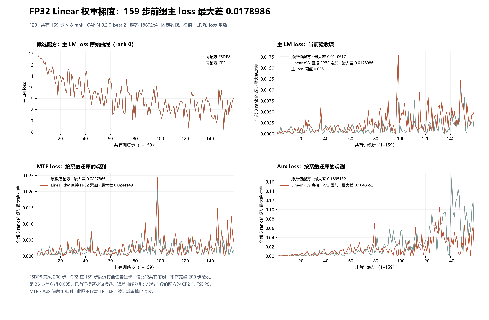

23个Linear含共享LM head每步均有实际覆盖；FSDP/CP2分别记录38,400/61,056次FP32权重梯度累加，主梯度消费检查通过。两布局数值helper相同，各自首步前向loss相对原配方控制均差0，完整输入/初始化/源码核验通过。CPU5项合约与2项配置解析、28项守卫回归通过。严格比较器保留20条精确预期的中断/窗口不足问题并返回FAIL，完整运行审计仍拒绝该159步输入。371份原始输入恢复、逐SHA核验并精确复算JSON后，29.59MB临时恢复目录及两端传输重复包已清理。[详细报告、无损包、原始值及复算工具](reports/f637-dense-wgrad-prefix/README_ZH.md)。

本候选FSDP完整200步allocated峰值增加2.729855GiB（12.3903%），单步中位时间增加2.6213%；CP2共有前缀allocated为21.930424GiB，单步中位1.653327秒。这些为带有界观测的单次原型成本，CP2还是中断运行，不能声称已获得满足精度目标的性能收益。未把该候选作为生产修复PR。

真实输出头局部VJP现已完成：FSDP8、3步，只观察rank0首个主LM调用，固定同一输入/权重/上游梯度。完整20,971,520坐标比较中，相同形状重复差0，按2048行拆分有2,029坐标不同，按128行拆分有1,546坐标不同，最大差均1.1920928955078125e-7；两半分别补零回4096行后差0。64个采样坐标与CPU FP64求和后转回BF16的结果相等。所有实际训练loss及梯度范数对原参考前三步差0；完整200步比较器仍因窗口不足返回FAIL，未放宽验收。

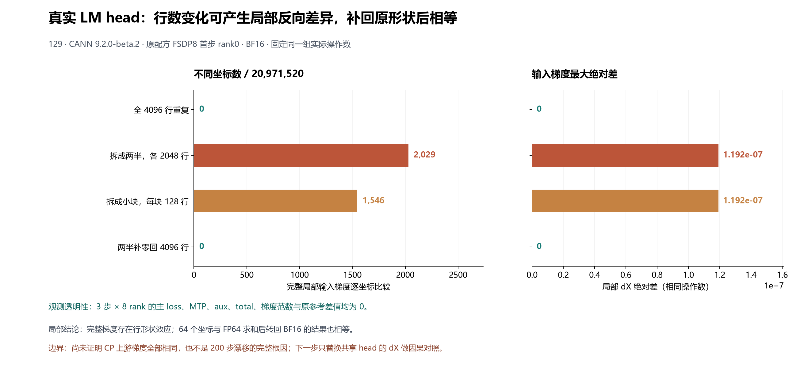

本次退出0、136.83秒后释放8卡；86文件逐SHA核验，212份离线输入恢复并精确复算分析JSON通过。CPU5项及真实配置解析、守卫31项通过。129启动前`/home`可用0，新目录与Docker所在根文件系统启动前可用62.78GB，已核对实际挂载；不使用内存盘、不复制约28GB保留检查点，43.71MB无用复制环境和两端重复传输包及时清理。观察器有额外重放和复制，不作生产显存/性能结论。[详细解释、原始统计与无损复算包](reports/f637-head-row-vjp/README_ZH.md)。

当时的MF GitHub镜像`5089da3`与Megatron主线`6e7e6ed`已逐文件核对，明确区分局部GEMM输出精度、分布式归约dtype和main_grad累积，不把源码配置当成跨框架实测。上述引用属于当时的固定版本，不能继续称为最新。CP2共享LM/MTP输出头输入梯度的局部替换已在558eff5完成三步观察，主LM差第2步变大、第3步变小，未确认根因；最新544526f7须先建立匹配参考后再决定是否需要该干预。局部形状效应尚不能证明CP上游梯度全部相同或200步漂移已解决，不新增未经验证的产品修复PR。[历史源码对照](reports/f637-dense-wgrad-prefix/dense-wgrad-reference-review-20261016.md)与[当时的二分定位计划](reports/f637-dense-wgrad-prefix/precision-causal-bisection-plan-20261016.md)。

## 待完成项、资源与数据管理

- [x] 14个独立问题各有中文小issue及单commit草稿PR，原生父子关系和正文双向链接回读通过。
- [x] 18602c4历史配方FSDP0–200、checkpoint200→400与独立连续400的两个200步窗口通过。
- [x] 18602c4历史配方off/full/selective均完成200步精度与全rank资源复算。
- [x] 历史201的544526f7 FSDP0–200完整执行、证据完整性与资源终态独立复核通过；19组后续配置仅完成CPU解析，用户现已取消201后续工作。
- [x] 129同源FSDP0–200参考完整完成；历史201完整200步×8rank跨机精度已检验，主LM最大差0.0095253，未通过0.005；后续仅用125/129。
- [x] 当前544526f7的129 FSDP8基线0–200、checkpoint200→400续训和独立连续400均完成；两个200步×8rank窗口主LM最大差均为0，三次均exit0并释放。
- [x] 当前544526f7的off/full/SAC selective均完成200步×8rank主LM验收；full/selective所测loss及梯度范数零差、实际三处wrapper正确、独立复核通过。
- [x] 当前544526f7预定14组矩阵已完成第一轮采集：full/SAC selective各完整200步通过，TP2/TP4/CP2/CP4/EP2/EP4/EP8及五种合法混合拓扑各完整200步×8rank但主LM均失败；这是证据采集完成，精度修复目标仍未完成。
- [x] MF PyNative与Megatron最新固定源码能力对照完成，接口及限制可追溯。
- [ ] TP/CP/EP及合法混合策略全部200步满足0.005，按确认的独立根因继续拆issue/PR。
- [ ] 完成当前配方模块成本消融，筛选有价值的策略后做200步回归。
- [ ] 数值配方若改变，重建对应FSDP基线、续训与独立连续400参考。
- [ ] 当前提交的完整CI、维护者评审及最终回归；PR创建不等于验收或合入。

当前只使用125/129：201后续排查、迁移准备与实验已取消，保留已有证据。按用户2026-10-18最新指示，取消每轮释放后1200秒，改为连续实验约2小时、在当前轮自然结束并确认释放后休息10分钟；每轮之间可直接继续，单轮最长900秒。首次部署的本机周期入口通过34项CPU/mock及真实Windows boot/全局锁核验，SHA `12765503eee9c8326995d845109d1cd9c30fe81c5727b58d13b19a75acaa8d9e`，已用于129的TP4及CP2并收回完整释放回执。v2入口SHA `ca2f65b2ade960c1a33311107698e71fd9b880377fde4ac132725408099f832a`已完成两个原生三步case并确认释放。随后v3入口SHA `2c3854d15b996f246ac6396bbf21ecb600a8621dc810817e0ffa28fb5dd0848a`再增加两个固定layer0三步case，保留原有配置域与全部时钟/锁/状态/调度函数，通过24项guard、27项跨profile CPU/mock以及18项真实Torch CPU测试后，已完成FSDP8与TP2各3步真机观测并释放；两者各自对原200步前3步的训练标量、输入和runtime均零差。其后v4入口SHA `ff0d4e2d4be5fe7f246298d956bae26514b81e382601af5d7f0cba429b021887`增加固定attention0观测与TP4+EP4 v3重跑配置，已用于这三次运行并核实释放；此前三组profile和全部调度操作函数不变。v5入口SHA `216099c1a2c24fc7f817a585f34e87e49c41fabf3a7a28e4fdee6f68a43a0588`仅再加第六组固定q_b旁路profile，已有五组profile与全部调度操作函数不变；经静态/mock独审及探针真实CPU13项验证后，已完成本次142.59秒的八卡3步并核实释放。v3/v4/v5复用相同全局锁、状态、时钟与7200/600秒策略，policy SHA仍为 `15e6575fb2278d21477fc5be559db751a8ad7dcf8e0ef454d389e7cc8a10cdea`。原远端matrix guard及14份冻结矩阵请求未改，125仍按真实占用和部署核验准备。历史实验按当时规则执行。八卡实验保留八卡规模和可比性。以实际计算PID、core利用率、显存和健康状态及启动前双检判断空闲；设备命名空间仅作诊断，不单独禁止启动。运行中真实冲突只停止本任务自己的容器。此前125中断与129设备发现失败的历史证据保留；129现已完成正式八卡训练。设备映射存在仍不等同于他人在训练。[实际空卡探针、诊断证据与准入边界](reports/actual-idle-discovery-20261017/README_ZH.md)。CPU检查单独记录，不混入NPU性能数据。

历史129、当前129与201的step200 checkpoint各约27.97GB；当前129的25文件已逐SHA核验，且已用于完成200–400续训，继续保留作复现与必要回归。历史129与201保留为各自版本的既有证据，不能混用；保留历史201证据不代表继续安排201工作。201新checkpoint共25文件已全部SHA复核，882个物理tensor分片已CPU分块读回且全部有限，8rank的step200/优化器/scheduler/数据计数/RNG结构通过；尚未执行DCP/NPU续训，CPU检查不等于恢复验收。每轮复制证据后核验大小和SHA，及时删除两端重复归档及已用完的临时源码/venv。125五份旧逐步参数探针此前无损gzip并读回校验，删除未压缩副本释放约6.14GB；随后将五份压缩归档共4,000,060,034字节转存本机，完整SHA及文件身份核验后删除远端重复件。另清理125/129共47份重复部署临时文件、8,319,960字节。[逐项转移与清理凭据](reports/f637-dgrad-long-prefix/README_ZH.md)及[此前清理凭据](reports/cp-denominator-cpu-and-cleanup/README_ZH.md)。后续大文件写入先检查容量和容器挂载，换位置时核实实际文件系统；用户镜像、共享数据和其他任务文件保留。

## 历史证据与版本边界

旧`ad1c553/ec2e16b/521d3a8`的长跑、模块消融、初期诊断以及历次让卡均保存在[此前完整报告的固定快照](https://github.com/xingleixu123/hyper-parallel/blob/cc6c1b3a76c4d6aa5559ad2b12d6b4b47087cdd6/docs/validation/jt-dev-8npu-20261014/REPORT_ZH.md)和[阶段历史索引](reports/phase-history-through-20261015.md)。旧配方MLP+norm200步零误差不转作当前结论；失败或中断记录不删除、不拼接。

#198在旧同拓扑200步对照中EP2/CP2分别节省9.422/10.125GiB且loss/梯度范数零误差，这是该修复的定向历史证据，与本轮资源表分别记录。#194目标反例、所有PR的完整SHA、最小复现、修复前后测试与两轴检视均保留在对应小issue/PR。与#145旧源码单卡100步及#190的MF单卡对齐范围不同，本单固定FSDP8、200步和独立恢复参考。
