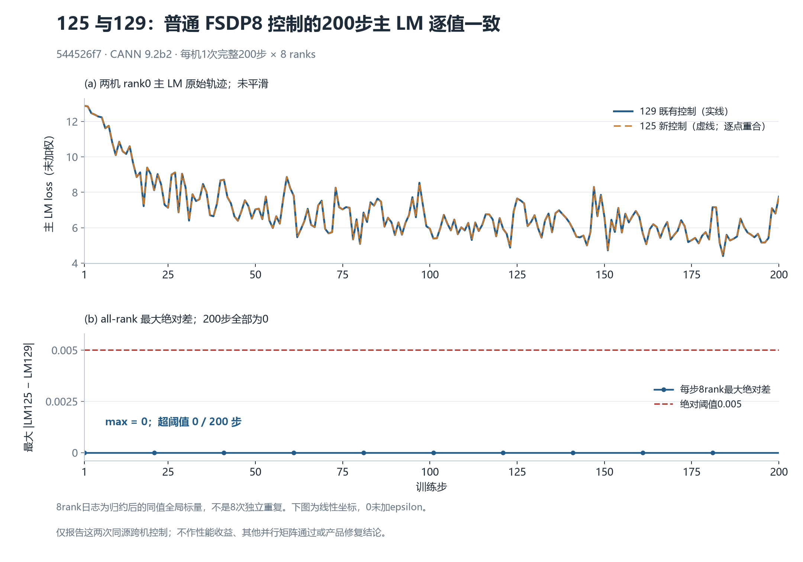

# 125 与129普通 FSDP8 控制：完整200步已记录数值重合

本次各一次、完整200步×8rank的同源跨机控制中，四项 loss、grad norm、LR及四项 data counters 逐值差异均为0。主 LM 最大绝对差为 **0**，首次超过绝对阈值0.005的步骤为**无**，超阈值 **0/200步**。这是这两次普通 FSDP8 控制的观察结果，不改变既有其他并行矩阵的失败结论。



图上半部分是两机 rank0 未平滑主 LM 轨迹，蓝实线与橙虚线逐点重合；下半部分是每步8rank最大绝对差及0.005线。误差使用线性坐标，真实0没有加epsilon、没有替换为对数下界。8rank记录的是归约后的同值全局标量，**不是8次独立重复**；本图没有置信区间，也不作性能收益推断。[SVG](figures/control200-main-lm.svg)含字形轮廓，便于跨机器打开。

| 完整200×8rank记录 | 最大绝对差 | 首个非零/超0.005步骤 | 超0.005步数 |
|---|---:|---|---:|
| 主 LM（未加权） | 0 | 无 | 0 |
| total loss | 0 | 无 | 0 |
| MTP（日志已乘0.3） | 0 | 无 | 0 |
| aux（日志已乘0.0001） | 0 | 无 | 0 |
| grad norm | 0 | 无；这里只报告严格相等 | — |
| LR | 0 | 无；要求严格相等 | — |
| consumed tokens/samples、step tokens/samples | 0 | 无；四项分别严格相等 | — |

四loss共6,400对、六项训练标量共9,600对日志比较。MTP/aux按原系数还原后的绝对差仍为0；这只是日志标量除以系数，不是额外捕获乘系数前张量。两机首步主 LM 都为`12.881054878234863`，第200步都为`7.756054878234863`。详细数值见[小型机器摘要](data/summary.json)及[200行数据CSV](data/control200.csv)（另有表头）。

## 同条件范围

参考为129的`r129-a1e6-fsdp8-0-200-v3`；新控制为125的`r125-a1e6-fsdp8-control200-v1`。二者 source clean `544526f7db8342c607244fd41009b2a74adb84c8`、空patch、相同固定image `sha256:5f9e677f439d11ab4e7c888f54b142335a27eee7411cbd2ce894a4798a70146d`。镜像只读证据中的CANN别名为`cann-9.2.0-beta.2`，本文简写 **CANN9.2b2**。

两侧FSDP8/TP1/CP1/EP1、GBS8、microbatch1、seed42、scheduler1000及原精度配方保持一致；`expert_fp32_weight_gradients=true`与`ns_dtype=float32`是原有配置。resolved recipe完整递归比较仅有两差：125的`save_ckpt`由true变false，以及checkpoint/output目录改为新case；其余数值字段相同。普通build控制仍保留原轻量逐步标量/输入指纹采集，没有native31或梯度replay探针。

16份runtime文档全等；每rank的48项已记录CPU初态指纹全等，**不是optimizer内部状态或所有中间张量字节的证明**。完整input_identity对象1600对全等，四项data counters全等。`global_sha256`来自排序后的全局输入组件指纹，不能升级为逐token UID或源DP槽位顺序证明。

## 原文链与映射

[来源链](evidence/source-provenance.json)绑定25份实际读取的源码证据快照：已冻结的mapping-aware科学结果、root独立读数核验、两份原始manifest、固定镜像CANN别名证据、16份metrics以及125四份raw/canonical scheduling原文。这里只保留必要的科学白名单摘要、CSV、图和工具；完整原文在任务本地保留，没有复制checkpoint、donor、训练文本、凭据、个人路径或容器生命周期原文。

原manifest SHA分别为：

- 129（91项）：`ffc52868bb02fd0f788aafcf3fa762f2528ec7556a511859d8533fc100c607ca`
- 125 c2（92项）：`c94c435cd29a1387971b485c7e28f70edfd7737f38e31cca809c58a931f2541c`

183项原成员已在先前科学比较及root独立复核中逐份验SHA。125远端scheduling原文格式与本机canonical格式不同；两种原文都保留各自SHA，解析JSON完全相等：

| 125文档/表示 | SHA256 |
|---|---|
| request canonical | `501e97fbf8bce3353f3b97fc6645a245e39cd7b1fdb3f868dc349a6c4104774f` |
| request remote raw | `0f1ef5b40744187d80211c98bcac7bfbe66d7f6114109156b4af5f8b82d31edd` |
| receipt canonical | `15b7248857d703f2d250f891b2cbf72dd8d9b309961e8484ccc28d663e3ee078` |
| receipt remote raw | `92f9fcb0adc12187586905aa1f74e20d6e4aa8d869b850bd2dbceab9c20072aa` |

125的原raw被收集到隔离的`remote-scheduling`路径，canonical没有冒充归档member。原strict工具保持未改，直接路径检查仍记录`FAIL / weighted PASS / unweighted UNVERIFIED`；唯一finding是它按旧位置查不到c2的canonical receipt。新的mapping-aware结果显式验证原raw member、canonical独立SHA和JSON相等后闭合，**没有将原strict状态改称通过**。129历史request另有本地SHA绑定但不在旧manifest内；旧receipt缺`input_files/container_stopped`字段的事实也没有补造。

root另用直接标准库JSON解码与有限数值相减完成独立核验，未导入compare/strict工具，原核验SHA为`0b7bdef7ee2754b699ee2d165f79ba9937ac3782d77b35375fa574a4b6a01886`。[安全独审摘要](evidence/input-independent-review-summary.json)保留其方法和结果；它是原科学数据独审，**不是这份新图文报告的独审**。本报告当前状态见[review-status](evidence/review-status.json)，仍待独立报告审核，尚未发布。

## 可移植复现

仅从本包CSV重绘，不需要训练框架、NPU、网络或私有原文；Python需安装Matplotlib及可用中文字体（Microsoft YaHei/Noto Sans CJK SC/Source Han Sans SC之一）：

```powershell
python -B -X utf8 tools/plot_control200.py --output-dir <全新绘图目录>
```

[绘图源](tools/plot_control200.py)先校验CSV的SHA和200步完整性，拒绝覆盖已有图。若拥有本任务保留的原始证据，可用[数据构建源](tools/build_data.py)从原16份metrics重新构建CSV、摘要和来源链，再从新数据重绘：

```powershell
python -B -X utf8 tools/build_data.py --task-root <任务根> --output-dir <全新报告数据目录>
python -B -X utf8 tools/plot_control200.py --data <新目录>/data/control200.csv --summary <新目录>/data/summary.json --output-dir <新目录>/figures
```

作者已在独立新目录实际重建并重绘，CSV/summary/provenance/PNG/SVG五份字节完全一致，PNG像素也一致，且实际查看了最终PNG；只清理了该次自有五份重复输出。[作者QA](evidence/author-validation-v1.json)记录范围和结果。本文没有报告性能数值，不从跨host单次运行推导收益；同源跨机日志相等不等于未观察的梯度/optimizer内部状态全等，不证明任何产品修复或唯一根因。
