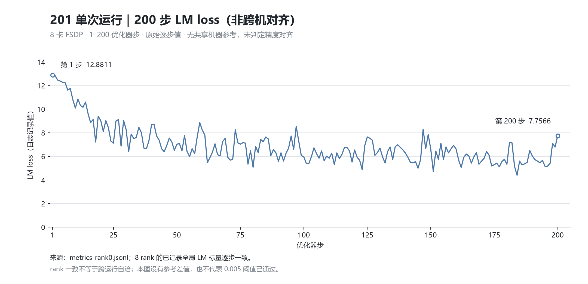
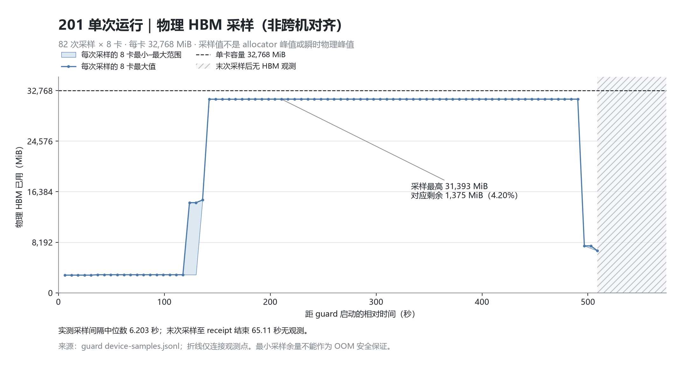

# JT_dev / 201 八卡 FSDP 阶段报告

> 历史阶段快照：后续已取消 namespace 作为调度硬门槛，并完成125/129实际探针，见[最新设备发现记录](../actual-idle-discovery-20261017/README_ZH.md)。本页初期checkpoint检查范围也已由[完整CPU读回报告](../a1e6-checkpoint-cpu/README_ZH.md)更新；历史原文与原归档保留。

截至本轮证据快照，201 已完成同一配置的三步启动检查和 FSDP 0–200 步训练，八个 rank 均正常结束，容器已移除、设备已释放。**当前只通过执行与单次运行完整性检查，`migration_allowed=false`**：125/129 尚无同源码、同配方的完整 200 步参考，主 LM loss 的 200 步 × 8 rank 逐点绝对误差是否不超过 0.005 尚未验证，不能据此放行 201 并行矩阵。MTP 和 aux loss 保留并列严格观测。

本目录保存本轮阶段报告与可复核证据。曲线均为 201 单次运行数据，不是跨机精度对齐图，也不把不同硬件的步时差解释为并行收益。

## 本轮固定源码与数值条件

| 项目 | 本轮记录 |
| --- | --- |
| 集成源码 | `544526f7db8342c607244fd41009b2a74adb84c8`，运行时工作区干净 |
| 对应上游 | `JT_dev@a1e6c222eab097c9609d6e744a3c5f98aeed6bdc`，已纳入 PR #232 |
| 201 硬件 | 8 × Ascend 910B4，每卡 32,768 MiB；125/129 为 64 GiB 910B3 |
| 训练软件 | CANN `9.2.0-beta.2 / V100R001C12B086`；Python 3.12.14；Torch 2.12.0+cpu；TorchNPU 2.12.0 |
| Demo 模型规模 | 2 个 decoder 层，hidden size=5120，8 个路由专家，1 个 MTP 层；不代表完整规模 DeepSeek-V3 |
| 并行配置 | FSDP shard=8，TP/CP/EP/PP=1，关闭重计算、关闭 offload；参数 BF16，归约 FP32 |
| 运行条件 | seed=42，单卡 micro-batch=1；沿用固定参考数据与训练配方；第 200 步保存 checkpoint |

[PR #232](https://github.com/hf1s/hyper-parallel/pull/232) 改变了 full determinism 的环境设置：旧源码会强制赋值 `CLOSE_MATMUL_K_SHIFT=1`，新源码保留继承值，包括未设置的状态。本轮 201 实际进程在 Trainer 前后均记录为未设置；确定性算法为开启、`allow_hf32=false`。未设置环境变量不能推导具体算子实际选择了何种 tiling；记录为 `null` 的其他后端属性也不能解释成 `false`。因此旧 `558eff…` 等轨迹只作历史证据，本轮需要重新生成匹配源码的参考。[数值默认策略证据](evidence/numerical-default-policy.json)

## 已验证的结果与尚未满足的条件

| 检查项 | 结论与边界 |
| --- | --- |
| 201 三步检查 | 8 rank 各有连续 1–3 步及 complete；92 个原始文件复核通过 |
| 201 0–200 | 8 rank × 200 步，共 1,600 条指标；92 个原始文件、98 项联合证据复核通过，exit=0 |
| 初始化与输入 | 每 rank 的 48 个初始 state_dict 条目及每步全局输入摘要一致；不是独立跨运行精度结论 |
| 已记录全局标量 | LM、MTP、aux、total loss 与 grad norm 在 8 rank 间逐步一致；这些是全局记录值，不能充当独立参考 |
| 共享机器参考 | 125/129 的本轮尝试均在首步前失败，未产生训练指标；缺少同源码完整参考 |
| 200–400 续训 | 尚未验证；checkpoint 存在不等于恢复正确 |
| 其他并行与重计算 | 本轮只运行 FSDP、关闭重计算；TP/CP/EP、完全/选择重计算尚未在此数值基线上完成验收 |
| 后续配置 CPU 预检 | 19 个配置经真实 production parser 解析通过，NPU 未初始化、容器已移除；只证明解析合法 |

19 个解析通过的配置中，129 的续训配置目前仍指向失败 v1 对应的 checkpoint 位置。真正启动前必须改为成功基线的 checkpoint，并重新核对来源及恢复参数；本次 CPU 结果不能作为执行该续训或放行 201 矩阵的依据。[CPU 采集回执](evidence/cpu-matrix-collection.json)与[CPU 19 配置独立复核](evidence/cpu-matrix-independent-review.json)分别保留实际解析结果的采集指纹、25 个固定输入和全部 19 个配置值及类型的一致性检查。

完整性结论来自[本轮执行汇总](evidence/execution-summary.json)、[独立 200 步审计](evidence/independent-run-review.json)和[三步独立审计](evidence/smoke-independent-review.json)。200 步独立审计另外核验了容器已不存在、无本任务运行容器、八卡健康且空闲；不把仅有退出 receipt 的情况扩展成未经核对的清理结论。

## 201 的 200 步 LM 轨迹

| 已记录指标 | 第 1 步 | 第 200 步 |
| --- | ---: | ---: |
| LM loss | 12.8810548782 | 7.7566366196 |
| MTP loss（日志加权 ×0.3） | 3.9283638000 | 2.3775138855 |
| aux loss（日志加权 ×0.0001） | 0.0002530856 | 0.0004627114 |
| total loss | 16.8096733093 | 10.1346130371 |

图中保留全部 200 个原始点，不平滑、不补点。首尾变化受各步输入影响，本图不用于判断模型收敛质量。三步检查与长跑最初三步的已记录损失相同，但这不能代替共享机器 200 步参考。由于参考缺失，本报告不绘制差值曲线或宣称 0.005 阈值通过。

## 显存、主机内存与时间口径

| 指标 | 201 本次结果 | 统计口径 |
| --- | ---: | --- |
| allocator allocated 峰值 | 22.0322 GiB | 精确字节值 23,656,889,344；各进程生命周期峰值，覆盖训练/checkpoint 回调 |
| allocator reserved 峰值 | 26.78125 GiB | 精确字节值 28,756,148,224；与物理 HBM 不同口径 |
| 物理 HBM 采样最高 | 31,393 MiB | 82 次 × 8 卡观测中的最大值，单卡容量 32,768 MiB |
| 最小采样剩余容量 | 1,375 MiB，约 4.20% | 仅为观测点余量，不是瞬时最低余量或 OOM 安全保证 |
| 容器 cgroup 高水位 | 99,737,739,264 B，约 92.8880 GiB | 采样读取到的内核内存高水位；尾部存在观测空档 |
| callback 步时中位数 | 1.729842 秒/步 | 每步取 8 rank 的最大记录值，再对第 21–200 步取中位数 |
| callback 有效 token 速率 | 10,666.02 token/秒 | 第 21–200 步，逻辑 token 只计一次；不含端到端启动/checkpoint/释放时间 |

guard 配置的采样间隔为 5 秒，实际中位数为 6.203 秒、最大为 6.494 秒；末次 HBM 采样到 receipt 结束还有 **65.11 秒无观测**，图中用斜线区域表示。采样峰值不能代替瞬时物理峰值，也不能保证后续并行或重计算配置仍能装入 32 GiB。allocator 数字使用完整进程生命周期，未因步时剔除前 20 步而同步剔除初始化/热身峰值。

本次步时只能说明当前 201 配方的 callback 表现。125/129 与 201 的卡型、显存、驱动和宿主环境不同，又缺少匹配参考，不据此计算跨硬件并行加速比或重计算性价比。

## Checkpoint 边界

第 200 步 checkpoint 清单包含 25 个文件，总计 **27,973,262,840 字节，约 27.97 GB**。17 个小文件的 SHA256 已复核，8 个大型 tensor 文件只核对尺寸；没有读取大型 payload 做哈希，也没有执行恢复或续训。checkpoint 留作后续 200–400 恢复实验，不能因目录存在或保存成功就判定续训通过。[清单及核验范围](evidence/checkpoint-inventory.json)

本报告及证据压缩包均不包含 checkpoint payload、训练 Arrow 或数据正文。

## 125/129 的阻塞状态与故障边界

本轮两次共享机器尝试均在 JT 构造 `torch.device` 时报告索引为字符串，发生于首个训练步之前。已落盘的部分 rank 初始化摘要与 201 相同，实际运行内六个包装脚本的 SHA 也相同。当前日志没有保存失败进程的原始 HAL 返回码、C 后备设备数及可用性缓存值；不能单凭 HAL 警告断言最终可用性为 false，更不能将故障定因为 PR #232。

之后的只读快照显示：125 和 129 当前各有一个其他普通容器持有低编号设备命名空间，均映射全部八卡；201 没有此类占用。这个状态与[昇腾官方的新容器设备占用排查项](https://www.hiascend.com/document/caselibrary/detail/topic_0000002238354198)对应，因此后续共享机器实验需要等待命名空间释放，不能只根据计算利用率或进程列表为空启动。

129 当前持有者的启动时刻晚于本轮失败窗口，故此快照只能证明**当前无法准入**，不能倒推之前失败的具体持有者。125 在旧源码时期已有新容器 `device is used / -8020` 的历史记录，进一步说明本类现象不应直接归因于新数值默认。历史上有一份“占用已消失”的摘要与其原始记录矛盾，已追加纠错说明，未覆盖原始数据。[公开脱敏摘要](evidence/environment-public-summary.json) · [历史摘要更正](evidence/historical-namespace-correction.json)

125 的时钟比本机测量参考慢约 266.5 秒，跨机日志时间不能直接排列为因果顺序。共享机器实验间隔仍按本机释放记录和单调时间执行。没有停止其他人的实验，也不采用特权容器或宿主 PID 命名空间绕过占用。

## 可复核交付与后续验收

- [白名单原始证据包](a1e6-201-admission-evidence.tar.gz)保留 201 三步/200 步、125/129 失败四次 collection manifest 中的全部 249 个文件，以及明确列入的审计代码、引用证据和 19 配置 CPU 解析记录；完整内容与指纹见[归档清单](evidence/archive-manifest.json)。未递归打包任务目录。
- [流式复核回执](evidence/archive-stream-verification.json)记录逐成员大小/SHA256 校验。复核通过压缩流直接读取，不解包到临时目录。`private.json`、其他任务身份、凭据、数据正文和 checkpoint 均不在包内。
- [LM/步时 CSV](data/loss-and-time.csv)、[HBM CSV](data/hbm-samples.csv)和[数据来源指纹](data/provenance.json)保留完整绘图数值；[绘图代码](plot_figures.py)仅使用本地 CSV。PNG 旁另有 [LM SVG](figures/201-lm-loss-200.svg) 和 [HBM SVG](figures/201-hbm-sampled-capacity.svg)。

等待共享机器设备命名空间释放后，先记录设备发现的真实返回值，再取得匹配 `544526f7…` 的完整 200 步参考。当前迁移准入要求主 LM loss 的 200 步 × 8 rank 全部逐点绝对差不超过 0.005，并核对初始状态、输入、配置和数值 flags。MTP 与 aux loss 按日志加权口径保留全量严格对比和异常记录，不作为额外迁移否决条件。

迁移准入后，再独立验证 200–400 续训、TP/CP/EP 和关闭、完全、选择重计算三种模式的主 LM loss，同时评估相同硬件和可比口径下的显存/性能收益。主 loss 全矩阵通过后先停止扩展实验并汇报，由用户决定是否继续 MTP/aux 专项。
