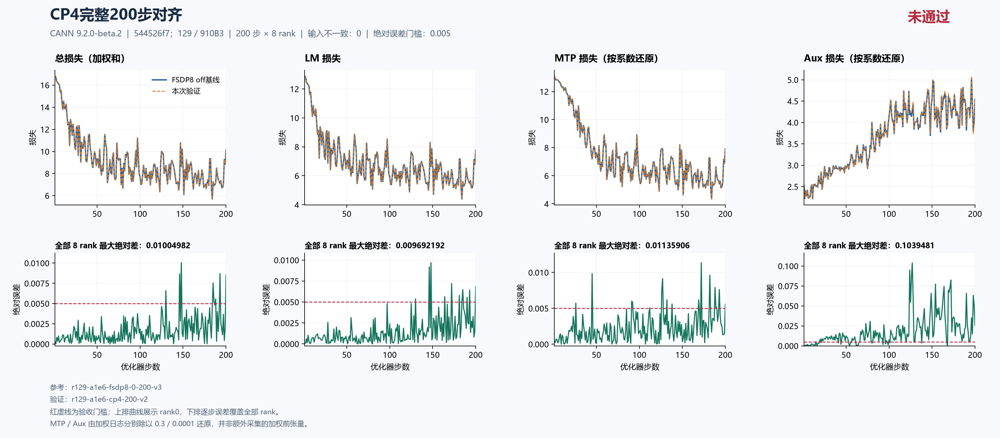
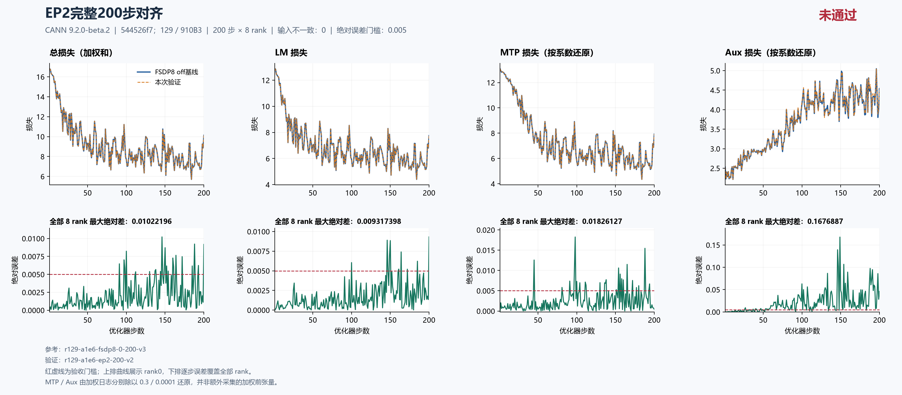

# 当前固定源码 CP4、EP2：完整 200 步主 LM 均未通过，根因待定位

固定集成源 `544526f7db8342c607244fd41009b2a74adb84c8` 的 **CP4、EP2 均从初态独立完成 200 步 × 8 rank**。CP4 主 LM 最大绝对差为 **0.009692192077636719（step 148）**，10 步超过 0.005；EP2 为 **0.009317398071289062（step 200）**，9 步超过 0.005。两项主 LM 验收均 **FAIL**，具体函数与根因仍 **UNRESOLVED**。完整性、输入身份、CPU 初态、数据计数及 LR 核验通过，不能替代精度验收。

漂移继续在[总问题单 #202 的 Top1](https://github.com/hf1s/hyper-parallel/issues/202)跟踪。本包提供当前同源 CP4、EP2 的独立实验与复算证据，没有把尚未定位的漂移命名为新的独立缺陷，也没有宣称已修复。FSDP 续训、重算的既有通过结果，以及 TP2/TP4/CP2 的其他结果各自保留；历史 `18602c4` 等源码和新的三步原生 trace 不并入本包的 200 步验收。

## 固定来源、数值配方与比较口径

主机 129，8 × Ascend 910B3 64 GiB，CANN **9.2.0-beta.2**；镜像为 `sha256:5f9e677f439d11ab4e7c888f54b142335a27eee7411cbd2ce894a4798a70146d`。本批次固定上游 JT_dev 为 `a1e6c222`，验证集成源为 `544526f7`，包含用户指定的 #180 及已集成的 #230/#232；这里的结果只绑定该固定提交，不泛指今后变化的分支 HEAD。

四次运行源码与空 patch 一致，保持 seed 42、dataloader seed 1234、GBS 8/MBS 1、seq 4096、LR 0.0001、scheduler 1000、MTP 系数 0.3、aux 系数 0.0001；模型为两层 trunk、一层 MTP、8 个 routed experts。FP32 初始化、归约和主参数、专家 FP32 权重梯度、Muon NS FP32、BF16 计算参数等配方也一致。实际 activation checkpoint 检查均为 off、0 个 wrapper。

| 用途与运行 | 实际拓扑/参数分片 | 每优化器步微批数 | 比较窗口 |
|---|---|---:|---|
| 精度参考 `r129-a1e6-fsdp8-0-200-v3` | DP8，FSDP8 | 1 | 1–200 |
| 资源 off 参考 `r129-a1e6-fsdp8-continuous400-v2` | DP8，FSDP8，无 checkpoint 保存 | 1 | 原文完整 400 步，资源取前 200 |
| `r129-a1e6-cp4-200-v2` | DP2 × CP4，TP1/EP1，dense FSDP8 | 4 | 1–200 |
| `r129-a1e6-ep2-200-v2` | DP8，TP1/CP1；dense FSDP8，expert EDP4 × EP2 | 1 | 1–200 |

精度参考与独立连续 400 的前 200 步在所测 loss、梯度范数、LR 和数据计数上完全一致。分别对两份参考复算，CP4、EP2 的误差相同。正式资源表统一使用不保存 checkpoint 的连续参考，避免把精度参考的 step 200 保存成本混入资源对照。

EP 是专家参数/通信域，不能把本配置误写成 dense DP4，或用 TP × CP × EP 相乘限制替代真实 mesh。输入按每个优化器步的全局身份摘要比较，不按不同拓扑的同编号物理 rank 或 microbatch 直接配对。

CP4 守卫总耗时 536.8933910799678 秒，EP2 为 407.2126402200083 秒；均 exit 0、已停止并释放本任务 PID，完整八卡释放快照通过。完整容器 ID 为 `b538af53536ded200f8b966c50374ab8f491ad938f3a8f0f4ee3f30a6cf3d3fc` 和 `801f28c0b3dfcea142cf487bcbac431fece084629a4774bdb9a44e1ccc897fed`，后续完整 ID 查询均已不存在。这些是保存的执行/释放证据，守卫耗时不等于稳态秒/步。

## 完整 200 步精度结果

| 全 200 步 × 8 rank 最大绝对差 | CP4 | EP2 |
|---|---:|---:|
| 主 LM | 0.009692192077636719（step 148） | 0.009317398071289062（step 200） |
| 总 loss（日志加权和） | 0.010049819946289062（step 148） | 0.01022195816040039（step 146） |
| MTP 日志（含系数 0.3） | 0.003407716751098633（step 172） | 0.005478382110595703（step 98） |
| MTP 按系数还原 | 0.011359055836995443（step 172） | 0.01826127370198568（step 98） |
| Aux 日志（含系数 0.0001） | 1.039481139741838e-05（step 127） | 1.6768870409578085e-05（step 149） |
| Aux 按系数还原 | 0.1039481139741838（step 127） | 0.16768870409578085（step 149） |
| 梯度范数 | 0.67254638671875（step 148） | 0.6246161460876465（step 148） |
| LR | 0（全程） | 0（全程） |

CP4 主 LM 超阈值步：**130、146、148、164、172、181、185、190、193、200**。

EP2 主 LM 超阈值步：**100、146、149、150、161、164、172、185、200**。

每项对每个参考比较 1,600 对标量；四项数据计数共 6,400 对，无差异，全局输入身份和 LR 也无差异。八 rank 日志中的 loss、梯度范数和 LR 属于全局归约后的观察，不能说有八份独立本地 loss 完全一致；梯度证据只包含范数。MTP/Aux 的未加权误差由已记录加权值除以 0.3/0.0001 得到，并非另采的加权前张量。本轮主 LM 优先，MTP/Aux 仅作诊断观测，不扩大为其专项全矩阵通过。

CP4：[严格比较](cp4-comparison.json)、[摘要](cp4-summary.json)、[独立科学复核](cp4-independent-review.json)。EP2：[严格比较](ep2-comparison.json)、[摘要](ep2-summary.json)、[独立科学复核](ep2-independent-review.json)。





两图上排为 rank0 轨迹，下排为逐步全部 8 rank 最大绝对差，覆盖 1–200 全部步骤。图名中的“对齐”表示比较过程，右上角“未通过”与本报告一致。MTP/Aux 按系数还原，0.005 虚线用于同口径诊断；不把组件诊断扩大为其专项已经验收。

## 首次更新前的证据与定位边界

| 首步全局日志 | FSDP8 | CP4 | CP4 绝对差 | EP2 | EP2 绝对差 |
|---|---:|---:|---:|---:|---:|
| LM | 12.881054878234863 | 12.880926132202148 | 0.00012874603271484375 | 12.881054878234863 | 0 |
| MTP 日志 | 3.928363800048828 | 3.9282426834106445 | 0.00012111663818359375 | 3.928363800048828 | 0 |
| Aux 日志 | 0.00025308559997938573 | 0.00025304779410362244 | 3.780587576329708e-08 | 0.00025308559997938573 | 0 |
| 总 loss | 16.809673309326172 | 16.80942153930664 | 0.00025177001953125 | 16.809673309326172 | 0 |
| 梯度范数 | 22.473445892333984 | 22.473007202148438 | 0.000438690185546875 | 22.473447799682617 | 1.9073486328125e-06 |

[固定源码 TextTrainer.train_step](https://github.com/xingleixu123/hyper-parallel/blob/544526f7db8342c607244fd41009b2a74adb84c8/hyper_parallel/trainer/text_trainer.py#L281)先完成各微批前向/反向并汇总 loss，再测量/处理梯度并执行 optimizer，最后记录完成步数。因此 CP4 首步 LM 已有差异，不能仅以之后 optimizer 更新累积解释。优先核查首次更新前的实际计算参数、CP 前向边界、微批相关状态和损失归约。

EP2 首步 total/LM/MTP/aux 四项标量差都是 0，梯度范数已经相差 1.9073486328125e-06；四项 loss 从 step 2 开始非零。该结果说明首次 optimizer 更新前已有可见的梯度范数差异，**不证明完整前向、根梯度或反向张量相同，也不定位某个反向算子或 optimizer 为根因**。后续需要分别对齐逻辑 token、专家参数与归约语义，才能比较原生前向、反向、未裁剪梯度、裁剪及参数更新。

48 项 CPU 构造张量的 shape/dtype/hash 一致，采集时 JT MLA 模块替换和 native 初始化已完成，尚未进行 NPU 搬运、TP/EP 参数切分及 FSDP 计算参数物化。它不等价于首次 NPU 全参数/缓存/RNG 等内部状态逐字节相同。当前 runtime flags、global input 摘要一致也不补足这一缺口。

本包没有把另行进行的三步原生 trace、观察透明性或局部消融并入完整 200 步结果；它们各自独立验收。只有具体函数/触发条件及因果证据足够，才建立独立小 issue 和单 commit PR；最终修复仍需返回完整 200 步主 LM ≤ 0.005 的同源验收。

## 全 rank 资源观测与布局解释

时间先逐步取 8 rank MAX，再取 step 21–200 中位数。有效监督 token/s 为同窗口逻辑监督 token 总数除以时间总和，不重复累加各 rank 的全局计数。Allocator 峰值取 step 1–200 内全部 rank 的进程累计值，包含预热。三次窗口的监督 token 总数都是 **3,325,552**；时间总和依次为 **207.85544788837433、358.5325846672058、237.70346474647522 秒**。

| 单次完整运行资源观测 | FSDP8 off | CP4 | EP2 |
|---|---:|---:|---:|
| 中位秒/步 | 1.155826 | 1.993121 | 1.318687 |
| 有效监督 token/s | 15999.35 | 9275.45 | 13990.34 |
| Allocated 峰值 GiB | 22.032196 | 19.866190 | 20.929016 |
| Reserved 峰值 GiB | 27.171875 | 24.828125 | 26.255859 |

相对 off，CP4 allocated 少 **2.166006088256836 GiB（9.83%）**，中位步时增加 **72.44%**、有效监督吞吐下降 **42.03%**；EP2 allocated 少 **1.103179931640625 GiB（5.01%）**，步时增加 **14.09%**、吞吐下降 **12.56%**。**两项精度失败，资源只作失败配方诊断，不能推荐为已验收优化。**

CP4、EP2 的 200 步中 rank0 时间低报其他 rank 的步数均为 0；本表仍统一使用[CP4 全 rank 复算](cp4-resources.json)、[EP2 全 rank 复算](ep2-resources.json)和[连续 off 参考](off-resources.json)。严格比较 JSON 中保留的 rank0 performance 字段仅供审计。单次共享机运行、输入哈希/标量采集、不同微批数和 callback 时长边界保留，不宣称无插桩端到端性能或物理 HBM 峰值。

持久参数份额与计算时临时峰值不能混为一谈：

- **CP4 仍为 dense FSDP8。** 实际 rank0 初始 46 项 FP32 model/main 参数元数据合计 **339,747,840 元素、1.2656593322753906 GiB**，与基线相同。CP4 将部分局部序列缩短，但不把持久参数或 TP1 计算权重自动缩为四分之一。本配置使用 expanded_ulysses、overlap=false，并有四个串行微批；CP 通信、重排、缓冲和微批成本需要实测分解，不能按 CP 度数预言四倍加速或 75% 总显存节省。
- **EP2 的 dense 与 expert 分域不同。** 42 项 dense 参数使用 `(fsdp_shard,tp)=(8,1)`，本地 **292,561,920 元素**；4 项 routed-expert 参数来自 trunk 第 1 层和 MTP 层，使用 `(edp_shard,ep)=(4,2)`，placement 为 `StridedShard(dim=0, split_factor=2), Shard(dim=0)`，本地 **47,185,920 元素**。二者合计仍 **339,747,840 元素、1.2656593322753906 GiB**，与 FSDP8 基线同份额；EP2 不能再被算作把所有持久参数减半。
- EP2 实际记录有 6 个 FSDP 单元，专家在两个独立 EXPERT 单元中，其余为 DENSE；初始 optimizer state 为空，model/main 元数据相同不等于两套已测独立存储。metadata 也不记录每次前向物化的完整参数字节。EP 改变专家物化、token dispatch/combine 和通信缓冲，可能改变峰值；本次 5.01% allocated 变化没有阶段 profile，不能定量归因到某个模块或假设理想两倍加速。

依据包括[CP 的 DP×CP FSDP 域](https://github.com/xingleixu123/hyper-parallel/blob/544526f7db8342c607244fd41009b2a74adb84c8/hyper_parallel/distributed/mesh.py#L143)、[EDP/EP mesh 构造](https://github.com/xingleixu123/hyper-parallel/blob/544526f7db8342c607244fd41009b2a74adb84c8/hyper_parallel/distributed/mesh.py#L197)、[JT EP 计算入口](https://github.com/xingleixu123/hyper-parallel/blob/544526f7db8342c607244fd41009b2a74adb84c8/hyper_parallel/models/jt_deepseek_v3/adapter/distributed/ep_compute.py#L30)，以及本包各运行的 `integration/check/optimizer_layout_initial.json` 和独立科学复核。源码机制说明不替代实际通信/算子 profiling。

## 公开证据、复算与当前执行边界

四次原采集各 91 文件、合计 **364 文件**逐 SHA/size 核验。本目录每次复制与既有审阅包一致的 56 个安全文件，共 **224 个 run 文件**，保留配置、逐 rank 指标、CPU 初态、runtime flags、起止标记、allocator 终态和 rank0 布局。训练文本、worker 日志、checkpoint 二进制和私有驱动原文不在公开包中，必要 checkpoint 与完整执行证据保留于任务归档。四份原始数据的本机副本未保存；独审通过三组请求 pins 一致和完整 global input/计数核对绑定数据身份，没有声称在本机重新哈希远端数据文件。

[source-provenance.json](source-provenance.json)逐项记录源文件、公开目的文件、字节数和 SHA，复制项均 byte-identical；[manifest.json](manifest.json)核验本包全部非 manifest 文件。原始私有 collection manifest、公开包 manifest 和源到公开文件 provenance 是不同层次。公开安全子集可独立复算标量、曲线及资源；完整执行检查依赖独审记录和原私有归档，不将公开子集冒充完整 91 文件采集。

两份 scientific review 是独立于原始分析的科学复核；本包的整理与自检属于作者工作，不把它们改称本公开包已经完成独立发布审核。

在本目录执行，输出使用新的派生文件名：

```text
python compare_runs.py runs/r129-a1e6-fsdp8-0-200-v3 runs/r129-a1e6-cp4-200-v2 1 200 --output cp4-scalars-recomputed.json
python compare_runs.py runs/r129-a1e6-fsdp8-0-200-v3 runs/r129-a1e6-ep2-200-v2 1 200 --output ep2-scalars-recomputed.json
python all_rank_resources.py runs/r129-a1e6-fsdp8-continuous400-v2 1 200 --output off-resources-recomputed.json
python all_rank_resources.py runs/r129-a1e6-cp4-200-v2 1 200 --output cp4-resources-recomputed.json
python all_rank_resources.py runs/r129-a1e6-ep2-200-v2 1 200 --output ep2-resources-recomputed.json
python plot_comparison.py . cp4-comparison.json --title "CP4完整200步对齐" --source-label "544526f7；129 / 910B3" --reference-label "FSDP8 off基线" --output figures/cp4-recomputed --raw-components --chinese
python plot_comparison.py . ep2-comparison.json --title "EP2完整200步对齐" --source-label "544526f7；129 / 910B3" --reference-label "FSDP8 off基线" --output figures/ep2-recomputed --raw-components --chinese
```

两项 scalar 比较返回 FAIL 和退出码 1 是如实重现科学失败。主 LM 判据为完整 200 × 8 覆盖且 `errors["training/foundation_loss/lm"]["max_abs"] <= 0.005`。重绘读取原严格比较 JSON。`strict_compare_runs.py` 保留完整审核实现；其全部原 manifest/执行检查仍需私有归档。图与逐 rank 日志已逐 SHA 绑定，不能用新生成的配置或局部测试代替本包完整真机记录。

后续仅用 125/129，201 后续工作已取消。当前采用 **约 7,200 秒连续实验，当前轮自然结束并确认释放后休息 600 秒**；不再每个实验固定等待 20 分钟。该策略和 v3 本机周期入口已有部署/激活证据，v3 与原入口共享同一全局协调状态和锁。每次启动仍须实际空卡双检、固定输入/归属验证及 840/900 秒限时，冲突时只能停止和清理本任务的完整 ID 容器。历史 1,200 秒间隔只描述当时政策，不覆盖当前执行规则。
