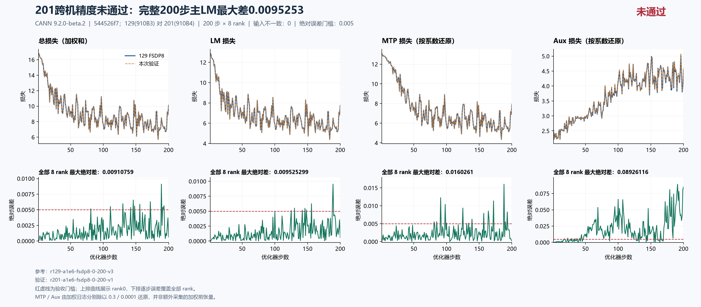

# 129 与 201：同源 FSDP8 完整 200 步跨机验证

**201 主 LM 准入未通过，后续实验继续使用 125/129。** 两侧均完整完成 200 步 × 8 rank；主 LM 最大绝对差为 **0.009525299072265625**（第 189 步），首次超过 0.005 是第 125 步。超阈值步为 125、130、142、146、148、156、188、189，共 8 步；不以最后一步较小误差替代整段最大误差。

## 配方、执行与证据

- 上游 `a1e6c222eab097c9609d6e744a3c5f98aeed6bdc`，集成训练源 `544526f7db8342c607244fd41009b2a74adb84c8`；包含 #180、#186、#230、#232。两侧工作树干净，六份采集脚本一致。
- 固定镜像 `sha256:5f9e677f439d11ab4e7c888f54b142335a27eee7411cbd2ce894a4798a70146d`；CANN 9.2.0-beta.2；seed 42、dataloader seed 1234、constant LR 0.0001、GBS 8 / MBS 1、序列 4096。MTP 系数 0.3、aux 系数 0.0001 保持原值。
- 两侧实际 `CLOSE_MATMUL_K_SHIFT` 均未设置；deterministic algorithms=true、warn_only=false、HF32=false。解析配置只允许 checkpoint 输出目录不同。
- 129：`r129-a1e6-fsdp8-0-200-v3`，8×910B3 64 GiB，真实运行 383.049959 秒后退出 0；容器已移除，释放后核对无本任务残留计算 PID。
- 201：`r201-a1e6-fsdp8-0-200-v1`，8×910B4 32 GiB，真实运行 574.092 秒后退出 0，已释放。
- 129 原采集 91 文件，加事后请求/协调器/释放读回形成 95 文件联合清单；201 是 92 原文件加 6 补充文件。两侧总计 193 项 SHA 与大小均核验；补采时间与用途有区分，没有伪称同一原始归档。
- 全 8 rank 的初态、逐步输入身份、LR、计数、有限值、200 步完成标记及实际 runtime flags 检查通过。**证据有效不等于训练精度通过。**

## 200 步差异

| 指标 | 全 8 rank 最大绝对差 | 最大差步数 | 含义 |
|---|---:|---:|---|
| 主 LM | 0.009525299072265625 | 189 | 超过 0.005，201 不准入 |
| Total | 0.009107589721679688 | 189 | 原日志加权总损失 |
| MTP 日志 | 0.004807829856872559 | 188 | 已乘 0.3 |
| MTP 按系数还原 | 0.01602609952290853 | 188 | 日志差除以 0.3 |
| Aux 日志 | 0.00000892611569724977 | 191 | 已乘 0.0001 |
| Aux 按系数还原 | 0.0892611569724977 | 191 | 日志差除以 0.0001 |
| 梯度范数 | 0.6833925247192383 | 148 | 范数差，不是完整梯度张量差 |

当前优先级仍是主 LM。MTP/aux 仅如实保留已有观测；还原值不是另采集的加权前张量，本轮没有开展其专项优化。



## 显存与耗时

| 实际观测 | 129 / 910B3 | 201 / 910B4 |
|---|---:|---:|
| 去前 20 步、逐步取全 8 rank MAX 后的中位步时 | 1.15625608 s | 1.72984213 s |
| 同窗口有效监督 token/s | 15990.5033 | 10666.0203 |
| 日志 allocator allocated 峰值 | 22.032196 GiB | 22.032196 GiB |
| 日志 allocator reserved 峰值 | 27.250000 GiB | 26.781250 GiB |

这是不同主机、芯片与驱动下的单次观测，**不能解释为 TP/CP/EP 或重计算性能收益**。步时包含当前采集方案的开销，不是端到端吞吐。allocator 峰值包含初始化及预热，与物理 HBM 不同；129 本次未保存完整运行期物理 HBM 采样。201 已保存的物理 HBM 采样最高 31,393 MiB、最低采样余量 1,375 MiB，不能当作瞬时峰值。

## 后续与定位边界

129 新 step200 checkpoint 的 25 个文件共 27,973,262,840 字节已逐文件流式核验 SHA，并保留用于续训。这只是文件完整性检查，未执行恢复。后续按顺序从它恢复训练 step201–400，再独立从初态连续训练 step1–400，分别比对两个 200 步窗口。125/129 每次确认释放后保留全局 1200 秒间隔，实际有人占卡则等待。

本结果确认跨机准入失败，尚未定位到具体算子或产品缺陷；不将硬件型号差异直接写成根因，也不据此创建一个没有定位依据的修复 PR。当前源的续训、并行及重算矩阵仍待完成，历史 `18602c4` 的通过结果不得重标为 `544526f7`。

## 可复算交付

[独立审阅回执](independent-review.json)确认两侧证据通过、主 LM 门槛失败。该审阅的 checkpoint 范围仅是库存与保存记录；其后完成的 25 文件 SHA 检查由本任务单独留存，不把两者混称为恢复验收。

[主摘要](summary.json)、[逐步全 rank 差异](comparison.json)及 `runs/` 内两侧逐 rank 标量、初态哈希、runtime flags、起止标记和配置可直接复核图表。完整私有原始清单、执行请求、释放凭据与审计报告保留在本任务归档；本目录是明确列出的公开子集，不包含 checkpoint 二进制、原训练文本或设备命名空间原文。

使用 Python 和 matplotlib，在本目录执行：

```text
python plot_comparison.py . comparison.json --title "201跨机精度未通过：完整200步主LM最大差0.0095253" --source-label "544526f7；129(910B3) 对 201(910B4)" --reference-label "129 FSDP8" --output figures/cross-host-200 --raw-components --chinese
```

中文字体使用 Microsoft YaHei。PNG 与 SVG 均保留；绘图脚本及数据可编辑。关联总问题单：[hf1s/hyper-parallel#202](https://github.com/hf1s/hyper-parallel/issues/202)。
