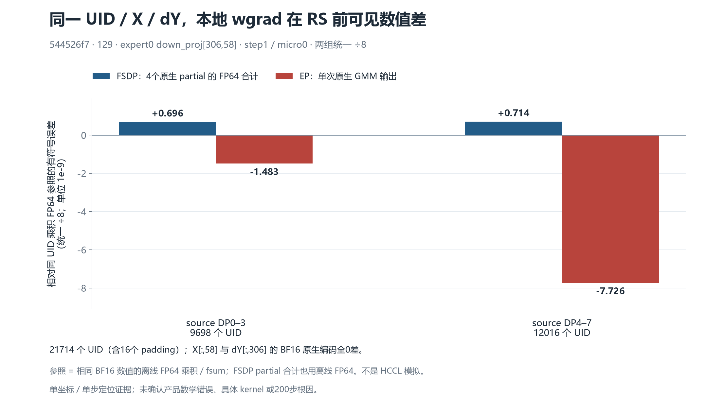
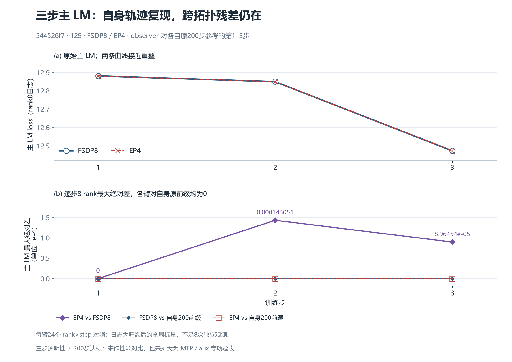

# 相同 UID / X / dY 下，E0 局部 wgrad 在 RS 前已有数值差

固定源码 **544526f7**、129、CANN 9.2.0-beta.2 的 FSDP8 与 EP4 各完成三步原生观察。首步 micro0、`model.layers.1.mlp.experts.down_proj` 的 **expert0、row306、col58**，两臂 **21714 个 UID**（含 **16 个 padding**、source DP0–7）完全对应；选定 `X[:,58]` 与 `dY[:,306]` 的 **BF16 原生元素编码全0差**。匹配相同 source-DP 贡献域后，局部 GMM 输出已经呈现数值差，位置早于所选 reduce-scatter（RS）。这圈定了一个数值差异边界，**尚未确认产品数学错误、具体 kernel 或完整200步主 loss 根因**。

两臂对各自原200步参考的前三步，8 rank 的主 LM 日志差均为0。跨拓扑主 LM 第1–3步的最大绝对差依次为 **0、0.0001430511474609375、0.0000896453857421875**。三步透明性没有改变[当前544源码 EP4 / EP8 的完整200步失败结论](../a1e6-ep4-ep8-200/README_ZH.md)，仍由[总问题单 #202](https://github.com/hf1s/hyper-parallel/issues/202)跟踪；`18602c4` 等历史源码轨迹不作为本轮同源参考。

## 公平求和域与原生数值

EP4 的两个 expert0 owner 是 rank0、rank4，分别消费 source DP0–3、DP4–7。FSDP8 每卡只消费一个 source DP，不能把同编号 rank 的局部标量直接相减。下表先将每个 EP owner 与对应四个 FSDP partial 对齐。FSDP partial 合计与乘积参照都使用**离线 FP64 / `math.fsum`**，不是实测 NPU 合并结果，也不是 HCCL 加法顺序模拟。

| 相同 source-DP 域 | UID数 | EP原生单次GMM输出 | 四份FSDP原生partial的离线合计 | EP−FSDP离线合计 |
|---|---:|---:|---:|---:|
| DP0–3 | 9698 | -0.01942492462694645 | -0.019424907201027963 | -1.7425918485969305e-8 |
| DP4–7 | 12016 | -0.04710324481129646 | -0.0471031772904098 | -6.752088665962219e-8 |

原件还支持：所有选定 owner 的 GMM post 与 pre-RS scaling pre **同4字节**；FSDP 的 `AVG / factor=None` 在该缩放点不改变这4字节；EP 的 `SUM / factor=0.125` 输出精确等于该 FP32 标量乘 `1/8` 的 FP32 编码。这里没有采集通信后的选定坐标，因此不能据此宣称 RS 输出已一致。



图1以同 UID 的 BF16 数值乘积之 FP64 `fsum` 为参照，**所有误差统一除以8**，纵轴单位为 `1e-9`。对应参考和原数值见 [accounting.json](data/accounting.json)、[accounting.csv](data/accounting.csv)。不同本地 K 长度、分块与浮点累加顺序可以产生这类误差；本图没有识别具体 kernel，也没有确认这些差异足以解释后续主 loss 漂移。

## 三步主 LM 与原200步前缀



图2上半显示实际 rank0 日志，下半显示每步8 rank最大绝对差。每臂24个 rank×step 对照自身原200步前缀均为0；日志是归约后的全局标量，**不是8次独立观测，也不是完整梯度张量相等**。实际输入、计数、CPU初态描述符和运行标志的透明性另由两份执行审阅支持。图中不放200步阈值线，不将三步扩为200步达标，不作性能收益或 MTP / aux 专项验收。

## 官方源码合同与后续验证

[最新官方源码窄范围核对](reference/README_ZH.md)绑定 2026-10-18 20:41 UTC 实际读取的 **MF master 409019a（PyNative）**、**Megatron main ce852bf**。在本次 DP8、TP1、CP1、EP4 / EDP2 配置和已核 token 贡献域下，FSDP 的八份贡献 `AVG` 与 EP 两组已汇集贡献的 `SUM + 1/8` 具有相容的理想数学归一化轴。相关源码未提供跨 EP 拓扑、局部 K 长度与不同归约树的逐位一致合同。

这也不允许孤立照搬系数：Megatron 另区分 per-token loss、DP×CP 和 GTP correction；MF 当前 PyNative 的 SUM、loss sense 和梯度累积共同定义缩放。JT 的 GMMAdd FP32目的缓冲区、HSDP对象移交与普通零梯度返回，不能仅凭变量名或 dtype 判定贡献丢失，也不能由 Python dtype 推定全部底层乘加精度。

下一步需要有原生 control 的单变量干预，检验局部分块差是否传递到通信后同一逻辑坐标、更新及主 loss；完整200步复验仍是独立门槛。当前不据此新建产品 bug 或修复 PR。

## 证据与复现

- [实际UID / 原生数值及公平域独立复算](evidence/a1e6-e0-wgrad-129-causal-v3/129-global-uid-native-independent-review-v1.json)：240份原件SHA、17字段身份、35项pins、完整block覆盖，另写路由重建和数值解码；没有按物理rank配对。
- [FSDP三步执行与前缀审阅](evidence/a1e6-e0-wgrad-129-causal-v3/129-fsdp-v3-prefix-native-independent-review-v1.json)、[EP4三步执行与前缀审阅](evidence/a1e6-e0-wgrad-129-causal-v3/129-ep4-v3-prefix-native-independent-review-v1.json)：两臂均 exit0 / released，完整自有容器已移除；源码、数学和执行审阅各自保留范围。
- [图表输入](data/accounting.json)、[主LM三步CSV](data/main-lm-first3.csv)、[数据提取源码](tools/build_accounting.py)、[可编辑绘图源码](tools/plot_accounting.py)。SVG保留文字和向量：[图1](figures/fair-source-dp-errors.svg)、[图2](figures/main-lm-first3.svg)。SVG仅按行去除行尾空格；PNG为直接绘图输出。

`native_byte_differences` 保留历史字段名，单位是 **BF16元素编码不等的个数**，不是不同字节数；`+0/-0` 也可计1。本轮该计数为0。

在具备 Matplotlib / NumPy 与中文字体的 Python 环境中，运行 `python tools/plot_accounting.py` 从本目录小JSON重绘；用 `--output-dir <新的目录>` 可独立复现而不覆盖报告图。数据提取源码读取原有固定来源并拒绝覆盖已生成的数据文件。原始报告生成时没有复制大型 raw，也没有更改旧证据。此公开副本另含两臂48份原生侧证、32份指标原件及独立审阅，以支持离线复算；没有包含checkpoint或重放梯度。

## 公开副本的复算方法

公开包保留原48份原生侧证、32份指标文件、独立审阅和当前官方来源快照。迁移只改本文相对链接和 `tools/build_accounting.py` 的 ROOT 常量，比较器、路由合同、绘图源码与数据/图片均保持原字节，见 [迁移指纹](publication-provenance.json)。

从本目录执行：

```sh
python tools/uid-comparer/tools/compare_e0_uid_native.py --left runs/r129-a1e6-e0-wgrad-fsdp8-3-v3 --right runs/r129-a1e6-e0-wgrad-ep4-3-v3 --output uid-comparison-new.json
python tools/plot_accounting.py --output-dir new-figures
```

离线比较会重新核对固定身份、完整路由block、UID与原生数值；它不执行Torch、NPU或HCCL。如需重建accounting，可复制本目录到新的临时目录，保留原data作对照后在空data目录运行 `python tools/build_accounting.py`；该脚本拒绝覆盖旧结果。完整控制面和240文件采集链由审阅原文绑定；公开包仅保留上述科学复算所需原件，未把公开子集称作240份全量包。
