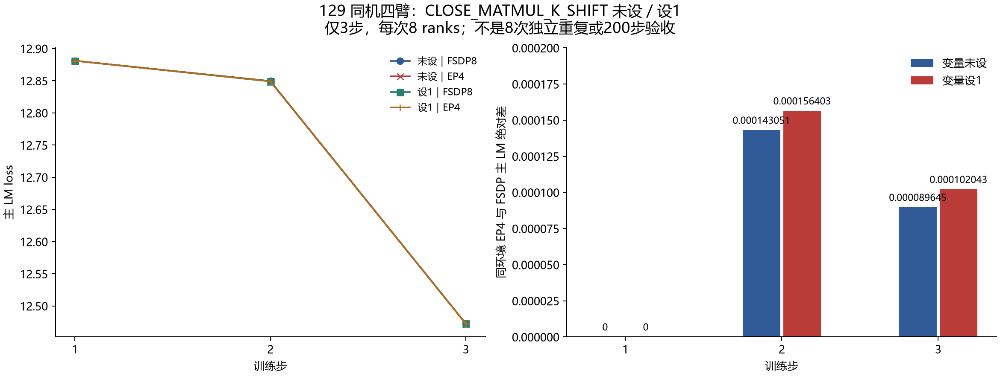
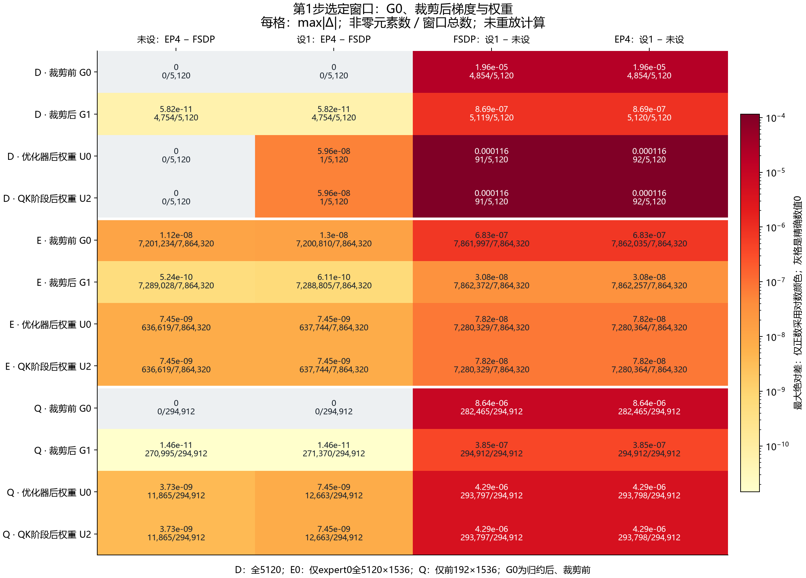

# 129 同机四臂三步：CLOSE_MATMUL_K_SHIFT 的有限消融

本报告记录已完成的 129 同机四臂三步消融。把环境变量 `CLOSE_MATMUL_K_SHIFT` 从**未设**改成 **`1`**，没有消除本次 FSDP8 与 EP4 的选定窗口差异，也没有形成统一的数值改善。三步主 LM 最大绝对差从 `0.0001430511474609375` 略增至 `0.000156402587890625`；日志中的 MTP、aux、total 最大差缩小。根因仍为 **UNRESOLVED**，本报告不作 200 步验收或产品修复结论。

## 对照和可信范围

四臂都在 129、固定源码 `544526f7db8342c607244fd41009b2a74adb84c8`、同一 `5f9e…146d` 镜像完成，每臂 3 步、8 ranks，均 exit 0、释放并核实自有完整 CID 不存在。每臂只有一次运行，8 ranks 是一次分布式运行的协作成员，不能计为 8 次独立重复。

| 名称 | 真实 case | 变量在建模前 / 训练时的回读 |
| --- | --- | --- |
| 未设 FSDP8 | `r129-a1e6-ep-stepbind-fsdp8-3-v1` | `null / null` |
| 未设 EP4 | `r129-a1e6-ep-stepbind-ep4-3-v1` | `null / null` |
| 设 1 FSDP8 | `r129-a1e6-ep-kshift-fsdp8-3-v1` | `"1" / "1"` |
| 设 1 EP4 | `r129-a1e6-ep-kshift-ep4-3-v1` | `"1" / "1"` |

原环境未设变量不等于显式设 `0`，设 `1` 也不等于已经观测到某个实际 kernel 分支。每种拓扑的两臂解析后配方只有输出目录不同，捕获的运行标志只差这一变量。seed 42、GBS 8、micro batch 1、LR `0.0001`、scheduler 长度 1000、`expert_fp32_weight_gradients=true` 与 Muon `ns_dtype=float32` 都保持原值。后两项不是这次新引入的干预。

本次重新读取并核验 4×8 ranks 的三步标量、全局输入指纹、计数器、每 rank 的 48 项 CPU 初态哈希、17 项产品源码和 1 项安装版 scheduler 证明。其中四臂的输入指纹、计数器、CPU 初态、源码与 scheduler 绑定一致；同一臂同一步各 rank 记录的全局标量相同，臂间标量差异见下表。`InputIdentityRecorder.global_sha` 是按组件哈希排序构成的全局无序指纹，不能据此直接证明源 DP 槽位或逐 token UID 相同。

## 三步 loss：结果混合



| 主 LM | 第 1 步 | 第 2 步 | 第 3 步 |
| --- | ---: | ---: | ---: |
| 未设 FSDP8 | 12.881054878234863 | 12.84947395324707 | 12.472381591796875 |
| 未设 EP4 | 12.881054878234863 | 12.84933090209961 | 12.472291946411133 |
| 设 1 FSDP8 | 12.881054878234863 | 12.84907341003418 | 12.472532272338867 |
| 设 1 EP4 | 12.881054878234863 | 12.848917007446289 | 12.472430229187012 |

| 同环境 EP4 与 FSDP 的三步最大绝对差 | 未设 | 设 1 |
| --- | ---: | ---: |
| 主 LM | 0.0001430511474609375 | 0.000156402587890625 |
| 日志 MTP | 0.0005972385406494141 | 0.00020647048950195312 |
| 日志 aux | 2.6921043172478676e-8 | 2.1143932826817036e-8 |
| 日志 total | 0.0004711151123046875 | 0.000102996826171875 |

MTP 与 aux 日志已经分别乘 `0.3` 和 `0.0001`。机器摘要另提供“日志差除以系数”的数值，供统一尺度阅读；这不恢复乘法之前的原张量，也不把辅助项当主 LM 验收。第 1 步四臂主 LM / MTP 相同，但同拓扑设 1 与未设的 aux 日志差已经是 `−2.9103830456733704e-11`，不能假设开关仅影响专家权重梯度。

## 首步原生窗口：E0 的更早差异仍存在



图内展示 31 个完整观测角色中的 12 个边界；机器图数据保留每条关系的全部 31 项。灰格是精确数值 0；仅正值使用对数颜色，未给 0 填入正数。每格同时给出最大绝对差和非零元素数 / 窗口元素总数。

- **D**：layer0 `input_layernorm.weight`，全 5120 元素。
- **E0**：layer1 `experts.down_proj` 的全局 **expert0**，全 `5120×1536`；不代表其余专家。
- **Q**：layer0 `q_b_proj.weight` 的前 `192×1536`；不代表完整投影或全模型。

`G0.all` 是实际 backward / FSDP 或 EDP 梯度归约后、裁剪前的梯度，不是归约前的原始 GMM 输出。`G1.grad` 是全局梯度裁剪后；`U0.weight` 是优化器更新后；`U2.weight` 是全局 QK 裁剪阶段后，该名称不表示 D/E 自身参与 QK 裁剪。

| 首步同环境 FSDP / EP4 边界 | 未设 | 设 1 |
| --- | ---: | ---: |
| D、Q 的 G0 | 原生字节相同 | 原生字节相同 |
| E0 G0 最大绝对差 | 1.1175870895385742e-8 | 1.30385160446167e-8 |
| E0 G0 非零元素 | 7,201,234 / 7,864,320 | 7,200,810 / 7,864,320 |
| D 的 U0 / U2 | 无差 | row 4875 单元素差，5.960464477539063e-8 |
| 31 角色中数值非零 / 原生字节不同的角色 | 20 / 20 | 22 / 22 |

两种拓扑各自“设 1 对未设”的关系均有 **26 / 31** 角色不同，说明干预也改变 FSDP 对照本身。首步 EP4−FSDP 的实际总范数差由 `+1.9073486328125e-6` 变为 `−1.9073486328125e-6`，仍为一个 FP32 ULP，符号反转。D/Q 的既有 G0 相同但 G1 不同可以用各自实际裁剪系数解释；E0 已在 G0 不同，不能把全部差异归结为裁剪。FP32 分组归约的舍入差也不能单凭 1 ULP 认定为独立产品 bug。

环境变量的官方来源与支持范围见 [K_SHIFT 小审计](https://github.com/xingleixu123/hyper-parallel/blob/71c2cc83b3f70e2b71461a35210a3ef29c0ac5b7/docs/validation/jt-dev-8npu-20261014/reports/a1e6-ep-stepbind-firststep/audits/kshift/README_ZH.md)，范数分组和参考实现见 [范数源码对照](https://github.com/xingleixu123/hyper-parallel/blob/71c2cc83b3f70e2b71461a35210a3ef29c0ac5b7/docs/validation/jt-dev-8npu-20261014/reports/a1e6-ep-stepbind-firststep/audits/norm/README_ZH.md)。现有材料没有证明本环境 CANN 9.2 的 `npu_grouped_matmul_add_` 实际消费该变量；它还可能影响其他 forward / dgrad / matmul 路径。上述结果只证实这组实际三步消融的差异，不能定位唯一 kernel 内因、给出生产性能收益或替代稳定的全 200 步回归。

## 输入绑定、独审和复算

[输入清单](study-inputs.json) 固定原文 SHA；[图数据](figure-data.json) 保留数值、运行标志、输入和初态指纹、31 角色与各原生文件的 manifest 哈希；[机器摘要](machine-summary.json) 由这些值计算差；[生命周期安全摘录](execution-provenance.json) 将每条关系绑定到具体 case、同一 source / image / host 与释放证据。canonical 数值报告不带 case 路径，因此还绑定 comparator 实际 `--left/--right` 执行回执，不能仅凭数值报告 SHA 推断是哪次运行。

首轮原件为 **444 文件、531,855,156 B**，仍保存在本任务原有 `runs` 与隔离的 scheduling raw 目录。报告没有复制约 498.4 MiB 的 32 份原生二进制，也没有复制含私有进程、完整 CID 或宿主路径的完整执行回执。四臂全 SHA / 31 角色逐元素复算由 私有正式科学独审（见[公开审阅摘录](scientific-review-public.json)） 确认，SHA `e53f28f8a8ed3c1cf561df4afdd5f6474c0818f9a712ae95358dd5a1c53ac114`。其中未设双臂沿用已重新哈希的 既有同 129 全 31 独审（SHA 与范围另见公开审阅摘录）。这里的 PASS 表示证据与选定窗口复算通过，不是主训练目标完成。

本报告生成器重新核验原始文字文件 SHA、标量和身份关系；对大原生文件只检查保留位置与大小，并绑定已核验 manifest 和独审。它**不再次计算全部原生数值**。只从图数据重绘则完全不核原始文件，适合可移植展示，不能提升原证据的可信级别。

从公开包重绘时使用下列命令。输出必须为尚未包含七个产物的新目录；脚本拒绝覆盖旧产物。需要 Matplotlib / NumPy 与中文字体 `Microsoft YaHei`；版本或字体变化可能改变图像字节。默认原文重核模式仅适用于原私有任务目录及保留的完整原件，公开包使用 `--from-data`，该模式不核原始训练证据。

```powershell
python -B -X utf8 '.\generate_figures.py' --from-data '.\figure-data.json' --output '.\new-portable-rebuild'
```

本公开包记录消融证据与图表，通过独立科学复算及报告 QA；不包含远端执行入口，不修改训练源码或运行控制面。完整目标与后续状态关联[总 issue #202](https://github.com/hf1s/hyper-parallel/issues/202)。
