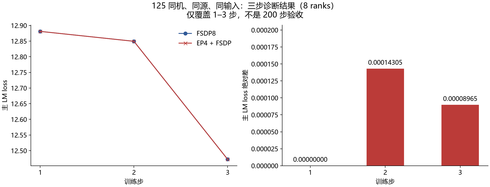
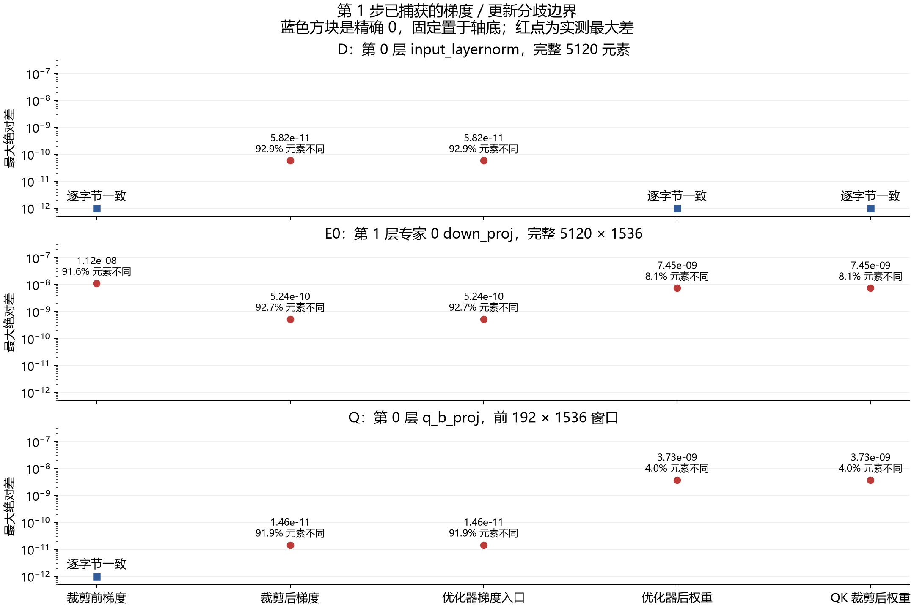

# 125 同机 FSDP8／EP4 首步梯度与更新边界

固定源码 `544526f7db8342c607244fd41009b2a74adb84c8`、CANN 9.2.0-beta.2，在同一台 125 上各执行一次完整三步、八 rank 诊断。两次均正常退出并确认释放设备。此报告用于定位第 1 步的数值分歧，**不是 200 步精度验收，也不是已确认的产品缺陷**。

普通参数 D、Q 选中窗口在梯度裁剪前逐字节一致，裁剪后出现微小差异；expert 0 的选中梯度在裁剪前已经不同。因此不能把 EP4 的全部差异归因于总梯度范数，也不能从单个 expert 推广到全部专家。

## 本次可比条件

| 项目 | 两侧设置 |
| --- | --- |
| 设备 | 125，同一组八张 910B3，64 GiB／卡 |
| 源码 | `544526f7db8342c607244fd41009b2a74adb84c8`，无产品源码修改 |
| 案例 | `r125-a1e6-ep-stepbind-fsdp8-3-v1`、`r125-a1e6-ep-stepbind-ep4-3-v1` |
| 计算 | BF16 参数计算、FP32 梯度归约／主参数；expert FP32 wgrad 已开启，Muon `ns_dtype=float32` |
| 训练 | seed 42，GBS 8，MBS 1，序列长度 4096，学习率 0.0001，重算关闭 |
| 损失系数 | MTP 0.3，aux 0.0001；未为对齐改变系数 |
| 数据 | 三步的八 rank 输入身份相同；实际逐 rank 日志保留 |
| 执行边界 | 各三步，840 秒内部／900 秒外部限时，结束后只清理本任务自有容器 |

输入身份边界：[固定544的InputIdentityRecorder](audits/input/tensor_probes.py)在形成`global_sha256`前对组件哈希排序，因此当前记录证明的是全局输入组件的无序指纹一致，并不直接证明源DP槽位、物理rank上的token次序或逐token UID一一相同。图中的“同输入”按这个全局指纹范围理解；后续对wgrad作逐token因果匹配必须补UID证据。这不否定已记录的全局数据与loss对照条件，也不扩大其证明范围。

两条训练均带有只观测首步的梯度／优化器探针，不能拿本次墙钟时间或显存峰值评价正式训练性能。125 FSDP 三步与已有 129 FSDP 基线及独立连续 400 的前 3 步，六项训练标量、输入、计数器和已记录 CPU 初态一致；这只证明对应三步的观测范围，尚不能替代 125 完整 200 步或其同机无探针对照。

## 三步 loss 结果

| 步 | FSDP8 主 LM | EP4 主 LM | 绝对差 |
| --- | ---: | ---: | ---: |
| 1 | 12.881054878234863 | 12.881054878234863 | 0 |
| 2 | 12.849473953247070 | 12.849330902099610 | 0.000143051147461 |
| 3 | 12.472381591796875 | 12.472291946411133 | 0.000089645385742 |

每条运行内，主 LM 在八个 rank 上一致。第 1 步 loss 相等并不表示第 1 步梯度或更新逐字节一致。三步主 LM 最大差 `0.0001430511474609375` 也不能证明第 1–200 步全程低于 `0.005`；已有 129 EP4 的完整 200 步失败证据仍有效。



## 第 1 步的已捕获边界

比较器按全局逻辑坐标重建值，不把不同布局的物理 rank 直接相减。完整验证涵盖 31 个选中角色：D 的 12 个、E0 的 9 个、Q 的 10 个。

| 目标／角色 | 比较元素数 | 不同元素数 | 最大绝对差 |
| --- | ---: | ---: | ---: |
| D 裁剪前梯度 | 5,120 | 0 | 0 |
| D 裁剪后／Adam 入口梯度 | 5,120 | 4,754 | 5.820766091346741e-11 |
| D Adam 后／QK 裁剪后权重 | 5,120 | 0 | 0 |
| E0 裁剪前梯度 | 7,864,320 | 7,201,234 | 1.1175870895385742e-08 |
| E0 裁剪后／Muon 入口梯度 | 7,864,320 | 7,289,028 | 5.238689482212067e-10 |
| E0 Muon 后／QK 裁剪后权重 | 7,864,320 | 636,619 | 7.450580596923828e-09 |
| Q 裁剪前梯度 | 294,912 | 0 | 0 |
| Q 裁剪后／Muon 入口梯度 | 294,912 | 270,995 | 1.4551915228366852e-11 |
| Q Muon 后／QK 裁剪后权重 | 294,912 | 11,865 | 3.725290298461914e-09 |

D 是 `model.layers.0.input_layernorm.weight` 的全部 5120 个元素；E0 是 `model.layers.1.mlp.experts.down_proj` 中 expert 0 的完整 `5120×1536` 矩阵；Q 是 `model.layers.0.self_attn.q_b_proj.weight` 的前 `192×1536` 窗口。Q 没有覆盖完整矩阵；Muon 使用矩阵内其他位置，不能仅凭这一窗口为整个矩阵的更新归因。



图中蓝色方块表示精确零，为适应对数轴固定放在轴底，并不表示测得 `1e-12`。红点表示实际最大绝对差，百分比的分母均为该目标本次比较的元素数。

本次总梯度范数的 FP32 原始字节分别为 `9ec9b341`／`9fc9b341`，即 `22.473445892333984`／`22.473447799682617`，相差一个 FP32 ULP。D／Q 选中梯度在裁剪后出现的差异与该范数差传播相符，仍待固定裁剪范数的单变量干预验证。不同并行拓扑改变 FP32 累加或归约次序时可以出现舍入差；单个 ULP 不能单独证明范数计算存在产品错误。

`G0` 是训练 backward 回调完成、FSDP／EDP 梯度归约完成后、裁剪前的实际本地梯度。它不是专家 grouped GEMM 的归约前输出。两侧 E0 在 `G0` 已不同，仅能把该目标的首个**已观测**分歧放到裁剪之前；目前仍需区分专家局部 wgrad 计算、token 拼接与梯度通信归约的贡献。

## 证据与后续判据

- [完整 31 角色比较](evidence/a1e6-ep-firststep-runtime-probe-v4/125-v4-fsdp-vs-ep4-native-comparison-v1.json)，SHA256 `18254a7b45a934e88577fe5d806059f874fb541fc5ca68b177dc56bace06da8d`，状态为 `SELECTED_WINDOWS_COMPARED_NOT_CAUSAL`。
- [FSDP 独立复核](reviews/125-v4-fsdp-native-independent-review-v1.json)，验证原始文件 SHA、全部选中 slab 的完整覆盖与有限值，以及对应三步的跨 129 参考比较。[EP4独立复核](reviews/125-v4-ep4-native-independent-review-v1.json)及[同机pair独立复核](reviews/125-v4-fsdp-vs-ep4-native-independent-review-v1.json)均已通过。公开文件是注明源SHA的安全摘录，原始独审全文在本地留存。
- [绘图数据及输入绑定](figure-data.json)、[可编辑绘图程序](generate_figures.py)，同时保留 PNG／SVG 两种图片。
- 本包公开的安全逐 rank 原文分别保存在 `runs/r125-a1e6-ep-stepbind-fsdp8-3-v1` 与 `runs/r125-a1e6-ep-stepbind-ep4-3-v1`，大二进制不复制进本报告。

下载本目录后，先运行标准库核验程序，再任选两种绘图输入路径。绘图需要 Matplotlib、NumPy 和可用的中文字体。

```bash
python -B verify_evidence.py
python -B generate_figures.py
python -B generate_figures.py --from-data
```

第一条命令重核公开manifest、92份安全run文件的原manifest指纹、48条逐rank-step日志、CPU初态哈希、输入/计数/runtime，并按全局坐标核对每侧860条唯一slab的**元数据声明哈希**与31角色覆盖和跨臂哈希不一致数。它不打开留存的大二进制，不能重算其逐元素max/nonzero/MSE/finite；这些数值由保留完整原件的正式独审复算确认。图表解析数值只取16份metrics中的主LM和已绑定canonical31，不把独审状态或文字当数值输入。

默认绘图路径重新读取本包16份原metrics及canonical31；`--from-data`只读取冻结figure-data。作者在同一Matplotlib/中文字体环境实际运行两路，两个PNG与原图均逐字节相同。不同字体/绘图库版本不承诺PNG字节相同。两路均不替代原生二进制复验。

本报告对应的三步采集尚不含125正常完整200步对照；完整200步参考另案执行和报告。后续应以同机参考为基础，再对 E0 上游路径做单变量消融。每次干预先比较选中 `G0` 的坐标覆盖、不同元素数、最大差和均方差，然后看范数、裁剪后梯度、优化器入口及更新；确认局部效果后再做完整 200 步回归。未定位具体产品函数与触发条件前，不把本次探针完善当作产品修复 PR。

最终验收仍要求同条件、完整 200 步 × 8 ranks 的主 LM 最大绝对差不超过 `0.005`，并单独评估正常运行时的显存与性能。MTP／aux 的本次日志仅作观测，不能扩展为其全矩阵验收。

## 公开范围与来源

[发布状态](review-status.json)区分已通过的科学独审与尚待独立publication QA的本公开候选；作者未commit/push或修改issue。[图表独审摘录](reviews/125-v4-report-independent-review-v1.json)保留两路重绘和可视QA结论。

- [执行终态安全摘要](execution-summary.json)、[FSDP原manifest索引](evidence/retained-fsdp-manifest-index.json)、[EP4原manifest索引](evidence/retained-ep4-manifest-index.json)保留原文SHA及文件指纹。16份native二进制合计261,316,608 bytes留存本地，未放入公开包；原始调度/归属/进程资料也未复制。
- [首步router对照](evidence/125-router-firststep-root-comparison-v1.json)的48份bias/count十六进制与16份组/LR记录一致；仅首步，不能证明全部路由顺序/所有步或归约前wgrad相同。
- [17份HP源码与framework固定pin](source-pins.json)、[范数/官方MF与Megatron源码核对](audits/norm/README_ZH.md)、[K_SHIFT官方出处及GMM覆盖边界](audits/kshift/README_ZH.md)。源码快照保留原许可头，附[LICENSE](LICENSE)。1ULP不单独成立产品bug；开关候选也不是已运行修复。
- [来源与公开变换](source-provenance.json)逐项标明原字节复制、展示稿路径调整和独审安全摘录。训练文本、权重/checkpoint、外来进程原文、私有操作路径/凭据和执行guard均未公开。

数据哈希和元数据不是八次独立重复；每侧是一次训练的八份物理rank日志。完整200步失败结论和既有独立issue/PR状态不因本包改变。
