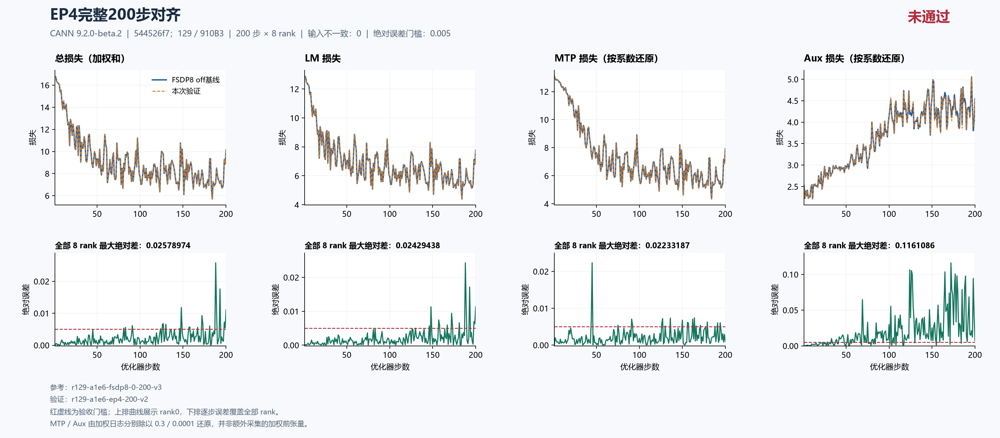
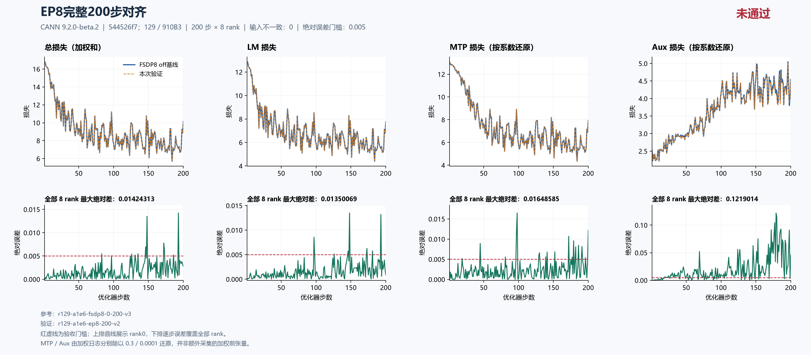

# 当前固定源码 EP4、EP8：完整 200 步主 LM 均未通过，根因待定位

固定集成源 `544526f7db8342c607244fd41009b2a74adb84c8` 的 **EP4、EP8 均从初态独立完成 200 步 × 8 rank**。EP4 主 LM 最大绝对差为 **0.024294376373291016（step 188）**，15 步超过 0.005；EP8 为 **0.013500690460205078（step 148）**，7 步超过 0.005。两项主 LM 验收均 **FAIL**，具体函数与根因仍 **UNRESOLVED**。输入、CPU 初态、数据计数、LR 与执行完整性核验通过，不能替代精度验收。

漂移继续在[总问题单 #202 的 Top1](https://github.com/hf1s/hyper-parallel/issues/202)跟踪。本包按当前最大误差先列 EP4，再列 EP8，没有把尚未定位的两个配置差异分别认定为两个独立缺陷。历史 `18602c4` 等源码、其他 TP/CP/EP 配置、FSDP 续训与重算，以及新的三步原生 trace 均保留各自验收范围；它们不并入本包完整 200 步结论。

## 固定来源、数值配方与比较口径

主机 129，8 × Ascend 910B3 64 GiB，CANN **9.2.0-beta.2**；镜像为 `sha256:5f9e677f439d11ab4e7c888f54b142335a27eee7411cbd2ce894a4798a70146d`。本批次固定上游 JT_dev 为 `a1e6c222`，验证集成源为 `544526f7`，包含用户指定的 #180 及已集成的 #230/#232；结果只绑定该提交，不泛指今后变化的分支 HEAD。

2026-10-18 06:29:27 UTC 的只读核验确认：远端 JT_dev HEAD 仍为 `a1e6c222eab097c9609d6e744a3c5f98aeed6bdc`；#180 已合并，其 merge commit `521d3a8a9aa62353327093ab1258ca2c22006e8b` 是固定源的祖先，固定工作树 clean。该状态摘要与 SHA 记录在 provenance 中，不复制完整 GitHub API 原文；它不改变本包固定训练源码。

四次运行源码与空 patch 一致，保持 seed 42、dataloader seed 1234、GBS 8/MBS 1、seq 4096、LR 0.0001、scheduler 1000、MTP 系数 0.3、aux 系数 0.0001；模型为两层 trunk、一层 MTP、8 个 routed experts。FP32 初始化、归约和主参数、专家 FP32 权重梯度、Muon NS FP32、BF16 计算参数等配方一致。实际 activation checkpoint 检查均为 off、0 个 wrapper。

| 用途与运行 | 实际拓扑/参数分片 | 每优化器步微批数 | 比较窗口 |
|---|---|---:|---|
| 精度参考 `r129-a1e6-fsdp8-0-200-v3` | DP8，FSDP8 | 1 | 1–200 |
| 资源 off 参考 `r129-a1e6-fsdp8-continuous400-v2` | DP8，FSDP8，无 checkpoint 保存 | 1 | 原文完整 400 步，资源取前 200 |
| `r129-a1e6-ep4-200-v2` | DP8，TP1/CP1；dense FSDP8，expert EDP2 × EP4 | 1 | 1–200 |
| `r129-a1e6-ep8-200-v2` | DP8，TP1/CP1；dense FSDP8，expert EDP1 × EP8 | 1 | 1–200 |

所有配置均为 PP1。EP 是专家参数/通信域，不能把 EP4、EP8 误写成 dense DP2、DP1，也不能以 TP × CP × EP 相乘限制替代实际 mesh。输入按每个优化器步的全局身份摘要比较，不按不同拓扑的同编号物理 rank 或局部专家直接配对。

精度参考与独立连续 400 的前 200 步在所测 loss、梯度范数、LR 和数据计数上完全一致。对两份参考分别复算，EP4、EP8 的误差相同。正式资源表统一使用不保存 checkpoint 的连续参考，避免把精度参考的 step 200 保存成本混入资源对照。

EP4 守卫总耗时 406.96522226999514 秒，EP8 为 407.18098892003763 秒；均 exit 0，已停止并释放本任务 PID，完整八卡释放快照通过。完整容器 ID 为 `6283f02facdbdf2c3b59d2f061db4f691d9e8f78f5b12ec05f65c88fc080c02c` 和 `eaa89c6da1d0bdae737e1961f8ef5bdf8883f71f27967ddfabc994c3938c6f3d`，后续完整 ID 查询均已不存在。这些是保存的执行/释放证据，守卫耗时不等于稳态秒/步。

## 完整 200 步精度结果

| 全 200 步 × 8 rank 最大绝对差 | EP4 | EP8 |
|---|---:|---:|
| 主 LM | 0.024294376373291016（step 188） | 0.013500690460205078（step 148） |
| 总 loss（日志加权和） | 0.025789737701416016（step 188） | 0.014243125915527344（step 193） |
| MTP 日志（含系数 0.3） | 0.006699562072753906（step 45） | 0.0049457550048828125（step 98） |
| MTP 按系数还原 | 0.022331873575846355（step 45） | 0.016485850016276043（step 98） |
| Aux 日志（含系数 0.0001） | 1.1610856745392084e-05（step 172） | 1.2190139386802912e-05（step 179） |
| Aux 按系数还原 | 0.11610856745392084（step 172） | 0.12190139386802912（step 179） |
| 梯度范数 | 0.7962799072265625（step 148） | 0.840362548828125（step 148） |
| LR | 0（全程） | 0（全程） |

EP4 主 LM 超阈值步：**130、146、148、157、158、167、172、173、181、188、189、193、198、199、200**。

EP8 主 LM 超阈值步：**97、126、146、148、173、181、193**。

每项对每个参考比较 1,600 对标量；四项数据计数共 6,400 对，无差异，全局输入身份和 LR 也无差异。loss 和梯度范数属于全局归约后的日志观察，八 rank 覆盖不能说成八份独立本地 loss 相等；梯度证据只包含范数。MTP/Aux 的未加权误差由已记录加权值除以 0.3/0.0001 得到，并非另采的加权前张量。本轮主 LM 优先，组件仅作诊断观测，不扩大为其专项全矩阵通过。

EP4：[严格比较](ep4-comparison.json)、[摘要](ep4-summary.json)、[独立科学复核](ep4-independent-review.json)。EP8：[严格比较](ep8-comparison.json)、[摘要](ep8-summary.json)、[独立科学复核](ep8-independent-review.json)。





两图上排为 rank0 轨迹，下排为逐步全部 8 rank 最大绝对差，覆盖 1–200 全部步骤。图名中的“对齐”表示比较过程，右上角“未通过”与本报告一致。MTP/Aux 按系数还原，0.005 虚线用于同口径诊断；不把组件诊断当作其专项已经验收。

## 首次更新前证据与定位边界

| 首步全局日志 | FSDP8 | EP4 | EP8 | 两个 EP 配置各自对基线绝对差 |
|---|---:|---:|---:|---:|
| LM | 12.881054878234863 | 12.881054878234863 | 12.881054878234863 | 0 |
| MTP 日志 | 3.928363800048828 | 3.928363800048828 | 3.928363800048828 | 0 |
| Aux 日志 | 0.00025308559997938573 | 0.00025308559997938573 | 0.00025308559997938573 | 0 |
| 总 loss | 16.809673309326172 | 16.809673309326172 | 16.809673309326172 | 0 |
| 梯度范数 | 22.473445892333984 | 22.473447799682617 | 22.473447799682617 | 1.9073486328125e-06 |

两项首步 total/LM/MTP/aux 四项标量差都是 0；梯度范数已经相差 1.9073486328125e-06，四项 loss 都从 step 2 开始非零。[固定源码 TextTrainer.train_step](https://github.com/xingleixu123/hyper-parallel/blob/544526f7db8342c607244fd41009b2a74adb84c8/hyper_parallel/trainer/text_trainer.py#L281)先完成前向/反向并汇总 loss，再测量/处理梯度、执行 optimizer，最后记录完成步数。因此首次 optimizer 更新前已有可见的范数差异。

这一观察 **不证明完整前向、根梯度或反向张量相同，也不定位某个反向算子或 optimizer 为根因**。两个 EP 度数的首步标量恰好相同，也不能推导之后完整轨迹相同。后续需要对齐逻辑 token、专家编号/参数与归约语义，再采原生前向、反向、未裁剪梯度、裁剪和更新边界，建立具体因果证据。

48 项 CPU 构造张量的 shape/dtype/hash 一致；采集时 JT MLA 模块替换和 native 初始化已完成，但尚未进行 NPU 搬运、TP/EP 参数切分及 FSDP 计算参数物化。这不等价于首次 NPU 全参数、缓存、RNG 等内部状态逐字节相同。全局参数元数据、runtime flags、global input 摘要一致也不补足该缺口。

本包不把其他三步 trace、局部消融或观察透明性结果并入 200 步验收。确认具体函数、触发条件和因果证据后，才建立独立小 issue 与单 commit PR；最终修复仍需回到同源完整 200 步 × 8 rank 主 LM ≤ 0.005。

## 全 rank 资源观测与专家布局

时间先逐步取 8 rank MAX，再取 step 21–200 中位数。有效监督 token/s 为同窗口逻辑监督 token 总数除以时间总和，不重复累加各 rank 的全局计数。Allocator 峰值取 step 1–200 内全部 rank 的进程累计值，包含预热。三次窗口监督 token 总数均为 **3,325,552**；时间总和依次为 **207.85544788837433、238.0988347530365、239.25359630584717 秒**。

| 单次完整运行资源观测 | FSDP8 off | EP4 | EP8 |
|---|---:|---:|---:|
| 中位秒/步 | 1.155826 | 1.320180 | 1.326078 |
| 有效监督 token/s | 15999.35 | 13967.11 | 13899.69 |
| Allocated 峰值 GiB | 22.032196 | 21.080860 | 21.100903 |
| Reserved 峰值 GiB | 27.171875 | 26.333984 | 26.333984 |

相对 off，EP4 allocated 少 **0.9513359069824219 GiB（4.32%）**，中位步时增加 **14.22%**、有效监督吞吐下降 **12.70%**；EP8 allocated 少 **0.9312934875488281 GiB（4.23%）**，步时增加 **14.73%**、吞吐下降 **13.12%**。EP8 相对 EP4 在本次观测中没有进一步节省 allocator 峰值或加速；单次共享机运行不足以给出稳定排序。**两项精度失败，资源只作失败配方诊断，不能推荐为已验收优化。**

两个配置的 200 步中 rank0 时间低报其他 rank 的步数均为 0；本表仍统一使用[EP4 全 rank 复算](ep4-resources.json)、[EP8 全 rank 复算](ep8-resources.json)和[连续 off 参考](off-resources.json)。严格比较 JSON 中的 rank0 performance 字段只供审计。输入哈希、标量采集与 callback 时长边界保留，不宣称无插桩端到端性能或物理 HBM 峰值。

两个配置的 rank0 初始布局均为 **42 项 dense + 4 项 routed-expert 参数**：

| 实际初始 metadata | EP4 | EP8 |
|---|---|---|
| dense mesh | `(fsdp_shard,tp)=(8,1)` | `(fsdp_shard,tp)=(8,1)` |
| expert mesh | `(edp_shard,ep)=(2,4)` | `(edp_shard,ep)=(1,8)` |
| expert placements | `StridedShard(dim=0, split_factor=4), Shard(dim=0)` | `StridedShard(dim=0, split_factor=8), Shard(dim=0)` |
| dense 本地 FP32 元素 | 292,561,920 | 292,561,920 |
| expert 本地 FP32 元素 | 47,185,920 | 47,185,920 |
| 合计本地 FP32 元素 | 339,747,840 | 339,747,840 |
| 单份 FP32 参数元数据对应 GiB | 1.2656593322753906 | 1.2656593322753906 |

4 项 expert 参数来自 trunk 第 1 层与 MTP 层，各含 gate_up_proj 和 down_proj。总持久份额仍与 FSDP8 基线相同：EP4 × EDP2 和 EP8 × EDP1 的组合总分片均为 8，不能再把所有持久参数分别除以 4 或 8。两个配置均记录 6 个实际 FSDP 单元，两个专家单元属于 EXPERT，其余为 DENSE；EDP1 也不意味着 dense DP1。

初始 optimizer state 为空；model/main 元数据相同不等于两套已测独立存储。metadata 不记录每次前向 all-gather 后的完整计算参数字节。EP 改变专家物化、token dispatch/combine 和通信缓冲，但缺少阶段 profiling，不能把 4.32%/4.23% 的峰值变化定量归因到某个模块，也不能据此假设理想四倍或八倍加速。

依据包括[EDP/EP mesh 构造](https://github.com/xingleixu123/hyper-parallel/blob/544526f7db8342c607244fd41009b2a74adb84c8/hyper_parallel/distributed/mesh.py#L197)、[JT EP 计算入口](https://github.com/xingleixu123/hyper-parallel/blob/544526f7db8342c607244fd41009b2a74adb84c8/hyper_parallel/models/jt_deepseek_v3/adapter/distributed/ep_compute.py#L30)，以及各运行的 `integration/check/optimizer_layout_initial.json` 与独立科学复核。源码机制说明不替代实际通信/算子 profiling。

## 公开证据、复算与执行边界

四次原采集各 91 文件、合计 **364 文件**逐 SHA/size 核验。本目录每次复制与既有审阅包一致的 56 个安全文件，共 **224 个 run 文件**，保留配置、逐 rank 指标、CPU 初态、runtime flags、起止标记、allocator 终态和 rank0 布局。训练文本、worker 日志、checkpoint 二进制和私有驱动原文不在公开包中，必要 checkpoint 与完整执行证据保留于任务归档。四份原始数据的本机副本未保存；独审核对请求数据 pins 以及完整 global input/计数，没有声称在本机重新哈希远端数据文件。

[source-provenance.json](source-provenance.json)记录每个复制源、目的文件、字节数与 SHA，复制项均 byte-identical；[manifest.json](manifest.json)覆盖本包全部非 manifest 文件。原私有 collection manifest、公开 manifest 与复制 provenance 是不同层次。公开安全子集可独立复算标量、曲线及资源；完整执行检查依赖科学复核和原私有归档，不将公开子集冒充完整 91 文件采集。

两份 scientific review 是独立于原始分析的科学复核。本包整理与自检属于作者工作，不能改称本公开包已经完成独立发布审核。EP8 的私有摘要脚本仅汇总 strict、全 rank resource 和实际首步日志，不参与训练，也不能代替原始证据验收；公开包保留直接复算工具与逐 rank 原文。

在本目录执行，输出使用新的派生文件名：

```text
python compare_runs.py runs/r129-a1e6-fsdp8-0-200-v3 runs/r129-a1e6-ep4-200-v2 1 200 --output ep4-scalars-recomputed.json
python compare_runs.py runs/r129-a1e6-fsdp8-0-200-v3 runs/r129-a1e6-ep8-200-v2 1 200 --output ep8-scalars-recomputed.json
python all_rank_resources.py runs/r129-a1e6-fsdp8-continuous400-v2 1 200 --output off-resources-recomputed.json
python all_rank_resources.py runs/r129-a1e6-ep4-200-v2 1 200 --output ep4-resources-recomputed.json
python all_rank_resources.py runs/r129-a1e6-ep8-200-v2 1 200 --output ep8-resources-recomputed.json
python plot_comparison.py . ep4-comparison.json --title "EP4完整200步对齐" --source-label "544526f7；129 / 910B3" --reference-label "FSDP8 off基线" --output figures/ep4-recomputed --raw-components --chinese
python plot_comparison.py . ep8-comparison.json --title "EP8完整200步对齐" --source-label "544526f7；129 / 910B3" --reference-label "FSDP8 off基线" --output figures/ep8-recomputed --raw-components --chinese
```

两项 scalar 比较返回 FAIL、退出码 1，是如实重现科学失败。主 LM 判据为完整 200 × 8 覆盖且 `errors["training/foundation_loss/lm"]["max_abs"] <= 0.005`。重绘读取原严格比较 JSON。`strict_compare_runs.py` 保留完整审核实现，其全部原 manifest/执行检查仍需私有归档。新生成配置或局部测试不能替代本包完整真机记录。

后续仅用 125/129，201 后续工作已取消。当前采用 **约 7,200 秒连续实验，当前轮自然结束并确认释放后休息 600 秒**；不再每次固定等待 20 分钟。策略和 v3 本机周期入口已有部署/激活证据，与原入口共享同一全局协调状态和锁。每次启动仍须实际空卡双检、固定输入/归属验证及 840/900 秒限时；冲突时只能停止和清理本任务完整 ID 容器。历史 1,200 秒间隔只描述当时政策，不覆盖当前规则。
