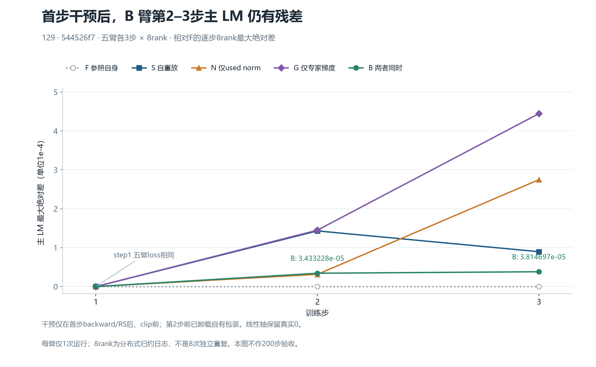
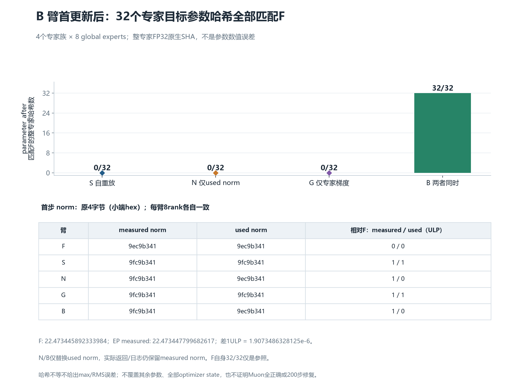

# 首步专家梯度与裁剪范数联合对齐：32个参数哈希匹配，后续loss仍有残差

129、固定集成验证源码544526f7、CANN9.2.0-beta.2；五个独立三步×8rank运行已完成。F为FSDP观察控制，S为EP4自重放，N仅将裁剪使用的范数替换为F值，G仅重放F的四专家族完整FP32梯度，B同时执行两项。干预在首步backward/RS之后、clip之前，第二步前卸载自有包装，原配方、数据与学习率保持不变。

| 运行 | 首更新后与F匹配的完整专家张量SHA | 第2步主LM绝对差 | 第3步主LM绝对差 |
|---|---:|---:|---:|
| S 自重放 | 0/32 | 0.0001430511474609375 | 0.0000896453857421875 |
| N 仅裁剪使用范数 | 0/32 | 0.00003147125244140625 | 0.000274658203125 |
| G 仅专家梯度 | 0/32 | 0.00014495849609375 | 0.0004444122314453125 |
| B 两项同时 | **32/32** | **0.000034332275390625** | **0.00003814697265625** |

B裁剪后的32个专家梯度与F的完整SHA也一致。这圈定了本次首更新四专家参数的可对齐输入边界；剩余loss差异仍需继续定位42个非专家参数、post-step状态及后续计算。不能由此认定整个Muon、全部optimizer state正确，也不能归因为唯一kernel或宣称200步已修复。

F测得/用于裁剪的FP32原4字节小端编码为9ec9b341，EP各臂实际测得9fc9b341，相差1ULP。N/B只替换used norm，保留原measured norm返回对象与日志。只对齐其中一项未获得32参数哈希匹配；完整SHA不等不代表已量化参数max/RMS误差。图保留真实0，不画200步验收阈值或虚构置信区间；8rank是归约同值日志，非8次独立重复。

[独立复核摘要](independent-review-summary.json)绑定实际五臂原生证据独审和本报告图文独审。原生科学审核复核596原件及32供体；报告复核133份小来源、720个标量及160条专家哈希记录，并从小原文重建9份图表数据、在独立目录重绘PNG/SVG均逐字节一致，两种格式均实际查看。

[完整中文说明与复现命令](authored/README_ZH.md)、[CSV与机器摘要](authored/data/)、[可编辑工具](authored/tools/)及[原作者manifest](authored/manifest-v1.json)原样保留。authored中的“图文待审/尚未发布”状态是作者冻结时的历史，本页与独审摘要反映之后的实际审核结果。可从本包CSV重绘；本包未复制1.40625GiB梯度供体、checkpoint或全部私有原始执行证据，不能冒充无需原文的完整运行复现包。MTP/aux仅保留原带系数日志观察，非其全矩阵专项验收。
