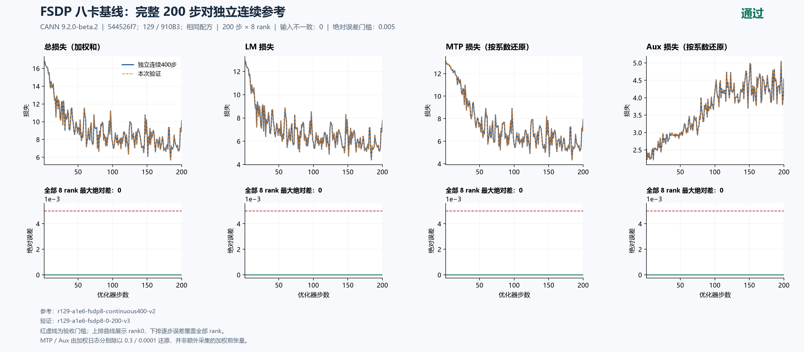
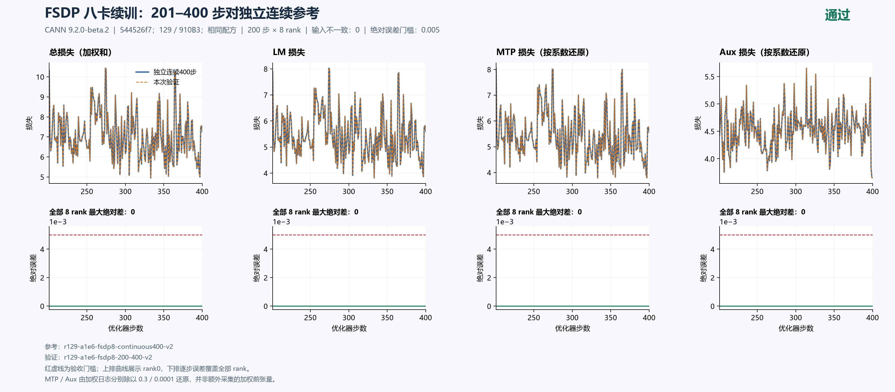

# 当前源码 FSDP 八卡：基线与续训对独立连续400步通过

固定 `544526f7db8342c607244fd41009b2a74adb84c8` 的两段验证均通过：独立基线 **step1–200**、从其step200 checkpoint恢复的 **step201–400**，分别与另一容器从同一初态连续训练step1–400的相应窗口比较。每段覆盖全部 **200步×8rank**，主LM最大绝对差均为 **0**，低于0.005。日志及按系数还原的MTP/aux、总loss、梯度范数也全部零差，输入与恢复计数一致。

这完成当前配方的FSDP基线/续训验收。当前源码的TP、CP、EP、组合及full/selective重算矩阵仍待完成；关闭重算的FSDP参考由本次提供。201跨机准入仍未通过，后续继续125/129。当前优先主LM，MTP/aux仅保留本轮已有观测，不据此宣布它们的全部并行矩阵通过。

关联：[总问题单#202](https://github.com/hf1s/hyper-parallel/issues/202)、[累计计数问题#208](https://github.com/hf1s/hyper-parallel/issues/208)、[独立单提交PR#197](https://github.com/hf1s/hyper-parallel/pull/197)。

## 三次独立执行

| 运行 | 起点与覆盖 | checkpoint行为 | 容器总耗时 |
|---|---|---|---:|
| `r129-a1e6-fsdp8-0-200-v3` | 从0开始，1–200 | 保存step200 | 383.050秒 |
| `r129-a1e6-fsdp8-200-400-v2` | 加载上述checkpoint，201–400 | 不再保存 | 371.027秒 |
| `r129-a1e6-fsdp8-continuous400-v2` | 独立从0开始，1–400 | 不加载、不保存 | 610.389秒 |

三次均exit0，实际八卡释放且自有容器已移除。每次共享机实验之间保持全局至少1200秒；从实际计算PID、core、显存与健康确认空闲并在启动前复查，设备命名空间仅保留诊断证据。续训和连续参考均未生成新checkpoint目录。step200的25文件共27,973,262,840字节保留用于复现，重复传输归档已核验后清理。

固定环境为129 / 8×Ascend910B3 64GiB、CANN9.2.0-beta.2、Python3.12.14、Torch/TorchNPU2.12，镜像ID `sha256:5f9e677f439d11ab4e7c888f54b142335a27eee7411cbd2ce894a4798a70146d`。上游 `JT_dev a1e6c222`（含#180、#230、#232）与已检视修复组成上述集成源。三次源码及空补丁相同，实际24份runtime flags一致：KSHIFT未设置、确定性打开、warn_only关闭、HF32关闭。

数值配方保持seed42、dataloader seed1234、GBS8/MBS1、seq4096、constant LR0.0001、MTP系数0.3/aux系数0.0001。BF16参数、FP32归约与主参数，专家FP32权重梯度和Muon NS FP32；不是全模型FP32。三份解析配置的差别只限运行步数、保存开关、输出/恢复路径。重算为off。

## 两个完整窗口的精度

| 全8rank逐步最大绝对差 | 基线1–200 vs 连续参考 | 续训201–400 vs 连续参考 |
|---|---:|---:|
| 主LM | 0 | 0 |
| 总loss（日志加权和） | 0 | 0 |
| MTP日志（乘0.3） | 0 | 0 |
| MTP按系数还原 | 0 | 0 |
| Aux日志（乘0.0001） | 0 | 0 |
| Aux按系数还原 | 0 | 0 |
| 梯度范数 | 0 | 0 |

[基线严格比较](baseline-comparison.json)与[续训严格比较](resume-comparison.json)均PASS，完整性findings为空。MTP/aux还原值由加权日志除实际系数推导，并非额外采集的加权前张量。上图曲线展示rank0，下图每一步误差覆盖全部rank；不把最后一步或一条rank曲线代替全量比较。





## 恢复计数及状态边界

恢复后的4项计数（逐步/累计samples、tokens）逐rank精确对照，共 **6400项、0差异**，其中累计计数3200项。[完整计数比较](resume-counters.json)。

| 边界 | 累计samples | 累计tokens | 本步tokens |
|---|---:|---:|---:|
| 保存端step200 | 1600 | 3713791 | 见逐rank原始记录 |
| 恢复后step201 | 1608 | 3720095 | 6304 |
| 恢复后step400 | 3200 | 7467738 | 16975 |

`CheckpointerCallback._collect_extra_state`保存meter、scheduler、dataloader及RNG状态；`_load_checkpoint`加载模型和优化器；`_apply_extra_state`恢复训练进度并调用`_restore_meter_state`。`EnvironMeterCallback.state_dict/load_state_dict`承载累计计数，后续按每步全局数据继续累加。固定集成源的对应位置为`checkpoint_callback.py:197/324/408/477`与`environ_meter_callback.py:229/236`。

本结果支持“固定配方下恢复后的所测训练行为、输入与计数和独立连续训练一致”。`initial-state`文件在初始化/分片及checkpoint恢复之前采集；它不是恢复后参数hash。当前未逐项导出并比较恢复后optimizer/scheduler/RNG内部字节，constant LR也不足以独立证明scheduler内部状态相同。因此不扩展为所有内部状态或任意数据、拓扑均相同。

#197直接修复累计计数保存/恢复；本轮是包含多个修复的544526f7集成验证，不将整轮loss一致性或性能归因于meter修复。原有最小红绿回归仍负责隔离该PR的具体作用。

## 显存与性能观测

先对每步取8rank MAX，再取以下窗口中位数；有效监督token吞吐按窗口token总数/步时总数计算。

| 运行与观测窗口 | 中位步时 | 有效监督token/s | allocator allocated峰值 | allocator reserved峰值 |
|---|---:|---:|---:|---:|
| 基线21–200 | 1.156256秒 | 15990.50 | 22.032196GiB | 27.250000GiB |
| 连续参考21–200 | 1.155826秒 | 15999.35 | 22.032196GiB | 27.171875GiB |
| 续训221–400 | 1.157550秒 | 16120.23 | 22.032196GiB | 25.316406GiB |
| 连续参考221–400 | 1.156937秒 | 16129.67 | 22.032196GiB | 27.171875GiB |

步时包含当前标量和输入身份采集开销，不是无插桩端到端吞吐。显存列从对应进程启动累计；连续参考后半程峰值可能继承前半程，不是各窗口重新清零的峰值。续训reserved较低不能解释为并行或重算策略节省；三次容器总耗时还包含初始化、加载或保存，不能直接当纯训练耗时比较。`final-memory`为整数字节，汇总日志经FP32归约可能有舍入差，两者都不是物理HBM瞬时峰值。

## 证据与复算

[主摘要](summary.json)、两份严格比较及计数报告保留实际输出；[独立复核](independent-review.json)从三次原始记录重新核算。每次原始采集91文件，连续参考另补充请求、协调器快照、释放读回及原manifest，形成95文件联合清单；原始91条保持不变，不能把补采说成一次原始归档。

`runs/`为明确列出的公开子集：三次各54份配置、源码标识、逐rank标量、初态、runtime flags、内存及起止标记。[source-provenance.json](source-provenance.json)记录来源路径与SHA，[manifest.json](manifest.json)校验本目录文件。完整原始manifest、请求、驱动诊断与释放证据保留在任务归档；checkpoint二进制及原训练文本不上传。公开子集足以复算展示的标量和计数，不替代完整私有执行身份审计。

在本目录用Python和matplotlib重绘：

```text
python plot_comparison.py . baseline-comparison.json --title "FSDP 八卡基线：完整 200 步对独立连续参考" --source-label "544526f7；129 / 910B3；相同配方" --reference-label "独立连续400步" --output figures/baseline-200 --raw-components --chinese
python plot_comparison.py . resume-comparison.json --title "FSDP 八卡续训：201–400 步对独立连续参考" --source-label "544526f7；129 / 910B3；相同配方" --reference-label "独立连续400步" --output figures/resume-200 --raw-components --chinese
```

中文字体为Microsoft YaHei，保留PNG/SVG和可编辑绘图源码。当前主loss矩阵尚未全部完成，因此不宣布整体目标完成；201跨机未通过的既有结论保持独立。
