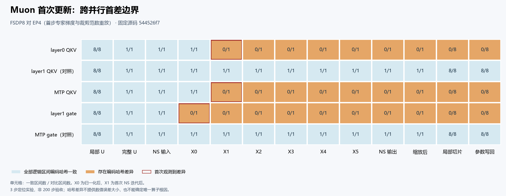

# Muon 首次更新：三个差异目标与两个阴性对照

同一固定源码 `544526f7`、相同数据/初态/配方下，FSDP8 与 EP4 两臂各运行 **3步×8rank**。EP4 的首步沿用专家梯度及裁剪范数重放；它是受控定位臂，不是未经干预的 EP4 完整200步验收。各臂对自身旧同拓扑控制的三步训练标量、输入、计数、初态与运行设置一致。

前一轮 census 在首次参数更新后发现三个非专家参数编码不同；本轮沿原调用进一步定位：

| 逻辑参数 | 首个观测到的编码差异 |
|---|---|
| layer0 QKV | X1：第一次原 NS 迭代后 |
| MTP QKV | X1：第一次原 NS 迭代后 |
| layer1 gate | X0：原归一化后 |
| layer1 QKV（阴性对照） | 全13边界一致 |
| MTP gate（阴性对照） | 全13边界一致 |



[65格 CSV](muon-first-boundary.csv) · [SVG](muon-first-boundary.svg) · [科学摘要](science-summary.json) · [绘图源](plot_muon_boundary.py) · [五份来源 SHA](source-bindings.json)

五个目标的局部 U、完整 U 和 NS 输入均一致。局部分片按完整逻辑区间配对，完整矩阵按 FQN、实际 owner 和成员顺序配对。EP4 中两个 QKV 合为 `[2,2112,5120]`，两个 gate 合为 `[2,8,5120]`；两个阴性对照分别覆盖未改变合批的 QKV 和合批改变但编码仍相同的 MTP gate。

固定 `hyper_parallel/core/optimizer/muon.py:143` 是原归一化；X0 在其后采样。168–174 行含原迭代的多次矩阵运算及点算子，X1 在第一次原174行更新后采样，不能据此指定唯一底层 kernel。

图中数字是**一致逻辑区间数/对比区间数**，不是误差幅度。完整 FP32 成员哈希不同只证明编码不同，不给出差异元素个数或 maxabs。三步主 LM 最大绝对差 `3.814697265625e-5` 只是此短窗观测；8rank 日志不代表8次独立重复实验。

下一步可检验仅拆开两个已证实合批组、保持原 owner 及其余路径的局部干预。本候选没有该干预的实测结果，也不宣称唯一数学根因、全优化器状态正确或200步精度修复；后续仍以功能和完整精度验收为准。

## 复现图表

需要 Python、Matplotlib 和可显示中文的字体。在本目录执行：

```bash
python plot_muon_boundary.py --output-dir /path/to/new-empty-directory
```

脚本只读取本包的65格 CSV，核对其 SHA 后生成 PNG/SVG，不访问私有证据或网络。系统缺少中文字体时可用 `--font /path/to/font.ttf` 指定字体。同一 Matplotlib/字体环境可逐字节重绘；更换字体或渲染器可能改变图像字节，CSV 的科学计数保持不变。SVG 固定绘图ID并移除日期、规范为 LF 换行并去除行尾空白。

本包保存可公开的小摘要、图和来源摘要 SHA，不包含原始训练张量、供体 payload、私有路径或容器信息。正式分析与独立原件复算已逐成员对照一致；完整私有证据按其 SHA 保留。
