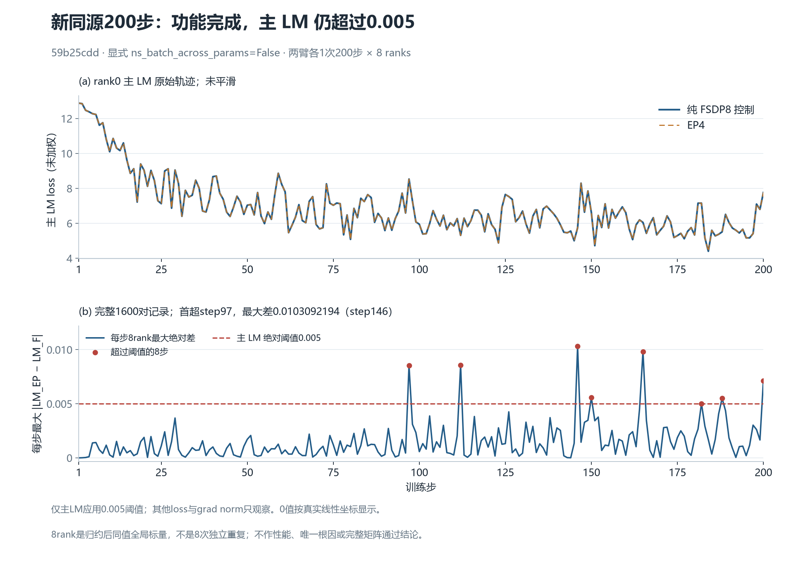
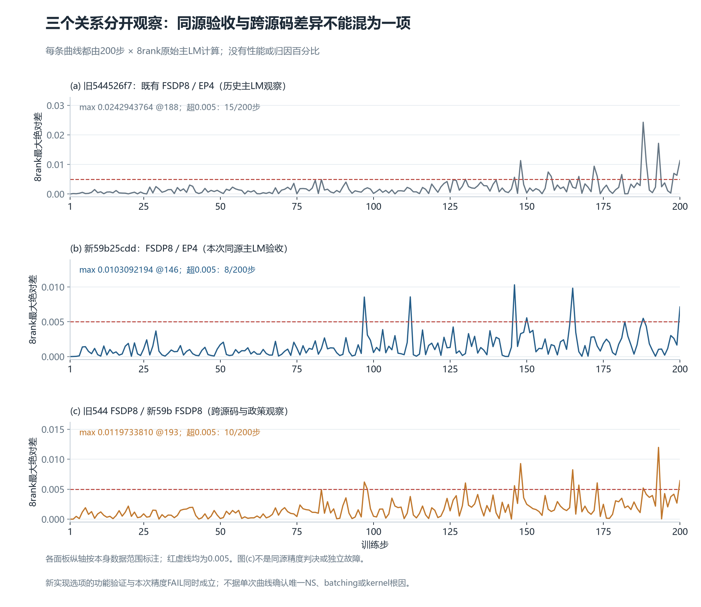

# 关闭跨参数NS拼批后的新同源200步：功能完成，主LM仍未通过

验收状态：**训练功能完成，主LM精度未通过**。2026-10-19（Asia/Shanghai）。两次普通训练均完整200步、exit0并释放；本轮唯一loss验收字段为相对纯FSDP的未加权主LM，要求全部200×8点绝对差不超过0.005。实际最大差为 **0.010309219360351562（step146）**，因此精度仍为 **FAIL**。功能完成与精度FAIL同时成立，不能把新选项、CPU单元测试或PR251说成200步精度修复成功。

独立科学审阅原件SHA为 `14cb3d229f05169e3b0e912ef202c2b311538359ef7559c765486d65864767d0`，安全摘录见 [科学独审摘要](evidence/scientific-review-summary.json)。作者小型main-only审计及原文映射另由独立源审 `a16d3c9ff5dbbb8b5a0a353d4550f687df587f2a97617af470257e1816dc5da1`核验。后续图文独审单列，见 [审阅状态快照](evidence/review-status.json)。



图1上方仅展示rank0未平滑轨迹；下方由全部1600对记录计算每步8rank最大绝对差。真实0使用线性坐标显示；8rank是归约后的同值全局标量，不是8次独立重复。8个超阈值步骤为 **97、112、146、150、165、182、188、200**，首次step97；共64个rank-step点超过0.005，非零1592/1600点。两臂各只有一次运行。

## 本次两个窗口与条件

`59b25cdd` 是以组合验证栈 `544526f7` 为父、合入本策略的集成验证提交；本轮 NPU 运行没有直接使用裸 `JT_dev a1e6c222` 上的产品 head `b32bded5`。裸产品 CPU 测试与集成 NPU 结果的适用范围分别保留。

| 项目 | 纯FSDP8控制 | EP4 |
|---|---|---|
| case | `r129-a1e6-muon-no-cross-param-fsdp8-200-v2` | `r129-a1e6-muon-no-cross-param-ep4-200-v1` |
| 源码 | clean `59b25cdd15505a4f6fb1990484d4e890e3d3724c`，空patch | 相同 |
| 记录窗口 | step1–200，8rank | 相同 |
| 已收原文 | 93文件，1,731,014B | 93文件，1,814,047B |
| 原manifest SHA | `727e8d08bf740dbbbfc65b629ca32a5ff8ab8ee227e748fab94d716024cae0da` | `71e7a6e8297c3328a54b948fa50582daf73dd1eb4e8aa45c9efd094656f7aec0` |

两臂在同一129、同image5f9e与CANN9.2b2、TP=CP=1/DP8条件下执行；数值recipe相同，保留FSDP/EP布局轴以及checkpoint保存/输出路径差异。每臂各41项输入pin、20项产品源码、CPU资格链、source/patch和实际容器释放证据均按原文绑定。普通六helper capture，不使用五臂供体、原生trace或第一步运行时拦截。

配置显式 `ns_batch_across_params=False`，两侧worker0的实际 `Effective muon config` 构造defaults日志也为False。该日志不是所有live参数group值的逐项实采，本报告不以未解码的checkpoint清单补造此证明。FP32专家wgrad、FP32 NS、确定性配置等原recipe保持；不把已有精度设置称为新消融。

四项data counters和LR逐点一致；每rank48项已捕获CPU初态、16份runtime flags及完整input_identity对象相同。初态不代表所有参数/梯度/optimizer state字节相同。输入的 `global_sha256` **按component_hash排序**，因此只证明已捕获逻辑样本/字段内容多重集合相同；没有另存逐DP-slot或micro原始顺序。相同TP/CP/DP、源码、seed和loader是确定映射的配方支持，不能包装成额外实际UID/顺序证据。这一限制不改变观察到的主LM超阈值事实，也不能凭global hash唯一定位NS。

## 十字段保留，loss只用主LM验收

| 新59b两臂字段 | 200×8最大绝对差 | 本轮用途 |
|---|---:|---|
| total loss | `0.010496139526367188` | 只观察；LR另要求相同配方 |
| 主LM（未加权） | `0.010309219360351562` | 0.005（本轮唯一loss门） |
| MTP（日志已乘0.3） | `0.006741762161254883` | 只观察；LR另要求相同配方 |
| aux（日志已乘0.0001） | `1.8278107745572925e-05` | 只观察；LR另要求相同配方 |
| grad norm | `0.3227577209472656` | 只观察；LR另要求相同配方 |
| LR | `0.0` | 只观察；LR另要求相同配方 |
| 四项data counters | `0.0`（各1600对） | 可比性条件 |

MTP和aux只展示原日志带系数数值，不把系数还原误差追加成本轮loss门。小型审计只调用已冻结的完整性读函数，没有调用legacy aggregate audit或measurement_context；不计算或报告性能。完整主LM导出见 [6400行CSV](data/main-lm-allranks.csv)，四窗口、每窗200×8；绘图曲线为 [200行CSV](data/curves.csv)，精确最大差/超步列表见 [summary](data/summary.json)。

## 三个关系必须分开



| 关系 | 最大主LM绝对差 | 最大所在步 | 首次超过0.005 | 超阈值步数 | 解释 |
|---|---:|---:|---:|---:|---|
| 旧544526f7：既有FSDP8 / EP4 | 0.024294376373291016 | 188 | 130 | 15/200 | 历史同源窗口的主LM观察；不重写其旧结论 |
| 新59b25cdd：本次FSDP8 / EP4 | 0.010309219360351562 | 146 | 97 | 8/200 | 本次同源主LM验收FAIL |
| 旧544 FSDP8 / 新59b FSDP8 | 0.011973381042480469 | 193 | 97 | 10/200 | 跨源码及显式政策观察，暂不发布为独立故障 |

图2各面板纵轴按本身数据范围标注。三个关系的reference和源码不同，不能把最大差或超步数直接解读为因果贡献、稳定收益或统一改善。新200步证据也不消除旧三步受控消融中已观察到的首步参数边界，更没有确认唯一NS、batching、NPU kernel或优化器根因。完整12主LM矩阵没有因此通过。

## 映射与可移植复现

canonical CRLF receipt与remote LF receipt各自保留真实SHA，JSON语义相等并不等于同字节。两个原manifest保持不变；派生joint清单明确canonical是本机原件、remote是原收集成员，不冒称canonical曾来自远端archive。旧 `_verify_manifest` 对原manifest的receipt finding保留，派生本机清单的检查通过不被改写成原工具原清单PASS。来源和原始SHA见 [provenance](evidence/source-provenance.json)。

本包不含checkpoint、供体或private lifecycle原文，也不包含完整训练重跑环境。F2的27,973,275,313B checkpoint仍在原位置，只有独立26文件流式SHA清单；没有把大payload复制进报告。公开包是主LM观测/绘图复现包，不是完整训练或checkpoint复现包。

在已有matplotlib与中文字体环境中，可脱离private原目录，只携带两个CSV、summary和绘图源重绘：

```powershell
& '<python>' -B -X utf8 '<报告>/tools/plot_main_lm.py' --data '<报告>/data/curves.csv' --summary '<报告>/data/summary.json' --output-dir '<新目录>'
```

有四份原run/manifest时，还可执行 [build_data.py](tools/build_data.py) 的 `--source-root <原ROOT> --output-dir <全新data目录>` 重建数据；它先验全部368项原成员SHA，再提取主LM。所有绘图输出拒绝覆盖。两幅图另有可编辑/可检索的 [图1 SVG](figures/new59b-main-lm200.svg)、[图2 SVG](figures/three-relations-main-lm200.svg)，工具许可见 [LICENSE](LICENSE)。
