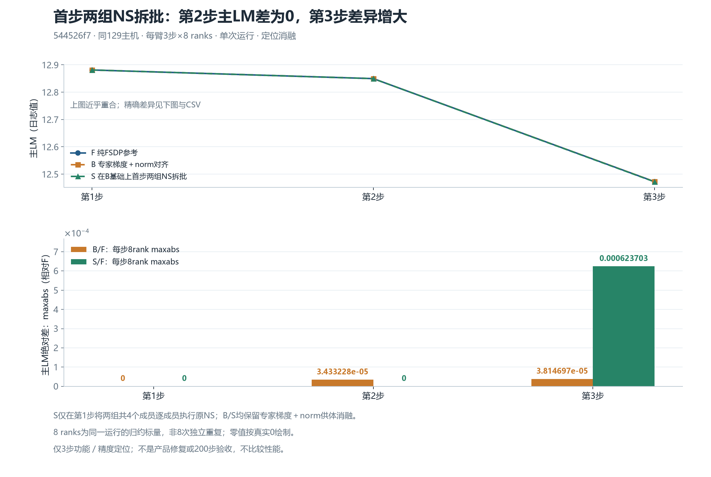

# 首步两组 NS 拆批：第二步主 LM 对齐，第三步残差增大

在相同 129 主机、固定源码 `544526f7db8342c607244fd41009b2a74adb84c8` 的三步窗口中，S 相对 F 的主 LM 最大绝对差为 `0 / 0 / 0.0006237030029296875`。第二步与 F 的日志值相同，但第三步比原 B/F 残差更大，不能称为整体精度改善、产品修复或 200 步验收通过。

`544526f7` 是合并了最新 `JT_dev a1e6c222` 与既有待合修复的组合验证栈，包含已合入的 #180。本报告三臂使用同一源码；不是裸 `JT_dev` 或随后新增产品开关的测试结果。

## 实验及证据范围

| 臂 | 已完成运行 | 首步处理 |
|---|---|---|
| F | `r129-a1e6-muon-update-fsdp8-3-v1` | 纯 FSDP 拓扑的原 NS 路径，带已验证透明性的只读 trace |
| B | `r129-a1e6-muon-update-ep4-both-3-v1` | EP4，首步使用 F 的选定专家 FP32 梯度及 used norm 供体；保留原批量 NS |
| S | `r129-a1e6-muon-selected-ns-unbatch-both-3-v2` | 在 B 的供体消融基础上，仅首步将两个 NS 组中的共四个逻辑成员分别执行原 NS，再按原顺序 stack |

S 没有将这一处理扩展到第二、三步。供体同时改变专家梯度与实际用于裁剪的 norm，因此这是一条受控诊断短臂，不能当作无需供体的产品实现。供体的 32 个完整 FP32 文件共 1.40625 GiB，本目录不复制供体、权重、checkpoint 或训练文本。

三个运行各为 **3 步 × 8 ranks**。同一臂同一步的八个 rank 记录相同的归约主 LM 标量，它们不是八次独立重复。输入组件的 `global_sha256`、LR 和四个计数器在本次日志比较中相同；该输入指纹按组件无序合并，不等于逐 token UID 或物理 rank token 对应证明。

## 主 LM：全部八 rank 复算



| 步 | F 主 LM | B 主 LM | S 主 LM | B/F 八 rank maxabs | S/F 八 rank maxabs |
|---:|---:|---:|---:|---:|---:|
| 1 | 12.881054878234863 | 12.881054878234863 | 12.881054878234863 | 0 | 0 |
| 2 | 12.84947395324707 | 12.84943962097168 | 12.84947395324707 | 0.000034332275390625 | 0 |
| 3 | 12.472381591796875 | 12.472343444824219 | 12.471757888793945 | 0.00003814697265625 | 0.0006237030029296875 |

差值按同一步全部八 rank 的 `max(abs(arm − F))` 计算。表中主 LM 取 rank0；便携绘图器会再次验证其余七个 rank 的主 LM 与 rank0 相同。图使用真实线性零基线，不把零替换为对数坐标中的伪数值，也不以三步窗口绘制 200 步验收结论。

MTP、aux 在原日志中是带原配方系数的日志值；本图只画主 LM，不将这些日志值冒称未加权原损失，也不比较性能、显存或性价比。

## 参数与 NS 边界

**正式独立科学审核** 已通过其限定范围。下表来自该固定 SHA 审核的[安全摘录](data/native-science-summary.json)和[28 行边界计数 CSV](data/native-boundaries.csv)，并非报告作者根据 loss 反推的参数结论。

| S 对 F 的首步观测范围 | 完整原生编码相等 |
|---|---:|
| 5 个 trace 目标的 13 个边界 | 170 / 170 成员观察 |
| 42 个非专家参数 P0、G0、G1 | 每阶段 336 / 336 逻辑分片 |
| 42 个非专家参数 P1（step 后） | 336 / 336 逻辑分片 |
| 6 项 pre_QK | 48 / 48 逻辑分片 |
| 32 个专家目标的 parameter_before、after_clip、optimizer_prepared、optimizer_actual_read、parameter_after | 每阶段 32 / 32 |

对原 B，S 的 P0/G0/G1 及 pre_QK 仍相同；P1 只有原来三个 FQN 的全部八片改变，共 24 / 336 片：`model.layers.0.self_attn.linear_qkv.weight`、`model.layers.1.mlp.gate.weight`、`mtp.layers.0.transformer_layer.self_attn.linear_qkv.weight`。两项阴性对照未变：`model.layers.1.self_attn.linear_qkv.weight` 是未处理的 singleton；`mtp.layers.0.transformer_layer.mlp.gate.weight` 属于被拆组的共同成员，但其全部 13 边界仍未变。不能把后一项写成“未接受干预”。

实际调用闭合为三个拦截点、四个派生二维成员调用、两次按原序 stack、一个原 singleton，合计五次原 NS 调用。两个被选中的原合批 NS 调用不再执行，原 NS 数学函数体保留。原输入字节、storage/version 与调用参数、次序等由独立审核核对；初态、输入组件指纹、配方及实际运行时绑定也在其范围内。

首步 S 的 measured norm 原生 FP32 四字节为 `9fc9b341`，供体 used norm 为 `9ec9b341`，相差 1 ULP。日志 `training/grad_norm` 对应 measured，不是实际裁剪所用的 used norm；不得将两者混为一项，也不能称首步全部六标量与 F 相同。

这些结果支持**本次首步合批调用边界具有局部因果作用**；没有确认唯一 NS、batching、归约或 kernel 根因。P1 观测位于 optimizer 及 QK/router 之后，另外检查了 parameter_after_apply 与 pre_QK，但 42 项普查、5 个 trace 目标和 32 个专家目标仍不是全模型或全 optimizer state。第二、三步没有完整参数／optimizer state 普查，第三步残差的精确来源仍待后续证据。

相等结论指所记录范围的原生编码；SHA 不同本身不能给出元素数值误差幅度。CPU 初态与实际运行时模型 probes 是两份独立证据，均不能代表所有 optimizer state 逐字节相同。本结论仅适用于这里固定的 `544526f7` 组合验证栈，不自动迁移到其他源码版本，不作为产品修复或 200 步验收。

## 小文件复算与便携重绘

[72 行科学字段 CSV](data/metrics-72rows.csv) 来自 24 份已收回的原始 metrics，每臂每 rank 恰三步；仅投影六个科学标量、四个计数器、step/rank 和输入组件指纹。没有复制原日志中的性能或显存字段。[三步图表 CSV](data/main-lm-3steps.csv)、[数值摘要](data/summary.json) 与 [原件 SHA 来源表](data/provenance.json) 保留精确数字和输入绑定。

便携绘图只需本目录的 `tools/plot_lm.py`、`data/summary.json` 和两份 CSV，以及已有 Matplotlib 与中文字体；不需要 Torch、NPU、原始任务目录或供体。输出目录须不存在对应图文件：

```text
python -B -X utf8 tools/plot_lm.py --data-dir data --output-dir replay-figures
```

若在保留原文的本机任务根复算 CSV，可使用已存在的环境，不安装软件；`--output-dir` 必须是新的目录：

```text
python -B -X utf8 tools/build_lm_data.py --task-root <任务根> --output-dir replay-data
```

builder 先核三份 collection manifest 的原始 SHA，再核其中与 root 读数相同的 24 份 metrics 字节、全部 72 行与三步范围，逐项复算六标量差、LR、计数器和输入指纹。它不重做完整容器执行链审核、不解析完整参数张量，也不签发任何运行或 CPU 资格。便携重绘仅验证随附小表的自洽，不代替重新读取这些私有原件。

## 绑定来源

- **Root 实际 metrics 读数**：`4d5219fafdd19bc158e192ee5ba4d1b7466e60c0da4161b9090cc8019ccf8b09`。
- **F 完整收集 manifest**：`923fede3296e6a2970e7950004940bf3b7a8a439ef854159ef0fd4d73c2e60bb`。
- **B 完整收集 manifest**：`1eb39f5279da26ce43ff700da4d338879917e64631ba29425f9eba31d1f71272`。
- **S 完整收集 manifest**：`7fee65ff001568b28711b1c1e2bbbde6eddeb7410ec0d4ca06c4012b0fdb32d9`，114 文件、3,269,076 B。完整执行链由其他审核另行确认；本报告不把这两个数字作为数值精度结论。
- **独立参数与 NS 科学审核**：`157526f69fdea759e970308baeae3e09110fff71e1b462913f072262857ab21c`。随附 JSON 仅保留计数、阴性对照、调用日程、科学结论与限制，排除了完整容器身份及私有生命周期 bindings。

完整原始事件、收集 manifest 和生命周期证据保留于私有任务档案；上列 SHA 指向这些原件。本公开小包只含经筛选的来源摘要、计数和图表，不包含完整容器身份、供体、checkpoint 或训练文本。小表重绘不能代替重新执行 NPU 或完整参数审核。

随附代码按 [Apache 2.0](LICENSE) 保留许可，可编辑绘图源及 CSV 可用于离线复核。
