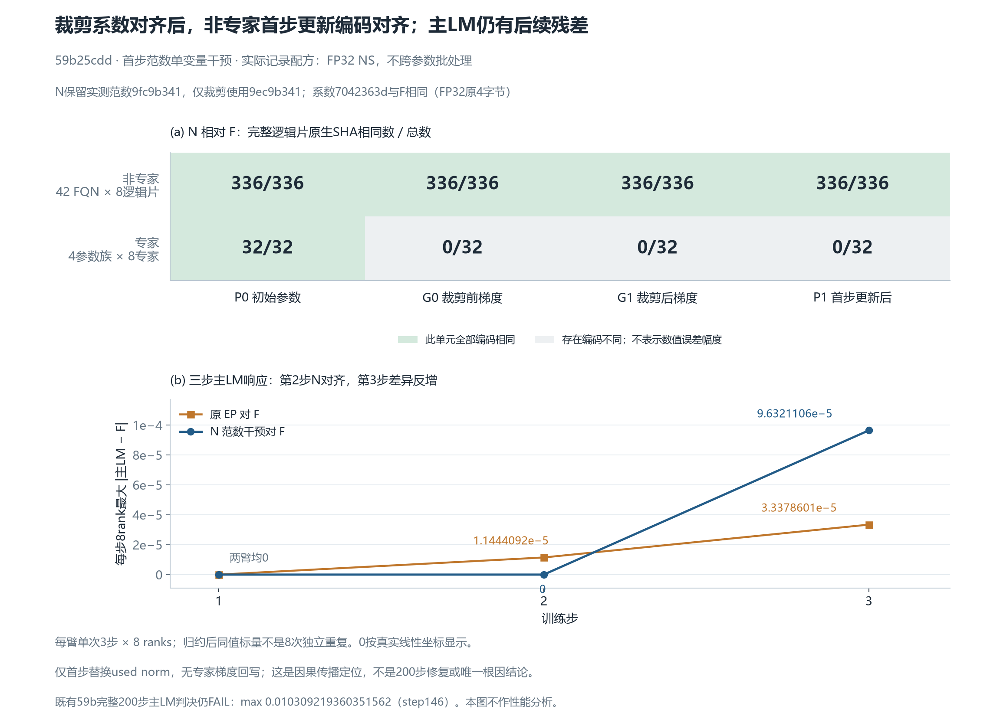

# 59b首步范数单变量干预：三步诊断报告

仅功能与精度定位。实际独立科学复核已完成，原始审阅SHA为 `c664f2211db90f6ac257c0c52225e60c0c7de1dff8cfac50d1af97ee0e82ff18`；本公开包提供派生数据与图片，完整原件私有留存。

N仅在首步将原裁剪消费的 `used total_norm` 换为F3已测FP32值。所观测非专家首步G1/P1的完整逻辑片原生SHA随之对齐F，但专家裁剪前差异与后续主LM残差没有消失；第三步N对F差异反而大于原EP对F。这个结果定位一条因果传播路径，不是精度修复成功。



## 实际条件与干预边界

产品源码固定 `59b25cdd15505a4f6fb1990484d4e890e3d3724c`。三臂均在同129主机各完成单次3步×8rank：F为FSDP8、EP为EP4×EDP2纯观察、N为相同EP拓扑的范数干预。作者逐份读取3份manifest绑定的resolved config：`ns_dtype=float32`、`ns_batch_across_params=false`，seed42。这里不是默认BF16 NS，也没有新增dtype实验或启用precision_experiments干预。

N没有专家梯度、参数或optimizer状态供体回写；仅首步改变clip实参，原measured norm、返回及日志保持原值，step2/3不再施加norm干预。正式独审还回读普通F2/EP200配置，五份实际resolved config均为FP32 NS/false；这不是逐checkpoint参数组metadata的额外实测。八rank原4字节记录一致（下表为rank0共识代表；CSV保留完整24行）：

|臂|measured norm：FP32小端hex|used norm：hex|clip coefficient：hex|
|---|---|---|---|
|F|`9ec9b341`|`9ec9b341`|`7042363d`|
|EP|`9fc9b341`|`9fc9b341`|`6f42363d`|
|N|`9fc9b341`|`9ec9b341`|`7042363d`|

F值为22.473445892333984，EP/N原测量为22.473447799682617，差1 FP32 ULP。N保留EP原测量9fc，仅clip使用9ec，实际裁剪系数因此与F同为7042363d。不能把used冒充本臂测量。

## 首更新的编码响应

N对F的观测范围如下；相等数来自完整逻辑片的native SHA记录，未直接留存/解码所有原始张量数值，不提供max/RMS误差。

|范围|P0 初始参数|G0 裁剪前梯度|G1 裁剪后梯度|P1 首步更新后|
|---|---:|---:|---:|---:|
|非专家42 FQN × 8逻辑片|336/336|336/336|336/336|336/336|
|专家4参数族 × 8专家|32/32|0/32|0/32|0/32|

N对原EP的P0/G0在非专家336片、专家32片全部相同，满足已观测干预前边界；G1/P1随后响应。非专家对原EP的相同数分别为1/336和126/336，专家均为0/32。N没有回写专家梯度，专家G0对F本已0/32相同，不能把这部分差异归因于后来的clip系数。P1包括QK/router的post-step读点；consumer证据是alias/version和原调用次数，不是每次consumer再次全量rehash。

## 三步主LM：第二步对齐，第三步差异反增

下面逐步最大差由24份原始metrics中的72条主LM重算，并逐条与冻结comparison核对；每臂同一步8rank标量都相同，这不是8次独立重复。

|step|F 主LM|原EP 主LM|N 主LM|原EP对F maxabs|N对F maxabs|
|---:|---:|---:|---:|---:|---:|
|1|12.881054878234863|12.881054878234863|12.881054878234863|0.0|0.0|
|2|12.84947395324707|12.849485397338867|12.84947395324707|1.1444091796875e-05|0.0|
|3|12.471919059753418|12.471885681152344|12.471822738647461|3.337860107421875e-05|9.632110595703125e-05|

因此只可说：在这一次首步N干预下，所观测非专家首更新编码对齐，并使第二步主LM与F相同。第三步仍有9.632110595703125e-5残差，大于原EP的3.337860107421875e-5；不据这3步宣称总体提升或200步修复。

既有同源59b完整F2/EP4各200×8记录的主LM判决仍为FAIL：max **0.010309219360351562（step146）**，首超step97，共8个超限步；本次没有重新运行200步。


## 证据范围与复绘

[科学摘录与逐步六标量响应](evidence/actual-independent-review-summary.json)绑定真实独审、完整采集与原比较SHA；[原始来源描述符](data/provenance.json)中的任务内路径用作私有证据标识，不表示这些原件已经公开。

独审直接核验N的115原件、18批传输、两次稳定库存、容器完整ID缺席与释放，55项固定输入、实际五个runtime及20项产品源指纹，2744条首步事件、原七调用恰一次、真实consumer与卸载。N干预前与原EP的P0/G0编码完整一致；三臂另核8个DP-slot指纹相同。输入多重集合SHA本身不证明逐token来源或完整RNG/optimizer内部字节一致。

P1包括QK/router post-step读点；consumer证明是alias/version及原调用次数，未逐次全量rehash。所有原生编码比较来自完整逻辑片；未全量公开原张量，不报告其max/RMS误差。专家G0差异早于clip，本次不锁定局部GMM或RS为唯一源头；既有范数源码审阅不支持double-count结论，正常FP32分组归约产生1ULP本身不是新独立产品bug。

[此前完整200步报告](../a1e6-muon-no-cross-param-200/README_ZH.md)的FAIL结论不变。本三步报告关联 [总问题202](https://github.com/hf1s/hyper-parallel/issues/202)、[子问题250](https://github.com/hf1s/hyper-parallel/issues/250)及[单提交草稿PR251](https://github.com/hf1s/hyper-parallel/pull/251)。本次没有改产品代码、PR提交数或CI状态；没有性能分析。

公开包保留6份派生数据、PNG/SVG、绘图源码与哈希清单。[曲线CSV](data/curves.csv)、[72行主LM](data/main-lm-rank-step.csv)、[16行阶段编码计数](data/stage-equality.csv)、[24行范数/系数](data/norm-coefficients.csv)可用于独立复绘；同一步8rank不是8次独立重复。

```text
python -B -X utf8 tools/plot_norm_response.py --data-dir data --output-dir <全新输出目录>
```

`tools/build_report_data.py`用于从完整私有证据重新提取数据，需要相应任务目录；公开CSV复绘不需要它或NPU。没有包含checkpoint、梯度供体、完整容器日志或凭据；不将派生摘录替代全量原件复核。
