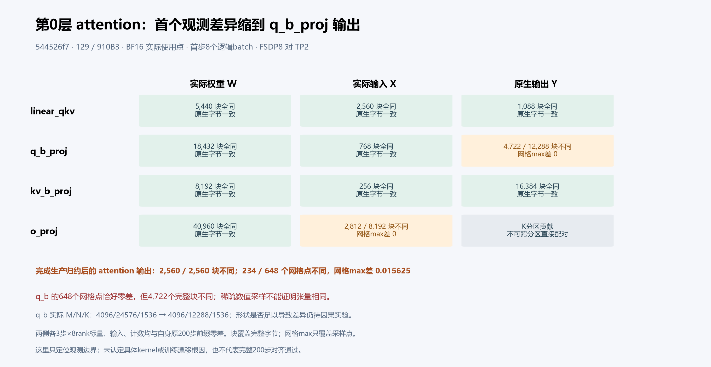
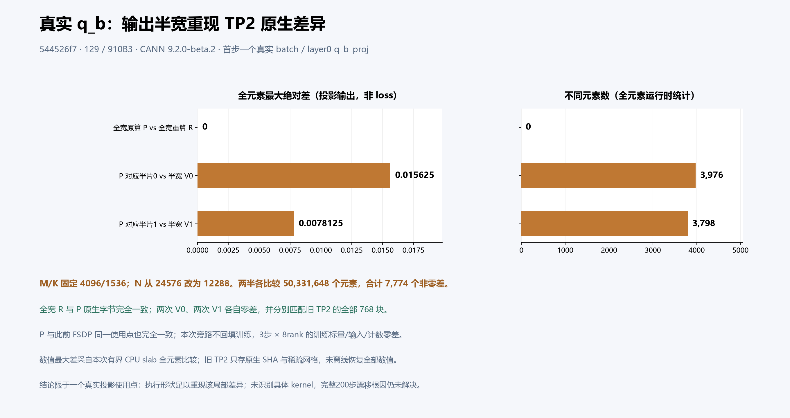

# q_b 原生执行宽度：同一真实使用点重现 TP2 局部字节差异

固定源码 `544526f7db8342c607244fd41009b2a74adb84c8`，129 / 910B3，CANN 9.2.0-beta.2。第0层 `model.layers.0.self_attn.q_b_proj` 的同一个真实 batch 上，完整输出宽度 N=24576 的无梯度旁路重算 R 与原生产物 P 全部1536个原生块相同；改为两个 N=12288 权重行视图后，各重复两次，每半全部768块均与此前实际 TP2 对应输出相同，且半宽两次结果逐字节稳定。实际输入 X、权重 W 的全部逻辑块同时匹配此前 FSDP 和 TP2。

这表明该使用点的执行形状变化足以重现已观察到的局部差异。它没有识别具体 CANN kernel，也没有证明或修复完整200步主LM漂移；没有据此创建新的产品修复PR。实验只在原前向输出上观察，所有shadow均不回填训练、不进入反向。

[总问题 #202](https://github.com/hf1s/hyper-parallel/issues/202) · [完整公开文件清单](manifest.json) · [来源及转换清单](source-provenance.json)

## 从观测边界到局部消融



上图按原字节保留，属于此前观测阶段的固定快照，其中“形状因果实验待做”是当时状态。该次第1步8个逻辑batch中，四个投影的实际W均一致，`linear_qkv` 和 `kv_b_proj` 的X/Y也一致；首个已观测完整边界差在 `q_b_proj` 输出，4722/12288个块不同。其648个数值网格点恰好零差，不能据此判断整个张量相同。`o_proj` 的X有2812/8192个块不同；完成生产归约后的attention出口2560/2560块不同、网格max为0.015625。o_proj原始输出仍是不同K分区贡献，未离线求和或当作副本强配。



本图的最大差与非零元素数，来自本次仍在生命周期内的真实 P 和shadow，在有界CPU slab内进行的**全元素运行时比较**；不是从旧TP2保存的SHA/稀疏网格离线恢复全部数值。每半50,331,648个元素，统计如下。

| 比较 | 完整原生块 | 全元素非零差数 | 运行时全元素max_abs | 坐标（token，全局输出feature） |
|---|---:|---:|---:|---|
| P vs 全宽R | 1536块全同 | 0 | 0 | 无 |
| P半片0 vs V0重复1/2 | 各768块，307块不同 | 各3976 | 0.015625 | (55, 6091) |
| P半片1 vs V1重复1/2 | 各768块，299块不同 | 各3798 | 0.0078125 | (462, 14965) |
| 同一半宽重复1 vs 2 | 各768块全同 | 0 | 0 | 无 |
| V0/V1各两次 vs 旧实际TP2 | 四次各768块全同 | 旧TP完整数值不可离线恢复 | 不提供旧TP全量数值max | 按全局feature配对 |

P是生产路径原输出；R是全宽无梯度校准；V0/V1是原W两个行视图的半宽无梯度旁路。M/K固定为4096/1536，N从24576变为12288；未添加clone、2D改写、FP32修复臂或新的数值配方。半宽视图还改变输出形状及第二半的权重存储偏移，不能据此命名未观察的底层格式、算法或kernel。

## 实际身份及三步观察透明性

目标batch SHA为 `17c01af6623ce2bf41d8e786abba55318ea40f8595ba027303d4d797d8349113`，第1步micro0。新shadow和旧FSDP来自rank2；旧TP2对应rank4、5，按同一batch和全局feature区间 `[0,12288)` / `[12288,24576)` 匹配，**没有按同号rank或micro号跨拓扑强配**。

实际X为BF16 `[1,4096,1536]`，stride `[6291456,1536,1]`。FSDP W为 `[24576,1536]`，TP2 W为 `[12288,1536]`，均contiguous，stride `[1536,1]`。在真实首次使用点核验UNSHARDED及installed storage身份，再记录完整逻辑tile。CPU构造初态相同不能替代此运行时物化证据；实际X/W一致的结论只覆盖这些被观察的投影使用点。

旧attention0 FSDP、旧attention0 TP2和本次FSDP shadow各自对本拓扑原完整200步运行的1–3步前缀，均为3步×8rank：主LM、总loss、日志中的加权MTP/aux、梯度范数、LR、四项样本/token计数和输入身份严格零差，CPU构造初态、runtime及排除train_iters的start元数据一致。这里的“梯度范数一致”不表示完整梯度张量一致；训练标量具有全局归约和日志均值语义。3步透明性也不代表200步验收。

本次11项原始状态不变量均通过：原输出对象/图、输入/权重/输出字节、tensor版本、requires_grad、grad模式、RNG、module.forward与functional linear身份均保持。原输出P在任何shadow执行前、校准时及结束后完整native哈希相同。完整内部状态和所有梯度/optimizer字节并未逐项采集。

## 内存、开销和CPU测试边界

冻结预算为显式CPU Tensor **52MiB = 48MiB原生slab + 4MiB tile scratch**，额外活跃NPU输出上界 **192MiB**。全宽R释放后才创建半宽输出；比较前按slab限界，未先把全W搬到CPU。成功路径预算及本次observer调用计数均为108次宽CPU copy，最大单slab为24MiB；这是源码调用计数，不是带宽/耗时性能测量。以上不含原训练已存活Tensor、Python/hash JSON、未知后端workspace及allocator缓存，不能当作实测CPU/HBM峰值或性能ROI；本短诊断计时包含观测开销，不用于推荐训练优化。

真实受限CPU容器已执行13/13项测试通过，Torch2.12.0+cpu、未加载torch_npu、exit0且自有完整容器精确移除回读。它验证小float64矩阵、合成物化owner、三步forward/backward/SGD透明性、生命周期/异常清理及合同负例；不是原生BF16 NPU正确性或200步证据。冻结finalization是运行前快照，其“待执行”字段没有回写，实际CPU/NPU结果另见本包安全摘录。CPU Config未独立保留Entrypoint原文：仅可引用冻结validator及create命令的验证合同，不能夸称原文覆盖。

- [真实CPU原始测试身份与结果](evidence/a1e6-qb-shadow-bisection-v1/cpu-validation-v1/tests.json)、[stderr原文](evidence/a1e6-qb-shadow-bisection-v1/cpu-validation-v1/stderr.log)
- [CPU独立审核安全摘录](evidence/a1e6-qb-shadow-bisection-v1/qb-shadow-cpu-independent-review-v1.json)、[冻结finalization原件](evidence/a1e6-qb-shadow-bisection-v1/author-finalization-v1.json)
- [执行、源码及guard/释放原件SHA摘要](evidence/execution-and-source-safe-extract.json)

## 公开原件与离线复算

包保留任务ROOT相对结构，冻结loader及工具均为原字节副本。5个运行各56个安全原件，加24份完整native trace：FSDP基线、原TP2完整200步控制、旧attention0 FSDP/TP2三步、本次shadow三步。额外原TP2控制保证旧TP2三步透明性也能独立复算。每份公开raw与私有原manifest逐项SHA一致；不公开权重/完整Tensor、数据文本、他人进程ID或私有资源回执。

在本包根目录用干净的Python进程执行（无需Torch）：

```powershell
python -B -X utf8 tools/reproduce_qb_native_width.py
```

该命令先核验本包所有manifest条目，再原样调用冻结pure JSON合同/比较函数，复算三组自身前三步透明性、初态/runtime/start、两旧attention完整native配对及当前shadow全部native匹配。它不写输出文件、不装框架、不启动训练。Windows冻结loader从自身ROOT定位；Linux原冻结合同固定 `/work`，需将**本包根**按原合同挂到 `/work` 后执行，不改原loader绕过SHA。

此复算能重验覆盖/逻辑坐标、dtype、完整字节SHA相同/不同块数、统计自洽与已保存的运行时全元素统计；因未保存完整数值，不会从哈希重新计算3976/3798或数值max。纯JSON复算通过不等于再次执行NPU。

- [shadow科学比较（仅路径字段规范化）](evidence/a1e6-qb-shadow-bisection-v1/paired-comparison-v1.json)、[shadow自身前缀安全摘录](evidence/a1e6-qb-shadow-bisection-v1/own-prefix-root-review-v1.json)
- [shadow科学独立审核安全摘录](evidence/a1e6-qb-shadow-bisection-v1/qb-shadow-native-independent-review-v1.json)、[新图独立QA原件](evidence/a1e6-qb-shadow-bisection-v1/qb-native-width-plot-independent-review-v1.json)
- [attention科学比较（仅路径字段规范化）](evidence/a1e6-attention0-forward-bisection-v1/paired-comparison-v1.json)、[attention自身前缀安全摘录](evidence/a1e6-attention0-forward-bisection-v1/own-prefix-root-review-v1.json)
- [attention科学独立审核安全摘录](evidence/a1e6-attention0-forward-bisection-v1/attention0-paired-independent-review-v1.json)、[旧图独立QA安全摘录](evidence/a1e6-attention0-forward-bisection-v1/attention0-projection-figure-independent-QA-v1.json)
- [模型固定源](source/544526f7/hyper_parallel/models/jt_deepseek_v3/modeling_jt_deepseek_v3.py#L260)、[固定forward rewriter](source/544526f7/hyper_parallel/distributed/_builder/forward_rewriter.py)
- [旧图可编辑SVG](evidence/a1e6-attention0-forward-bisection-v1/figures/attention0-projection-boundaries-v1.svg)、[新图可编辑SVG](evidence/a1e6-qb-shadow-bisection-v1/figures/qb-native-width-shadow-v1.svg)

两份配对JSON只规范input路径键并附转换说明；科学值、tool SHA未改。前缀、独审、执行/CPU回执为显式安全摘录，保留完整源文件size/SHA和字段清单，省略私有环境路径、owner/完整CID等内容；不能称为完整回执原文。PNG、冻结源码、trace和安全raw逐字节复制；两份公开SVG副本仅逐行去掉尾部space/tab，保留原换行及语义，原私有SVG和绘图源码未改。来源清单将SVG明确列为转换副本并绑定前后SHA。

可在同字体/绘图环境下执行 `python -B -X utf8 tools/reproduce_qb_native_width.py --plots`，另需Matplotlib/Pillow及冻结脚本要求的Microsoft YaHei路径 `C:/Windows/Fonts/msyh.ttc`。它在内存重绘两图，PNG按原字节及像素核验；生成SVG先应用同一逐行rstrip，再仅归一自动ID/引用及Date后核验整棵XML树，不写图文件。默认入口仍不需要绘图库。其它绘图平台未验证，不修改冻结脚本来隐藏字体或版本差异。

本包处于作者整理QA阶段，包含既有科学/图表独审；其独立发布审核另行出具，不能把本次作者复算当作新的独立发布审核。后续仍需带梯度的修复设计、原训练透明性与完整200步验收，才能判断对主LM漂移的作用。
