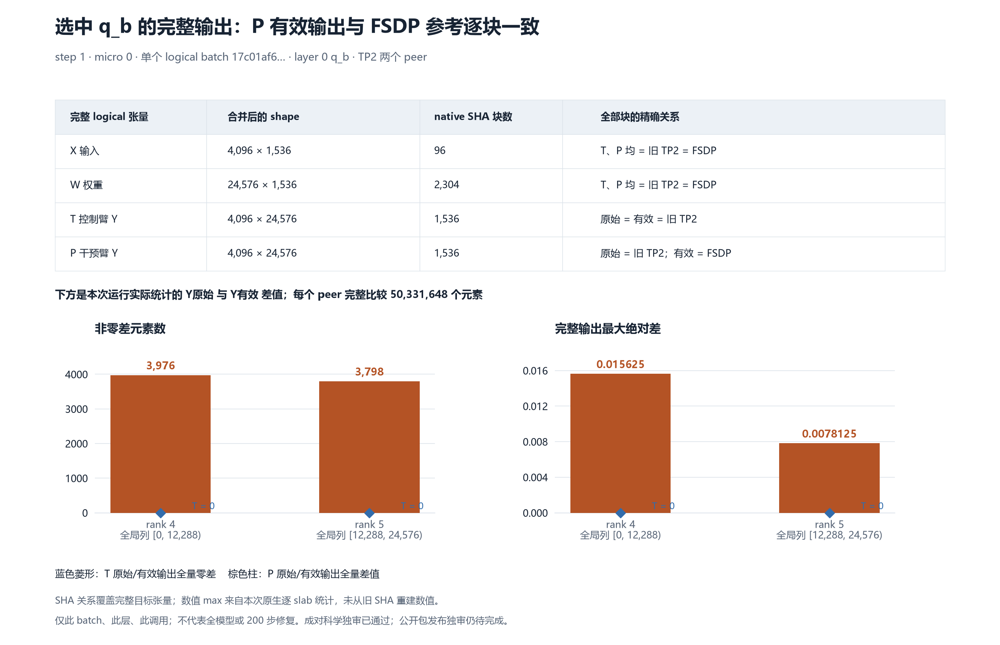
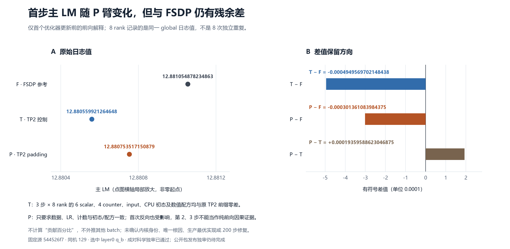

# q_b padding 短程因果对照：完整目标输出对齐，首步主 LM 仍有残余差

在固定源 `544526f7db8342c607244fd41009b2a74adb84c8`、129 同机实验中，仅对首步一个 logical batch 的第 0 层 `q_b_proj` 做 padding 干预：两个 TP peer 的**完整有效输出**均与已有同源 FSDP 目标输出逐块一致。首步主 LM 从 T 控制臂的 `12.880559921264648` 变为 P 臂的 `12.880753517150879`，相对 FSDP 参考 `12.881054878234863` 仍差 `-0.000301361083984375`。

这支持“选中调用的数学等价实现会改变首步前向数值”的有限结论。**唯一根因、具体内核身份和 200 步修复仍未确认。**P/T/F 成对结果已通过[独立科学复核](evidence/paired-independent-review.json)，完整原件 SHA 为 `4f5d682077a5afe40de9517ce0c989946596a6f95fc9642709f946b119e8c247`。**本公开候选的独立发布审阅仍待完成**；作者复算与图表 QA 不代替该审阅。

## 实验范围与对照关系

| 标记 | 实际执行与用途 | 可解释范围 |
| --- | --- | --- |
| F | `r129-a1e6-attention0-forward-fsdp8-3-v1`，已有同源 FSDP 原生参考 | 为选中 logical batch 的完整 X/W/Y 和首步 global LM 提供参考 |
| T | `r129-a1e6-qb-padding-t-tp2-3-v2`，原 forward 执行后，以同一 live X/W 再做局部 `F.linear` 并返回结果 | 检验活动 posthook、额外计算和返回路径的观察透明性 |
| P | `r129-a1e6-qb-padding-p-tp2-3-v2`，原 forward 执行后，在正确全局行位置保留本地 W，另一半补零；做全宽 `F.linear`，取回本 rank 区间并 `contiguous()` | 首次优化器更新前，选中调用对首步前向 LM 的有限因果对照 |

干预仅发生在 step 1、micro 0、`model.layers.0.self_attn.q_b_proj`，目标 batch SHA 为：

```text
17c01af6623ce2bf41d8e786abba55318ea40f8595ba027303d4d797d8349113
```

实际 TP peer 为 rank 4、5，分别对应全局输出特征 `[0, 12288)`、`[12288, 24576)`；同一 logical batch 在 FSDP 参考中位于 rank 2。跨拓扑按真实 batch SHA、模块和全局坐标配对，不能拿同编号 rank 直接比较。其余 batch 不替换返回值，首步完成后卸载本探针 hook。

完整 logical shape 为 X=`[4096,1536]`、W=`[24576,1536]`、Y=`[4096,24576]`。每个 TP peer 实际使用 X=`[1,4096,1536]`、W=`[12288,1536]`、Y=`[1,4096,12288]`，输出含 `50,331,648` 个元素。实际权重是当次已安装的 plain tensor，原 forward 路线为绑定同一模块的裸 `torch.nn.Linear.forward`；没有将 detached 的观测副本用于有效计算。

数值配方保持 seed=`42`、dataloader seed=`1234`、GBS=`8`、MBS=`1`、序列长度=`4096`、LR=`0.0001`、scheduler horizon=`1000`、BF16 参数/FP32 归约、重算=`off`、MTP 系数=`0.3`、aux 系数=`0.0001`。T/P 均为 TP2、CP1、EP1、PP1，3 步且不保存 checkpoint；两者 resolved config 除各自输出目录外相同。主 LM 使用原日志字段 `training/foundation_loss/lm`，不做系数还原；MTP/aux 在本稿只参与 T 透明性检查，不宣称其完整矩阵通过。

本轮使用任务中已固定的 CANN 9.2.x 镜像 `sha256:5f9e677f439d11ab4e7c888f54b142335a27eee7411cbd2ce894a4798a70146d`。固定源来自 JT_dev 基线 `a1e6c222…` 的集成版本；[2026-10-18 06:29 UTC 的既有只读回执](evidence/current-source-readonly-20261018-v1.json)确认 #180 合并提交 `521d3a8a…` 是固定源祖先。本报告不重新查询上游，也不将该时间点的版本状态写成永久“最新”。

## 完整 native 输出与原生全量数值统计



完整 BF16 native 分块 SHA 的比较结果如下。这里的“相同”指覆盖整个选中 logical 张量的所有分块均相同，不是稀疏数值采样相同。

| 对象 | 完整块数 | 精确关系 |
| --- | ---: | --- |
| X 输入 | 96 | T、P 均与旧 TP2 和 FSDP 参考相同 |
| W 权重 | 2,304 | T、P 均与旧 TP2 和 FSDP 参考相同 |
| T 原始/有效 Y | 1,536 | 两者都与旧 TP2 相同 |
| P 原始 Y | 1,536 | 与旧 TP2 相同 |
| P 有效 Y | 1,536 | 与 FSDP 相同 |

以下差值统计来自 **P 本次原生运行**在 `QBPaddingTrace._intervene` 内对原始 Y 与有效 Y 的完整逐 slab 比较。每个 peer 的 `compared_numel`、左右 finite count 和 both finite count 均为 `50,331,648`；不是从旧 SHA 离线重建全量数值。

| TP peer / 全局列区间 | 非零差元素数 | 最大绝对差 | 最大差坐标（token, 全局 feature） | 该处原始 → 有效值 | MSE |
| --- | ---: | ---: | --- | --- | ---: |
| rank 4 / `[0,12288)` | 3,976 | 0.015625 | `(55,6091)` | `-2.265625 → -2.25` | `3.008641699986228e-10` |
| rank 5 / `[12288,24576)` | 3,798 | 0.0078125 | `(462,14965)` | `1.7265625 → 1.734375` | `3.0530831317795215e-10` |

P 的不同 native 块数分别为 307、299。T 在相同两 peer 上的完整原始/有效 Y 统计均为零差。分块 SHA 与原生数值统计是两类互相补充的证据：前者负责历史参考的完整身份比较，后者负责当前调用内实际差值的大小。

## 首步主 LM：保留有符号差，不计算贡献比例



| 量 | 原数值 |
| --- | ---: |
| F 主 LM | 12.881054878234863 |
| T 主 LM | 12.880559921264648 |
| P 主 LM | 12.880753517150879 |
| T − F | -0.0004949569702148438 |
| P − T | +0.00019359588623046875 |
| P − F | -0.000301361083984375 |

8 个 rank 的上述值完全一致，但它们是**同一个经过归约的 global 日志值的 8 份记录**，不能当作 8 次独立重复、计算统计误差条，或用来放大样本量。固定源先在 [mean_global_loss](source/544526f7/hyper_parallel/trainer/runtime/metrics.py) 中形成 token 加权全局 loss，随后 [EnvironMeterCallback](source/544526f7/hyper_parallel/trainer/callbacks/environ_meter_callback.py) 对日志 loss 做 `mean`；证据 callback 保存的是 `step_env_metrics`。此处也不是目标单样本的独立 LM，而是仅干预该调用后观测到的整步 global LM。

这轮 P 臂使该首步 global LM 相对 T 发生上述变化，且残余 P−F 仍非零。没有计算“贡献百分比”，也不把一个 batch 的结果外推到其他 batch、其他层或全部 TP 漂移。首步值较接近 F 不等于稳定训练更优，更不等于完整 200 步达标。

## T 透明性、P 一致性与时间顺序

T 已对原 TP2 完整 200 步的前三步及旧 attention TP2 三步参考完成比对：**3 步 × 8 rank，每指标 24 对**，total loss、主 LM、MTP、aux、日志 grad_norm、LR 六项 scalar，四项数据计数和 input identity 均零差；CPU 初始状态记录、runtime flags 和数值配方也一致。作者本次又直接从原始日志复算 T 对原 TP2 前缀，结果相同。

P 只要求与 T 的三步数据、LR、四项计数、input identity，以及 CPU 初始状态记录、runtime flags 和数值配方一致。P 是有意替换返回值的活动干预，不能要求它的所有 loss/grad/更新都与 T 零差。**P 的首次反向执行形状也会改变；因此第 2、3 步只能作为短臂完整性与轨迹记录，不能继续解释为纯前向因果。**本稿数值 JSON 保留这些原日志值，主图只展示首步。

CPU 初始状态记录相同不等于证明整个模型在 NPU 首次前向时的所有参数、优化器状态和内部状态逐字节相同。本轮额外证明了选中 q_b 的完整实际 X/W 身份与原返回值保留；不能据此排除所有未观察内部差异。日志 grad_norm 相同也不等于全梯度逐元素相同。

T、P 均完成 3 步、exit 0 并释放自有容器，guard 记录时长分别为 `136.0850114899804` 秒和 `136.22208151000086` 秒。P 运行后既有只读回执确认固定源干净、全部 24 个输入指纹未变，完整自有 CID 的 `docker ps` 精确查询为空且 `inspect` 返回不存在。完整 CID 留在原私有回执，本稿不复制其他任务身份信息。

## 代码落点、工具缺陷与尚未证实的解释

实现入口是 [native_qb_padding.py](evidence/a1e6-qb-padding-causal-v2/tools/native_qb_padding.py)，SHA `a9c2e2b0042a12d3f56133f1bedf6b81f2fdb819ba5c9e0a2c4c7b4c10238b32`。实际类名为 `QBPaddingTrace`：

| 函数 / 行号 | 本实验相关行为 |
| --- | --- |
| `live_weight`，60–82 | 取得同一已安装 live 权重，保留可微路径；观测副本不参与计算 |
| `actual_forward_proof`，102–134 | 验证合法裸 Linear 或受限固定 adapter，绑定原函数/模块身份 |
| `effective_linear`，137–150 | T 使用原 local shape；P 沿正确全局 N 行补零、全宽 Linear、切回本 rank 并 contiguous |
| `QBPaddingTrace._pre_hook`，313–350 | 在原 forward 前绑定实际 X/W、batch、shape、版本与 RNG |
| `QBPaddingTrace._intervene`，352–427 | 原 forward 完成后验证身份，构建有效返回、完整原/有效 Y 比较及不变量记录 |
| `QBPaddingTrace._post_hook`，429–452 | 只替换准确目标调用；非目标返回 `None` |
| `finish_step`，454–466；`cleanup_after_execution`，479–485 | 首步或异常后仅卸载本探针自己的 hook |

固定模型中 q_b 调用见相邻公开包的 [modeling_jt_deepseek_v3.py](../a1e6-qb-native-width-cause/source/544526f7/hyper_parallel/models/jt_deepseek_v3/modeling_jt_deepseek_v3.py) 第 260、355 行；参数 colwise 角色见 [sharding.py](source/544526f7/hyper_parallel/models/jt_deepseek_v3/adapter/policies/sharding.py) 第 28 行。裸 forward 与 validate adapter 的区别可核对相邻包的 [forward_rewriter.py](../a1e6-qb-native-width-cause/source/544526f7/hyper_parallel/distributed/_builder/forward_rewriter.py)。源文件字节与 SHA 均由两包 manifest 及本包 [source-provenance.json](source-provenance.json) 绑定。

v1 曾在真实 T 臂报 `Actual projection lacks the fixed local-parameter adapter`：探针错误地把 validate 分支的 adapter 假设当作 production 裸 Linear 的必要条件。v1 没有生成完整 Y 或三步 metrics，不能纳入科学对照。v2 修正的是**诊断工具的准入判断与 CPU fixture 覆盖**，保持数学操作及 T/P 范围不变；实际 21 项 Torch CPU fixture 通过后，T v2 又完成上述原生三步透明性验证。这不是已确认的 HyperParallel 产品精度根因，也不应伪装成一个产品修复 PR。

padding 同时改变分配、存储/布局路径、拼接内容及前后向执行形状；本轮没有记录具体命名内核，也没有证明内核选择是唯一原因。候选 P 每个目标 peer 的显式额外前向张量预算为 `415,236,096 B`（396 MiB），T 为 `100,663,296 B`（96 MiB）；这是实现中列出的张量上界，**不是实测峰值**，不包含未知 backend workspace 与完整反向寿命。原 forward 加额外计算、主机观测等成本使该诊断不具备生产性能可比性；guard 总时长也不能用作吞吐收益。本稿不推荐将 padding 直接用于生产，更不宣称它是最优实现。

## 资源与跨机边界

本组结果全部来自 129。本组执行时共享机调度采用已部署的 `7200/600` 活动窗口/自然休息策略；真实占卡时等待，namespace 仅用于诊断。冻结作者快照所引用的 2026-10-18 11:01:02 UTC 的 125 T2 准入回执当时为 `attempted=false`、等待八卡空闲，当时未创建该实验容器；这不是对 125 后续状态的查询，本文没有 125 与 129 的跨机精度结论。201 不在本稿实验范围。

本公开候选只读取已收回的本机证据，并写入这一新目录；没有 SSH、容器或 NPU 操作，没有修改固定源、guard、request、协调器、既有公开包或总报告，也没有提交、推送或更新 issue。

## 原始数值、当前审核状态与可离线复算范围

[source-values.json](source-values.json) 保留冻结作者稿原字节，SHA 为 `1ceb050cb0c49817eeb0234a60d76ed628323318f5984c4290053cb2c11daeff`。其中 `review_status` 是 2026-10-18 作者快照里的历史 pending 字符串，**不代表当前成对科学独审状态**。[review-status.json](review-status.json) 单独记录当前成对科学独审 PASS 与本公开包发布独审 PENDING。作图和复算均分别绑定这两个文件，不改写历史数值快照以更新状态。

本目录含 T/P 各 62 份安全证据：48 份逐 rank metrics/初态/runtime/start/complete/final-memory、6 份配置/退出码/源状态，以及 8 份目标探针 JSONL。每臂原收集清单均有 109 项，全部原件已核 SHA；公开的是其中可复算的子集。没有复制训练文本、权重、checkpoint、完整张量、外部进程身份、私有命令或调度日志。四份目标 rank 4/5 trace 仅将 Torch 包源文件位置规范为 `torch-package://torch/nn/modules/linear.py`，原绝对路径不是运行机密钥；其原 SHA 与变换字段均保留在 provenance。所有 native 块哈希、物理布局、对象/存储一致性、图不变量和数值统计保持原值。其他 120 份运行证据为原始字节。

已有 FSDP/TP2 的 attention 原生三步证据与 200 步前缀明确复用相邻 [a1e6-qb-native-width-cause](../a1e6-qb-native-width-cause/README_ZH.md)，不重复复制约 37 MB。离线复算须同时保留两个相邻目录；新包固定相邻 manifest SHA `5498d76b34c860c17d136a0b4be952a71fa0900dc5ce95e77fd1b566ee84cd3d`，会验证两包的全部文件，而非默许其他来源替代。此复用只是原始参考来源，不把完整 200 步 TP2 FAIL 改称通过。

[纯标准库复算器](tools/reproduce_qb_padding_firststep.py) 从以下证据重新计算：

- 两包 manifest 的精确文件集合、字节数、SHA，以及六个旧支持文件与两个新纯 JSON 合同的固定 SHA；从同一已校验字节快照加载纯解析代码，不导入 Torch。
- T/P 八 rank 首步事件、两个 TP peer 的实际 batch、全局行列范围、完整 X/W/原始 Y/有效 Y 块集合、native dtype、物理布局、live 参数和 forward 身份及图不变量；再与旧 attention FSDP/TP2 的全量 canonical map 比较。
- T 对旧 TP2 三步与原 200 步前三步的每指标 24 对 scalar/四计数/input/CPU 初态/runtime/数值配置；P 对原 TP2 的 LR/计数/input/初态/runtime/数值配置。旧 FSDP 原生三步的日志和初态/runtime 另对原 baseline 前三步核验。
- 首步 F/T/P 主 LM 的 8 份 global 日志副本、有符号差值，以及冻结数值快照的 `original_comparison_fields`、`target`、`native_runtime_selected_records`、`first_three_step_logged_scalars`、`recipe`、`execution_summary` 字段。历史 `review_status`、`author_rechecks`、`plot_policy` 不作为数值输入或当前审核凭据。

完整 SHA 身份与 native 运行时全元素差统计的证明范围不同。复算器检查记录的有限性、完整元素计数、非零数、最大值/坐标、平方和/MSE 的合同及相互一致性，并逐字段核对原运行记录；**没有完整张量原文，就不能仅由 SHA 离线重新计算这些数值统计**。释放/固定源/24 pin 的私有原回执只提供[已独审安全摘要](evidence/execution-safe-summary.json)与原 SHA；公开工具不重新查询容器。

在本目录运行，普通 Python 3.10+ 即可完成上述复算；`--self-test` 额外在内存中拒绝 20 个缺 rank、坏生命周期、缺块/重复块、错 dtype/offset、数值矛盾、未知 forward 和图/存储合同负例。两个命令不写输出文件：

```powershell
python -B tools/reproduce_qb_padding_firststep.py
python -B tools/reproduce_qb_padding_firststep.py --self-test
```

[图表源](plot_qb_padding_report.py) 保留数值输入的原 SHA，公开副本只新增当前审核状态绑定并更新两图图注；[PNG](native-target-output.png)、[SVG](native-target-output.svg) 及[首步 LM 矢量图](first-step-main-lm.svg) 已从该副本重生成。绘图需要 Matplotlib 与中文字体；先创建一个新的输出目录再执行，脚本拒绝覆盖已有图：

```powershell
python -B plot_qb_padding_report.py --output <新的输出目录> --font C:/Windows/Fonts/msyh.ttc
```

[作者 QA](author-validation-v1.json) 记录实际离线复算、负例、字体/渲染环境与 PNG 目视检查，不是独立发布审核。`manifest.json` 覆盖本目录除自身外全部文件；[source-provenance.json](source-provenance.json) 及[逐文件来源表](provenance/copy-records.json) 记录冻结稿到公开副本的原 SHA、目的 SHA、必要脱敏与文案变换。复用/复制的源文件保留 Apache 2.0 头，许可见 [LICENSE](LICENSE)；相邻包也保留各自许可。

| 冻结输入 / 公开对应 | 原 SHA-256 |
| --- | --- |
| 冻结作者稿 manifest（[原字节副本](provenance/author-draft-manifest.json)） | `69279458d497bc66eb616d0220113aa63d44fe69dc89199695afc6c9e0a133df` |
| 原成对比较（[公开数值副本](evidence/paired-comparison.json)，仅省去私有路径索引） | `f7a2bdd342474820dcfb34e7448f29d263a6e839dd7194ba2152cdcd7bbbe7ed` |
| 成对独立科学复核（[安全摘录](evidence/paired-independent-review.json)） | `4f5d682077a5afe40de9517ce0c989946596a6f95fc9642709f946b119e8c247` |
| T 109 项原件 manifest | `85cd828afea2e1d2716cdee54ff07b13696fe16b9d68dca1ac82307d0e09313c` |
| P 109 项原件 manifest | `0dab05268cf0b8d92b5f0d5a634e00a25f0c1a6427799cdbed76876479f4b4d6` |
| T 原生独审（原件私有；成对独审重新复核相关结论） | `c0395235a8f61596d0237e63c335119cd8d0083a1bfa8a6f5455781ff2b0cd2c` |
| P 运行后固定源/输入/回收回执（[安全摘要](evidence/execution-safe-summary.json)） | `5bf297286da338af416924cc9779d2301cb2fee659d5e305e67543a3a2757d4b` |

成对科学证据已独审；本公开候选须再完成独立发布审核后由根任务决定发布。当前没有新增 200 步修复验收、产品修复 PR 或唯一根因结论。
