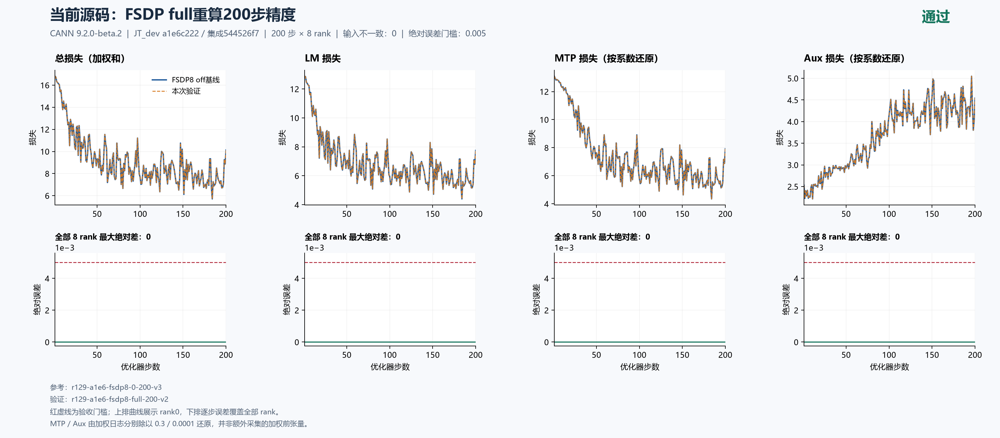
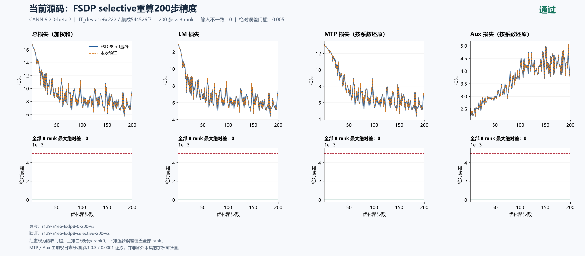
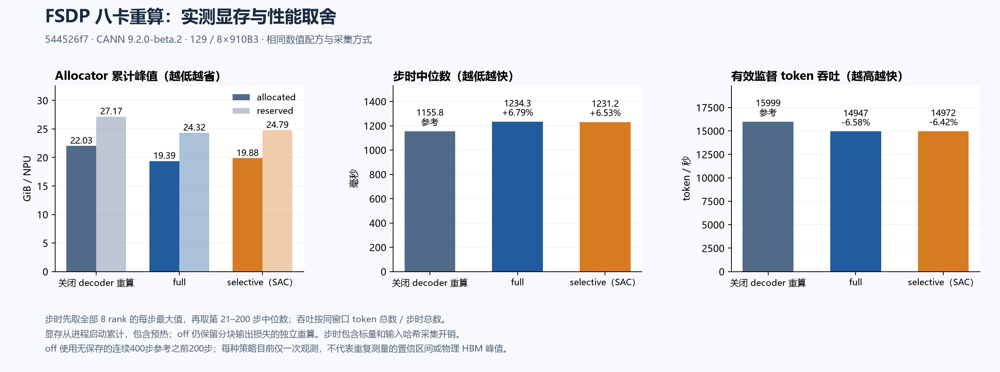

# 当前源码 FSDP 八卡：off / full / selective 完整200步重算验收

固定集成源 `544526f7db8342c607244fd41009b2a74adb84c8`，本轮 **full 与默认 SAC selective 均独立完成200步×8rank，主LM最大绝对差为0**。二者分别与已验收的 off 基线比较，总loss、已有MTP/aux日志及按系数还原值、梯度范数、LR和输入也全部零差；独立复核另外对照了无保存的连续400步参考之前200步。没有拼接中断前缀。

这完成当前配方的 FSDP8 三种重算模式验收；**当前源码 TP/CP/EP 及组合矩阵仍未完成**。主LM矩阵优先，已有MTP/aux结果保留，不扩展为它们全部并行专项通过。201后续工作已取消，只使用125/129。

关联：[总问题单#202](https://github.com/hf1s/hyper-parallel/issues/202)、[MTP覆盖问题#206](https://github.com/hf1s/hyper-parallel/issues/206)/[单提交PR#195](https://github.com/hf1s/hyper-parallel/pull/195)、[路由副作用问题#207](https://github.com/hf1s/hyper-parallel/issues/207)/[单提交PR#196](https://github.com/hf1s/hyper-parallel/pull/196)。整轮属于多修复集成验证，不能将全部数值或资源结果归因于某一个PR，也不能仅凭新结果宣布这些PR已合入或CI通过。

## 执行身份与可比条件

| 模式 | 运行 | 实际范围 | 保存行为 | 容器总耗时 |
|---|---|---|---|---:|
| off精度基线 | `r129-a1e6-fsdp8-0-200-v3` | 1–200 | 保存step200 | 383.050秒 |
| off性能参考 | `r129-a1e6-fsdp8-continuous400-v2` | 独立1–400，本文取1–200 | 不保存 | 610.389秒（完整400步） |
| full | `r129-a1e6-fsdp8-full-200-v2` | 独立1–200 | 不保存 | 388.208秒 |
| selective（SAC） | `r129-a1e6-fsdp8-selective-200-v2` | 独立1–200 | 不保存 | 382.248秒 |

运行主机为129 / 8×Ascend910B3 64GiB，CANN9.2.0-beta.2，Python3.12.14、Torch/TorchNPU2.12；镜像完整ID为 `sha256:5f9e677f439d11ab4e7c888f54b142335a27eee7411cbd2ce894a4798a70146d`。2026-10-18重新查询上游 `JT_dev` 仍为 `a1e6c222eab097c9609d6e744a3c5f98aeed6bdc`，包含#180/#230/#232。四次均核验同一源码与空补丁、相同初始化/数据及运行标志。

固定seed42、dataloader seed1234、GBS8/MBS1、seq4096、constant LR0.0001、MTP系数0.3、aux系数0.0001；BF16参数、FP32归约与主参数、专家FP32权重梯度、Muon NS FP32，chunk loss4096。没有通过改变seed、样本、学习率或系数贴齐曲线。数值基线、续训与独立连续400的前置验收见[续训报告](../a1e6-fsdp-resume-400/README_ZH.md)。

两次新运行均exit0，守卫记录完整容器ID、停止、无本任务残留PID及完整八卡释放快照，随后移除自有容器。启动前两次按真实计算PID、core、HBM与健康检查空闲；namespace映射仅诊断，不阻止实际空卡启动。全局1200秒释放间隔由本机协调器执行，不用有偏差的远端时钟代替。

## 完整200步精度与实际覆盖

| 全8rank、全200步最大绝对差 | full vs off基线 | selective vs off基线 |
|---|---:|---:|
| 主LM | 0 | 0 |
| 总loss（日志加权和） | 0 | 0 |
| MTP日志（乘0.3） | 0 | 0 |
| MTP按系数还原 | 0 | 0 |
| Aux日志（乘0.0001） | 0 | 0 |
| Aux按系数还原 | 0 | 0 |
| 梯度范数、LR | 0 | 0 |
| 输入identity不一致项 | 0 | 0 |

[Full严格比较](full-comparison.json)与[selective严格比较](selective-comparison.json)均PASS。两份独立复核从原始JSONL重新计算，full分别对照baseline和连续参考，selective另外对照full；均完整覆盖200×8，没有只看最终步或rank0。初态文件中的48项CPU模型张量metadata/hash逐rank一致；采集点在NPU并行处理前，不据此宣称所有运行时内部状态逐字节相同。

MTP/aux还原量来自加权日志分别除以0.3/0.0001，并非额外采集的加权前张量。八rank日志包含全局归约值；全rank覆盖不是八份独立本地样本。梯度结论限于所记范数，不扩大为所有参数梯度逐元素相同。





上排曲线为rank0，下排逐步最大差覆盖全部8rank，红虚线为0.005。两个新运行的实际wrapper清单和全部8rank构建日志均确认三处：

```text
model.layers.0
model.layers.1
mtp.layers.0.transformer_layer
```

完整wrapper清单随各自 `runs/.../integration/check/activation_checkpoint.json` 公开。当前已包含上游#230的动态派生wrapper识别修复。这里证明这三个区域实际安装；不能据此将MTP外围norm、投影或共享embedding/head都说成整块MTP重算。

## 显存、步时与性价比

性能off对照使用 **无checkpoint保存的连续400步之前200步**。每步先取全部8rank MAX，步时排除前20步，再取21–200中位数；有效监督token吞吐按同窗口token总数除以逐步MAX时间总数。显存取1–200中进程累计峰值，包含初始化和预热。

| 模式 | 中位步时 | 有效监督token/s | Allocated峰值 | Reserved峰值 |
|---|---:|---:|---:|---:|
| off | 1.155826秒 | 15999.35 | 22.032196GiB | 27.171875GiB |
| full | 1.234299秒 | 14947.21 | 19.392933GiB | 24.320313GiB |
| selective（SAC） | 1.231250秒 | 14972.48 | 19.875641GiB | 24.789063GiB |

Full相对off少用 **2.639263GiB allocated（11.98%）**，中位步时增加 **78.474ms（6.79%）**；selective少用 **2.156555GiB（9.79%）**，增加 **75.424ms（6.53%）**。这两项策略级观测对应约0.03363与0.02859 GiB/额外ms，数值见[summary.json](summary.json)。

Full比selective多省0.482708GiB allocated和0.468750GiB reserved，两者中位步时仅差0.247%。**每种只有一次观测，不能用这个小差异判定稳定速度胜负。** 在当前样本内full提供更大的显存余量；尚不能宣布它对所有模型规模、拓扑或模块选择都最优。



这些是同配方、同采集方式的callback性能，含标量和输入identity复制/哈希开销，未开启额外模块profiling。不是无插桩端到端吞吐；容器总耗时包含不同长度训练和初始化，不能直接相互当训练速度比。Allocated/reserved是allocator进程累计峰值，不是物理HBM瞬时峰值。

## 模块选择灵活性与后续测量

当前默认selective是 **算子级SAC**，不是MF式模块路径×层范围选择。JT adapter在544未注册 `ModelAdapterSpec.recompute`；通用safe-regions入口及 `layer_count/layer_indices` 已存在，但本模型不能直接使用。safe-regions分支又在full/selective模式分支之前返回，目前两种名字都会为选中的子模块安装普通checkpoint，不能称为子区域SAC。

本轮官方参考固定在MF master `409019aac0c6579bb4fb8a9b04a75c259d98a96e` 与Megatron main `65ac8216e481b8a2e10d0f366865528fc010342a`。MF PyNative支持白名单路径、层范围、exclude和独立通信选择；Megatron区分普通模块checkpoint与丢弃输出型checkpoint。普通norm wrapper不能直接获得后者的显存收益。[详细源码分析、边界与最小provider方案](flexibility/README_ZH.md)及[sources.json](flexibility/sources.json)保留精确行号和文件哈希；该附录是建议，没有实现provider或获得模块级硬件ROI。

`off`仍保留分块输出损失的独立checkpoint，因此三种模式都不是“整个训练图无重算”。下一阶段模块成本应独立短诊断：分别切换norm、shared experts及组合，测峰值边际差和步时边际差，再决定安全集合；性能profiling与正式200步运行分开。已有module profiler的inclusive时间不能在父子模块间相加，allocation delta也不等于模块保留激活或全步峰值贡献。最终候选仍需同源基线及完整200步精度验收，不以模块短跑替代。

## 证据范围与复算

四次原始采集各91文件；[full独立复核](full-independent-review.json)核验相关三次共273项，[selective独立复核](selective-independent-review.json)扩展到四次共364项。两个新运行的传输归档在逐文件SHA核验后已清理，step200必要checkpoint保留，没有生成新checkpoint副本。

本目录公开明确筛选的配置、逐rank标量、初态、runtime flags、内存、起止标记与wrapper清单，见[source-provenance.json](source-provenance.json)和[manifest.json](manifest.json)。原训练文本、checkpoint二进制和完整私有驱动诊断不上传。公开子集支持所示数值和资源复算；完整原manifest与执行身份审计留在任务归档，不能把公开子集叫作全部原始91文件。

在本目录重绘，需Python、matplotlib与numpy，中文字体Microsoft YaHei：

```text
python plot_comparison.py . full-comparison.json --title "FSDP full重算200步" --source-label "544526f7；129 / 910B3" --reference-label "off基线" --output figures/full-200 --raw-components --chinese
python plot_comparison.py . selective-comparison.json --title "FSDP selective重算200步" --source-label "544526f7；129 / 910B3" --reference-label "off基线" --output figures/selective-200 --raw-components --chinese
python plot_a1e6_recompute_cost.py summary.json figures/recompute-cost
python all_rank_resources.py runs/r129-a1e6-fsdp8-full-200-v2 1 200 --output full-resources-recomputed.json
python all_rank_resources.py runs/r129-a1e6-fsdp8-selective-200-v2 1 200 --output selective-resources-recomputed.json
```

公开PNG/SVG及绘图源码可复用。报告只将已完成的FSDP重算项改为通过；TP/CP/EP及组合和模块级ROI仍按实际证据继续推进。
