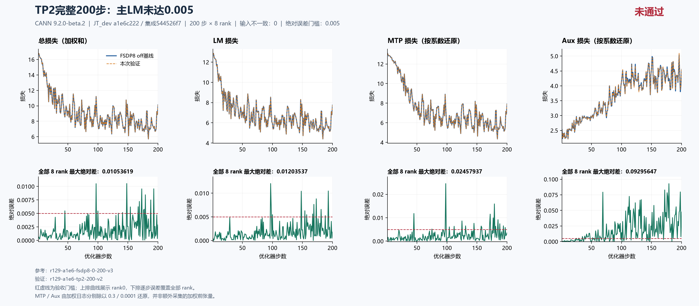

# 当前源码 TP2：完整200步主LM未通过，先定位更新前的前向边界

`544526f7` 的 TP2 已独立完成 **200步×8rank**。与同源FSDP8基线相比，主LM最大绝对差 **0.012035369873046875**，出现在 **step97**；共12步超过0.005，精度验收 **FAIL**。执行完整性、输入identity、CPU初态记录、计数与LR检查通过，运行exit0并释放八卡。根因尚未确认，继续在[总问题单#202的Top1](https://github.com/hf1s/hyper-parallel/issues/202)追踪，定位具体函数和触发条件后再拆独立问题与单commit PR。

当前FSDP基线/续训及off/full/SAC selective重算已通过；本结果只覆盖纯TP2，其余TP/CP/EP与组合仍待当前源码验证。[已验收重算及资源对照](../a1e6-recompute-200/README_ZH.md)。本轮优先主LM，保留MTP/aux观测，尚不扩大为其全矩阵专项。

## 同源执行与完整比较

运行 `r129-a1e6-tp2-200-v2`，完整容器ID `bf62a85c296a8c98c1e0734f4a48b92d7476dffe51a1a3d6caedc267b301efdd`；守卫总耗时512.812秒，exit0、停止、自有PID释放及完整八卡快照均核验，容器已移除。91文件归档逐SHA核验后，两端重复传输包已清理。

主机129 / 8×Ascend910B3 64GiB，CANN9.2.0-beta.2，镜像 `sha256:5f9e677f439d11ab4e7c888f54b142335a27eee7411cbd2ce894a4798a70146d`。上游JT_dev固定 `a1e6c222`，集成源完整SHA `544526f7db8342c607244fd41009b2a74adb84c8`，包含#180及#230/#232。源码、空补丁、镜像、seed42、dataloader seed1234、GBS8/MBS1、seq4096、LR0.0001、MTP0.3/aux0.0001、FP32初始化/归约/主参数、专家FP32权重梯度、Muon NS FP32与参考一致。

TP2启用SP和loss parallel，DP4，每个优化器步顺序执行2个微批；FSDP8参考为DP8、1个微批。输入比较按每个优化器步的全局identity，不能按同编号物理rank或microstep强配。48项初态模型张量的metadata/hash相同，采集点在CPU初始化之后、NPU并行处理之前；首次NPU前向状态仍需进一步观测。

| 全200步×8rank最大绝对差 | 数值 | 出现步 |
|---|---:|---:|
| 主LM | 0.012035369873046875 | 97 |
| 总loss（日志加权和） | 0.01053619384765625 | 148 |
| MTP日志（乘0.3） | 0.007373809814453125 | 98 |
| MTP按系数还原 | 0.024579366048177086 | 98 |
| Aux日志（乘0.0001） | 0.000009295647032558918 | 179 |
| Aux按系数还原 | 0.09295647032558918 | 179 |
| 梯度范数 | 0.6902656555175781 | 148 |
| LR | 0 | 全程 |

主LM超阈值步为 **97、98、100、148、154、157、167、169、173、181、188、193**。完整数值见[严格比较](comparison.json)与[摘要](summary.json)。八rank日志是全局归约标量；它们覆盖全部rank，但不等同八个独立本地loss。MTP/aux还原值来自日志除以实际系数，不是另采的加权前张量。梯度结论限于范数。



## 首步差异与定位顺序

| 首步rank0全局日志 | FSDP8 | TP2 | 绝对差 |
|---|---:|---:|---:|
| LM | 12.881054878234863 | 12.880559921264648 | 0.0004949569702148438 |
| MTP日志 | 3.928363800048828 | 3.9281868934631348 | 0.00017690658569335938 |
| Aux日志 | 0.00025308559997938573 | 0.000253074977081269 | 0.000000010622898116707802 |
| 梯度范数 | 22.473445892333984 | 22.473865509033203 | 0.00041961669921875 |

首步LM已非零，早于该步优化器更新产生的新参数。[TextTrainer.train_step](https://github.com/xingleixu123/hyper-parallel/blob/544526f7db8342c607244fd41009b2a74adb84c8/hyper_parallel/trainer/text_trainer.py#L281)先形成各微批loss和反向，再裁剪与更新。因此下一轮先比较更新前的计算参数、实际前向和损失归约；目前尚未证明某个算子错误，也未排除首次NPU状态差异。

准备同源FSDP8/TP2各3步原生观测：第1步在embedding、两层decoder、主norm和MTP内部/外围norm与投影边界记录按真实样本、全局token/feature位置对齐的分块摘要；后两步核验观测器对已有轨迹的透明性。粗边界缩小后再二分attention/MLP与局部VJP。只有前向及根梯度相同而反向不同，才继续比较未裁剪主梯度、裁剪及Muon更新。

历史CP的head行数消融只证明相应局部dX形状敏感，三步效果有好有坏；CP使用全词表权重的补行方式也不能直接迁移到TP词表分片。历史采样零差不等于完整前向相等，已有诊断中缺失的MTP外层final norm需补齐。新的短程观测和干预仍须实际执行、确认透明性，最终修复须回到完整200步验收。

## 资源收益与拓扑预期

下表用无checkpoint保存的连续400步参考之前200步作off性能对照。时间先逐步取8rank MAX，再取21–200中位数；token/s按同窗口有效监督token总数除以时间总数。峰值为进程累计allocator值，包含预热。

| 单次完整运行资源观测 | FSDP8 off | TP2 |
|---|---:|---:|
| 中位秒/步 | 1.155826 | 1.855199 |
| 有效监督token/s | 15999.35 | 9975.38 |
| Allocated峰值GiB | 22.032196 | 17.294672 |
| Reserved峰值GiB | 27.171875 | 18.638672 |

TP2 allocated少4.737524GiB（21.50%），中位步时增加60.51%，监督吞吐下降37.65%。这些只作失败策略的诊断观测，不能当作达到精度目标后的优化推荐。43步rank0时间低于其他rank，本表使用[全rank资源复算](tp2-resources.json)，不使用严格比较输出中的rank0性能字段。单次观测、标量/输入哈希采集及allocator峰值边界保留；不是无插桩端到端性能或物理HBM峰值。

收益应结合实际布局解释：

- TP分片参数的持久份额约为 `P/(TP2×FSDP4)=P/8`，与FSDP8接近；TP复制参数随decoder走FSDP4，为 `P/4`。EP=1时没有独立expert FSDP mesh，配置 `edp_shard_size=1` 不表示专家不做FSDP。
- Router/experts、shared experts、linear_qkv及MTP eh_proj在本配方TP上复制。实际rank0优化器初始layout的46项FP32本地参数元素数从339747840增至409356288，按layout推算约1.265659→1.524971GiB。峰值降低不能解释成持久参数减半；FP32主参数与模型参数还可能直接共用，不能再算一份复制。
- Vocab分片的embedding/head materialize权重更小，SP区域部分激活保留半段序列，可降低临时峰值；gather后的激活、完整NS输入及workspace不能一律按TP倍数缩减。当前尚未做算子级峰值归因。
- 每步两个串行微批，`requires_grad_sync=true`，每微批都做FSDP同步，额外TP collective及kernel启动可能抵消局部计算缩小的收益。固定八卡、固定GBS的总计算量也不因TP2自动减半。

对应实现为[mesh的EP条件](https://github.com/xingleixu123/hyper-parallel/blob/544526f7db8342c607244fd41009b2a74adb84c8/hyper_parallel/distributed/mesh.py#L197)、[FSDP梯度同步](https://github.com/xingleixu123/hyper-parallel/blob/544526f7db8342c607244fd41009b2a74adb84c8/hyper_parallel/trainer/runtime/fsdp.py#L405)、[TP模板](https://github.com/xingleixu123/hyper-parallel/blob/544526f7db8342c607244fd41009b2a74adb84c8/hyper_parallel/distributed/_builder/default_templates.py#L139)及[Muon临时收集](https://github.com/xingleixu123/hyper-parallel/blob/544526f7db8342c607244fd41009b2a74adb84c8/hyper_parallel/core/optimizer/muon.py#L647)。理论布局解释不替代通信/算子profiling。

## 证据与后续

[独立科学与资源复核](independent-review.json)从三次原始记录重算；[source-provenance.json](source-provenance.json)对应公开配置、逐rank指标、CPU初态、runtime flags、布局与起止标记；[manifest.json](manifest.json)核验公开包。原训练文本、checkpoint二进制和私有驱动原文不上传。公开子集与完整原manifest分开描述，保留必要step200 checkpoint及复现证据。

在本目录重绘或复算：

```text
python plot_comparison.py . comparison.json --title "TP2完整200步：主LM未达0.005" --source-label "544526f7；129 / 910B3" --reference-label "FSDP8 off基线" --output figures/tp2-200 --raw-components --chinese
python all_rank_resources.py runs/r129-a1e6-tp2-200-v2 1 200 --output tp2-resources-recomputed.json
```

只使用125/129，遇真实他人占卡等待。本轮实际按当时的1200秒释放间隔执行；用户随后明确改为连续实验约2小时后，在该轮结束释放时休息10分钟，单次实验之间不再等20分钟。新调度入口需完成测试、审阅和部署后实际使用，不能把尚未生效的候选说成已执行。接下来在空卡窗口继续原生前向二分，其他尚未完成的并行矩阵保持待验状态。
