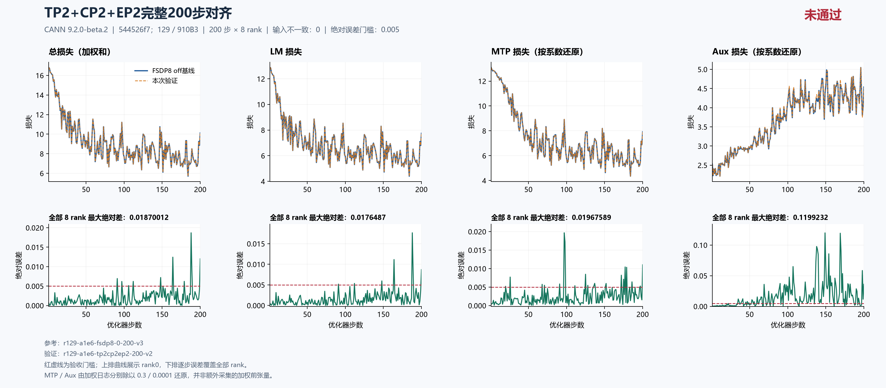
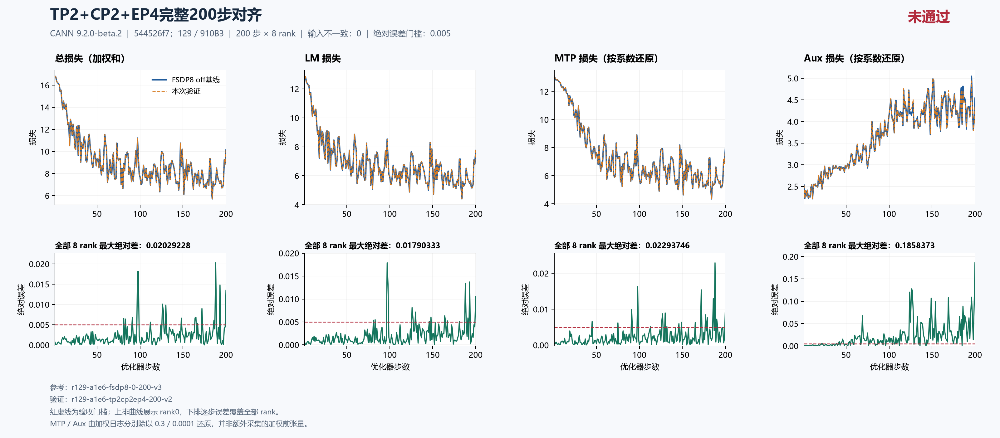

# TP2×CP2×EP2 / EP4：两种组合完整200步主LM均未通过

固定集成源 `544526f7db8342c607244fd41009b2a74adb84c8` 下，两项均从原初态独立完成 **200步×8rank、exit0并释放**。TP2×CP2×EP2 主LM最大差 **0.017648696899414062（step188）**，7步超0.005；TP2×CP2×EP4 为 **0.01790332794189453（step97）**，16步超阈。两项验收均 **FAIL**，具体根因 **UNRESOLVED**。

本包对应当前主loss矩阵的最后两种既定组合，在[总问题单#202](https://github.com/hf1s/hyper-parallel/issues/202)的Top1继续跟踪。完整矩阵有运行证据，不等于跨拓扑精度已通过。其他拓扑、历史源码或三步诊断的结论不移植为本次根因；本包不创建尚未定位的独立修复PR。

## 固定来源与数值配方

129主机，8×Ascend 910B3 64GiB，CANN **9.2.0-beta.2**；镜像 `sha256:5f9e677f439d11ab4e7c888f54b142335a27eee7411cbd2ce894a4798a70146d`。固定集成源544526f7以 `a1e6c222eab097c9609d6e744a3c5f98aeed6bdc` 为JT_dev基点，包含用户指定#180。[源码只读快照](current-source-readonly-20261018-v1.json)记录2026-10-18 06:29:27 UTC的祖先与clean核验；本报告只绑定固定提交，不泛指之后变化的分支HEAD。

四次完整运行的源码、空patch、CPU初态和runtime flags一致；seed42、dataloader seed1234、GBS8/MBS1、seq4096、LR0.0001、scheduler1000、MTP系数0.3、aux系数0.0001保持不变。两层trunk、一层MTP、8个routed experts；FP32初始化/归约/main、专家FP32 wgrad、Muon NS FP32与BF16计算保持原配方。实际重算off、0个wrapper。

| 用途与case | 实际并行域 | 每优化器步微批 | 本包窗口 |
|---|---|---:|---|
| 精度参考 `r129-a1e6-fsdp8-0-200-v3` | DP8，dense FSDP8 | 1 | 1–200 |
| 资源参考 `r129-a1e6-fsdp8-continuous400-v2` | DP8，dense FSDP8，无checkpoint保存 | 1 | 原文400步，资源取前200 |
| `r129-a1e6-tp2cp2ep2-200-v2` | DP2×CP2×TP2；dense FSDP4×TP2，expert EDP4×EP2 | 4 | 1–200 |
| `r129-a1e6-tp2cp2ep4-200-v2` | DP2×CP2×TP2；dense FSDP4×TP2，expert EDP2×EP4 | 4 | 1–200 |

两候选均PP1，sequence parallel与loss parallel开启；CP采用 `expanded_ulysses`、`overlap=false`。EP是另一个专家参数/通信域，不能把TP×CP×EP乘积当物理卡数或统一参数分片倍数。两个FSDP参考的前200步loss、梯度范数、LR、计数和输入逐项一致；候选对两参考分别复算，结果完全相同。

守卫总耗时分别为 629.5491818700102 / 616.6232239800156秒，包含启动、检查、训练与回收，不是稳态秒/步。两次均exit0/released、已停止自有容器，完整ID不存在的只读证据已核验；不复制私有驱动/进程归属快照或外部作业身份。

## 完整200步精度

| 全200步×8rank最大绝对差 | TP2×CP2×EP2 | TP2×CP2×EP4 |
|---|---:|---:|
| 主LM | 0.017648696899414062（step 188） | 0.01790332794189453（step 97） |
| 总loss（日志加权和） | 0.018700122833251953（step 188） | 0.020292282104492188（step 188） |
| MTP日志（系数0.3） | 0.005902767181396484（step 97） | 0.006881237030029297（step 188） |
| MTP按系数还原 | 0.01967589060465495（step 97） | 0.022937456766764324（step 188） |
| Aux日志（系数0.0001） | 1.1992320651188493e-05（step 149） | 1.8583727069199085e-05（step 200） |
| Aux按系数还原 | 0.11992320651188493（step 149） | 0.18583727069199085（step 200） |
| 梯度范数 | 0.4994359016418457（step 148） | 0.4574298858642578（step 148） |
| LR | 0（全程） | 0（全程） |

EP2组合主LM超阈步骤：**91、112、148、164、188、189、200**。

EP4组合主LM超阈步骤：**81、83、97、98、126、127、130、146、148、164、167、181、188、191、193、200**。

每候选对每参考均有1600对记录；4项计数共6400对、LR、全局输入SHA和rank_count零差。`input_identity`整对象因`micro_steps`由1变4而有1600处预期差异，不能误报为数据不同。同编号物理rank或microbatch也不等于同一逻辑样本。

[固定callback的DP+CP组](https://github.com/xingleixu123/hyper-parallel/blob/544526f7db8342c607244fd41009b2a74adb84c8/hyper_parallel/trainer/callbacks/environ_meter_callback.py#L151)在本两组合的4rank组内对loss/梯度范数做MEAN，FSDP参考组为8。8rank日志恰好相同不等于8份独立本地激活或梯度张量相同。MTP/Aux还原只把日志除以0.3/0.0001，不是另采乘系数前张量；本轮以主LM为先，不扩为组件专项全矩阵验收。

EP2组合：[严格比较](ep2-comparison.json)、[摘要](ep2-summary.json)、[科学复核安全摘录](ep2-independent-review.json)。EP4组合：[严格比较](ep4-comparison.json)、[摘要](ep4-summary.json)、[科学复核安全摘录](ep4-independent-review.json)。





可编辑[EP2 SVG](figures/ep2-200.svg)、[EP4 SVG](figures/ep4-200.svg)。上排rank0轨迹，下排每步8rank最大绝对差，完整覆盖1–200；图名“对齐”指比较过程，图中“未通过”与本报告一致。MTP/Aux的0.005虚线只作相同单位诊断，不代表专项已验收。

## 首步边界与剩余定位

| 首步日志 | FSDP8 | EP2组合 | 绝对差 | EP4组合 | 绝对差 |
|---|---:|---:|---:|---:|---:|
| 主LM | 12.881054878234863 | 12.880511283874512 | 0.0005435943603515625 | 12.880511283874512 | 0.0005435943603515625 |
| MTP日志 | 3.928363800048828 | 3.9282236099243164 | 0.00014019012451171875 | 3.9282236099243164 | 0.00014019012451171875 |
| Aux日志 | 0.00025308559997938573 | 0.0002530583296902478 | 2.727028913795948e-08 | 0.0002530583296902478 | 2.727028913795948e-08 |
| 总loss | 16.809673309326172 | 16.808988571166992 | 0.0006847381591796875 | 16.808988571166992 | 0.0006847381591796875 |
| 梯度范数 | 22.473445892333984 | 22.473594665527344 | 0.000148773193359375 | 22.47359275817871 | 0.0001468658447265625 |

[TextTrainer](https://github.com/xingleixu123/hyper-parallel/blob/544526f7db8342c607244fd41009b2a74adb84c8/hyper_parallel/trainer/text_trainer.py#L281)先完成微批前向/反向及loss汇总，再取得梯度范数、执行优化器，最后递增完成步数。两组合首步主LM已非零，不能仅以后续优化器更新累积解释；首步梯度范数也有差，但不能由此定位具体反向函数。

全部rank的48项CPU初态shape/dtype/hash、46项全局参数元数据与runtime flags相同。CPU证据在JT MLA替换及CPU初始化后、NPU搬运/TP/EP/FSDP应用前采集，不证明首次NPU前向计算参数、buffers、RNG等全状态逐字节一致。另一个TP2三步attention/q_b定位只覆盖其自身拓扑和逻辑batch，不直接构成本两组合根因。

本轮没有新算子干预、完整激活或梯度张量对齐、optimizer状态字节比较或phase profiling。需继续按真实可观测边界定位具体函数与触发条件；只有因果证据充分才拆中文小issue和单commit PR，并返回完整200步主LM≤0.005验收。

## 显存与性能：仅失败配方的单次诊断

先逐步取8rank MAX，再统计step21–200中位步时。监督token/s为同窗口逻辑监督token总数除以时间总和，不能重复累加全rank计数。Allocator累计峰值取step1–200，包含预热；它不等于物理HBM峰值。

| 单次完整运行观测 | FSDP off连续前200 | EP2组合 | EP4组合 |
|---|---:|---:|---:|
| 中位秒/步 | 1.1558255553245544 | 2.38569438457489 | 2.3777740001678467 |
| 有效监督token/s | 15999.349710506209 | 7741.503518554743 | 7768.784517303858 |
| Allocated GiB | 22.032196044921875 | 12.693195343017578 | 12.678276062011719 |
| Reserved GiB | 27.171875 | 15.515625 | 15.224609375 |
| 窗口时间总和（秒） | 207.85544788837433 | 429.57443499565125 | 428.0659339427948 |
| 窗口监督token数 | 3325552.0 | 3325552.0 | 3325552.0 |

| 相对off参考 | EP2组合 | EP4组合 |
|---|---:|---:|
| Allocated减少GiB | 9.339001 | 9.353920 |
| Allocated减少% | 42.387970 | 42.455686 |
| 中位步时增加% | 106.406094 | 105.720836 |
| 吞吐变化% | -51.613636 | -51.443123 |

**两项精度均失败，资源变化只作诊断，不能推荐为已验收优化。** EP4组合比EP2组合的单次步时约小0.332%，差幅很小且无重复统计，不能据此判断性能胜负。

EP2组合有16步rank0时间低报，稳态窗口内16步；EP4组合150步，窗口内137步。统一使用全rank MAX；strict JSON的rank0 performance不替代本表。[EP2全rank资源](ep2-resources.json)、[EP4全rank资源](ep4-resources.json)、[off资源](off-resources.json)。

## 持久参数份额与成本解释

两组合的rank0初始model/main参数均FP32、46项，optimizer state为空。元数据不证明model/main是两套独立存储，也不代表前向物化参数的完整字节身份。

| 持久局部元素数 | FSDP8 | 两种TP2×CP2组合 |
|---|---:|---:|
| TP分片dense，14项 | 270139392 | 270139392 |
| TP复制dense，28项 | 22422528 | 44845056 |
| Routed expert，4项 | 47185920 | 47185920 |
| 合计，46项 | 339747840 | 362170368 |

dense为 `(fsdp_shard,tp)=(4,2)`；28项TP复制参数因FSDP8改为FSDP4而使份额增加22422528个FP32元素（0.08353042602539062GiB），例如fused linear_qkv、shared-expert投影、MTP eh_proj。14项TP切分dense与4项专家的持久份额仍与基线相同。因此本地FP32 main持久份额合计1.3491897583007812GiB，比基线更大，不能把峰值降低解释为所有参数都按TP/CP/EP乘积缩小。

EP2组合expert域为`(edp_shard,ep)=(4,2)`、`StridedShard(dim=0, split_factor=2), Shard(dim=0)`；EP4组合为`(2,4)`、`StridedShard(dim=0, split_factor=4), Shard(dim=0)`。两者均每rank持有1个global expert的持久份额，但global专家身份须按真实mesh坐标映射，不能只用物理rank推断。

公开rank0 layout和科学摘录支持上述份额。[DP×CP与dense FSDP域](https://github.com/xingleixu123/hyper-parallel/blob/544526f7db8342c607244fd41009b2a74adb84c8/hyper_parallel/distributed/mesh.py#L143)、[独立expert域](https://github.com/xingleixu123/hyper-parallel/blob/544526f7db8342c607244fd41009b2a74adb84c8/hyper_parallel/distributed/mesh.py#L190)解释归属；激活切分、参数物化、重排、通信缓冲、四个串行微批及证据采集会影响实际峰值/时间。本轮无模块profile，不定量归因或推算理论加速倍数。

## 公开证据与复算

四次完整原采集各91份，共364份原文件逐SHA/size核验；公开仅按既有安全白名单各56份，合计224个run文件。保留逐rank指标、配置、CPU初态、runtime flags、起止标记、allocator终态及rank0 layout；不公开训练文本/token/tensor原值、checkpoint、worker日志、私有驱动或外部作业身份。两份原strict保持字节，内含的本任务容器ID已与exit0/released所有权回执匹配；未包含外部作业原文。

数据由冻结四文件pins和逐步全局输入摘要绑定，本机无原数据文件，不宣称重新哈希未复制的数据。必要checkpoint与完整原件继续保留任务归档。

[source-provenance.json](source-provenance.json)记录241份原字节复制和2份科学复核安全摘录的来源/目的SHA、size；[manifest.json](manifest.json)覆盖全部非manifest文件。README、provenance、manifest是新说明。科学摘录明确不与原完整review逐字节相同，省略本机路径、全量bindings和所有权快照；摘录不表示本公开包已完成独立发布审核。包整理和下面复算属于作者QA，后续需另一位审阅者独立核验。

在本目录使用新输出名：

```text
python compare_runs.py runs/r129-a1e6-fsdp8-0-200-v3 runs/r129-a1e6-tp2cp2ep2-200-v2 1 200 --output ep2-scalars-recomputed.json
python compare_runs.py runs/r129-a1e6-fsdp8-0-200-v3 runs/r129-a1e6-tp2cp2ep4-200-v2 1 200 --output ep4-scalars-recomputed.json
python all_rank_resources.py runs/r129-a1e6-fsdp8-continuous400-v2 1 200 --output off-resources-recomputed.json
python all_rank_resources.py runs/r129-a1e6-tp2cp2ep2-200-v2 1 200 --output ep2-resources-recomputed.json
python all_rank_resources.py runs/r129-a1e6-tp2cp2ep4-200-v2 1 200 --output ep4-resources-recomputed.json
python plot_comparison.py . ep2-comparison.json --title "TP2+CP2+EP2完整200步对齐" --source-label "544526f7；129 / 910B3" --reference-label "FSDP8 off基线" --output figures/ep2-recomputed --raw-components --chinese
python plot_comparison.py . ep4-comparison.json --title "TP2+CP2+EP4完整200步对齐" --source-label "544526f7；129 / 910B3" --reference-label "FSDP8 off基线" --output figures/ep4-recomputed --raw-components --chinese
```

两次scalar比较返回FAIL/退出码1是如实复现科学失败。主LM判据为完整200×8，且`errors["training/foundation_loss/lm"]["max_abs"] <= 0.005`。公开副本可复算标量与资源、重绘两图；strict_compare_runs.py与summarize_a1e6_matrix_case_v1.py保留原审核/汇总源码，但完整执行还依赖原任务tools/evidence/runs结构、91项原manifest和执行回执，不应在安全子集根目录伪造缺失原件运行。

后续仅125/129，201已取消。本包只报告两项完整结束运行，不替代整个目标的根因定位、修复回归或MTP/Aux专项决策。
