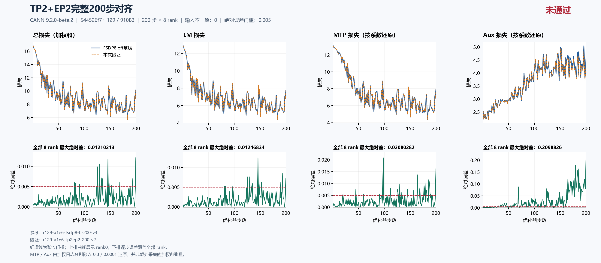

# TP2+EP2完整200步主LM未通过；TP4+EP4在169步因外部作业冲突回收

固定集成源 `544526f7db8342c607244fd41009b2a74adb84c8` 的 **TP2+EP2从初态完成200步×8rank**，主LM最大绝对差为 **0.012468338012695312（step146）**，13步超过0.005，主LM验收 **FAIL**。输入identity、CPU构造初态、LR、计数及执行完整性通过，不能替代精度门槛；具体函数与根因仍 **UNRESOLVED**。

**TP4+EP4 v2只保存了8rank各1–169步的连续记录。** 守卫在所选设备上发现经归属复核的外部容器进程后，按约停止并释放自有容器；记录的中断原因是外部资源冲突，不能把退出137直接解释成OOM。本包不为它作完整200步验收、性能对比或优化推荐，也不补造缺失的结束文件。

尚未定位的漂移继续在[总问题单#202的Top1](https://github.com/hf1s/hyper-parallel/issues/202)跟踪，本包没有新的修复或未经定位的新问题单。历史通过项、其他拓扑和其他源码版本的结论不移用到这两个组合。

## 固定环境、来源与比较窗口

主机129，8×Ascend910B3 64GiB，CANN9.2.0-beta.2，镜像 `sha256:5f9e677f439d11ab4e7c888f54b142335a27eee7411cbd2ce894a4798a70146d`。运行采用固定集成源544526f7及空patch；其上游JT_dev基点为 `a1e6c222eab097c9609d6e744a3c5f98aeed6bdc`，包含用户要求的#180。

[2026-10-18只读源码摘要](current-source-readonly-20261018-v1.json)的核验时刻为 **2026-10-18 06:29:27 UTC**：当时JT_dev仍为上述基点，#180已合并且其merge commit为祖先，固定集成树为clean。这是该时刻的核验快照，不将未来上游变化称为已测试，也没有用证据仓库当前HEAD替换训练源码。

各运行的数值配方保持seed42、dataloader seed1234、GBS8/MBS1、seq4096、LR0.0001、scheduler1000、MTP系数0.3、aux系数0.0001，以及FP32初始化/归约/主参数、专家FP32权重梯度和Muon NS FP32等设置。

| 用途/运行 | 实际拓扑 | 每优化器步微批数 | 本包范围 |
|---|---|---:|---|
| 精度参考 `r129-a1e6-fsdp8-0-200-v3` | DP8、FSDP8 | 1 | 完整1–200 |
| 资源off参考 `r129-a1e6-fsdp8-continuous400-v2` | DP8、FSDP8，不保存checkpoint | 1 | 保留完整400原记录，资源取1–200 |
| `r129-a1e6-tp2ep2-200-v2` | DP4×TP2，CP1/PP1，EP2，SP及loss parallel；dense FSDP4×TP2，expert EDP4×EP2 | 2 | 完整1–200 |
| `r129-a1e6-tp4ep4-200-v2` | DP2×TP4，CP1/PP1，EP4，SP及loss parallel | 4 | 仅实际1–169，中断 |

精度参考与连续400运行前200步的所测loss、梯度范数、LR和数据计数一致；TP2EP2对两者得到相同误差。资源表统一使用不保存checkpoint的连续参考之前200步，避免把带step200保存的精度参考混入正式成本对照。GBS固定为8时，TP2和TP4分别需要两个和四个串行微批，不能由TP倍数推导整体加速。

输入按每个优化器步的**全局identity**配对；不同拓扑下相同物理rank编号或microstep编号并不代表相同本地样本。

## TP2+EP2：完整200步的数值结果

| 全200步×8rank最大绝对差 | TP2+EP2 |
|---|---:|
| 主LM，未加权 | **0.012468338012695312（step146）** |
| 总loss，日志加权和 | 0.012102127075195312（step200） |
| MTP日志，已乘0.3 | 0.0062408447265625（step98） |
| MTP按系数还原 | 0.020802815755208336（step98） |
| Aux日志，已乘0.0001 | 0.000020988256437703967（step200） |
| Aux按系数还原 | 0.20988256437703967（step200） |
| 梯度范数 | 0.7076635360717773（step148） |
| LR | 0（1600对均相等） |

主LM超0.005的13步为：**81、83、97、126、130、134、135、146、148、153、189、193、200**。完整覆盖200×8，每个指标1600对scalar，四类数据计数共6400对；全局输入摘要和CPU构造初态无不一致，严格审核findings为空。

八rank实际记录的loss、梯度范数、LR和数据计数一致，这是归约后的日志观测，不能作为八份独立本地loss或梯度张量逐字节相等的证据。固定源码的[EnvironMeterCallback](https://github.com/xingleixu123/hyper-parallel/blob/544526f7db8342c607244fd41009b2a74adb84c8/hyper_parallel/trainer/callbacks/environ_meter_callback.py#L151)使用DP+CP mesh，不能仅凭日志相同写成所有指标都在8rank全world上归约。

本轮以主LM门槛为验收重点；MTP/Aux是诊断观测，按实际记录系数除以0.3/0.0001还原，不是另采的加权前张量，也不表示它们的专项全矩阵已通过。

参见[严格比较](tp2ep2-comparison.json)、[结果摘要](tp2ep2-summary.json)及[独立科学复核](tp2ep2-independent-review.json)。独审原件SHA256为 `138ff43cd4587f1dbe02916eed119d74601c6bf8c305c1638e276bd817a594be`，本包逐字节复制。



图上排为rank0日志轨迹，下排为逐步8rank最大绝对差，覆盖全部1–200步。原图“对齐”表示比较过程，图中“未通过”与本报告FAIL一致；MTP/Aux的0.005虚线仅作图中同口径诊断。另提供[可编辑SVG](figures/tp2ep2-200.svg)。本包不为中断TP4EP4制作一张看似完整200步的曲线。

## 首步已经存在差异，根因尚未定位

| 首步rank0日志 | FSDP8参考 | TP2+EP2 | 绝对差 |
|---|---:|---:|---:|
| 主LM | 12.881054878234863 | 12.880559921264648 | 0.0004949569702148438 |
| MTP日志 | 3.928363800048828 | 3.9281868934631348 | 0.00017690658569335938 |
| Aux日志 | 0.00025308559997938573 | 0.000253074977081269 | 0.000000010622898116707802 |
| 总loss | 16.809673309326172 | 16.80900001525879 | 0.0006732940673828125 |
| 梯度范数 | 22.473445892333984 | 22.473865509033203 | 0.00041961669921875 |

[TextTrainer.train_step](https://github.com/xingleixu123/hyper-parallel/blob/544526f7db8342c607244fd41009b2a74adb84c8/hyper_parallel/trainer/text_trainer.py#L281)先完成微批前向/反向和loss汇总，再裁剪并调用优化器。因此首步loss差已经形成于第一次参数更新之前，后续优化器累积不能单独解释它。下一步需核对首次实际计算参数、原生前向和归约；这里没有把差异定位到某个GEMM、通信dtype、优化器或既有PR。

CPU初态是在JT MLA替换后、转NPU及TP/FSDP处理前采集的shape/dtype/hash证据，不等于首次NPU参数物化逐字节相同。本包也不把其他拓扑的局部观察、历史采样或因果实验移作TP2EP2的根因证明；没有新增本组合的三步原生观察透明性或修复验收。最终修复仍须回到完整200步主LM最大差不超过0.005。

## TP2+EP2资源观测及持久布局解释

时间先逐步取8rank MAX，再取21–200步中位数；有效监督token/s为同一窗口逻辑监督token总数除以这些逐步MAX时间总和，token只计一次。Allocated/Reserved峰值取1–200全部rank的进程累计allocator值，包含预热；不是物理HBM瞬时峰值。

| 单次完整运行观测 | FSDP8 off，连续参考前200步 | TP2+EP2 |
|---|---:|---:|
| 中位秒/步，21–200 | 1.155826 | 1.837146 |
| 有效监督token/s，21–200 | 15999.35 | 10065.69 |
| 同窗口监督token数 | 3,325,552 | 3,325,552 |
| 同窗口时间总和，秒 | 207.85544788837433 | 330.38501965999603 |
| Allocated峰值，GiB | 22.032196 | 15.812039 |
| Reserved峰值，GiB | 27.171875 | 17.175781 |

相对off，TP2EP2的中位步时增加58.95%、监督吞吐下降37.09%；allocated少6.220156669616699GiB（28.23%），reserved少9.99609375GiB。**精度失败，以上只用于诊断失败配方，不构成已验收的优化建议。**

TP2EP2全200步有142步rank0时间低于8rank MAX，其中21–200为131步。采用[全rank资源复算](tp2ep2-resources.json)和[off参考](off-resources.json)；严格比较JSON与`compare_runs.py`内的`performance`来自rank0，仅保留供审计，不能取代本表。单次共享机运行、共同输入哈希/标量采集、微批数和callback边界均影响成本解释；这不是无插桩端到端性能结论。本包没有计算或报告中断TP4EP4的性能对比。

持久布局与运行时峰值分开解释：

- rank0初始46项FP32布局实测为 **362,170,368元素，1.3491897583007812GiB**，基线为339,747,840元素、1.2656593322753906GiB；增加 **22,422,528元素，0.08353042602539062GiB**。初始`optimizer_state`为空，这不是训练后momentum/AdamW状态已测值，也不能重复累计成模型和主参数两份实测存储。
- 增量来自 **28个TP复制的dense参数**：基线FSDP8局部22,422,528元素，在本组合FSDP4下为44,845,056元素。14个TP分片dense参数仍为270,139,392元素，因`P/(TP2×FSDP4)=P/8`。本组合4个routed expert参数的rank0份额为47,185,920元素，与基线相同；这里必须同时考虑EDP4×EP2，不能套用EP-only持久份额解释。
- 实际参数mesh/placement见[rank0布局](runs/r129-a1e6-tp2ep2-200-v2/integration/check/optimizer_layout_initial.json)及独审的逐组分解。TP复制dense中包含router/shared expert、linear_qkv、MTP eh_proj等；vocab分片参数的局部元素数可保持与基线一致。不能写成所有参数或所有显存都减半。
- TP/SP、vocab分片和EP可能改变部分materialize权重与激活瞬时占用，同时增加通信、workspace及重排；完整NS输入、gather后的激活与FSDP物化不能一律按TP/EP倍数缩小。两次串行微批及其同步也增加成本。本次未作阶段profile，allocator累计峰值不能量化归因到某一模块或通信缓冲。

## TP4+EP4：只公开真实169步和中断事实

| 事实 | 本包可支持的结论 |
|---|---|
| 指标覆盖 | rank0–7各169条，精确连续1–169，共1352对日志scalar/指标 |
| 前缀主LM最大绝对差 | 0.008181571960449219，step146；只描述已观察前缀 |
| 200步验收 | **NOT_EVALUATED_INCOMPLETE**，没有170–200步证据 |
| 运行结束文件 | `EXIT_CODE`、8份`complete-rank*.json`和8份`final-memory-rank*.json`实际缺失，未补造 |
| 中断原因 | 守卫记录`foreign-job-appeared-on-selected-devices`；归属复核为外部容器进程后，停止自有容器 |
| 守卫回执与释放 | 私有守卫回执记录退出137、自有资源已释放，后续完整ID核查自有容器已不存在；这不是缺失的run内`EXIT_CODE`文件 |
| 外部作业边界 | 未停止、删除或进入外部容器；不公开其cgroup/status/命令/身份原文 |
| 后续处理 | v2请求已消费，不覆盖或重跑同case；计划用新`r129-a1e6-tp4ep4-200-v3`从原始初态重跑，**不是从169步续训**；本包不宣称v3已经执行或通过 |

归属事件和守卫原因支持“外部容器资源冲突触发回收”，不支持把本次中断报告为OOM。退出137本身也不能证明OOM。前缀loss诊断不替代完整200步判据，TP4EP4根因仍未定位。

[中断摘要](tp4ep4-interrupted-summary.json)列出每rank覆盖、实际metrics SHA、17个缺失文件名及私有原件SHA。原始75文件采集manifest、归属事件、执行回执和根审核留在私有归档；公开摘要只提取必要事实，排除外部作业身份原文。新的[前缀核验工具](check_interrupted_prefix.py)只复算实际日志、全局输入摘要、CPU初态、LR和计数，不推断外部归属、不计算资源对比，也不产生200步PASS/FAIL。

## 可公开复算范围与字节来源

四组原采集分别为91、91、91、75文件，合计 **348文件**，已逐一核验原manifest的size/SHA。本包沿用已审协议的安全子集：基线、连续参考、完整TP2EP2各56文件，中断TP4EP4只取实际存在的39文件，合计 **207个run文件**。后者缺少的17项保持缺失，不以其他运行或守卫回执替代。

公开内容包括配置、逐rank指标、CPU初态、runtime flags、实际起始标记与rank0布局；完整运行另有实际结束/allocator终态。训练文本、权重和checkpoint二进制、私有驱动/namespace/守卫日志、外部作业身份原文不上传。所需checkpoint和完整执行/传输证据保留在任务归档。

[source-provenance.json](source-provenance.json)记录 **219条源/目的文件**的字节数、SHA及byte-identical关系，并区分新生成的摘要/文档/前缀工具；[manifest.json](manifest.json)列出本包除manifest自身外的223项。本包共 **224文件**，与原始私有manifest的范围不同。公开安全子集可独立复算标量误差、完整曲线和TP2EP2/off资源；复制的严格审核保留完整执行审核结论，重新审核全部私有执行/传输/容器证据仍需私有原件。

在本目录运行，输出使用尚不存在的新派生文件名：

```text
python compare_runs.py runs/r129-a1e6-fsdp8-0-200-v3 runs/r129-a1e6-tp2ep2-200-v2 1 200 --output tp2ep2-scalars-recomputed.json
python compare_runs.py runs/r129-a1e6-fsdp8-continuous400-v2 runs/r129-a1e6-tp2ep2-200-v2 1 200 --output tp2ep2-continuous-reference-recomputed.json
python all_rank_resources.py runs/r129-a1e6-fsdp8-continuous400-v2 1 200 --output off-resources-recomputed.json
python all_rank_resources.py runs/r129-a1e6-tp2ep2-200-v2 1 200 --output tp2ep2-resources-recomputed.json
python plot_comparison.py . tp2ep2-comparison.json --title "TP2+EP2完整200步对齐" --source-label "544526f7；129 / 910B3" --reference-label "FSDP8 off基线" --output figures/tp2ep2-recomputed --raw-components --chinese
python check_interrupted_prefix.py runs/r129-a1e6-fsdp8-0-200-v3 runs/r129-a1e6-tp4ep4-200-v2 --last-step 169 --output tp4ep4-prefix-recomputed.json
```

前两条标量比较返回FAIL和退出码1是如实重现科学失败。主LM门槛为完整200×8覆盖且`errors["training/foundation_loss/lm"]["max_abs"] <= 0.005`；其他组件诊断不扩大为主矩阵验收。前缀工具成功仅表示其有限核验完成，输出固定注明未作200步验收。`strict_compare_runs.py`保留完整审核实现，原私有采集manifest及运行身份材料没有被公开子集冒充。作图需要matplotlib/numpy，其余比较工具使用Python标准库；复算不得覆盖原指标或包内已有文件。

后续工作仅用125/129，201后续任务已取消。用户最新 **连续实验约2小时、当前轮自然结束并确认释放后休息10分钟** 的本机协调策略已有部署和实际激活证据，不再逐实验等待20分钟；历史1200秒规则只描述相应旧运行。每次仍须检查真实空卡、限时、归属与释放，只处理自有容器；本次TP4EP4遇到外部入卡后回收，正是该资源边界的实际执行。本包的准备不启动新实验。
