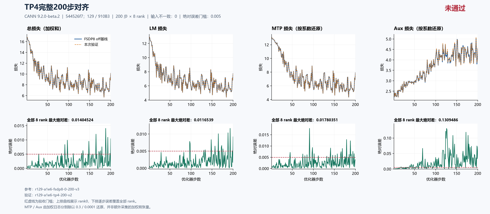
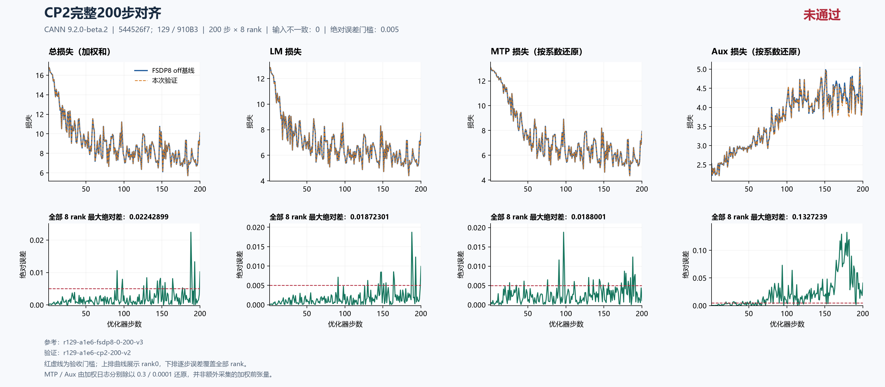

# 当前源码TP4与CP2：完整200步主LM均未通过，根因待定位

固定集成源 `544526f7db8342c607244fd41009b2a74adb84c8` 的 **TP4、CP2均从初态独立完成200步×8rank**。TP4主LM最大绝对差 **0.011653900146484375（step193）**，14步超过0.005；CP2为 **0.018723011016845703（step188）**，13步超过0.005。两项主LM验收均 **FAIL**，具体函数与根因仍 **UNRESOLVED**。输入identity、CPU构造初态、计数、LR和执行完整性核验通过，不等于精度通过。

尚未定位的漂移继续在[总问题单#202的Top1](https://github.com/hf1s/hyper-parallel/issues/202)跟踪；本包不创建未经定位的新问题或修复PR。FSDP/续训/重算的既有通过结论与本次失败分开保留；本包只覆盖当前TP4和CP2，不能替代其他拓扑或组合的验收。18602c4及更早的历史结果不移用到当前源码。

## 同源运行、比较窗口与实际布局

主机129，8×Ascend910B3 64GiB，CANN9.2.0-beta.2，镜像 `sha256:5f9e677f439d11ab4e7c888f54b142335a27eee7411cbd2ce894a4798a70146d`。固定上游JT_dev为 `a1e6c222`，集成源含用户指定#180及#230/#232。源码和空patch一致，seed42、dataloader seed1234、GBS8/MBS1、seq4096、LR0.0001、scheduler1000、MTP0.3/aux0.0001，以及FP32初始化/归约/主参数、专家FP32权重梯度和Muon NS FP32等数值配方保持一致。

| 用途/运行 | 拓扑 | 每个优化器步微批数 | 本包观察窗口 |
|---|---|---:|---|
| 精度参考 `r129-a1e6-fsdp8-0-200-v3` | DP8，FSDP8 | 1 | 1–200 |
| 资源off参考 `r129-a1e6-fsdp8-continuous400-v2` | DP8，FSDP8，无checkpoint保存 | 1 | 完整400原记录，取前200 |
| `r129-a1e6-tp4-200-v2` | DP2×TP4，SP及loss parallel，FSDP2 | 4 | 1–200 |
| `r129-a1e6-cp2-200-v2` | DP4×CP2，TP1，FSDP8 | 2 | 1–200 |

精度参考与独立连续400之前200步的所测loss、梯度范数、LR及数据计数一致，两种参考给出相同误差。资源对照统一取不保存checkpoint的连续参考，避免把带step200保存的精度参考混入正式成本表。固定八卡和GBS8时，TP4/CP2让DP减少、微批增加，不能预言4倍或2倍整体加速。输入按每个优化器步的全局identity核对，不能按不同拓扑的同编号物理rank或microstep直接配对。

TP4守卫耗时622.605313秒，CP2为462.580722秒；均exit0、已停止、释放自有PID且完整八卡快照通过。完整容器ID分别为 `0400c2bccafb41ce7adca385c5a06cca68520f440fd65df109705166da90d972` 和 `aee522961bfb59f8afae0adfd722973dce27ead200d9723a7db689992643b974`，后续只读完整ID核查均已不存在。这些是执行/释放证据，守卫总耗时不是下文的稳态秒/步。

## 完整200步精度结果

| 全200步×8rank最大绝对差 | TP4 | CP2 |
|---|---:|---:|
| 主LM | 0.011653900146484375（step193） | 0.018723011016845703（step188） |
| 总loss（日志加权和） | 0.014045238494873047（step188） | 0.02242898941040039（step188） |
| MTP日志（乘0.3） | 0.005341053009033203（step91） | 0.0056400299072265625（step97） |
| MTP按系数还原 | 0.01780351003011068（step91） | 0.01880009969075521（step97） |
| Aux日志（乘0.0001） | 1.3094861060380936e-05（step126） | 1.3272394426167011e-05（step179） |
| Aux按系数还原 | 0.13094861060380936（step126） | 0.1327239442616701（step179） |
| 梯度范数 | 0.6766133308410645（step148） | 0.409757137298584（step148） |
| LR | 0（全程） | 0（全程） |

TP4主LM超阈值步：**97、98、131、134、148、157、165、172、173、176、188、193、198、200**。

CP2主LM超阈值步：**91、130、144、147、148、151、154、164、165、188、189、193、200**。

每项每个参考比较1600对scalar。八rank所记loss/梯度范数/LR属于相同全局归约标量，并非八份独立本地loss；梯度结论仅限范数。MTP/Aux按日志实际系数除以0.3/0.0001还原，不是另采的加权前张量。本轮主LM优先，MTP/Aux作为诊断观测，不能包装为其专项全矩阵已经通过；图中其0.005虚线也只作同口径诊断。

TP4的[严格比较](tp4-comparison.json)、[摘要](tp4-summary.json)及[独立科学复核](tp4-independent-review.json)；CP2的[严格比较](cp2-comparison.json)、[摘要](cp2-summary.json)及[独立科学复核](cp2-independent-review.json)。





两图上排为rank0轨迹，下排为逐步全部8rank最大绝对差，覆盖1–200全部步骤。原图的“对齐”表示比较过程；右上角“未通过”与本报告FAIL一致。MTP/Aux还原口径写在图下注释中。

## 首步差异与定位入口

| 首步rank0全局日志 | FSDP8 | TP4 | TP4绝对差 | CP2 | CP2绝对差 |
|---|---:|---:|---:|---:|---:|
| LM | 12.881054878234863 | 12.88046646118164 | 0.0005884170532226562 | 12.88092041015625 | 0.00013446807861328125 |
| MTP日志 | 3.928363800048828 | 3.9282331466674805 | 0.00013065338134765625 | 3.9284071922302246 | 4.3392181396484375e-05 |
| Aux日志 | 0.00025308559997938573 | 0.0002530759375076741 | 9.66247171163559e-09 | 0.00025306345196440816 | 2.214801497757435e-08 |
| 总loss | 16.809673309326172 | 16.80895233154297 | 0.000720977783203125 | 16.809581756591797 | 9.1552734375e-05 |
| 梯度范数 | 22.473445892333984 | 22.47479248046875 | 0.001346588134765625 | 22.473630905151367 | 0.0001850128173828125 |

主LM首步已有非零差：[TextTrainer.train_step](https://github.com/xingleixu123/hyper-parallel/blob/544526f7db8342c607244fd41009b2a74adb84c8/hyper_parallel/trainer/text_trainer.py#L281)先完成各微批前向/反向、汇总loss，再裁剪和调用优化器。因此后续更新的累积不能单独解释首步差，下一步优先核对首次更新前的实际计算参数、原生前向、微批相关内部状态及损失归约。

48项CPU构造张量的shape/dtype/hash、runtime flags和实际全局输入摘要一致，采集点早于NPU并行处理。这并不证明首次NPU参数/内部状态逐字节相同，也没有确认某个算子、优化器或既有PR是根因。只有前向和根梯度相同、反向出现差异后，才继续比较未裁剪梯度、裁剪及Muon更新。本包没有新的三步原生观察透明性或局部因果干预验收；历史局部采样/消融也不等于完整前向相等。最终修复仍须回到完整200步主LM门槛。

## 全rank资源观测与拓扑预期

以下时间先逐步取8rank MAX，再取21–200中位数；监督token/s为同窗口有效监督token总数除以时间总和，逻辑token计一次。Allocator峰值取1–200内全部rank的进程累计值，包含预热。三项监督token总数均为3,325,552；时间总和分别为207.85544788837433、423.8657248020172、286.5645694732666秒。

| 单次完整运行资源观测 | FSDP8 off | TP4 | CP2 |
|---|---:|---:|---:|
| 中位秒/步 | 1.155826 | 2.354883 | 1.593995 |
| 有效监督token/s | 15999.35 | 7845.77 | 11604.90 |
| Allocated峰值GiB | 22.032196 | 13.556466 | 20.706646 |
| Reserved峰值GiB | 27.171875 | 14.386719 | 25.943359 |

相对off，TP4 allocated少8.475729942321777GiB（38.47%），中位步时增加103.74%、监督吞吐下降50.96%；CP2少1.3255500793457031GiB（6.02%），步时增加37.91%、吞吐下降27.47%。**两项精度均失败，资源仅作失败配方诊断，不能推荐为已验收优化。**

TP4全200步有95步rank0时间低于其他rank，CP2为0步；统一使用[TP4全rank复算](tp4-resources.json)、[CP2全rank复算](cp2-resources.json)和[off参考](off-resources.json)。`compare_runs.py`及严格比较JSON里的`performance`字段来自rank0，保留作审计，不用于本表。单次共享机运行、输入哈希与标量采集开销、不同微批数和callback时长边界均保留；不是无插桩端到端性能或物理HBM瞬时峰值。

持久存储与计算时临时峰值要分别解释：

- TP4上被TP切分的参数持久份额约 `P/(TP4×FSDP2)=P/8`，与FSDP8接近；TP复制的router/experts、shared experts、linear_qkv及MTP eh_proj走FSDP2，局部持久份额可增大。实际rank0初始46项FP32布局为 **548573184元素、2.0435943603515625GiB**，基线为339747840元素、1.2656593322753906GiB，增加 **0.7779350280761719GiB**。这是本次TP4实测layout，不能套用TP2的1.524971GiB。初始optimizer_state为空，也不能把模型/main或训练后momentum/AdamW重复估算为已测持久显存。
- TP4的vocab分片embedding/head和其他分片权重materialize更小，部分SP激活保留更短序列，能改变计算期峰值；gather后的激活、完整NS输入、通信与workspace不能一律按TP4缩减。四个串行微批、每微批FSDP同步和额外TP通信/launch会增加成本，尚无阶段profile给出定量峰值归因。
- CP2配置仍 `dp_shard_size=8`。源码[MeshContext的DP×CP FSDP域](https://github.com/xingleixu123/hyper-parallel/blob/544526f7db8342c607244fd41009b2a74adb84c8/hyper_parallel/distributed/mesh.py#L143)及实际layout一致：rank0初始46项仍 **339747840元素、1.2656593322753906GiB**，持久参数份额与基线相同，不是减半。
- CP2分短本地序列、改变部分激活与attention工作范围，但本配置使用[expanded_ulysses、overlap=false](https://github.com/xingleixu123/hyper-parallel/blob/544526f7db8342c607244fd41009b2a74adb84c8/hyper_parallel/models/jt_deepseek_v3/adapter/distributed/context_parallel.py#L150)，会引入CP通信、重排与缓冲。TP1下权重materialize也不能因CP2自动减半；固定GBS下还有两个串行微批。本次6.02%的allocated下降不能当作全显存或参数减少50%。

同步行为见[FSDP微批梯度同步](https://github.com/xingleixu123/hyper-parallel/blob/544526f7db8342c607244fd41009b2a74adb84c8/hyper_parallel/trainer/runtime/fsdp.py#L405)，Muon临时收集见[固定源码](https://github.com/xingleixu123/hyper-parallel/blob/544526f7db8342c607244fd41009b2a74adb84c8/hyper_parallel/core/optimizer/muon.py#L647)。布局解释不替代通信/算子profiling。

## 公开证据、复算与当前执行边界

四次原采集各91文件、合计364文件均逐SHA/size核验；本目录每次仅复制与既有审阅协议相同的56个安全文件，共 **224个run文件**。它们包括配置、逐rank指标、CPU初态、runtime flags、起止标记、allocator终态和rank0布局。原训练文本、worker日志、checkpoint二进制和私有驱动原文不上传；必要checkpoint及完整执行/传输证据保留在任务归档。

[source-provenance.json](source-provenance.json)逐项记录源与公开目的文件的字节数/SHA及byte-identical关系；[manifest.json](manifest.json)核验公开包，二者与原始私有manifest区别标明。复制后的严格比较保留完整执行审核结论；本目录的安全子集可以独立复算所列scalar误差、曲线和全rank资源，完整私有执行审核仍以独审记录和原manifest为凭。

在本目录执行，输出使用新的派生文件名：

```text
python compare_runs.py runs/r129-a1e6-fsdp8-0-200-v3 runs/r129-a1e6-tp4-200-v2 1 200 --output tp4-scalars-recomputed.json
python compare_runs.py runs/r129-a1e6-fsdp8-0-200-v3 runs/r129-a1e6-cp2-200-v2 1 200 --output cp2-scalars-recomputed.json
python all_rank_resources.py runs/r129-a1e6-fsdp8-continuous400-v2 1 200 --output off-resources-recomputed.json
python all_rank_resources.py runs/r129-a1e6-tp4-200-v2 1 200 --output tp4-resources-recomputed.json
python all_rank_resources.py runs/r129-a1e6-cp2-200-v2 1 200 --output cp2-resources-recomputed.json
python plot_comparison.py . tp4-comparison.json --title "TP4完整200步对齐" --source-label "544526f7；129 / 910B3" --reference-label "FSDP8 off基线" --output figures/tp4-recomputed --raw-components --chinese
python plot_comparison.py . cp2-comparison.json --title "CP2完整200步对齐" --source-label "544526f7；129 / 910B3" --reference-label "FSDP8 off基线" --output figures/cp2-recomputed --raw-components --chinese
```

两项scalar比较返回FAIL和退出码1是如实重现科学失败。主LM判据为`errors["training/foundation_loss/lm"]["max_abs"] <= 0.005`且完整覆盖200×8；工具的其他组件诊断不扩大为主矩阵验收。重绘使用原始比较JSON；`strict_compare_runs.py`保留完整审核实现，但重新进行其全部执行/原manifest检查需要私有归档，不把公开子集冒充完整私有采集。

后续仅用125/129，201后续工作已取消。用户最新 **连续实验约2小时、当前轮自然结束并确认释放后休息10分钟** 的本机周期入口已有部署和实际激活证据，不再逐次等待20分钟；每次实验仍保持实际空卡复查、限时及只停止自有容器。历史1200秒间隔只描述当时运行，不能覆盖当前政策。
