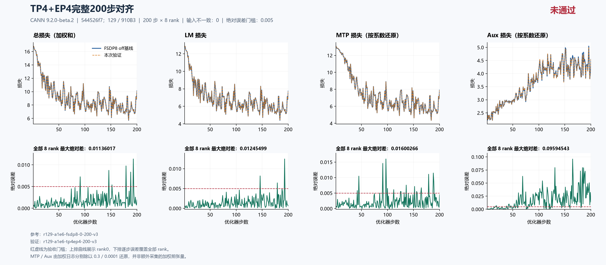
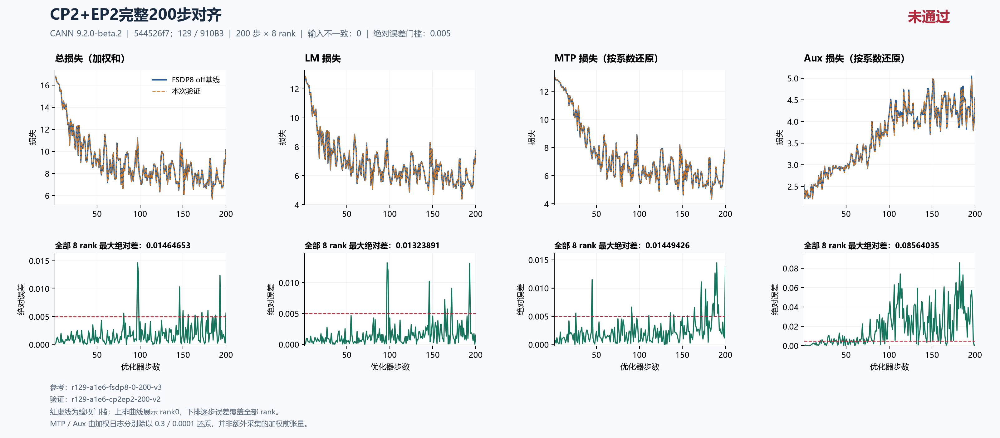

# TP4×EP4、CP2×EP2 完整 200 步：主 LM 均未通过，根因待定位

固定集成源 `544526f7db8342c607244fd41009b2a74adb84c8` 下，**TP4×EP4 v3 与 CP2×EP2 v2 都从初态独立完成 200 步 × 8 rank**。主 LM 最大绝对差分别为 **0.012454986572265625（step 193）**、**0.013238906860351562（step 97）**，分别有 3、7 个步骤超过 0.005。两项精度验收均 **FAIL**；运行、输入与证据完整性通过，具体根因仍 **UNRESOLVED**。

漂移在[总问题单 #202 的 Top1](https://github.com/hf1s/hyper-parallel/issues/202)跟踪。本包报告这两项当前同源完整实验，不将未定位现象直接命名为独立缺陷，也不把历史源码、其他拓扑或三步前向诊断合并为这里的 200 步验收。

## 固定来源与实验配方

主机 129，8 × Ascend 910B3 64 GiB；CANN **9.2.0-beta.2**，镜像 `sha256:5f9e677f439d11ab4e7c888f54b142335a27eee7411cbd2ce894a4798a70146d`。集成源为 `544526f7`，上游 JT_dev 基点为 `a1e6c222eab097c9609d6e744a3c5f98aeed6bdc`，包含用户指定的 #180。[源码只读核验快照](current-source-readonly-20261018-v1.json)记录 **2026-10-18 06:29:27 UTC** 时上游仍在该基点、#180 merge commit 为固定源祖先、固定工作树 clean。结果仅绑定这一提交，不泛指随后变化的分支 HEAD。

四个完整运行的源码、空 patch 与 runtime flags 一致。配方保持 seed 42、dataloader seed 1234、GBS 8/MBS 1、seq 4096、LR 0.0001、scheduler 1000、MTP 系数 0.3、aux 系数 0.0001；两层 trunk、一层 MTP、8 个 routed experts。FP32 初始化、归约和主参数、专家 FP32 权重梯度、Muon NS FP32、BF16 计算参数一致。实际 activation checkpoint 检查均为 off、0 个 wrapper。

| 用途与运行 | 实际拓扑与参数分片 | 每优化器步微批数 | 本报告窗口 |
|---|---|---:|---|
| 精度参考 `r129-a1e6-fsdp8-0-200-v3` | DP8，dense FSDP8 | 1 | 1–200 |
| 资源参考 `r129-a1e6-fsdp8-continuous400-v2` | DP8，dense FSDP8，无 checkpoint 保存 | 1 | 原文完整 400 步，取前 200 |
| `r129-a1e6-tp4ep4-200-v3` | DP2×TP4，CP1/PP1；dense FSDP2×TP4，expert EDP2×EP4；SP、loss parallel 开启 | 4 | 1–200 |
| `r129-a1e6-cp2ep2-200-v2` | DP4×CP2，TP1/PP1；dense FSDP8，expert EDP4×EP2；SP、loss parallel 关闭 | 2 | 1–200 |

EP 是专家参数/通信域，不能用 TP×CP×EP 的乘积替代实际 mesh 合法性。CP2×EP2 的 dense 元数据保留大小为 1 的 TP 轴，不代表另外分片。TP4×EP4 的 TP/MoE overrides 以已解析配置和实际 layout 为准，不由拓扑名称推断所有参数都被 TP 切分。

两个参考的前 200 步所测 loss、梯度范数、LR 和数据计数完全一致。分别对两参考复算，候选误差相同。资源统一使用不保存 checkpoint 的连续参考，避免将精度基线 step 200 的保存成本混入资源表。

TP4×EP4、CP2×EP2 的守卫总耗时分别为 **579.4152170299785 秒**、**463.6114030199824 秒**，均 exit 0、自有容器已停止并释放；完整 ID 不存在的只读回执已独立核验。守卫总耗时包含启动、检查和回收，不等于稳态秒/步。本包不公开容器归属原文或其他作业身份。

## 完整 200 步精度结果

| 全 200 步 × 8 rank 最大绝对差 | TP4×EP4 v3 | CP2×EP2 v2 |
|---|---:|---:|
| 主 LM | 0.012454986572265625（step 193） | 0.013238906860351562（step 97） |
| 总 loss（日志加权和） | 0.01136016845703125（step 193） | 0.014646530151367188（step 97） |
| MTP 日志（含系数 0.3） | 0.0048007965087890625（step 97） | 0.004348278045654297（step 190） |
| MTP 按系数还原 | 0.016002655029296875（step 97） | 0.01449426015218099（step 190） |
| Aux 日志（含系数 0.0001） | 0.000009594543371349573（step 165） | 0.000008564034942537546（step 182） |
| Aux 按系数还原 | 0.09594543371349573（step 165） | 0.08564034942537546（step 182） |
| 梯度范数 | 0.3326263427734375（step 148） | 0.5064473152160645（step 148） |
| LR | 0（全程） | 0（全程） |

TP4×EP4 主 LM 超阈值步：**146、179、193**。CP2×EP2：**97、98、146、164、167、172、193**。

每项对每个参考有 1,600 对记录；四项计数共 6,400 对，无差异，全局输入 SHA、rank_count 和 LR 也无差异。`input_identity` 整对象中的 `micro_steps` 按拓扑从 1 变为 4 或 2；这一差异不表示全局数据变更。不同拓扑的同编号物理 rank 或 microbatch 不是同一逻辑样本，不能直接配对本地张量。

[固定 callback](https://github.com/xingleixu123/hyper-parallel/blob/544526f7db8342c607244fd41009b2a74adb84c8/hyper_parallel/trainer/callbacks/environ_meter_callback.py#L151)在 DP+CP 组做 loss/grad_norm MEAN：TP4×EP4 组大小为 2，CP2×EP2 与 FSDP8 为 8。全部 rank 日志标量恰好相同不等于八份独立本地前向张量全同。MTP/Aux 还原值来自加权日志除以 0.3/0.0001，并非另采的乘系数前张量；本轮以主 LM 为先，不扩大为 MTP/Aux 专项全矩阵验收。

TP4×EP4：[严格比较](tp4ep4-comparison.json)、[摘要](tp4ep4-summary.json)、[独立科学复核公开摘录](tp4ep4-independent-review.json)。CP2×EP2：[严格比较](cp2ep2-comparison.json)、[摘要](cp2ep2-summary.json)、[独立科学复核公开摘录](cp2ep2-independent-review.json)。





上排为 rank0 轨迹，下排为每步全部 8 rank 绝对差最大值，覆盖完整 1–200；另有[TP4×EP4 SVG](figures/tp4ep4-200.svg)与[CP2×EP2 SVG](figures/cp2ep2-200.svg)。图名“对齐”指比较过程，图中“未通过”与报告一致。MTP/Aux 的 0.005 虚线只作同口径诊断，不代表专项已验收。

## 首次更新前边界与 TP4×EP4 重跑

| 首步日志 | FSDP8 | TP4×EP4 v3 | 绝对差 | CP2×EP2 v2 | 绝对差 |
|---|---:|---:|---:|---:|---:|
| LM | 12.881054878234863 | 12.88046646118164 | 0.0005884170532226562 | 12.88092041015625 | 0.00013446807861328125 |
| MTP 日志 | 3.928363800048828 | 3.9282331466674805 | 0.00013065338134765625 | 3.9284071922302246 | 0.000043392181396484375 |
| Aux 日志 | 0.00025308559997938573 | 0.0002530759375076741 | 9.66247171163559e-09 | 0.00025306345196440816 | 2.214801497757435e-08 |
| 总 loss | 16.809673309326172 | 16.80895233154297 | 0.000720977783203125 | 16.809581756591797 | 0.000091552734375 |
| 梯度范数 | 22.473445892333984 | 22.47479248046875 | 0.001346588134765625 | 22.473630905151367 | 0.0001850128173828125 |

[TextTrainer.train_step](https://github.com/xingleixu123/hyper-parallel/blob/544526f7db8342c607244fd41009b2a74adb84c8/hyper_parallel/trainer/text_trainer.py#L281)先执行微批前向/反向并汇总 loss，再取得梯度范数、执行 optimizer，最后递增完成步数。两项首步 LM 已非零，不能仅以之后参数更新累积解释；首个更新前的计算参数、前向、损失归约、微批状态应分别核查。这些日志没有定位具体算子、通信或 optimizer 为根因。

48 项 CPU 初态张量 shape/dtype/hash、46 项全局参数元数据、runtime flags 一致。CPU 初态在 JT MLA 替换和 native 初始化后、NPU 转换及 TP/EP/FSDP 应用前采集，不能证明首次 NPU 前向全部参数、buffers、RNG 等状态逐字节相同。梯度范数也不是完整梯度张量身份。

TP4×EP4 v3 **从原始初态重新训练 200 步**，不是从旧 v2 的第 169 步续训。旧 v2 因外部作业冲突回收。独立复核确认 v3 前 169 步精确重现旧前缀：每项标量 1,352 对、四项计数 5,408 对、全局输入、LR 和完整 input identity 均零差；数值配方不变，配置仅修改输出目录。前缀复现不使旧 v2 获得完整 200 步验收，也不证明根因。

历史依据使用[固定提交 335f72a8 的公开包](https://github.com/xingleixu123/hyper-parallel/blob/335f72a80bcf4a14eb4879f4967c262a5cab4483/docs/validation/jt-dev-8npu-20261014/reports/a1e6-tp2ep2-200-tp4ep4-interrupted/README_ZH.md)；其中“计划 v3”是当时快照，本包记录随后实际完成的 v3。复算前缀可只从该固定提交取公开 v2 metrics/初态，与本包 v3 对照，不需要外部作业身份。本包不复制旧私有事件、其他容器 PID 或状态原文。

其他三步 trace、消融和透明性检验各自独立，不移植为这里两拓扑的根因。只有具体函数、触发条件与因果证据足够，才建立独立中文小 issue 和单 commit PR；修复仍需返回完整 200 步同源主 LM ≤ 0.005。

## 全 rank 资源与实际参数布局

计时先每步取 8 rank MAX，再取 step 21–200 中位数；有效监督 token/s 为同窗口逻辑监督 token 总数除以时间总和，不重复累加各 rank 的全局计数。Allocator 峰值取 step 1–200 所有 rank 的进程累计值，包含预热。

| 单次完整运行资源观测 | FSDP8 off（连续前 200） | TP4×EP4 v3 | CP2×EP2 v2 |
|---|---:|---:|---:|
| 中位秒/步 | 1.1558255553245544 | 2.135074734687805 | 1.622047781944275 |
| 有效监督 token/s | 15999.349710506209 | 8645.716749311956 | 11406.570060626129 |
| Allocated 峰值 GiB | 22.032196044921875 | 11.149884223937988 | 19.535375595092773 |
| Reserved 峰值 GiB | 27.171875 | 11.7109375 | 25.572265625 |
| 窗口时间总和（秒） | 207.85544788837433 | 384.6473457813263 | 291.5470629930496 |
| 窗口监督 token 总数 | 3,325,552 | 3,325,552 | 3,325,552 |

相对 off，TP4×EP4 allocated 减少 **10.882311820983887 GiB（49.39%）**，中位步时增加 **84.72%**、吞吐下降 **45.96%**；CP2×EP2 allocated 减少 **2.4968204498291016 GiB（11.33%）**，步时增加 **40.34%**、吞吐下降 **28.71%**。**两项精度失败，资源变化只作诊断，不能推荐为已验收优化。**

TP4×EP4 全 200 步中有 **146 步** rank0 时间低于所有 rank MAX，其中窗口内 132 步；CP2×EP2 为 0。严格比较 JSON 的 rank0 performance 不替代本表。采用[TP4×EP4 全 rank 资源](tp4ep4-resources.json)、[CP2×EP2 全 rank 资源](cp2ep2-resources.json)和[off 资源](off-resources.json)。

rank0 初始 model/main 参数元数据为 FP32、46 项，optimizer state 为空；它描述持久局部形状与份额，不是计算中 all-gather 权重的全量 byte 身份，也不说明 model/main 是两个独立分配的存储。

| 持久参数局部元素数 | FSDP8 | TP4×EP4 v3 | CP2×EP2 v2 |
|---|---:|---:|---:|
| Dense，42 项 | 292,561,920 | 359,829,504 | 292,561,920 |
| Routed expert，4 项 | 47,185,920 | 47,185,920 | 47,185,920 |
| 合计，46 项 | 339,747,840 | 407,015,424 | 339,747,840 |

TP4×EP4 的 dense mesh 为 `(fsdp_shard,tp)=(2,4)`，expert 为 `(edp_shard,ep)=(2,4)`。14 项真正 TP 分片的 dense 参数和 4 项 EP expert 局部份额与基线相同；28 项在 TP 上复制的 dense 参数由 22,422,528 增至 89,690,112 元素，额外 **67,267,584 FP32 元素（0.2505912780761719 GiB）**。例如 fused `linear_qkv`、shared-expert 投影、MTP `eh_proj` 保持 TP 复制。因此不能由 TP4 推断每个持久参数减为四分之一，或把峰值下降全部归因为持久参数减少。

CP2×EP2 的 dense mesh 为 `(fsdp_shard,tp)=(8,1)`；4 项 expert 来自 trunk 第 1 层与 MTP 层，采用 `(edp_shard,ep)=(4,2)` 与 `StridedShard(dim=0, split_factor=2), Shard(dim=0)`。46 项参数持久 local numel 逐项等于 FSDP8，合计 **1.2656593322753906 GiB**。两个 expert 独立进入 EXPERT 域，共 6 个 FSDP 单元。CP 配置为 `expanded_ulysses`、`overlap=false`，两个串行微批；CP2 与 EP2 不将持久参数或总显存按乘积再次除以四。

本包各运行 `integration/check/optimizer_layout_initial.json` 与独立复核支持这些事实。[DP×CP 域](https://github.com/xingleixu123/hyper-parallel/blob/544526f7db8342c607244fd41009b2a74adb84c8/hyper_parallel/distributed/mesh.py#L143)和[expert 域](https://github.com/xingleixu123/hyper-parallel/blob/544526f7db8342c607244fd41009b2a74adb84c8/hyper_parallel/distributed/mesh.py#L190)解释参数归属，不能替代模块成本实测。激活、物化参数、重排、通信缓冲、微批串行和证据采集均可能影响峰值与耗时，本包无 phase profile，不定量归因到某一模块。Allocator 峰值不是物理 HBM；单次共享机运行不是重复统计或无插桩端到端性能结论。

## 公开证据与复算

四次完整原采集各 91 文件，共 **364 文件**逐 SHA/size 核验；公开仅取既有安全白名单的每次 56 文件，共 **224 个 run 文件**。保留配置、逐 rank 指标、CPU 初态、runtime flags、起止标记、allocator 终态和 rank0 layout；排除训练文本、token/tensor 原值、checkpoint、worker 日志、驱动/容器归属原文。必要 checkpoint 与完整原件留存任务归档。数据由冻结的四文件 pins 和每步全局输入摘要绑定，不声称在本机重哈希未复制的数据文件。

[source-provenance.json](source-provenance.json)区分原字节复制、科学审阅公开摘录与新说明；[manifest.json](manifest.json)覆盖全部非 manifest 文件。两份公开 scientific review **仅提取既有独立科学审阅的安全字段**，绑定各私有原件 SHA，省略本机路径、执行归属原文、全量私有 bindings；不声称摘录仍与完整审阅逐字节相同。公开包整理、自检属于作者工作，不把两份科学审阅改称本包已完成独立发布审核。

在本目录运行，使用新派生输出名：

```text
python compare_runs.py runs/r129-a1e6-fsdp8-0-200-v3 runs/r129-a1e6-tp4ep4-200-v3 1 200 --output tp4ep4-scalars-recomputed.json
python compare_runs.py runs/r129-a1e6-fsdp8-0-200-v3 runs/r129-a1e6-cp2ep2-200-v2 1 200 --output cp2ep2-scalars-recomputed.json
python all_rank_resources.py runs/r129-a1e6-fsdp8-continuous400-v2 1 200 --output off-resources-recomputed.json
python all_rank_resources.py runs/r129-a1e6-tp4ep4-200-v3 1 200 --output tp4ep4-resources-recomputed.json
python all_rank_resources.py runs/r129-a1e6-cp2ep2-200-v2 1 200 --output cp2ep2-resources-recomputed.json
python plot_comparison.py . tp4ep4-comparison.json --title "TP4+EP4完整200步对齐" --source-label "544526f7；129 / 910B3" --reference-label "FSDP8 off基线" --output figures/tp4ep4-recomputed --raw-components --chinese
python plot_comparison.py . cp2ep2-comparison.json --title "CP2+EP2完整200步对齐" --source-label "544526f7；129 / 910B3" --reference-label "FSDP8 off基线" --output figures/cp2ep2-recomputed --raw-components --chinese
```

两个 scalar 比较返回 FAIL 和退出码 1 是如实重现科学失败。主 LM 判据为完整 200×8 且 `errors["training/foundation_loss/lm"]["max_abs"] <= 0.005`。作者已从本包副本重算标量和资源；原图绑定严格比较并经过逐点、重绘核验。

`strict_compare_runs.py` 保留完整审核实现，其原 manifest/执行检查仍需完整归档。`summarize_a1e6_matrix_case_v2.py` 是 TP4×EP4 v3 的原汇总源码，按实际 v3 选择输入并拒绝覆盖输出；它依赖原任务的 `tools/、evidence/、runs/` 结构与完整 manifest，不应直接在此安全子集根目录运行或伪造缺失文件。CP2×EP2 摘要仍由既有 v1 生成，未改历史输入和源码。

本包只交付已完整结束的两项混合并行。历史中断、完整验收、公开子集、科学复核与发布审核分别保持各自范围；201 不在后续实验范围内。
