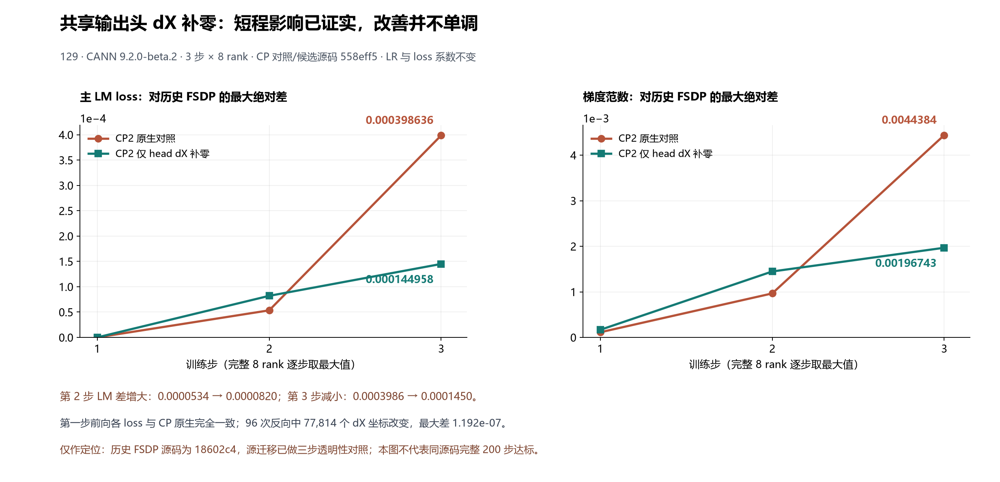

# 共享输出头输入梯度补零：三步因果对照

本轮确认了输出头局部反向的行数变化能传导到后续训练，但**不能据此认定已经定位完整200步漂移根因或修复有效**。只把共享 `lm_head` 的输入梯度计算补零到4096行，主LM差在第2步变大、第3步变小。没有为这项未证实的实验提交产品修复PR。



## 固定条件和对照关系

- 主机129，8×910B3 64GiB，CANN9.2.0-beta.2；镜像ID `5f9e677f439d11ab4e7c888f54b142335a27eee7411cbd2ce894a4798a70146d`。
- 两个本轮CP2实验均使用源码 `558eff53571498538048015ae3a7e3e57ba74fb9`，工作树及补丁为空。该集成源已同步JT_dev `e21302f`（包含合入的#230）；相对此前18602c4只增加重算覆盖报告修复和回归。
- 先完成 `r129-e213-native-cp2-3-v1`：全部3步×8rank的LM、日志加权MTP/aux、总loss及梯度范数与旧CP2的同一前缀完全相等。初始化全量哈希、输入身份及训练计数一致。
- 再完成 `r129-e213-head-pad-dx-cp2-3-v1`：保持相同CP2配方，只在真实共享输出头反向中改变dX计算的行形状。LR、batch、序列、模型、损失系数、初始化和输入顺序未改。
- 图中FSDP参考仍是源码18602c4的历史200步基线。本轮源迁移只有三步透明性证据，不能把历史200步重新标为最新源码结果，也不能将本图作为同源码完整200步验收。

## 实验实际改变了什么

CP2的真实局部输入为 `[1,2048,5120]`，共享权重为 `[152064,5120]`，上游梯度为 `[1,2048,152064]`，均为BF16。前向仍调用原生投影；反向先执行原生VJP，直接返回其中的dW。实验仅将局部输入及上游梯度按CP行位置补零至4096行，执行对应原生VJP，并切回本地dX。切片复制为独立本地存储，避免返回梯度保留整个补零缓冲区。

它没有修改全局 `F.linear`，也没有替换其他线性层；覆盖主LM和MTP共同使用的真实head。计数来自实际反向调用，不能用前向重计算次数代替。

全部8rank、每rank3步×每步4次，合计**96次反向**。完整比较了**1,006,632,960个dX坐标**，其中**77,814个非零差**，最大差为**1.1920928955078125e-7**，绝对差总和为**0.0012693910004456938**。第一步前向各loss与原生CP完全相同，第一步梯度范数及后续loss发生变化。

## 三步结果

下表均对全部8rank取最大绝对差；每行对应相同训练步。

| 步 | 原生CP对历史FSDP的LM差 | 仅head dX补零对历史FSDP的LM差 | 补零对原生CP的LM差 |
|---|---:|---:|---:|
| 1 | 0 | 0 | 0 |
| 2 | 0.00005340576171875 | 0.0000820159912109375 | 0.0001354217529296875 |
| 3 | 0.0003986358642578125 | 0.00014495849609375 | 0.0002536773681640625 |

第3步的改善不能抵消第2步恶化，也不能外推后续197步。补零与原生CP同源码比较的严格验收仍拒绝：仅3步，不是要求的连续200步。原生CP新旧源码比较同时保留“不是200步”和“源码不同”两项拒绝理由。

该诊断增加了VJP重放、完整dX的主机比较和同步，不能把这三步耗时或显存当作产品性能收益。模块绑定、共享head、非重入重计算、dW保持原生、独立行位置/存储和恢复绑定的5项CPU检查通过；CPU不能替代NPU200步结论。

两个NPU实验均退出0并释放8卡，耗时分别142.498秒和142.403秒。原始采集分别74和102份文件逐项SHA校验通过；使用后的两端传输归档已清理，必要原始证据及检查点保留。

## 离线复核

`head-pad-inputs.tar.gz` 保留379份原字节输入（4,882,197字节），包含两个新三步实验、历史CP/FSDP参考、实际请求、固定辅助脚本、CPU凭据和原始守卫版本。压缩包和每个文件均由 `head-pad-inputs-manifest.json` 固定SHA；训练文本、数据Arrow、模型张量和检查点不在公开包中。

```bash
python restore_inputs.py /tmp/jt-head-pad-inputs
python /tmp/jt-head-pad-inputs/tools/audit_latest_head_controls.py --output /tmp/jt-head-pad-inputs/evidence/recomputed-control.json
python /tmp/jt-head-pad-inputs/tools/audit_latest_head_controls.py --with-intervention --output /tmp/jt-head-pad-inputs/evidence/recomputed-causal.json
```

恢复目录和新结果路径必须尚不存在；脚本拒绝覆盖。离线恢复379文件后，两份审计结果均与原结果字节SHA完全相同，见 [复核凭据](offline-roundtrip-verification.json)。原始结果见 [因果对照审计](e213-head-pad-dx-causal-audit.json)、[源迁移三步审计](e213-native-cp2-control-audit.json) 和 [逐步全部指标](e213-head-pad-dx-three-step-errors.json)。

后续继续同源码FSDP参考及完整200步定位。201的环境准备与125/129实验并行；201只有先通过同源码同配方跨机器精度对照，才接手后续矩阵。三步跑通不构成迁移准入。
