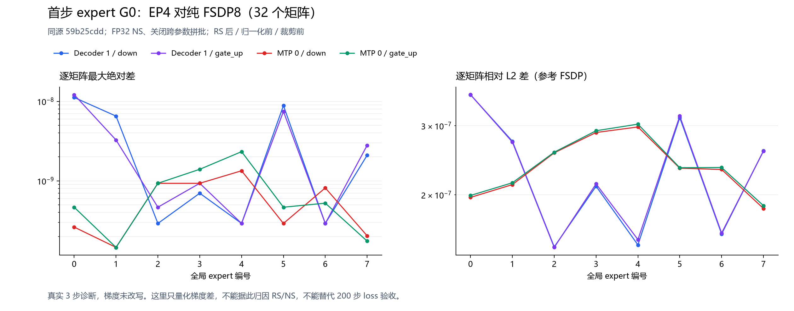

# 原生专家 G0 的三步只读比较：观察透明，EP200 精度仍未通过

本报告记录 2026-10-19 已完成的 E 三步只读诊断及独立复核。实验现已按用户要求暂停；本报告不安排或启动后续实验。

**E 对同源纯 EP3 透明；首步 32/32 个专家 G0 逻辑矩阵与纯 FSDP 供体存在细小而广泛的数值差。** 最大绝对差为 **1.210719347000122e-8**，全局 RMS 为 **5.766217561000351e-11**，全局相对 L2 为 **3.253720377589696e-7**。本次为“原生哈希不同”补充了误差幅度，不能直接判定 GMM、RS 或 NS 有错。

当前同源 59b 的完整 200 步 EP 精度结论始终为 **FAIL**：主 LM 最大绝对差 **0.010309219360351562（step146）**，首次超过 0.005 在 **step97**，超限步骤共 **8/200**，为 **97、112、146、150、165、182、188、200**。本次三步观察没有改变该结论，不是 200 步修复。

## 固定源码、配方与比较位置

实际产品源码为 clean **`59b25cdd15505a4f6fb1990484d4e890e3d3724c`**、空 patch，父提交为集成验证栈 `544526f7db8342c607244fd41009b2a74adb84c8`。该栈包含 FP32 专家 wgrad、可配置 Muon NS 精度等既有变更，并合入参数间 NS 合批策略用于验证；不能等同于裸 `a1e6c222`。PR #251 的产品提交基于裸 `a1e6c222`，也不能直接代替本次集成栈的证据。**#180 已在裸 a1e6 和当前 59b 两者的祖先中**，不是这两者之间本轮新增的单变量。

E、原 EP3 与 F/G 参考沿用同一固定 image5f9e、**CANN 9.2.0-beta.2（9.2.0b2）**。实际配方为 `ns_dtype=float32`、`ns_batch_across_params=False`；E 的 worker0 原构造配置日志、八个原 Muon consumer 的 NS dtype 记录及受源绑定的策略检查支持这个边界。八 rank 运行 flags 为 `allow_hf32=False`。这不是默认 BF16 NS 或新 dtype 消融，也不是所有 live 参数组值、checkpoint 内容的逐项新实采。

E 比较 **step1、原 backward/RS 和既有缩放完成之后、原 total-norm/clip 之前的持久本地 FP32 expert G0**。它在原 CPU slab 上只读比较，不回写 gradient、norm、NS 输入或参数。首更新包装完成后卸载，step2/3 保持原训练路径。

F 参考由已合格的 G 供体运行提供：四个专家参数族 × 八个 global expert，共 **32 文件、1,509,949,440B**。G 对原 F3/F2 前三步透明，32 个 G0 原生哈希与 F3 相同。大供体未下载进本报告，本机没有重读或解码其完整张量。

## E 对原纯 EP3 的透明性

本轮收集 **124 个原件、3,109,007B、20 个有界批次**；两份完整库存、所有原件 SHA、分块 offset/字节、58 项实际输入 pin、终态与 fullCID 缺席证据均闭合。canonical 与 remote receipt 分别保留原 SHA；二者 JSON 语义相同、序列化字节不同，没有互相覆盖。

- 每 rank 完整 step1–3，合计 **24 对记录**；四 loss、grad norm、LR 和四 counters 的最大绝对差逐项均为 **0**。
- 八 rank 各 **48 项 CPU 初态**、runtime flags、start/complete 和输入记录一致；首步另有 **8/8 个逐 DP-slot 指纹相同**。
- 非专家 **42 FQN × 8 = 336 逻辑分片**在 P0/G0/G1/P1 各阶段全部相同；专家四族 **32 个逻辑矩阵**在四阶段也全部相同。
- **pre-QK 48/48**、**router bias 32/32** 原生记录相同。七个原边界调用每 rank 各一次，自有包装已卸载。
- resolved recipe 差仅为本 case 的 checkpoint 输出路径。本报告不分析性能。

CPU 初态不是完整 optimizer state。global input SHA 按 component hash 排序，只证明已捕获内容多重集合一致；首步逐 DP-slot 指纹是额外实际槽位证据，仍不等于完整 token/微批顺序、RNG 或全部内部状态字节证明。router bias 相同也不等于所有 token 路由轨迹相同。

## G0 数值幅度



图为最终 actual-v3 的原始 PNG；[SVG](figures/native-expert-g0-statistics.svg) 仅规范行尾和尾部空白，XML 图形、属性与文字经规范比较保持相同；原 SVG 字节及 SHA 另在来源记录保留。图对应下表及包内 [32 矩阵精确 JSON](data/matrices.json)、[CSV](data/matrices.csv)，不把主 LM 的 0.005 阈值套到梯度。

32 个矩阵共 **377,487,360 个 FP32 元素**；**325,468,098 个元素逐位且数值均不同**，仅正负零编码不同的计数为 **0**。每矩阵范围如下。

| 指标 | 最小 | 最大 |
|---|---:|---:|
| maxabs | 1.4551915228366852e-10 | 1.210719347000122e-8 |
| RMS | 3.818468955994673e-12 | 1.8207311503506152e-10 |
| 相对 F 的 L2 | 1.4690911690083005e-7 | 3.600444381161473e-7 |

全局 RMS、相对 L2 由 32 份平方和加总计算，**不是平均各矩阵的 RMS/比值**。最大点为 `decoder1-gate_up`、global expert0、E rank0，**row58、column668**：EP 为 `0.012161518447101116`（FP32 LE `1b41473c`），F 为 `0.012161530554294586`（`2841473c`）。这一个点不能代表全部元素的 ULP 分布。

统计由已审运行时逐字节消费供体、把 FP32 位模式解码到 FP64 后按块求平方和并补偿累加得到；不是 FP64 训练、RS 或 HCCL 顺序模拟。本地独审重算了统计代数、跨矩阵汇总及最大点四字节数值，并核对实际 G0 事件、参考 SHA、EOF 与前后 path/fd stat；**没有在本机独立重算完整张量数组的每个差值**。

### 逐32矩阵统计

`decoder1` 为 decoder layer1，`mtp0` 为 MTP layer0；gate_up/down 是对应专家参数族。rank 是 E 的物理 rank，global expert 是逻辑坐标，二者不能直接混用。浮点列为科学记数舍入值，精确原值见包内 [JSON](data/matrices.json)，全局汇总见 [summary.json](data/summary.json)。bit/numeric/signedzero 是元素计数，不是不同 bit 的数量。

| E rank | global expert | alias | maxabs | RMS | relative L2 to F | bit unequal | numeric unequal | signedzero only |
|---:|---:|---|---:|---:|---:|---:|---:|---:|
| 0 | 0 | decoder1-down | 1.117587089539e-08 | 1.820731150351e-10 | 3.599290344986e-07 | 7201234 | 7201234 | 0 |
| 0 | 0 | decoder1-gate_up | 1.210719347000e-08 | 1.732080714591e-10 | 3.600444381161e-07 | 14409412 | 14409412 | 0 |
| 0 | 0 | mtp0-down | 2.619344741106e-10 | 6.070319428060e-12 | 1.970212304300e-07 | 6618765 | 6618765 | 0 |
| 0 | 0 | mtp0-gate_up | 4.656612873077e-10 | 5.991863477294e-12 | 1.993064452238e-07 | 13262456 | 13262456 | 0 |
| 1 | 2 | decoder1-down | 2.910383045673e-10 | 8.637438119917e-12 | 1.473477602596e-07 | 6279713 | 6279713 | 0 |
| 1 | 2 | decoder1-gate_up | 4.656612873077e-10 | 8.893428439723e-12 | 1.469091169008e-07 | 12574215 | 12574215 | 0 |
| 1 | 2 | mtp0-down | 9.313225746155e-10 | 1.882547824150e-11 | 2.559639488362e-07 | 6913519 | 6913519 | 0 |
| 1 | 2 | mtp0-gate_up | 9.313225746155e-10 | 1.750013809035e-11 | 2.568913511271e-07 | 13845484 | 13845484 | 0 |
| 2 | 4 | decoder1-down | 2.910383045673e-10 | 5.895796647934e-12 | 1.490713867462e-07 | 6297541 | 6297541 | 0 |
| 2 | 4 | decoder1-gate_up | 2.910383045673e-10 | 5.775102553017e-12 | 1.537984722390e-07 | 12630785 | 12630785 | 0 |
| 2 | 4 | mtp0-down | 1.338776201010e-09 | 3.080222686331e-11 | 2.979271540428e-07 | 7062523 | 7062523 | 0 |
| 2 | 4 | mtp0-gate_up | 2.328306436539e-09 | 3.055540737161e-11 | 3.028955509655e-07 | 14137063 | 14137063 | 0 |
| 3 | 6 | decoder1-down | 2.910383045673e-10 | 6.610785905236e-12 | 1.589326084634e-07 | 6358412 | 6358412 | 0 |
| 3 | 6 | decoder1-gate_up | 2.910383045673e-10 | 6.338472421900e-12 | 1.598244216629e-07 | 12734337 | 12734337 | 0 |
| 3 | 6 | mtp0-down | 8.149072527885e-10 | 1.091620997599e-11 | 2.321312761704e-07 | 6744172 | 6744172 | 0 |
| 3 | 6 | mtp0-gate_up | 5.238689482212e-10 | 1.093208984485e-11 | 2.348333584720e-07 | 13506045 | 13506045 | 0 |
| 4 | 1 | decoder1-down | 6.519258022308e-09 | 6.244540041059e-11 | 2.740009270900e-07 | 6935513 | 6935513 | 0 |
| 4 | 1 | decoder1-gate_up | 3.259629011154e-09 | 5.807662525383e-11 | 2.726778751841e-07 | 13879930 | 13879930 | 0 |
| 4 | 1 | mtp0-down | 1.455191522837e-10 | 4.165507407741e-12 | 2.123996887951e-07 | 6706267 | 6706267 | 0 |
| 4 | 1 | mtp0-gate_up | 1.455191522837e-10 | 4.069148598303e-12 | 2.147029452290e-07 | 13443683 | 13443683 | 0 |
| 5 | 3 | decoder1-down | 6.984919309616e-10 | 1.193791975324e-11 | 2.103421655660e-07 | 6708733 | 6708733 | 0 |
| 5 | 3 | decoder1-gate_up | 9.313225746155e-10 | 1.143583243332e-11 | 2.133085368564e-07 | 13434358 | 13434358 | 0 |
| 5 | 3 | mtp0-down | 9.313225746155e-10 | 2.393839568653e-11 | 2.884165428125e-07 | 7022404 | 7022404 | 0 |
| 5 | 3 | mtp0-gate_up | 1.396983861923e-09 | 2.388900590888e-11 | 2.914227603461e-07 | 14060964 | 14060964 | 0 |
| 6 | 5 | decoder1-down | 8.847564458847e-09 | 1.116662875885e-10 | 3.145602224184e-07 | 7133195 | 7133195 | 0 |
| 6 | 5 | decoder1-gate_up | 7.450580596924e-09 | 1.142936300476e-10 | 3.176126073551e-07 | 14276204 | 14276204 | 0 |
| 6 | 5 | mtp0-down | 2.910383045673e-10 | 8.617685206205e-12 | 2.338743504051e-07 | 6872928 | 6872928 | 0 |
| 6 | 5 | mtp0-gate_up | 4.656612873077e-10 | 8.525047627285e-12 | 2.345427200680e-07 | 13754139 | 13754139 | 0 |
| 7 | 7 | decoder1-down | 2.095475792885e-09 | 5.714893751276e-11 | 2.589323807936e-07 | 6966422 | 6966422 | 0 |
| 7 | 7 | decoder1-gate_up | 2.793967723846e-09 | 5.828600647635e-11 | 2.586085917488e-07 | 13953562 | 13953562 | 0 |
| 7 | 7 | mtp0-down | 2.037268131971e-10 | 4.096971739677e-12 | 1.846025266646e-07 | 6576520 | 6576520 | 0 |
| 7 | 7 | mtp0-gate_up | 1.746229827404e-10 | 3.818468955995e-12 | 1.877197417885e-07 | 13167600 | 13167600 | 0 |

## E 相对 F/G 的阶段差异

下表是**原生哈希相同的逻辑分片数**，不能从“不相同”推导参数误差幅度；只有上面的 G0 表实际量化了数值差。

| 边界 | 非专家（分母336） | 专家（分母32） |
|---|---:|---:|
| P0：更新前参数 | 336/336 | 32/32 |
| G0：RS后、norm/clip前梯度 | 336/336 | 0/32 |
| G1：原 clip 后梯度 | 1/336 | 0/32 |
| P1：optimizer 与 QK/router poststep 后 | 126/336 | 0/32 |

对 F/G，pre-QK 为 **0/48** 相同，router bias 仍为 **32/32** 相同。P1 包含 QK/router poststep，不能把它统称为纯 Muon 输出。

“E 透明”不表示“EP 与 F 相同”。从实际 24 对 E/G 主 LM 记录计算，三步最大绝对差分别为 **0、1.1444091796875e-5、3.337860107421875e-5**。八 rank 的 loss 是归约后的同值全局标量，不是八次独立重复。

## N2 与因果解释的边界

既有 N2 只把首步原 clip 的 used total-norm 从 EP 的 `9fc9b341` 换成 F 的 `9ec9b341`，原 measured norm、返回与日志测值保持。N2 对 F 的非专家 G1/P1 为 **336/336** 相同，专家 G1/P1 仍为 **0/32**。这证明该 scalar 入参对所观察非专家首更新有局部因果贡献，**没有证明 norm 数学错误、double-count、完整 EP 修复或总体 loss 改善**；N2 第三步主 LM 差增大到 `9.632110595703125e-5`。

**E 只在 postRS 观察，不能唯一定位 preRS 原因。** forward/router、上游 dY、局部 expert GMM 的 token 分组与累积、RS/缩放路径均可能处于此前。细小相对 L2 不自动表示无影响，也不证明 RS、GMM 或 NS 是唯一根因。False 只关闭跨参数合批，不等于把单参数 expert 固有 batch 全部拆开；本次没有直接观测每个 NS 内部输入边界。

暂停时点未执行后续 G/GN 干预；供体资格、三步观察和本地候选均不能替代新的实际重放或完整200步验收。本报告不新增诊断、实验、产品 issue 或 PR。

## 可复核材料与重绘

- [文件 SHA 清单](manifest-v1.json)。
- [实际科学独审公开摘录](evidence/actual-scientific-review-summary.json)：原件 SHA `5f2a07eedb84092e7773a25ebac6ce2763bec8d4045240ca59dfdc07eaf376a2`。此文件是安全派生摘录，不是原件全文或新的独审结论。
- [来源角色及完整 SHA](evidence/provenance.json)：固定原图、原绘图脚本、八 rank 比较记录，以及 F 供体、N2、完整200步独审的实际来源指纹。完整私有原件和运行生命周期记录保留在任务档案；公开包不含其私有路径、CID 或大张量。
- [32 矩阵精确 JSON](data/matrices.json)、[CSV](data/matrices.csv)、[汇总 JSON](data/summary.json)。公开包可复算计数、跨矩阵平方和汇总、表格及重绘，**不能脱离私有供体和原始运行数据，独立逐元素重算整个梯度差**。
- [可编辑绘图脚本](tools/plot_native_g0.py)：只读包内数据，不依赖私有目录或网络。使用 Python、Matplotlib 和中文字体；原图使用 Microsoft YaHei。同一 Matplotlib/字体条件下可重绘相同 PNG；SVG 含生成时间和随机元素 ID，字节差异不等于图形差异。

```text
python tools/plot_native_g0.py --data data/matrices.json --output-dir <new-output-directory> --font <Chinese-font-file>
```

[既有同源59b完整200步报告](https://github.com/xingleixu123/hyper-parallel/blob/811b730544962c96e9d0421cabd91234ce94ef89/docs/validation/jt-dev-8npu-20261014/reports/a1e6-muon-no-cross-param-200/README_ZH.md) 与 [既有 N2 三步报告](https://github.com/xingleixu123/hyper-parallel/blob/bb924679ebb447accba0842c94eda4386c152bcf/docs/validation/jt-dev-8npu-20261014/reports/a1e6-norm-only-firststep-3/README_ZH.md) 保留其各自范围。

本报告为[总问题单 #202](https://github.com/hf1s/hyper-parallel/issues/202)、[问题单 #250](https://github.com/hf1s/hyper-parallel/issues/250) 与 [PR #251](https://github.com/hf1s/hyper-parallel/pull/251) 的证据补充。不改变问题状态或 PR head，不把 PR #251 说成200步修复，不增加性能结论。
