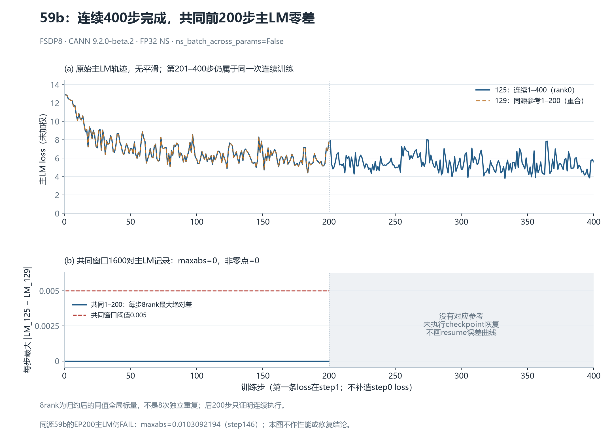

# 暂停收尾：59b连续400步与同源前200步对照

**目标已 PAUSED。** 本节整理暂停时已自然结束的运行及已有独审，不启动新试验，不作性能分析。属于暂停收尾报告的公开证据。

固定集成源码 `59b25cdd15505a4f6fb1990484d4e890e3d3724c` 的125侧FSDP8从step0连续完成400步，8rank各400条指标、合计3200条rank/step记录。对照129侧同源clean FSDP8参考的**共同1–200步**，六个训练标量与四个计数器每项1600对记录均为零差。它证明本次连续执行和共同窗口的观测一致性；**没有执行从checkpoint恢复的201–400步，因此不产生59b续训资格，也不改变现有EP200精度FAIL。**



[SVG矢量图](figures/continuous400-main-lm.svg) · [4800行逐rank主LM](data/main-lm-allranks.csv) · [400行绘图数据](data/curves.csv) · [数值摘要](data/summary.json) · [脱敏来源及SHA](evidence/provenance.json)

## 本次完成了什么

| 项目 | 实际覆盖或结果 |
|---|---|
| 连续运行 | `r125-a1e6-muon-no-cross-param-fsdp8-continuous400-v1`，start=0、complete=400、8rank完整 |
| 同源参考 | `r129-a1e6-muon-no-cross-param-fsdp8-200-v2`，clean exit0，共同窗口1–200 |
| 连续400完整性 | 十字段各3200个有限值；步/rank无缺失；四计数器累计关系成立 |
| 终态与收集 | exit0、reason为空、已释放并移除自有容器、无剩余自有PID；94原件共3,066,452字节、19批；两次完整库存稳定、全部SHA及分块字节闭合 |
| 共同窗口 | 十字段各1600对，最大绝对差0、非零点0；主LM满足逐点绝对差≤0.005 |
| 初态与运行条件 | 每rank的48项CPU初态记录与runtime对象相同；共同窗口全部1600个input_identity对象相同；20项产品源码与4项数据SHA映射相同 |
| 未做的验证 | checkpoint恢复201–400、恢复后optimizer/scheduler/RNG内部字节、EP精度修复或完整并行矩阵 |

首步主LM为`12.881054878234863`，step200为`7.762490272521973`，step400为`5.612583637237549`。这些是未平滑的原始标量，单点下降不代表一条单调曲线。各rank记录的是归约后同值全局标量，**不能作为8次独立重复或据此画统计置信区间**。

图的上半部只画实测连续1–400曲线，以及129参考的实测1–200曲线。横轴保留0刻度，但没有补造step0 loss。下半部只在共同1–200步计算每步8rank最大绝对差和0.005线；201–400区域没有对应参考，不补零、不外推，也没有resume曲线。

## 数值配方及共同窗口

实际环境为CANN `9.2.0-beta.2`。运行采用`ns_dtype: float32`、`ns_batch_across_params: false`；训练runtime中的`allow_hf32=False`。seed为42，LR为0.0001，`lr_scheduler_iters=1000`，未因总步数改为400而改动该调度长度。source为clean提交、patch为空。

构造后的Effective Muon日志确认本配方的FP32 NS和跨参数拆批政策。该日志是实际构造默认值记录，不能扩大成对每个live optimizer group或checkpoint值的额外逐项转储。实际NPU集成源59b以`544526f7`为父；它与以裸`a1e6`为基点的产品PR251提交`b32bded5`是不同源码对象，不能拿其中一个的测试身份代替另一个。

连续400与clean129参考的resolved recipe只有三处差异：总训练步数400/200、`save_ckpt=False/True`及checkpoint输出路径。LR调度长度、seed、数据、loss系数与其余recipe相同。共同窗口重算如下：

| 字段 | 逐rank比较数 | 最大绝对差 | 非零点 |
|---|---:|---:|---:|
| 总loss | 1600 | 0 | 0 |
| 主LM loss | 1600 | 0 | 0 |
| 日志MTP loss | 1600 | 0 | 0 |
| 日志aux loss | 1600 | 0 | 0 |
| grad norm | 1600 | 0 | 0 |
| LR | 1600 | 0 | 0 |
| 每步tokens | 1600 | 0 | 0 |
| 累计tokens | 1600 | 0 | 0 |
| 每步samples | 1600 | 0 | 0 |
| 累计samples | 1600 | 0 | 0 |

MTP与aux这里是日志中带实际系数的标量，不称直接采集的未加权张量。阈值0.005只用于主LM；其他九字段列为一致性观察。input_identity中的global SHA按component hash排序，可证明逻辑内容多重集合一致，不能单凭它证明逐DP-slot/micro的原始排列或逐token provenance。48项CPU初态记录也不等于全部optimizer状态字节。

旧125同源200步内容与本次共同前200步的十字段同样零差，但旧运行保留`owned-process-observation-unavailable`、`allow_incomplete=True`和`complete_collection=False`。其原状态仍为`OBSERVATIONAL_ONLY_EXECUTION_GATE_UNVERIFIED`；数值零差不追溯清除当时监控告警。本次400独审已把这一边界单列，本节不把两次运行的终态混合。

## 续训历史与当前精度边界分别保留

| 源码与关系 | 已有结论 | 本次是否新增资格 |
|---|---|---|
| 历史`544526f7`：checkpoint200→新进程201–400，对独立连续400参考 | 已发布固定配方续训PASS；恢复窗口200×8的日志标量和计数对齐 | 无；这里只引用历史报告，不重跑、不改其边界 |
| 当前`59b25cdd`：125连续400→clean129参考前200 | 连续400功能完成；共同前200十字段零差 | 仅本次连续运行及共同窗口观察 |
| 当前`59b25cdd`：checkpoint200→恢复201–400 | 尚未运行或验收 | **无resume资格** |
| 当前`59b25cdd`：FSDP8↔EP4各200步 | **主LM FAIL**：最大差`0.010309219360351562`，step146；首超step97 | 未改变，不因连续400完成而转为PASS |

当前EP200超过0.005的8步为`97、112、146、150、165、182、188、200`，共64个rank/step点。连续400既没有验证该EP分支的后200步，也不能将已有三步诊断或NS政策变更称为200步修复。

历史544续训的来源为[固定证据提交中的中文报告](https://github.com/xingleixu123/hyper-parallel/blob/3dfd73fb84ed69a93f883478cf055d38dae46808/docs/validation/jt-dev-8npu-20261014/reports/a1e6-fsdp-resume-400/README_ZH.md)，已存发布回执绑定该报告SHA `16d344416f64b55107c6f5480acb3aea54ff74a6f434e566639810010e6c209a`。历史恢复前采集的initial-state不证明恢复后参数hash，constant LR也不单独证明scheduler内部状态相同；这些限制继续保留。

## 来源链与公开小证据范围

本小包直接从本机完整原始日志提取主LM。每个metrics文件都按其原collection manifest的大小与SHA核验，原manifest不改。原始canonical receipt与remote receipt保持两份字节：前者SHA `ebb6c82e…d3d3d41c`，后者`3687b455…d5309e7`，JSON语义相等而序列化字节不同。脱敏摘要不以一份替换另一份，也不复制包含私有运行信息的完整receipt。

| 关键原件 | SHA256 |
|---|---|
| 新400原collection manifest | `e1737f301416c5f4a8850b416efcb650f423fc94d0c79101238742129e5725cd` |
| 新400独立科学复核 | `9c4521a661edcc060fd6eceafb347aa1fcbcbf4a20293fe6c84b543af09ff99b` |
| clean129 F2原manifest | `727e8d08bf740dbbbfc65b629ca32a5ff8ab8ee227e748fab94d716024cae0da` |
| clean129 F2独立功能复核 | `c32806a519fd94874722aec16076eea267f9d937ef50ca1837a896ab180d5df0` |
| 当前59b EP200独立主LM复核 | `14cb3d229f05169e3b0e912ef202c2b311538359ef7559c765486d65864767d0` |

新400独审的范围为`PASS_ACTUAL_CONTINUOUS400_FSDP_FUNCTIONAL_EVIDENCE_AND_COMMON_FIRST200_OBSERVATIONS_ONLY`，无blocking finding；它不是resume或EP全矩阵通过声明。完整94原件、原始命令/stdio、双库存及容器身份检查保留在私有证据库；本包只公开逐rank主LM、派生统计和带原SHA的脱敏摘要。不含大checkpoint、专家供体、宿主机私有绝对路径、凭证或性能字段。只凭这个小包可以重算图和主LM差值，不能独立重建全部私有执行环境与原始审计链。

## 本地复算与文件说明

[绘图脚本](tools/plot_main_lm.py)只需本包的两个CSV和`summary.json`，使用已有Matplotlib与可用中文字体；不导入训练框架、不访问远端。脚本会校验CSV的SHA、4800行完整轴和共同窗口1600对主LM，并拒绝为201–400补造参考。输出目录必须为空或不存在：

```text
python -B -X utf8 tools/plot_main_lm.py --data-dir data --output-dir <新的图像目录>
```

[数据导出脚本](tools/build_data.py)用于持有原始私有证据库者复核95个来源描述符并重新导出。输入根目录需包含原`runs/`、`scheduling/`及`evidence/`相对结构；只写新的输出目录，不覆盖原件：

```text
python -B -X utf8 tools/build_data.py --source-root <原始证据根> --output-dir <新的空目录>
```

`main-lm-allranks.csv`含`role/rank/step/main_lm`四列，连续运行3200行、参考1600行。`curves.csv`含400行；第201–400步参考值及误差留空，空白不表示0。[manifest.json](manifest.json)列出本包逐文件大小和SHA；[作者复算回执](author-receipt.json)说明数据重建、重绘与实际目视检查，不能代替新的独立审阅。作者回执记录构建时的草稿状态；本包随后合并为公开报告，科学边界不变。目标保持PAUSED，不安排新实验。
