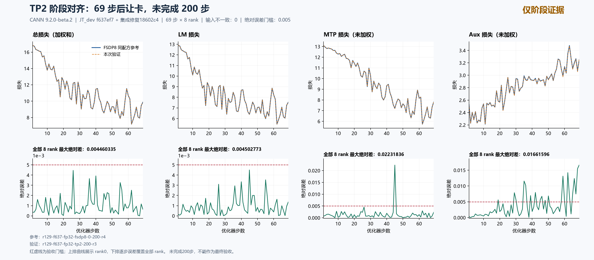

# 2026-10-15阶段执行与回归记录

## 最新补充：资源统计独立修复与TP2的69步阶段证据（2026-10-15）

新增小问题[#225](https://github.com/hf1s/hyper-parallel/issues/225)与单提交草稿PR[#226](https://github.com/hf1s/hyper-parallel/pull/226)，提交`b58fed7fcdce38a8a62c5fb5bae845247fcbbeb7`。原回调仅在DP+CP组内取资源MAX，TP/PP其他rank不被覆盖；现在只将步耗时、allocated、reserved三次MAX改为全world，数据计数及loss保留DP+CP，避免重复统计。规范和需求两轴检视通过；5个CPU测试和7个子测试通过，同一测试在未修复基点有4项资源相关子测试失败。尚未验证修复后的真实NPU/PP通信和通信成本；当前head没有check run、combined status为pending，不宣称CI通过。

[修复前原始日志](global-resource-metrics/global-resource-metrics-red.log) · [修复后原始日志](global-resource-metrics/global-resource-metrics-green.log) · [两轴检视与最终源码指纹](global-resource-metrics/global-resource-metrics-two-axis-review.json) · [全rank资源观测](global-resource-metrics/global-resource-metrics-real-observation.json) · [原始证据大小与SHA](global-resource-metrics/global-resource-metrics-test-evidence.json)。CPU结果不能换算成实际显存收益。

固定源`18602c4`、同镜像同配方TP2第三轮`r129-f637-fp32-tp2-200-r3`完成69步×8rank后，4号卡出现其他容器任务。守卫刷新归属后只停止本任务容器，退出137、270.47秒后释放，无本任务设备PID残留。68份原始文件逐一核验；公开67份，进程归属原文件本地保存，公开仅给出命名空间/控制组不同的判定，避免展开其他任务信息。

| 同参考的69步前缀，全8rank最大绝对差 | LM | 日志MTP（×0.3） | 还原MTP | 日志aux（×0.0001） | 还原aux |
|---|---:|---:|---:|---:|---:|
| TP2，未完成200步 | 0.0045027733 | 0.0066955090 | 0.0223183632 | 0.0000016616 | 0.0166159589 |

输入哈希和初态无不一致。未加权量由日志按实际系数还原；MTP在第45步、aux在第19步首次超过0.005。该前缀已观察到超阈值，但完整200步验收仍未完成；资源指标修复不解释或修复训练数值偏差。

[全部loss逐步误差](f637-tp2-r3-interrupted/f637-tp2-r3-prefix69-analysis.json) · [68份采集清单](f637-tp2-r3-interrupted/f637-tp2-r3-interrupted-evidence-manifest.json) · [公开原始8rank指标](f637-tp2-r3-interrupted/raw/runs/r129-f637-fp32-tp2-200-r3) · [释放凭据](f637-tp2-r3-interrupted/raw/scheduling/r129-f637-fp32-tp2-200-r3.receipt.json) · [进程归属判定](f637-tp2-r3-interrupted/f637-tp2-r3-interrupted-ownership-summary.json)。

资源统计缺陷的实际证据：26/69步rank0耗时低于全rank最大值，最大少报0.004096秒；3/69步rank0累计reserved低于全rank最大值，最大少报0.0390625 GiB。allocated的TP lane间有差异，但此轮rank0恰好处在较大一侧，因此不能说本轮rank0 allocated也少报。后续跨拓扑性能比较必须逐步覆盖全部rank；此处不以69步中断样本给出最终并行收益。

满足全局20分钟间隔后，125重试`r125-f637-fp32-tp2-200-r1`又在初始化阶段遇到0号卡其他容器进程；训练0步，退出137，67.74秒后只释放本任务，31文件核验通过，两端重复归档已清理。该尝试未到达训练，不能据此判定125完整训练环境已恢复。[采集与清理凭据](f637-r125-tp2-r1-interrupted/f637-r125-tp2-r1-interrupted-local-verification.json) · [归属判定](f637-r125-tp2-r1-interrupted/f637-r125-tp2-r1-interrupted-ownership-summary.json)。下一轮在释放后重新计满20分钟，仅使用125/129空闲资源；优先补齐尚无当前配方结果的EP2，TP2完整200步继续列为待完成。

## 最新补充：#214 的 Ascend 两卡／四卡回归通过（2026-10-15）

在独立单提交`453618aaad72c3a2f9fb7bf367cd31ca45437d17`、原CANN9.2.0-beta.2镜像上重新运行：两卡各通过FP32/BF16两个测试，四卡各通过Partial归约测试。2、1、3、4行交替覆盖合法等长、空分片、一般非整除、重复调用及缓存变换；非法源/目标分片和直接Partial入口一致拒绝，合法重建或归约后重建均要求独立参考零误差。

实验`r129-pr214-uneven-st4-r2`退出0，80.32秒后释放0–3号卡，无本任务设备PID残留；源码与patch干净，editable导入路径核验通过。24份原始文件大小/SHA逐一核对，两端重复归档已删除；[规范及验收两轴独立复核](pr214-uneven-npu-st-r2/pr214-uneven-npu-st-r2-two-axis-review.json)均通过。该结果补齐#211／#214的Ascend/HCCL定向回归，不替代八卡200步loss门槛，也不宣称吞吐或显存收益；小问题仍开启、PR仍为单提交草稿。

[验证分析](pr214-uneven-npu-st-r2/pr214-uneven-npu-st-r2-analysis.json) · [24份采集清单](pr214-uneven-npu-st-r2/pr214-uneven-npu-st-r2-evidence-manifest.json) · [两端清理与SHA核验](pr214-uneven-npu-st-r2/pr214-uneven-npu-st-r2-local-verification.json) · [原始两卡／四卡日志](pr214-uneven-npu-st-r2/raw/runs/r129-pr214-uneven-st4-r2) · [释放凭据](pr214-uneven-npu-st-r2/raw/scheduling/r129-pr214-uneven-st4-r2.receipt.json)。此前收集失败及入口修复证据保留在上一轮记录中。

当时计划于2026-10-15 23:12:35（UTC+8）后继续TP2第三轮；其后续69步中断结果见最新补充。125的只读namespace快照中，先前普通ns0的全部8卡映射已经消失，TP2请求的12份固定文件也已逐一核对；尚未以新容器验证设备发现，不能提前判定已完全恢复。若后续在125运行，跨主机的性能差异必须单列，不能当作并行收益。

## 本轮补充：四卡短步回归、独立选卡修复与资源让出（2026-10-15）

- #199 在原独立提交 `e9fc94d`、CANN9.2.0-beta.2 上完成129四卡回归，4rank各 `1 passed`；该入口实际执行8种CP/TP/SP训练组合、每组2步，并检查packed注意力输出、梯度和统计量。容器退出0，73.99秒后释放，17份采集文件逐一核验。16条rank0记录的LM/MTP/aux日志最大绝对差分别为0.0006828308、0.0001194477、9.1036782e-8。既有相对容差和短步场景不替代200步绝对误差≤0.005验收，也不用于宣称性能收益。[分析与16条原始数值](pr199-f637-npu-st/pr199-f637-npu-st-analysis.json) · [完整采集清单](pr199-f637-npu-st/pr199-f637-npu-st-evidence-manifest.json) · [四卡释放凭据](pr199-f637-npu-st/r129-pr199-f637-st4-r2.receipt.json)。
- 新问题#223与单提交PR#224：父环境指定`4,5,6,7`，旧`parallel_run`却分配`0,1`、`2,3`。独立修复继承上层设备并在启动前校验预算；无设备容器中修复前24失败/4通过（含子测试），修复后10测试/18子测试通过，规范和需求两轴均通过。[复现](parallel-case-visible-devices/parallel-case-visible-devices-reproduction.json) · [修复前](parallel-case-visible-devices/parallel-case-visible-devices-before.log) · [修复后](parallel-case-visible-devices/parallel-case-visible-devices-after.log) · [两轴检视与提交指纹](parallel-case-visible-devices/parallel-case-visible-devices-review.json)。此修复不改训练公式，也不将CPU结果算作NPU训练通过。
- TP2第二轮在两次空卡检查后启动，但初始化35.33秒时4号卡出现另一容器的进程；命名空间及控制组不同，刷新后仍在。只停止本任务容器，外部任务继续运行；0训练步、退出137、设备已释放。该轮没有精度或性能结论。[中断分析](f637-tp2-r2-interrupted/f637-tp2-r2-interrupted-analysis.json) · [31份证据核验](f637-tp2-r2-interrupted/f637-tp2-r2-interrupted-local-verification.json)。

#214首轮按间隔启动四卡后，测试收集报`ModuleNotFoundError: No module named tests`，两卡阶段0用例、四卡阶段未启动；容器退出1，30.88秒后已释放。根因为回归脚本从日志目录运行，操作脚本已改为从源码目录启动且禁用pytest缓存，独立绝对日志路径及资源约束保持不变。无NPU容器复核两个入口共3个测试节点收集成功；规范/需求两轴复审通过。这是入口修复，不是#214 NPU算法通过证据。[首轮分析](pr214-uneven-npu-st/pr214-uneven-npu-st-analysis.json) · [14份原始采集清单](pr214-uneven-npu-st/pr214-uneven-npu-st-evidence-manifest.json) · [无设备收集预检](pr214-uneven-npu-st/pr214-fixed-runner-cpu-collection-r2.log) · [脚本复审](pr214-uneven-npu-st/pr214-fixed-runner-two-axis-review.json)。首次CPU预检还有Windows传输换行问题，原记录保留，按bytes传输修正后才得到成功结果。

上述首轮后的空窗已满足，并完成本节之前记录的第二轮Ascend回归；最新实验间隔按第二轮释放重新计满20分钟。重复压缩包两端已清理，另清理已用完的源码导入bundle和35.23MB远端CPU复现checkout；当前step200 checkpoint保留供跨拓扑参数/优化器定位。

## 最新验收：FSDP基线与续训两个200步窗口均通过（2026-10-15）

独立连续0–400第三轮已经完整结束：8rank各400条指标、退出0、622.66秒后正常释放8卡，无本任务设备PID残留。启动前满足全局20分钟间隔，并额外进行一分钟三次只读空卡观察；守卫随后独立复查空卡、源码和文件哈希。源为包含#180的最新已核对JT_dev `f637ef7`加已检视修复的固定集成提交`18602c4524dc664b81b2bad9a7b624455ce1494f`，CANN9.2.0-beta.2及镜像保持一致。

将它分别作为基线1–200与checkpoint200恢复后201–400的独立参考，严格验收结果如下。比较绑定两侧采集清单SHA和不同容器执行身份，核对源码/patch/镜像/配方、完整rank与步区间、初态、输入哈希、LR、样本/token累计计数、有限值、完成标记及退出码；没有采用自比较。

| 验收窗口，均200步×8rank | LM最大绝对差 | 日志MTP / 还原MTP最大差 | 日志aux / 还原aux最大差 | 总loss / 梯度范数最大差 | 结论 |
|---|---:|---:|---:|---:|---|
| 基线1–200 对独立连续参考1–200 | 0 | 0 / 0 | 0 / 0 | 0 / 0 | PASS，全部≤0.005 |
| 续训201–400 对独立连续参考201–400 | 0 | 0 / 0 | 0 / 0 | 0 / 0 | PASS，全部≤0.005 |

MTP/aux使用本轮实际配置系数0.3/0.0001，将日志标量差还原到未加权口径；并非额外直接采集加权前张量。两个窗口的初态、输入、计数和LR无不一致，全部指标有限。 已完成规范轴与验收轴的独立检视，逐项重算和原始文件SHA核验均通过，未发现待修问题；[两轴检视记录](f637-fsdp8-continuous400-r3-complete/f637-fsdp-independent-two-axis-review.json)。此前有关本轮FSDP独立精度“待验证”的段落均为当时记录，以本节完整结果为准；其他TP/CP/EP及重算矩阵仍未完成当前配方的200步验收。

[基线严格比较](f637-fsdp8-continuous400-r3-complete/f637-fsdp8-baseline-independent-comparison.json) · [续训严格比较](f637-fsdp8-continuous400-r3-complete/f637-fsdp8-resume-independent-comparison.json) · [400步完成及资源摘要](f637-fsdp8-continuous400-r3-complete/f637-fsdp8-continuous400-r3-complete-analysis.json) · [76份采集文件SHA校验](f637-fsdp8-continuous400-r3-complete/f637-fsdp8-continuous400-r3-complete-local-verification.json) · [释放凭据](f637-fsdp8-continuous400-r3-complete/r129-f637-fp32-fsdp8-continuous400-r3.receipt.json)。目录保存完整8rank逐步指标、初态/开始/完成标记、配置及rank0日志。两端重复压缩包均已清理。

| 同窗口观测，去掉各窗口前20步 | 基线/续训中位秒/步 | 独立参考中位秒/步 | 基线/续训峰值allocated / reserved GiB | 独立参考累计峰值allocated / reserved GiB |
|---|---:|---:|---:|---:|
| 1–200 | 1.155003 | 1.157494 | 22.032196 / 27.25 | 22.032196 / 27.25 |
| 201–400 | 1.160107 | 1.157457 | 22.032196 / 25.316406 | 22.032196 / 27.25 |

`step_time`是环境回调区间的全rank最大值，包含相同输入身份观测，但不包括全部回调后段汇总、落盘与checkpoint I/O；不是端到端应用吞吐。峰值计数器从各进程运行开始累计，连续参考后200步的峰值也可能来自前200步；reserved差异不证明续训本身节省内存。单次约0.2%的时间差不足以宣称吞吐收益。

等待期间完成[14组网格、存储构成与资源预期](f637-resource-expectations/f637-resource-expectations.md)：模型保存载荷中embedding及输出头占57.29%，路由专家占13.89%，据此避免把EP倍数当作整模型显存收益；TP/CP导致微步数变化，统一按完整优化器步比较。该文档为配置/源码推断，不替代实测。

TP2首轮随后在满足20分钟间隔、连续两次空卡检查后启动，初始化约41.77秒时3号卡出现另一容器的外部Python进程；PID命名空间及控制组与本任务不同，刷新后仍在。守卫只释放本任务容器，退出137，无本任务设备PID残留。8rank均无训练步和start/complete标记，本轮不计为精度成功或失败，也不纳入性能收益。31份文件大小及SHA验证通过，两端重复压缩包已清理。[中断与归属摘要](f637-tp2-interrupted/f637-tp2-interrupted-analysis.json) · [释放凭据](f637-tp2-interrupted/r129-f637-fp32-tp2-200.receipt.json) · [文件核验](f637-tp2-interrupted/f637-tp2-interrupted-local-verification.json) · [初始化日志](f637-tp2-interrupted/rank0-stderr.log)。

第二轮TP2沿用同源同镜像、逐字节相同配置，使用独立运行目录和端口；最早2026-10-15北京时间21:43:13再检查资源，不提前占卡。本轮再次读取上游JT_dev，仍为`f637ef7ee4d4b416800716f1ebaaae7709b8a06a`。checkpoint200继续保留供后续跨拓扑step200参数/优化器差异定位；待不再需要时核实归属和使用情况后清理。

截至2026-10-15 22:26（UTC+8），总单、11个小问题及11个单提交PR共23项，11组原生父子关系和双向正文链接均已回读核对。新增集成验收结果已同步到续训问题#208及PR#197，保持草稿及单提交，不把多修复集成的通过全部归因于某一个PR。[本次关联核验](pr214-uneven-npu-st/github-chinese-full-link-audit.json) · [发布回读凭据](pr214-uneven-npu-st/github-chinese-publication-receipt.json)。
