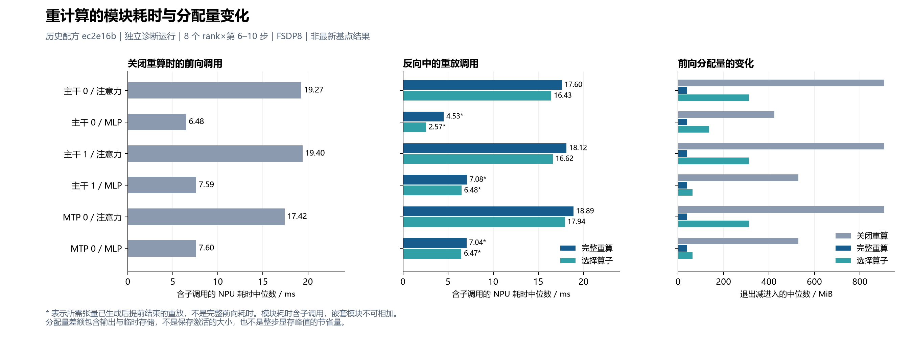

# 重计算成本实测（阶段结果）

固定源 `ec2e16bce26e497519c573f0a8d87a538a329197`，含用户指定 PR180 与六项修复。8×910B3、CANN 9.2.0-beta.2，FSDP8、GBS8、seq4096、两层主干加一层 MTP。以下模块策略是明确记录目标的实验 wrapper，不是当前 YAML 已有的模块选择接口。

以下均为历史轮次；最新 `f637ef7` 基点仍需重新完成匹配配方的 200 步验证，不能沿用本节结论。中文图仅翻译标签，原始数值不变。

## 整体峰值与步耗时

各策略独立运行 40 步，全部 8 rank 的 LM/MTP/aux/total loss、梯度范数均与 FSDP off 参考精确相同；初值、逐步输入和 LR 一致。步耗时取第21–40步的中位数，峰值取全部8rank的最大 allocated。每个策略只运行一次，图中的P10–P90是步间分布，不是重复实验置信区间。

| 重算策略 | 峰值 allocated GiB | 节省 GiB | 中位秒/步 | 耗时增幅 |
|---|---:|---:|---:|---:|
| 关闭 | 22.6338 | 0 | 0.94073 | 基准 |
| 完整 decoder | 19.5386 | 3.0952 | 1.02665 | +9.13% |
| 当前 selective 算子策略 | 20.2272 | 2.4066 | 1.02064 | +8.50% |
| 只重算 attention | 20.9384 | 1.6954 | 0.99724 | +6.01% |
| 只重算 MLP | 21.7809 | 0.8528 | 0.95873 | +1.91% |
| 只重算 norm | 22.3212 | 0.3126 | 0.94206 | +0.14% |
| 只重算 MTP decoder | 22.6338 | 0 | 0.96884 | +2.99% |

当前显存有余量时，关闭重算的吞吐最高。只重算 MLP 的单位额外时间收益优于 attention；norm 的增量时间接近噪声，不能据此报告无限高收益比。只重算 MTP block 没有降低整步峰值，在这个模型/batch下不划算。

MLP+norm 组合已另外完成200步，全部8rank的 LM/MTP/aux/total loss 和梯度范数与 FSDP off 参考精确相同。峰值 allocated 为21.4684 GiB，实测节省1.1654 GiB；第21–200步中位耗时0.95816s，相对同一比较报告的 FSDP off 参考0.93928s增加2.01%。这是一组独立长跑结果，不与上表40步时间窗口混用。目标为 `*.mlp,*.input_layernorm,*.post_attention_layernorm,*.enorm,*.hnorm`，仍属于实验模块 wrapper。证据见 [200步比较报告](module-mlp-norm-200-comparison.json)。

完整和 selective 的200步精度已在先前六项中的四项修复集成源上通过，全部loss与梯度误差为0；上表其余模块策略的40步结果不替代200步验收。

## 模块调用测量

另起关闭/完整/selective三组12步诊断，在第6–10步采集NPU events。全部8rank、全部12步loss也与参考精确相同。每个主要 attention/MLP 条目包含40次调用（8rank×5steps）。

在关闭重算时，attention的单次inclusive中位时间约17.42–19.40ms，MLP约6.48–7.60ms。当前selective保留了部分计算结果，但attention重放仍约16.43–17.94ms，解释了其整步耗时相对full只减少少量的实测现象。该解释来自本配置的观察，不能外推到所有模型或batch。

图中allocation delta是模块退出减进入时的allocated变化，包含输出及临时存储，不是保存的激活大小；嵌套模块inclusive时间不可求和。带星号的重放调用在需要的张量生成后提前退出，不是执行错误，也不能当作完整模块前向耗时。

## 配置灵活度

当前JT的`selective`是通用算子策略。YAML的`selection`只支持adapter声明的safe regions与相应层索引；JT尚未声明这样的区域，不支持直接配置任意模块路径与层范围映射。本次模块目标选择是实验插桩，不能声称已有MindFormers那样的用户配置能力。

MindFormers PyNative文档支持`select_module`路径正则与层范围，以及排除/通信重算配置；Megatron支持模块类别和full uniform/block。接口对照及固定引用见[能力核对](recompute-reference-comparison.md)。若扩展HP接口，需要验证目标匹配、无匹配失败、父子嵌套冲突、共享模块、CP/EP通信与副状态重放，而不是只增加一个字符串列表。

机器可读证据：[策略CSV](recompute-policy-cost.csv)、[模块events CSV](recompute-module-events.csv)、[完整汇总JSON](recompute-cost.json)。运行文件SHA256清单见`recompute-evidence-inventory.json`。
