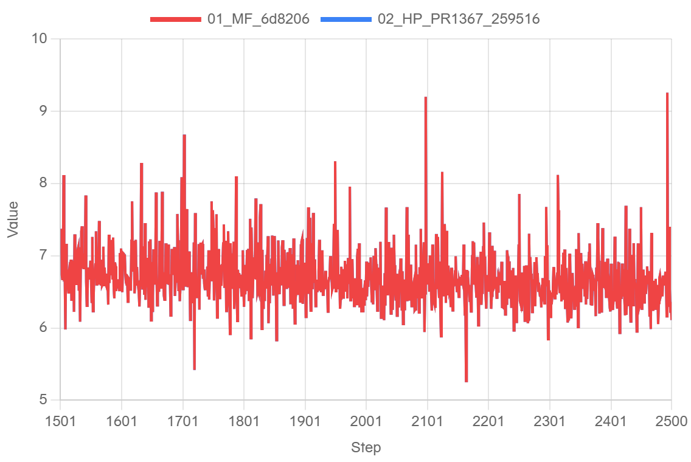
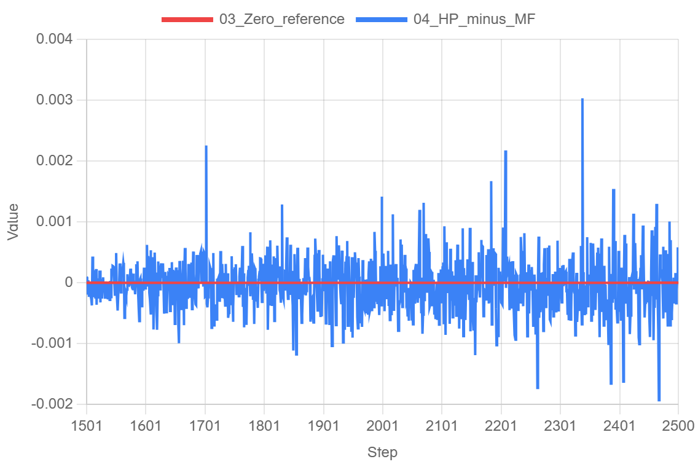
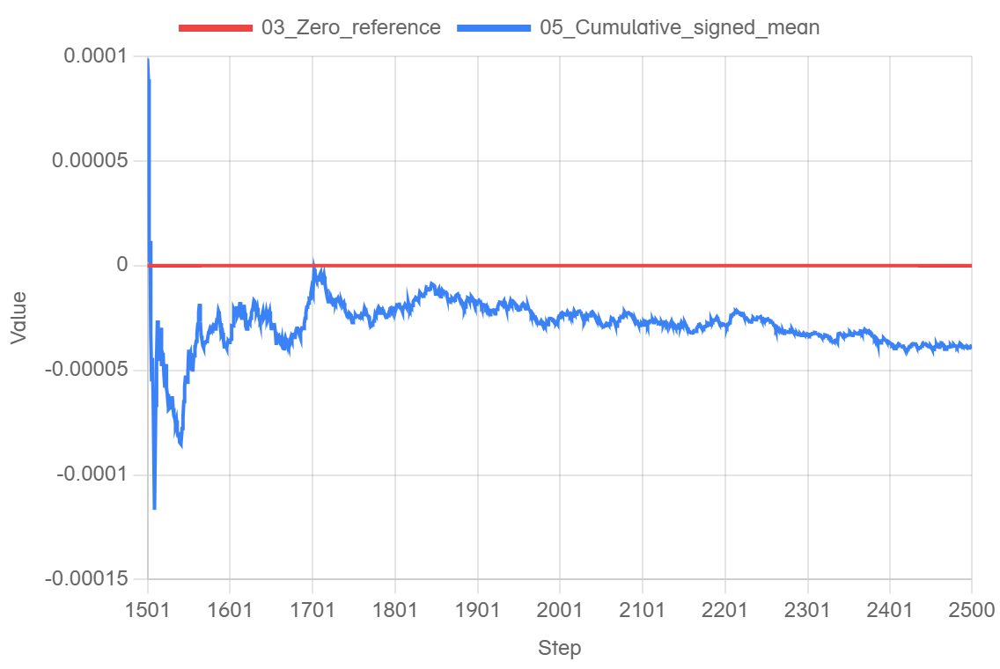

# PR #1367：MF→HP 单卡完整千步精度，通过

本次使用新整合头259516b4816994ebe65b751aa76babe96345bd75，在125空闲NPU卡0独立运行。MF复用此前连续1–2500步的有效基线；HP加载**从MF第1500步完整训练状态转换出的native DCP**，执行1501–2500步，共1000次优化更新、2000次forward/backward。不是HP加载自身训练权重的自恢复对比，也未把历史33096的统计改称新头实跑。

## 固定版本和配置

- HP源码树6ecd3b46129572431a0674cc374486ca5c517934；部署2702个文件逐一核验，实际editable import指向该快照。
- MF实际候选6d8206686b116d397273b22971a6934d8accf47f，官方基线902de5f0aa5f16c77fe8f45c57550d333ac32634。MF实际调用HP MindSpore checkpoint wrapper，运行链为MF+HP1.0.1+MindSpore2.12.0 → HP新PR+PyTorch2.12.0+PTA2.12.0.post3。
- Python3.12.14、CANN9.2.0、Ascend910B3；两侧实际wheel、环境及导入身份有原始收据。MindSpore wheel SHA256为5469879b58d97d9bd1ed0634adbbcecc9a3be4285ff4782415acc985496cee3a。
- 沿用已确认base.yaml基线：3层（2 Dense+1 MoE），GBS2/LBS1，训练序列4096；原2500步日程及constant LR1e-5。核心模型、优化器、混精、重算设置与旧单卡基线逐项一致，新planner仅作语义映射。
- MTP依YAML关闭，MTPLOSS为N/A，不生成虚构零值曲线。

首次更新前核验144个活体模型/优化器状态tensor的hash、main参数绑定、各组FQN和全部超参数、optimizer/scheduler步数、HP原生RNG与sampler游标3000。MF RNG没有翻译为HP位流；当前dropout为零、force router关闭，不能声称跨框架随机位流一致。第1501步两微批分别在各自forward前核对MF自然样本，完整窗口再独立比较8000个四字段摘要及元数据、游标与LR。最终2500完整DCP落盘，worker/supervisor完成且退出码0。

## 完整1000步统计

MF取未舍入callback.loss，HP取实际loss；不额外加MF单列的load_balancing_loss。Δ=HP−MF，先保留正负号求均值，再取绝对值；0.005只约束**完整窗口abs(mean)**，不是单步阈值。MAE/max和累计前缀均值为诊断，未增设阈值。

| 指标 | 实测 |
|---|---|
| signed mean(HP−MF) | -3.8232445716857908e-05 |
| abs(mean) | **3.8232445716857908e-05 ≤0.005：通过** |
| MAE | 0.00032886135578155516 |
| 最大绝对差 | 0.0030310153961181641，step 2338 |
| 正 / 负 / 零 | 449 / 550 / 1 |
| 输入字段摘要 | 8000 / 8000 一致 |
| MTPLOSS | N/A（关闭） |

## 真实网站导出图

以下三图来自log.javazero.top在线页面、可见Edge会话的PNG导出。横轴统一1501–2500，关闭平滑及downsample，保留全部实际点和离群值。Zero_reference仅是数学零线。原ledger仅按原行及原浮点值规范化后上传，没有重新采样、补点或压缩日程；绘图助手的original输入模式指没有再转换这些规范化日志。网站零基准相对误差不参与验收。

[逐步数值](data/paired.csv)、[统计和SHA](data/stats.json)、[网站配置](website/parsing-config.json)、[显示与轴范围证明](website/export-proof.json)。在本目录执行 python -B verify_scalars.py，可独立重算每步差值、全部累计前缀与完整均值。完整原ledger、绘图点到源日志行映射、LR/grad norm/耗时/吞吐/allocated/reserved日志在本机证据归档保留；本轮只对单卡LOSS精度作正式验收。

[本轮HP/MF实际YAML私仓归档](https://github.com/xingleixu123/mindformers-private/tree/e44994166d223b92e48ffcd7993d1afad58ac6be/private_review/archives/pr1367-single-20261030)，归档时仍只对本人账号开放。[公共中文复现模板](https://github.com/xingleixu123/hyper-parallel/tree/259516b4816994ebe65b751aa76babe96345bd75/examples/training_demo/xing40)。审计worker将同步checkpoint设为2500/save_epochs1，复刻历史保存行为；公共脚本默认500/0，不能将新增I/O当作同条件性能测量。stdout的data/consumed_samples是本会话计数，恢复后的全局游标以审计ledger为准。

交互Edge窗口保留；普通网站首页URL不携带本轮数据，未伪造可持久分享链接。新PR保持Draft及两个提交，不据此宣称新头四卡、整网性能或外部门禁已验收。
