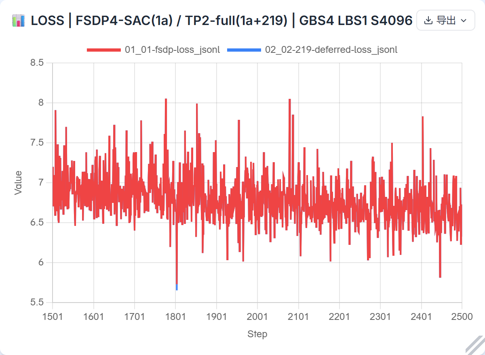
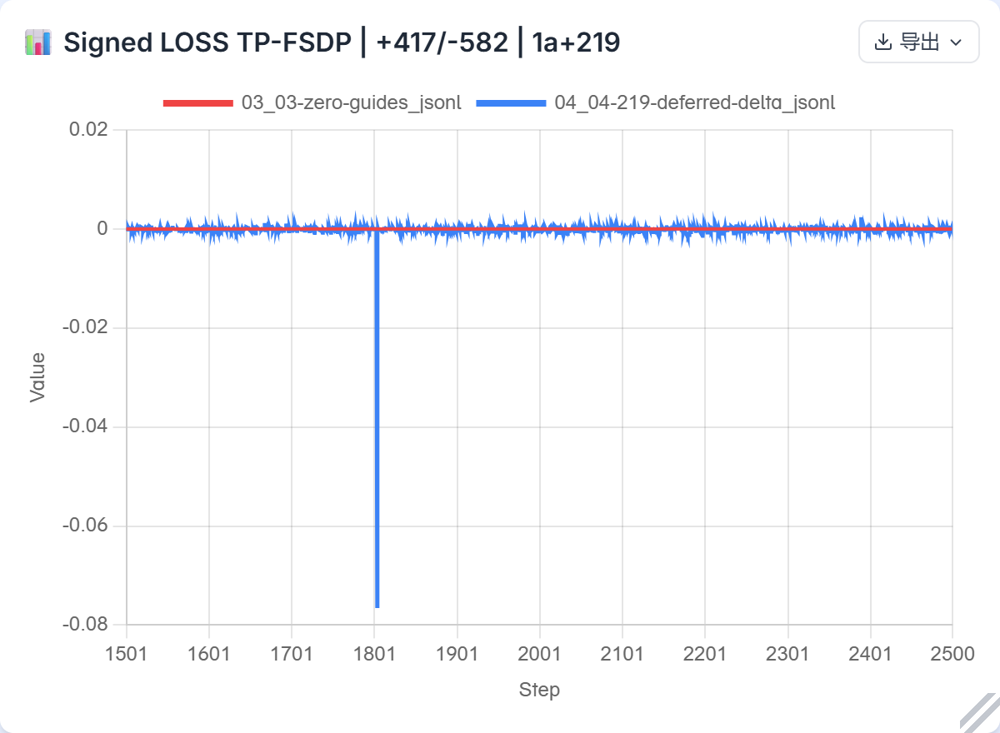
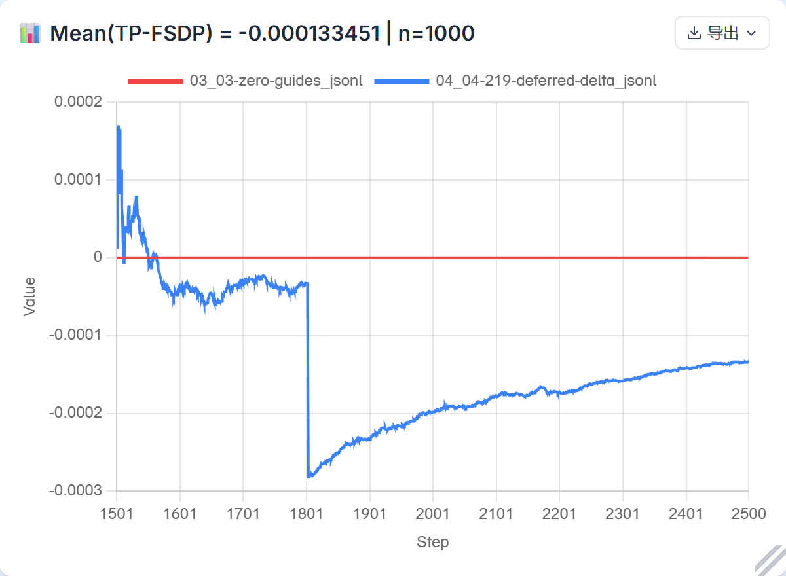
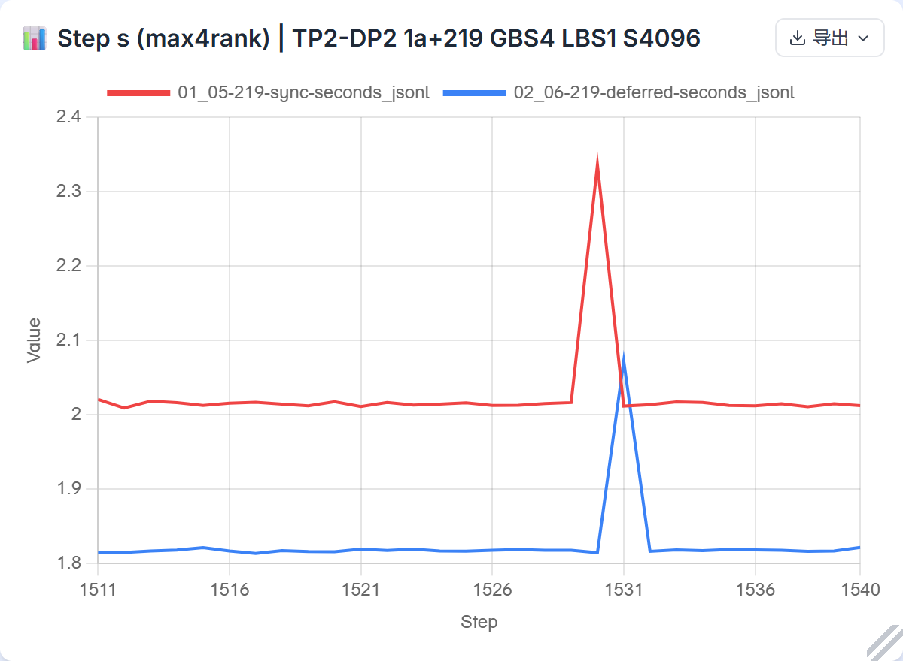
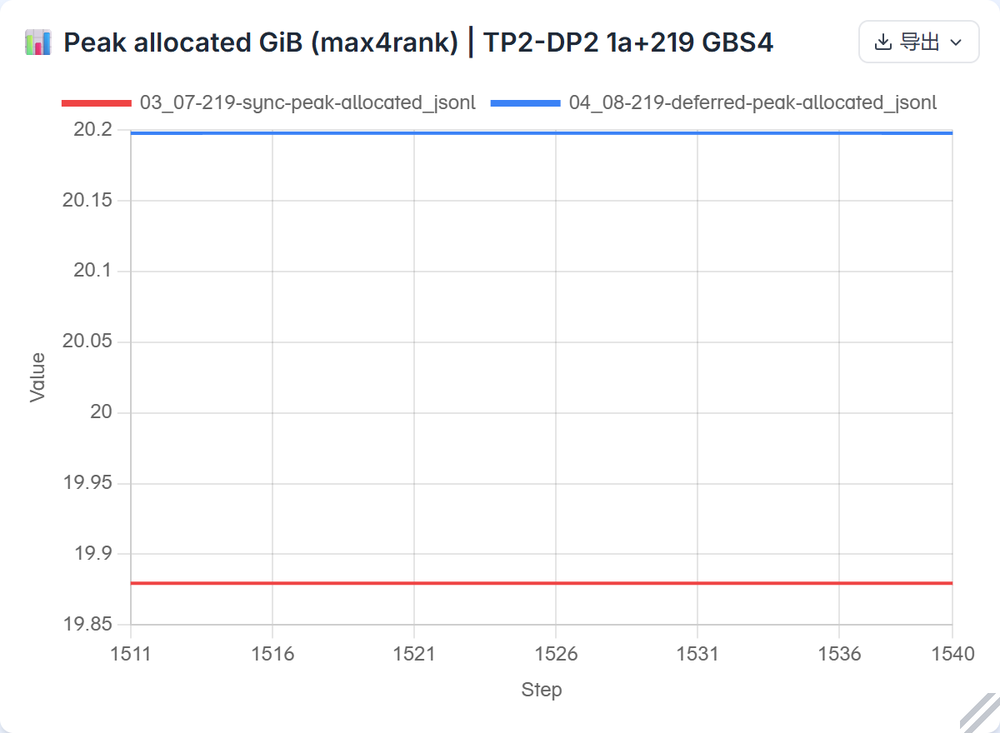
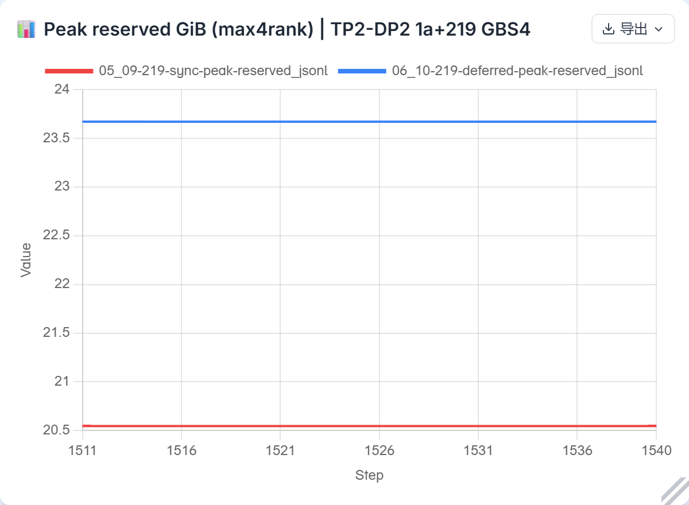

# HP 四卡性能：模块树生命周期修复后的完整续训验收

**本轮选定场景的训练、独立统计与真实网站图已完成。** 原始统计、图形设置和证据范围分别保留，未把均值验收外推为所有参数的数值证明。

本轮将 PR #1369 的新版 scheduler 纳入固定训练基线，完成真实四卡同步40步、延迟同步1000步及独立 CPU 复核。完整窗口1501–2500的 LOSS 指标 `abs(mean(待测配置−FSDP参考))=0.00013345050811767577≤0.005`，417正、582负、1零；MTP依原YAML关闭，MTPLOSS为N/A。不能把该均值约束解释成每一步的误差界，或完整模型所有参数的数值证明。

同源两臂的30步计时窗口中，平均最大rank耗时由2.025203降为1.826096秒，名义吞吐提高10.9034%；每卡allocated峰值增加0.318218GiB、reserved峰值增加3.123047GiB。结果是一对顺序运行的描述性比较，包含长尾；不表示普适加速比。

[本轮实际输入和8份resolved配置，仅本人私仓](https://github.com/xingleixu123/mindformers-private/blob/91238336e717da7828185abc03d7c4da0e9a33c1/private_review/archives/tp-lifecycle-219-20261030/PUBLICATION.md)。原18个策略run及72条rank硬件映射、既有MF/HP和四卡精度记录见[先前完整报告](https://github.com/xingleixu123/hyper-parallel/tree/e8cc4dc696c013c9cda6442c2fc4ac6e756dfbf7/reports/hp-fourcard-performance-20261030-final)；这里补充新219源码的验证，不改标旧51运行。

## 冻结基线与来源

| 项目 | 本轮实际值 |
|---|---|
| 训练源 | `1a39572fef23819a2d2651b4bd53047a05a4892f`，仅替换 scheduler 为 `219ce9346d528948dbe0755b50a261db025c87d1a6f207b893c22b8e9de0524d`；2661文件清单 `a5ac2084985dd2c3c4ad5c774e07cbf3984a7269879f892410a122191045ebfe` |
| 修复来源 | Draft [PR #1369](https://github.com/mindspore-ai/hyper-parallel/pull/1369)，head `388ec460a163ae06e18b9189c490cf37da460f8a`，base `e0cdf62c9d66f1f9ec48c6f15df87dcf4ce80a5f` |
| PR #310 | [hf1s PR #310](https://github.com/hf1s/hyper-parallel/pull/310)，head `fdd152d501b09602ab1cbd6240877bc35bbe81b7`；完整7提交与本地Git核对一致，PR正文的旧4提交描述未作为挑选依据 |
| 环境 | Python3.12.14、Torch2.12.0+cpu、PTA2.12.0.post3、CANN9.2.0（内部V100R001C12SPC001B237）、numpy1.26.4、transformers5.21.0、tokenizers0.23.3；环境指纹 `e14f2704e4d568d79ef9df15546f3ed82e0613455ccb512f8c9e8c8b14b948cc` |
| 硬件 | 125，Ascend910B3，物理4/5/6/7对应rank0/1/2/3；driver26.0.rc1.b080；连接类型HCCS，不据此推断链路带宽或实际CPU绑核 |
| 模型和日程 | 唯一配置依据为[base.yaml](https://gitcode.com/xuxinglei/net-regression-suite/blob/main/deepseek-v3-29b-8card/base.yaml)；相同减层3层：2Dense+1MoE，MTP off；GBS4/LBS1/S4096，原2500步日程、constant LR1e−5、warmup0 |
| 待测并行 | TP2×DP2，CP1/EP1，full activation checkpoint，每优化步2个micro；两臂仅 `requires_grad_sync` 不同 |
| 参考 | 已保存的原1a FSDP4/selective连续基线1501–2500，1个micro/优化步；rank0原始文件SHA `790f667ad93dfa2bfe572c5184523ef979755bff8ad32ca4613a963e4495ae81` |

GBS4是用户确认的四卡纯FSDP下可整除`4×LBS1`的最小值；它不改动既有单卡GBS2实验。除指定batch、步数和已确认减层外，未调整模型、优化器、精度或学习率策略。短程对照只提前停止，没有压缩原日程。全模型基线和MF长跑均未重复运行。

本轮训练不是完整388ec源码树。两卡模块诊断确实使用388ec完整2679文件（清单`dd4c52de…`），而训练保留1a的逐参数精度override。两树的12个诊断关键文件中，`hsdp_state.py`、`hsdp_param.py`、`fully_shard/utils.py`另有差异：每参数policy与模块policy、custom_params捕获/验证，以及通信/local shard view的detach位置。它们没有被一并替换；统一FP32模块结果不能迁移为混合精度整网结论。跨源关联由源码审查限定，整网另外执行恢复和训练验证。

## 假设、修复与可核验证据

旧生命周期把曾进入BACKWARD的单元当作已完成收尾，末micro未参与的子单元可能残留pending梯度；仅从child输出反向时，又可能没有登记根finalizer。旧setter51覆盖了较窄的同步切换场景。新版219由参与反向的单元共享登记树级收尾，先完成既有归约和apply，再复位整树执行状态；保留仍需跨micro累计的pending缓冲。它没有固定算子/规约顺序、复刻累加轨迹或引入MF专用算术。

- [真实两卡模块证据](module-npu/README.md)：public fully_shard/HCCL、FP32 SUM、两种fusion、zero-copy=false；28个rank-case、72条rank backward观察、4份清梯度前快照及2终态。普通CPU直接导数和独立Fraction计算逐元素复核输入、初始分片、loss、pending、SUM和状态；没有optimizer step，也没有观察callback次数。
- 新四卡两臂分别从同一native1500恢复；258项角色覆盖包括58模型state、57模型parameter、57 optimizer主参数和86slots。源/目标区域、分组、步数、LR、适用随机状态、数据进度和下一批身份经过独立CPU恢复审计，再核真实PID/starttick/namespace/cgroup和物理SMI，才放行训练。
- 新deferred四rank各有40+960条连续记录、2500步终态、258项有限值/布局与绑定检查。仅实际拥有输入的TP切面loader前进，TP peer loader保持未消费状态符合设计；全局逻辑样本进度到10000。
- 根正式分析与独立复算逐项核对1000个差、60个计时值及8条分卡内存记录。NPU诊断、旧0f单步CPU证据、新1a+219训练分别标明来源，没有把旧804项原值比较称为新代码录像。

## 样本与LOSS口径

数据前缀为`mmap_deepseekv3_datasets_text_document`。bin大小4,645,101,328字节，SHA `6b925f342504c3eae80c5bde3163ff5924ad36b262bc6a276839a6f3f817ea3c`；idx大小18,610,322字节，SHA `d535e502d62368e7a195b27a9a717543534ee1eaa9b4f9ce45f4d08d746cb5cd`。4096是实际训练取样长度，不是所有原始文档的长度。

完整区间对应实际索引6000–9999。首两步逐项现场核了input_ids、labels、loss_mask、position_ids及TP广播；后续核实际索引、固定数据/缓存/adapter和canonical映射，未声称4000个实际tensor都现场取过SHA。CPU canonical的4000个mask SHA均为`ea6bed229e52e1b8a6b4529a458abc8ad644c1502bd2389b2b99278bf1b22134`，等于4096个小端int32的1；adapter拒绝负labels，mask=1不引入ignore目标。后续有效token计数结论依赖这些固定映射条件。

在本配置CP1、SP=false、MTP-off和等有效token条件下，TP2×DP2×2micro与FSDP4×1micro每micro CE项的分母均为16384；累加得到相同全局样本的归一公式。记录的rank0 LOSS已经包含相应全局归约与micro累加，统计不再次对四rank归约。这不是对变长micro的一般结论，也不证明实际浮点归约位级相同。

| 完整1501–2500，待测−参考 | 结果 |
|---|---:|
| signed mean | −0.00013345050811767577 |
| abs(signed mean)，唯一数值阈值 | **0.00013345050811767577 ≤ 0.005** |
| 正/负/零步数 | 417 / 582 / 1 |
| MAE | 0.0003921523094177246 |
| 最大绝对差 | 0.07622170448303223 @1804 |
| MTPLOSS | N/A，配置关闭 |

1804的参考LOSS为5.7313151359558105，待测为5.655093431472778。它与先前51/SAC对照共用同一个原始参考，不能算作额外独立基线复现；原因尚未确证，没有为消掉该点而调整实现或统计。该点完整保留，MAE、max和正负计数不另设验收阈值。

## 性能与显存取舍

1501–1510预热，1511–1540计时；每步取四rank同步原生train_step耗时的最大值，包含正常数据准备、前反向、optimizer、scheduler及callbacks，排除恢复和证据I/O。它不是跨进程全局makespan。吞吐采用`4×4096 / mean(step_seconds)`。

| 同源219，30计时步 | sync | deferred |
|---|---:|---:|
| mean秒/步 | 2.0252030403 | 1.8260961117 |
| 总体标准差秒 | 0.0577601691 | 0.0457722842 |
| CV | 2.8521% | 2.5066% |
| p50 / p90秒 | 2.014668 / 2.017687 | 1.817662 / 1.819809 |
| 最大秒/步 | 2.335948 @1530 | 2.072405 @1531 |
| 名义tokens/s | 8090.0530 | 8972.1455 |

本窗口耗时减少9.8315%，吞吐提高10.9034%。两臂长尾均保留；没有把单对顺序运行、背景离散观察或旧51结果当作严格因果重复。墙钟存在宿主/本机偏移，计时采用同一125宿主上的monotonic时钟；没有用未经校正的跨机墙钟归因长尾。

| 物理卡 | sync allocated峰GiB | deferred allocated峰GiB | sync reserved峰GiB | deferred reserved峰GiB |
|---|---:|---:|---:|---:|
| 4 | 19.879516 | 20.197734 | 20.546875 | 23.669922 |
| 5 | 19.879516 | 20.197734 | 20.546875 | 23.669922 |
| 6 | 19.879515 | 20.197733 | 20.546875 | 23.669922 |
| 7 | 19.879515 | 20.197733 | 20.546875 | 23.669922 |

每卡allocated峰多341,684,224字节，reserved峰多3,353,346,048字节；warm已知tensor唯一storage约6.223887GiB，两臂不变。这是allocator指标，SMI进程用量的离散观察不是物理HBM峰值。峰值时刻不同，不能把若干组件峰相加，或把peak减warm直接称作activation。

延迟同步按既有数学语义减少micro间梯度通信，保留FP32 pending累积，节省时间并增加瞬时缓冲需求。逻辑未分片FP32梯度量约5.348833GiB并不等于观测峰增量；缓存、重用和存活区间共同决定allocator峰，reserved增长不单独证明碎片或泄漏。原模型的FP32等价参数量约7.230669GiB、optimizer状态约10.730777GiB，在理想完全分片假设下FSDP4的持久部分约4.49036GiB/卡、HSDP2×2约8.98072GiB/卡；实际还受精度override、alias、激活、all-gather及临时缓冲影响。

## 整体策略结论与适用边界

原18-run矩阵按各自源码、主机和测量对分组保留，不强行合成全局排名：TP目前只部分切分attention，Dense/MoE/shared仍有复制，并从FSDP4的1micro变为DP2的2micro；因此这组减层模型的TP开销大于纯FSDP，减少同步通信并不能消掉结构代价。EP2观测到约14.30GiB allocated峰，独立时段数据不作为严格速度因果对照。CP2需要同时考虑sequence分片、DP分片减少、micro数量和通信；RAF表示reshard-after-forward，不是activation checkpoint。

重计算、HSDP owner与GMM接口的独立修复及风险验证保留在[既有报告](https://github.com/xingleixu123/hyper-parallel/tree/e8cc4dc696c013c9cda6442c2fc4ac6e756dfbf7/reports/hp-fourcard-performance-20261030-final)。严格attention梯度oracle、compile/List、zero-copy/grouped和HSDP partial-only等未测/未决范围继续明确，不外推为本轮219整网结论。参考[Megatron-LM固定实现](https://github.com/NVIDIA/Megatron-LM/tree/581248531984920e92f076946ad4629d359442a4)及[TorchTitan固定实现](https://github.com/pytorch/torchtitan/tree/1e30d69a3df2c027c7a5ea65d2fd5439bf068f69)仅用于模块语义、成本和适用条件，未在同硬件同配置实测，不据此比较跨框架性能优劣。

## 图与复现

以下六个主面板由实际在线[log.javazero.top](https://log.javazero.top/)生成；保留网站白卡截图、原生PNG与CSV、10份标量JSONL、逐行来源SHA和实际Node调用参数。最终采用accuracy v2与performance v1；accuracy首版仅因长标题挤裁而重导，数据不变。

当次浏览器实际加载的入口`index-Dt_C2ejh.js`原body SHA为`a18e5182a650bee0579d5ffa0d5d4435ee40f7be81cc4f99b6d89590d7b8eed3`；导出前后实际`chartConfig`一致，downsampleEnabled=false、smoothing=none。结合该版本的显式配置传递及`tension=0`源码和实际主图复核，使用未抽样、未平滑的逐点曲线。这里只读了已加载响应和设置，未读取canvas内部状态；performance的两个重复parser-worker body观察失败原样保留，不声称捕获全部资源。原JS正文仅留本机，不打包公开。

六面板包含6000个精度标量点及180个性能标量点；不删除长尾。网站自动相对零基线百分比不用于验收，累计曲线以最后一个点表示完整窗口均值，不能再次平均累计曲线。0.005只约束完整1000步的有符号均值绝对值，不是单步差值界。

LOSS两条线大部分重合，差值图保留1804的完整幅度：

同源sync/deferred的逐步最大rank耗时，1530/1531长尾均保留：

allocator峰曲线采用每步四rank最大值，不是同一时刻四卡用量之和。allocated增加约1.6007%，reserved增加约15.1996%；纵轴为实际GiB数值：

本报告及图片链接可分享；网站普通URL不携带这组数据会话。包内复现命令可重新导入相同逐点数据，原完整运行回执留在本机，公开部分为去本机路径的派生摘要。

输入、命令、关键native1500 checkpoint、完整本地闭合日志与原始数值保留。公开包不含YAML、等价完整配置JSON、训练样本、权重或完整随机状态。新模块和两臂精确CID均在闭合归档后正常stop/rm，未使用force或删除volume；bind证据及源树保留。旧27,026,128字节重复候选已清理且可完整重建。

本轮发布更新沿用已有中文[总issue #304](https://github.com/hf1s/hyper-parallel/issues/304)、[问题 #1368](https://github.com/mindspore-ai/hyper-parallel/issues/1368)及Draft [PR #1369](https://github.com/mindspore-ai/hyper-parallel/pull/1369)，不重复建单。15:17UTC观察时PR仍Draft、fresh-CI标签检查失败、CLA成功、review批准状态pending；本地/NPU验收不冒称CI全绿或已合入。

重复阅读、配置整理、归档和独立数值复算委派GPT-6.1 Terra max；工具未提供Fast选择器，未虚称已启用。实验设计、关键原始证据复核、跨源码判断和最终验收由负责人完成。

部分暂存副本及Matplotlib临时解包目录删除被自动审批以“blocked by policy”拒绝，已保留，未绕过；相关清理限制不改变训练和统计结果。
