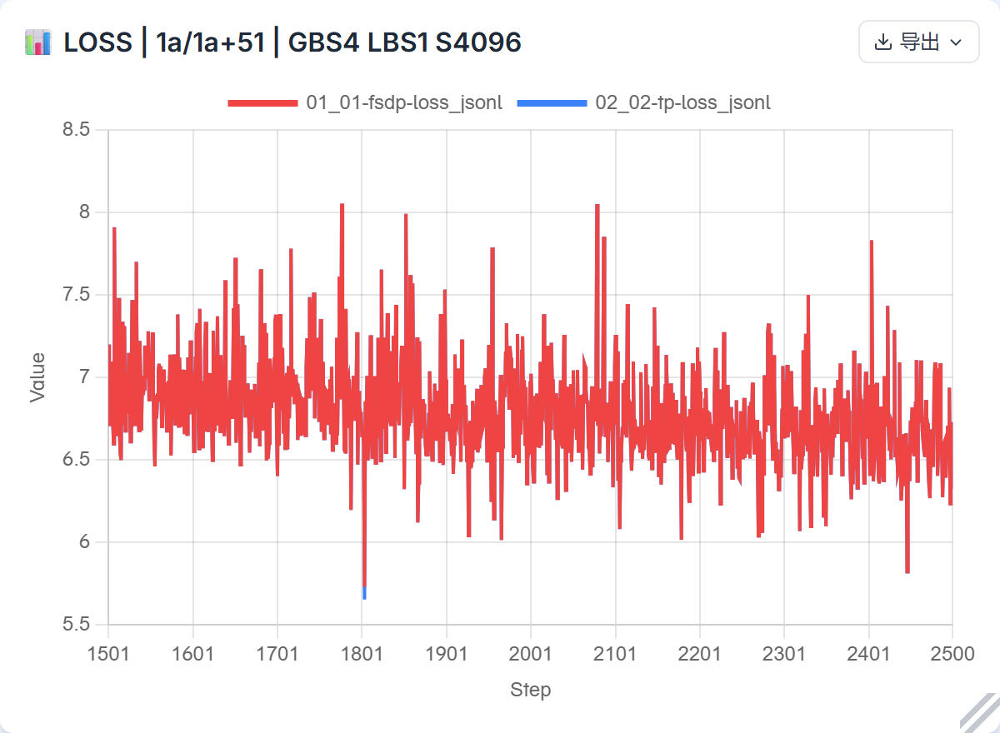
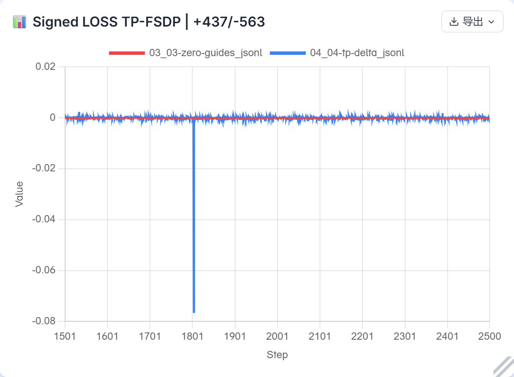
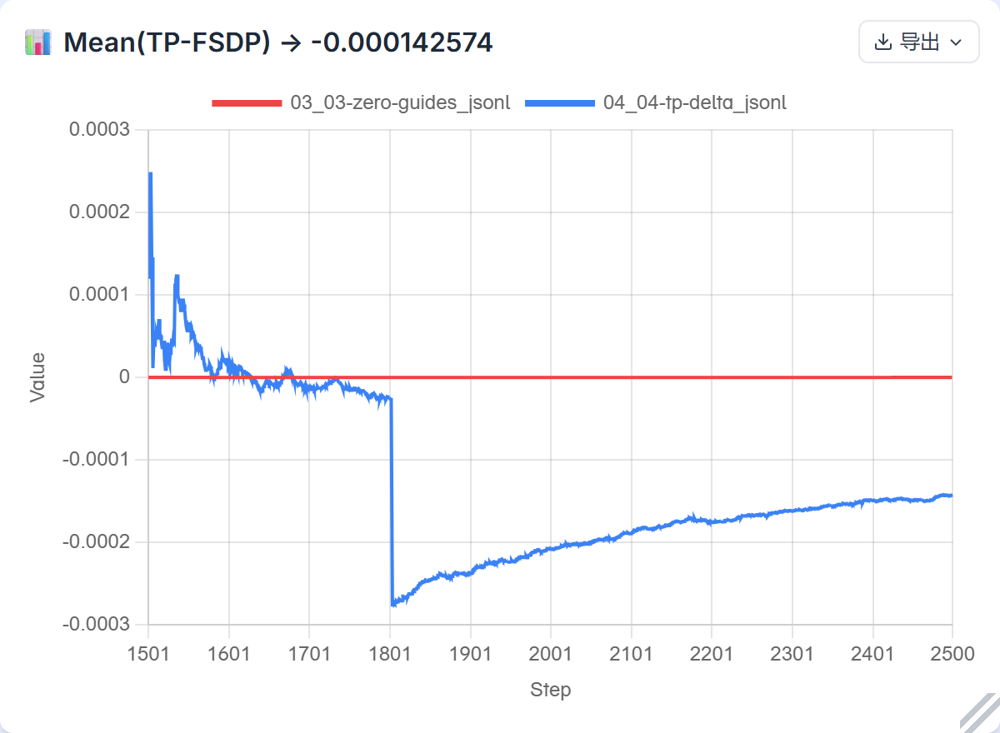
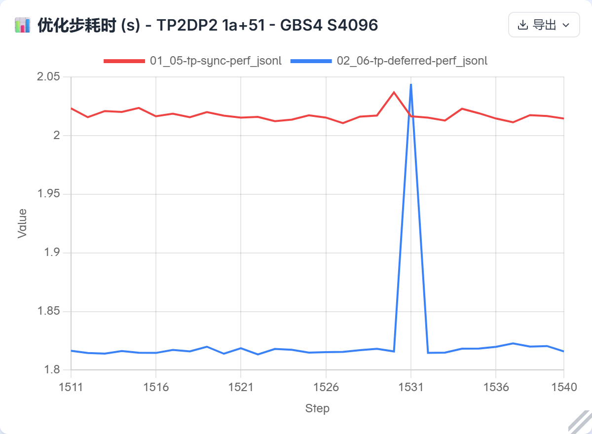
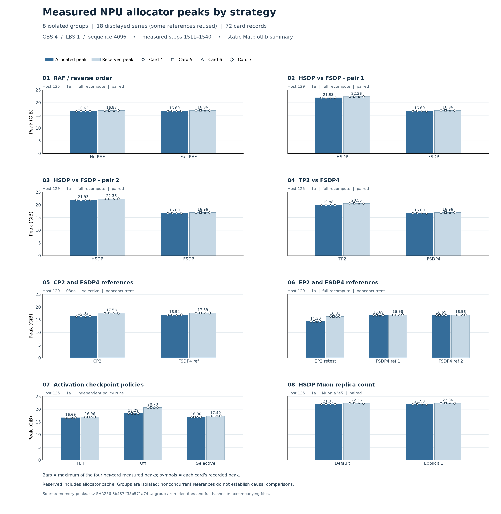

# 四卡性能与显存评估（草稿，固定 PR310 基线）

本报告汇合真实四卡测量、完整续训、模块回归和独立数学审查。模型为减层后的三层 Xing40（2 Dense + 1 MoE）、MTP 关闭、S4096、GBS4/LBS1。并行、分片、重计算和语义等价的 micro/累积适配是实验变量；没有压缩2500步学习率日程，也没有修改模型/优化器算术以追逐框架数值。

已有 CP、TP、EP、selective 的相应1501–2500千步指标继续复用。新 TP2/DP2、full重计算、延迟同步也完成该完整窗口：**abs(mean(TP−FSDP)) = 0.000142573595047 ≤ 0.005**。这项新比较同时改变并行、重计算与同步方式，不能将其损失差归因于单一开关。

## 主要发现

| 受控范围 | 实测结果 | 能支持的判断 |
|---|---|---|
| TP2/DP2，同源同步 / 延迟同步，125物理4–7 | 2.017418988 / 1.824370796 s/步；名义8121.268 / 8980.630 tokens/s | 首组顺序对照耗时−9.57%、名义吞吐+10.58%；allocated每卡+0.318218GiB，reserved +3.123047GiB。保留1531长尾及背景限制，不宣称普适或严格因果收益。 |
| HSDP2×2 / FSDP4，129两对 | 1.168668/0.779871；1.178738/0.788007 s/步 | 此四卡规模HSDP均较慢。replica维度不继续分片持久状态，理想每卡持久字节约翻倍；额外通信与Muon包布局需结合生命周期评估。 |
| HSDP同源 default / 显式replica count=1 | 1.168631892 / 1.182438706 s/步；allocated峰约21.9263GiB均相同 | count1是singleton、关闭该维度组内去重；此组未见加速或驻留状态下降，不能按名字将它推荐为加速开关。 |
| FSDP前向后不重分片 / 前向后重分片，同机反向顺序 | 0.754402 / 0.780831 s/步；allocated约16.625/16.689GiB | 保留全参数是理论上减少再次获取需要的途径；本组实测的是整步耗时差和峰值，未单测重新获取的分项成本。不推广到其他规模；此变量与激活重计算不同。 |
| 原1a full / off / selective激活重计算 | 0.783251 / 0.740971 / 0.822024 s/步；allocated16.688899 / 18.293450 / 16.900913GiB | 本模型full相对off降低峰值并增加耗时，selective不保证优于full；这些是原策略注册结果，不能改称修复后的SAC性能。 |
| EP2复测，129 | 0.816409 s/步；allocated14.300731GiB | 是实际配置的描述性结果；FSDP参考非同期，不能直接判定严格单因素收益。理想持久状态与FSDP4同级，不以峰值差直接推断状态节省来源。 |
| CP2 + fixed selective / 同源FSDP fixed selective | 1.357785 / 0.820776 s/步；CP allocated16.317334GiB | CP局部序列2048、每卡两micro，仍为全局4个4096样本；参考非同期。参数/主权重分片、通信与额外micro成本不能和序列分片的激活收益混为一项。 |

保守TP只分片部分attention路径，Dense/MoE/shared路径仍复制；DP2使每卡需要两micro，FSDP4为一micro。相同GBS不表示每卡执行相同数量的复制模块工作。它相对FSDP较慢有实际配置代价，不能仅凭数值断言通信实现有缺陷。CP也不能只根据局部序列减半预测端到端加速。

HSDP可核验的参数/优化器持久状态更大、pack/collective关联及去重语义有源码和实测支持；完整关键路径的可加时间分账尚未闭合。owner数不是NS kernel次数，逻辑包字节不是链路字节，wait lane并集不是端到端因果贡献。没有为获得更接近的数值而固定算子/规约顺序或复刻累加轨迹。

本轮固定的独立源码参考包括：[PyTorch2.12 FSDP pending梯度dtype](https://github.com/pytorch/pytorch/blob/0d62256a2b23365f8e1604297eb23a6545102aa8/torch/distributed/fsdp/_fully_shard/_fsdp_param.py#L728-L747)、[TorchTitan1e30d69非PP末micro同步开关](https://github.com/pytorch/torchtitan/blob/1e30d69a3df2c027c7a5ea65d2fd5439bf068f69/torchtitan/training_engine.py#L780-L785)、[Megatron-LM5812485普通DDP的main_grad累积](https://github.com/NVIDIA/Megatron-LM/blob/581248531984920e92f076946ad4629d359442a4/megatron/core/distributed/distributed_data_parallel.py#L598-L644)。前者给出reduce_dtype下的pending合同；Titan循环本身不决定精度policy；Megatron引用只适用于所引DDP路径及精度配置。这些不证明实现逐位相同，也不作为异硬件速度对照。

## 千步数值与恢复

| 新TP deferred − 原1a FSDP4/selective | 完整1501–2500 |
|---|---:|
| 有符号均值 | −0.00014257359504699706 |
| 有符号均值绝对值，验收指标 | **0.00014257359504699706 ≤ 0.005** |
| MAE，仅诊断 | 0.0003751966953277588 |
| 最大绝对差，仅诊断 | 0.07632064819335938，step1804 |
| 正 / 负 / 零 | 437 / 563 / 0 |
| MTPLOSS | N/A：YAML关闭MTP，没有伪造零损失 |

全部1000行、差值及累计有符号均值保留，不平滑、不剔除离群点。0.005约束完整窗口的有符号均值绝对值，不约束单步差、MAE或全部参数。累计曲线的**最后一个值**才是完整窗口均值；网站对累计序列另算的平均值、零基准相对误差都不作为验收指标。step1804原基线loss/grad norm为5.731315136/60.253479004，新TP为5.654994488/57.202770233；既有SAC-fixed为5.654379845/57.127082825。**TP与SAC两份差值共用同一original FSDP参照**，不是两条独立基线复现。现有记录不足以归因该点；均值达标也不证明该点具体模块语义正确。

两边原生1500恢复审核和实际post记录各含四rank×258 role，涵盖模型、main别名、优化器slot/group、步数/LR/调度器、适用的RNG/extra及loader。post记录的全元素finite检查均无nonfinite，layout/bindings与初态合同相符；不是跨运行全部权重误差比较。优化器和调度器实际推进到2500，数据总进度10000。实际dataset索引6000–9999共4000项逐步覆盖；**前两步**另外直接核input IDs/labels/loss mask/position IDs四字段及TP广播，后续索引覆盖不能写成所有步都有四字段hash。

trainer返回的loss已经按token在DP+CP组聚合并跨micro累计。使用rank0原返回值，不再次跨四rank求均值。其他rank与rank0差异最高约1.67e−6，保留该观察，不将它单独作为具体数值机制的证明。

## 计时、显存与可比性

每组从native1500独立恢复，1501–1510预热、1511–1540计时；每步取四rank各自同步train_step时长的最大值，再报告30步均值、总体标准差、CV、分位及极值。这不是公共时钟下最早开始至最晚结束的全局makespan。吞吐16384/平均耗时为名义tokens/s，未扣mask/padding；逐步吞吐的均值与该整体比值不同。

新TP同步/延迟总体标准差0.004819293/0.040858218s，CV0.238884%/2.239579%；延迟29/30个同编号步骤较短，1531长尾原样保留。首组sync缺少同粒度全机背景快照，离散无进程点样不证明全程独占；桌面/125主机约297秒时钟差不用于推算精确窗口。旧TP同步2.019936s仅是不同worker/source/入口的量级支持，不能冒称同源重复。可选A2三次准入未部署，间歇外部八卡作业不成为已有描述和数值验收的自设阻塞。

allocated、reserved及warm唯一storage分别报告，allocator不是整卡HBM。57个model/main实际别名只计一次，86个slot另计。TP两臂warm唯一storage约6.223887GiB相同；allocated峰约19.879516→20.197734GiB，reserved20.546875→23.669922GiB。不能把peak−warm当激活，不能把reserved增量或reserved−allocated直接称作碎片/泄漏。假设57个参数的全FP32 pending全部同时存活，逻辑payload估计5.348833GiB/卡；这是条件估计，不是实测新增量、allocator或物理HBM上界。

全局FP32参数逻辑7.230669GiB，优化器slot逻辑10.730777GiB。在仅考虑理想持久分片和main别名的假设下，FSDP4/该EP布局约4.49036GiB/卡，HSDP2×2约8.98072GiB/卡；真实峰值还取决于梯度、获取后的参数/精度转换、激活、CE、Muon、通信临时量的重叠，不能简单相加。独立数学、Megatron-LM/TorchTitan对应实现仅用于适用条件与语义归因，不作跨硬件性能排名。

## 修复、版本和范围

- [SAC issue1357 / Draft1358](https://github.com/mindspore-ai/hyper-parallel/pull/1358)：修复实际算子overload注册。原/修复selective千步均值通过；1804及attention严格梯度仍未归因，compile/真实List路径未独立验收。
- [GMM issue1361 / Draft1362](https://github.com/mindspore-ai/hyper-parallel/pull/1362)：修复整数序列派发语义；CPU红绿及32项NPU模块回归，不宣称整网加速。
- [Muon issue1364 / Draft1366](https://github.com/mindspore-ai/hyper-parallel/pull/1366)：保留显式replica子组配置；模块和原生DCP控制、整网两40步已验证。整网count1跨ownership恢复和千步没有执行，不升级为该更强主张。
- [no-sync issue1368 / Draft1369](https://github.com/mindspore-ai/hyper-parallel/pull/1369)：修复末micro缺席模块的完整pending梯度flush；CPU/NPU数学回归、官方e0+51两rank16/16和本报告TP整网证据分开标注。[HSDP partial-only RFC1105](https://github.com/mindspore-ai/hyper-parallel/issues/1105#issuecomment-6516038348)仍未修，不在该补丁覆盖范围。

原始冻结基线为1a39572fef23819a2d2651b4bd53047a05a4892f，原生checkpoint producer33096a1030012777a5f71502dee009a7dd409bf9。表内CP fixed及对应FSDP fixed selective另用SAC修复源03ea31945303bf8dca37d319a737f1f05596474b，manifest17232e0241a749b5e02d04e4ff531aab8f4ad7f0fdba1719d16d5abb8df30116，不能标为1a原字节。新TP source manifest0f168e2ce3279cb315fc27d60d06693a17a5626a228fbf777146dda9da3e977d，仅scheduler51abc1d50805960b50c334c8f5a5b5c4a5b2a5e0d7984686bae3d2e553499fe2；HSDP replica实验使用单独Muon overlay，不能与TP源码混写。

本任务环境Python3.12.14、PyTorch2.12.0+cpu、PTA2.12.0.post3、CANN9.2.0（V100R001C12SPC001B237），910B3，numpy1.26.4/transformers5.21.0/tokenizers0.23.3；环境指纹e14f2704e4d568d79ef9df15546f3ed82e0613455ccb512f8c9e8c8b14b948cc。constant LR1e−5、warmup0、完整日程2500步。数据bin/idx及实际采样身份锁定，训练样本4096不意味着每个原始document长度都等于4096。

数据前缀`mmap_deepseekv3_datasets_text_document`：`.bin`为4,645,101,328字节，SHA256 `6b925f342504c3eae80c5bde3163ff5924ad36b262bc6a276839a6f3f817ea3c`；`.idx`为18,610,322字节，SHA256 `d535e502d62368e7a195b27a9a717543534ee1eaa9b4f9ce45f4d08d746cb5cd`。数据内容未公开。

18个唯一run的72个rank目标记录对应物理卡4–7。125/129的既有`npu-smi -t topo`快照均标记NPU两两连接类型为HCCS；卡4/5推荐CPU亲和0–31，卡6/7为64–95，这不是实际worker绑核的证明，也不是链路带宽测量。分组/mesh与实际Muon PG证据另见硬件索引；default的Muon replica assignment为[0,2]/[1,3]，显式1为singleton，不能据此说全模型HSDP replica维消失。

12:13UTC核对官方master仍e0cdf62c9d66f1f9ec48c6f15df87dcf4ce80a5f，hf1s PR310仍fdd152d501b09602ab1cbd6240877bc35bbe81b7的7提交集；没有将旧训练标签改成最新master实测。相关代码PR仍open Draft，CI未全绿，不宣称已合入。总issue中其他会话MF r2.10/CANN9.1/PTA post2单卡结果及图片原样保留，未混入此CANN9.2性能比较。

[实际TP两臂、各rank YAML及命令私有归档](https://github.com/xingleixu123/mindformers-private/blob/cd43cdfe5af8152aa2a699abeb77c9ca05ae357d/private_review/archives/tp-nosync-perf-acceptance-20261030/PUBLICATION.md)已逐字节回读，仓库private且collaborator仅owner；历史MF/HP和HSDP归档继续保留。公开包只包含聚合指标、逐步标量、来源指纹和图，实际YAML、权重、slot、RNG及token内容保持私有。

网站13个运行视图已实际完成online逐点校验，两个隔离Edge交互窗口保持打开。原始source-points可与派生JSONL的lineage连接，追到原CSV/JSONL行及SHA；普通网站URL不是可复现分享链接。Terra整理工作使用max；当前无Fast selector，未声称开启。

## 图与重现

以下曲线来自真实在线网站。白底PNG是网站图表卡片截图；原生PNG/CSV及整页报告本地保留，未离线重画这些曲线。

[所有网站主图及原生CSV映射](plots.json) · [13视图online与范围回执](website-validation.json) · [逐点原值和统计](tp-data/README.md) · [分组、版本与每卡字节值](site-inputs/strategies/README.md) · [硬件/卡号证据](hardware-topology.json)。原始封存候选README中的“未发布/待审”为封存时状态，最终归档以本报告及全局清单为准。

`commands.json`保存相对于本目录的逐视图Node参数数组：将输出占位符换成新空目录，使用已安装Microsoft Edge和Playwright运行。`interactive-accuracy`与`interactive-performance`不含headless，保留交互页；其他视图自动导出。工具只经网站公开X输入修改显示范围，并核原点未裁去；source-points可接对应site-inputs lineage追到原CSV/JSONL行和SHA。CPU源/统计构建需要私有原件，公开读者可从已公开派生标量复核统计和重现图，不能凭此包重算私有checkpoint或token内容。

静态汇总明确分8组，不把非同期参考作因果排名；柱是四卡峰值最大，符号为各卡实测值，allocated/reserved不堆叠。可编辑SVG、绘图源、72条数据与工具环境保留在static-memory。该附图未冒称网站产物。
