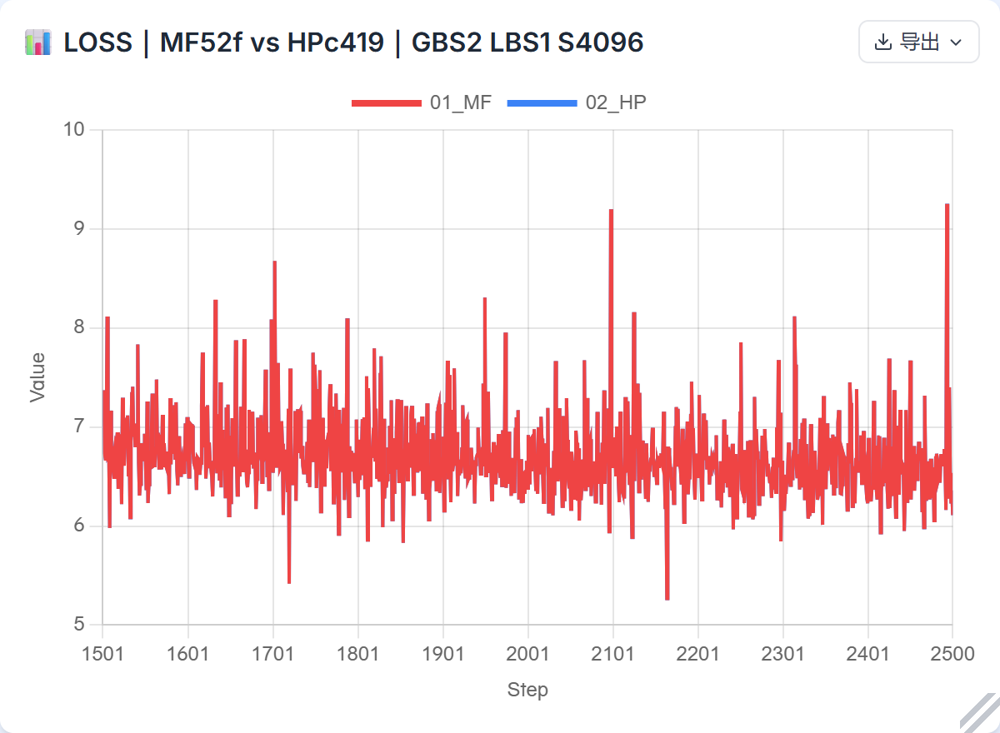
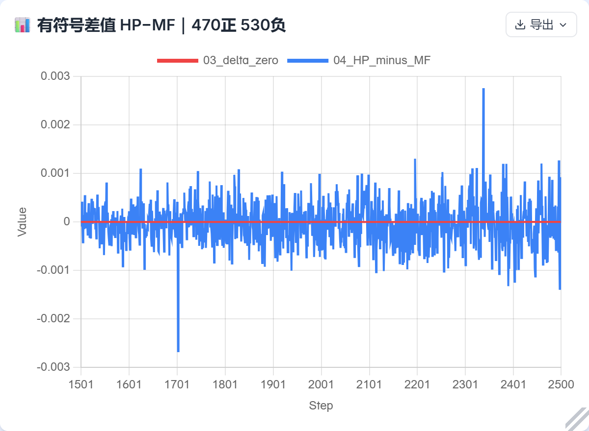
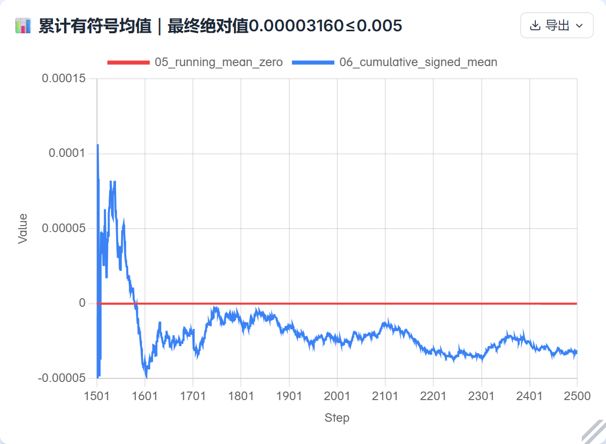

# 单卡 Muon 续训对照：MF1500 → HP 1501–2500

HP 与 MF 在完整 1000 步的 **HP−MF signed mean 为 −3.1603455543518064e−5**，其绝对值满足给定的 **≤0.005**；470 步为正、530 步为负、0 步为零。MAE 为 **0.0003377457857131958**，最大单步绝对差为 **0.0027565956115722656**（step 2338）。无单步绝对差超过 0.005；这只是诊断计数，给定门槛只适用于整窗有符号均值的绝对值。

每 100 步的均值在零附近正负波动，没有观察到旧配置中后段均值单向扩大的负偏。误差幅度并非不变：前 500 步 MAE 为 **0.00029350900650024415**，后 500 步为 **0.0003819825649261475**。这组结果不证明误差收敛、自然围零或两框架算术完全相同。

| 步数 | signed mean (HP−MF) | MAE | 正 / 负 |
|---|---:|---:|---:|
| 1501–1600 | −0.000041275 | 0.000233259 | 44 / 56 |
| 1601–1700 | +0.000000858 | 0.000250092 | 50 / 50 |
| 1701–1800 | +0.000004845 | 0.000337801 | 51 / 49 |
| 1801–1900 | −0.000026045 | 0.000321884 | 46 / 54 |
| 1901–2000 | −0.000058053 | 0.000324509 | 48 / 52 |
| 2001–2100 | +0.000043132 | 0.000349472 | 55 / 45 |
| 2101–2200 | −0.000138766 | 0.000364057 | 36 / 64 |
| 2201–2300 | −0.000061038 | 0.000336144 | 44 / 56 |
| 2301–2400 | +0.000046811 | 0.000444207 | 54 / 46 |
| 2401–2500 | −0.000086505 | 0.000416033 | 42 / 58 |

## 试验含义与配置

MF + HyperParallel + MindSpore 的真实训练已记录 step 1–2500。本次 HP + PyTorch Ascend（PTA）从该运行闭合的 **MF1500 来源**转换并保存的 native HP1500 checkpoint 恢复模型权重和完整训练状态，再续训 1501–2500；MF 对照使用同一 MF 运行的实际后续记录。这是共同 MF 来源状态的续训对照，不能描述成从 HP 自己独立训练出的权重出发的精度对照。

模型为 3 层：2 Dense + 1 MoE；GBS 2、LBS 1、序列长度 4096，原日程 2500 步、学习率 1e−5，FP32 model/main 参数别名；使用 125 物理卡 2 的 Ascend 910B3（64 GiB），MTP 关闭，**MTP LOSS 为 N/A**。HP loss 为两个 micro 的原生返回值之和，每个 micro 已按整步 8192 token 归一；MF 使用原 callback 累积 loss，未另按 micro 数乘除。

修正内容包括通过现有模型接口为 Muon 指定逻辑矩阵边界，以及将 MF 实际 NS 配置映射到 HP 现有原生选项：`ns_variant=legacy`、`ns_epsilon=1e-8`、5 次迭代。目标参数组在 checkpoint 中已保存为该配置，训练恢复后没有 runtime switch。`legacy` 是 HP 现有系数选项名称；核心 Muon 不改，没有复制旧 MF Graph 算术，也不由相同系数和 epsilon 宣称两个框架的归一化、舍入或执行次序完全一致。

## 源码链与相关问题单

实跑集成链依次为：纯六 PR 基础 `356ac94d9254e966f076bc065789dfc93754adec` → 加入已有模型 CE 兼容增量的 `2dd33e02f46fc5d6810e806b9d7d4717cf10a3e4` → 加入 checkpoint 生命周期修复的 `f827186ea3416b58371603210140ee32ff08b04f` → 加入逻辑矩阵边界的实测 `c419d1356af9eccec8377e636a6d9e5a2b7a285b`。三项增量在该链上各为一个提交。

| 范围 | 问题单 / PR | 与本单卡结果的关系 |
|---|---|---|
| Xing40 Muon 逻辑矩阵边界 | [hf1s#318](https://github.com/hf1s/hyper-parallel/issues/318) / [hf1s#319](https://github.com/hf1s/hyper-parallel/pull/319) | 模型通过现有接口声明拆分边界；这是本次精度对照涉及的模型侧逻辑。 |
| checkpoint 非 owner 状态生命周期 | [官方 #1430](https://github.com/mindspore-ai/hyper-parallel/issues/1430) / [官方 #1431](https://github.com/mindspore-ai/hyper-parallel/pull/1431) | 保存或恢复后的非 owner 状态清理；单卡无非 owner，不能归因为本次精度变化的原因。 |
| 已有模型 CE / TP loss-parallel 兼容 | [官方 #1426](https://github.com/mindspore-ai/hyper-parallel/pull/1426) | 并非本轮新增 PR；实跑集成中对应模型文件 +11/−8 的增量，单卡走完整词表的 chunked 分支，不走 TP loss-parallel 分支。 |

上文的 `legacy` 与 epsilon 是框架已有原生选项的配置映射，没有为此新增 core Muon PR。

## 状态和证据边界

恢复时的 model/main、optimizer slots、groups、extra、sampler 及记录的 RNG 域通过校验；首个实际 batch 与 MF natural 记录一致。全部 1000 步、2000 个 micro 的 **8000 个输入字段**的 shape、dtype 和摘要与 MF 相同，步号、sampler、scheduler、记录的 RNG 域及 loss 口径经逐步复核。首步逻辑分块覆盖 28 个参数、13 个拆分和 44 个逻辑片。RNG 结论仅限已记录的域。

HP 最终 step 2500 checkpoint 已另由独立 CPU world-size-1 进程只读加载：58 个 model tensor 和 86 个 optimizer slot 的 hash 与保存前 producer 活体 fingerprint 一致，596 个非 tensor group 字段由 reader 逐项核对，四个 payload 的 SHA 和 stat 在读回前后稳定。这是 HP checkpoint 的自读回，不是 MF 算术等价证明；摘要与身份见 [readback-summary.json](readback-summary.json)。

MF 原 runner 在**终态 guard**以 exit 1 结束，终态 inode / 权限连续性缺口保留。真实 1–2500 逐步训练记录和 step 1500 恢复证据已核对；不能把这次末检失败写成 clean 退出，也不能据此把已核实记录当作训练中断。

本次实际 HP 源码为已公开的 [c419d1356af9eccec8377e636a6d9e5a2b7a285b](https://github.com/xingleixu123/hyper-parallel/tree/c419d1356af9eccec8377e636a6d9e5a2b7a285b)，tree 为 `82e641d37ea1073eb8690a4345cbc7f6fee23767`。公开逻辑功能提交 `909a4fcce3b990b749095e253837bd22119de6f3` 与实测源码的 `muon_layout.py` 和 `optim.py` 两个生产 adapter 文件已核为字节相同；**没有对该公开提交本身独立执行 NPU 运行**，不将两个文件相同外推为整个版本相同。准确版本、六 PR 的八个集成提交、配置以及数据 bin / idx / MF cache 的 SHA 标识见 [versions.json](versions.json)；不包含数据或 cache 的内容。MF `52f614eeb91c6e873d37bdbb5b880c82926ae9f6`、MindSpore 2.10 和 CANN 9.2 是本试验使用且已获接受的实验组合，不声称官方配套。

本结果仅覆盖单卡。按用户当前要求，四卡工作暂缓，不能据此宣称四卡验收。

## 数据、图与复算

[逐步配对 CSV](paired-loss1000.csv) 含 HP/MF 原生 loss、差值与梯度范数；[基础统计](statistics.json) 和 [独立复核](independent-verification.json) 保留原始字节。基础统计反映其封存时的状态，其中「最终 global tensor 独立读回及大 shard 独立重哈尚未做」已由后续完成的 [CPU 读回补充摘要](readback-summary.json) 更新，并非当前状态。

三幅图来自原始训练记录派生且可追溯的 scalar 输入，横轴均为 step 1501–2500，没有平滑或降采样；网站和匹配配置见 [plot-config.json](plot-config.json)。红蓝 loss 曲线高度重叠，需结合差值图查看。

*MF callback loss 与 HP 两个已按 8192 token 归一的 micro loss 之和，每侧各 1000 个步点。*

*逐步 HP−MF native loss 与零参考线。*

*从 step 1501 到当前步的累计有符号均值；末点为完整 1000 步均值，给定 0.005 条件只用于完整窗口。*

复算和训练入口的可公开说明见 [REPRODUCE.md](REPRODUCE.md)。私有配置归档 v6 固定于 [commit `565682bf00c3e74ec80ad43113cae51c0c7e50e8`](https://github.com/xingleixu123/mindformers-private/tree/565682bf00c3e74ec80ad43113cae51c0c7e50e8/private_review/hp-mf-sixpr-cann92-20261102-single-mapped-v6)，需要该私有仓库的访问权限；公开报告不提供原始 YAML、样本、随机状态或 checkpoint。私档的「最终验收待认定」是生成时尚待 ROOT 汇总的状态；本报告汇总已有的数值复核及 CPU 读回证据，不改写该历史快照。
