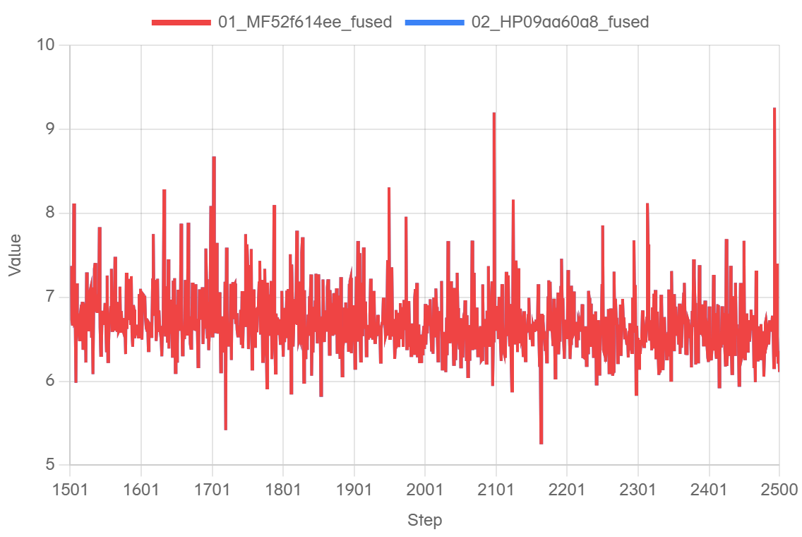
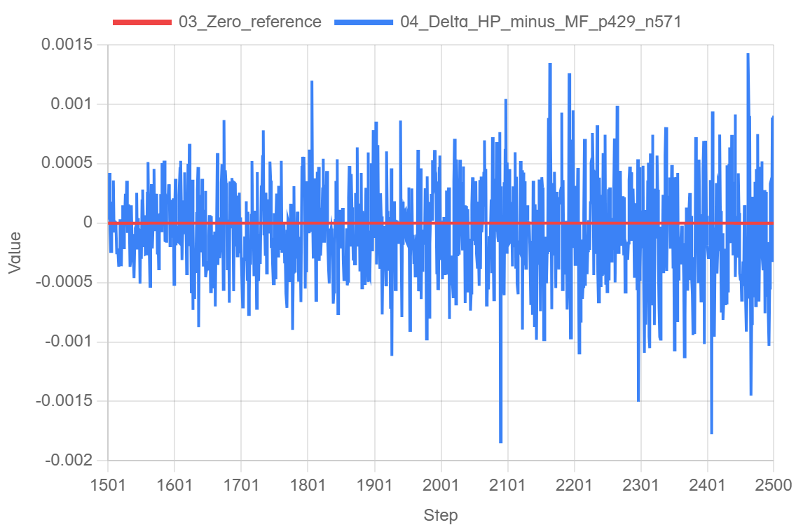
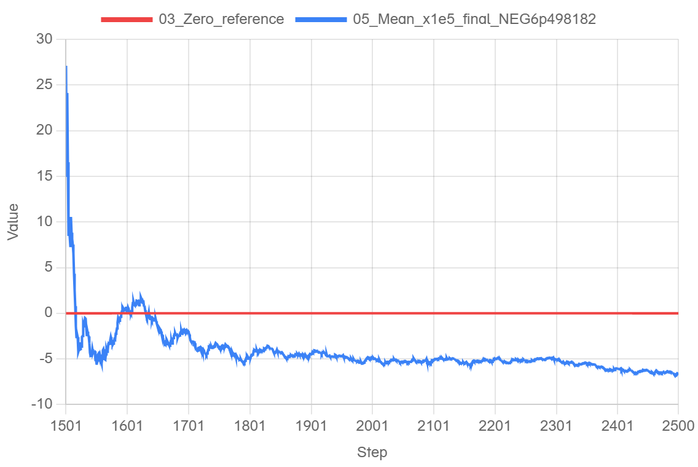
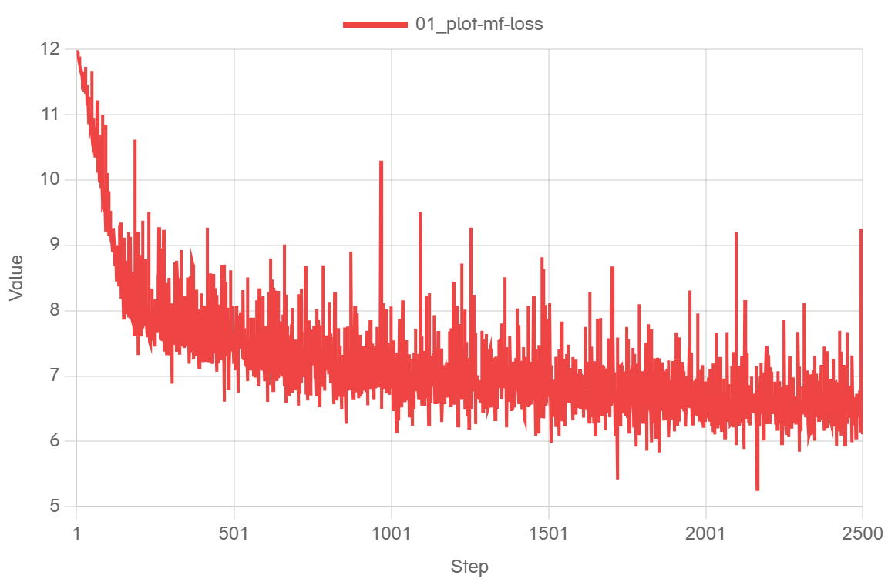

# MF / HP 双方融合 mHC：单卡完整续训精度

本轮固定版本下，MF 连续训练 1–2500，完成第1500次更新后保存完整训练状态；HP 从该真实 MF 状态转换的 native DCP 在独立新进程续训1501–2500。完整1000步已由负责人独立复核通过。模型为3层（2 Dense + 1 MoE）、GBS2/LBS1、序列4096、原2500步日程；两侧层内 mHC 均启用融合，MTP按配置关闭，记N/A。

|项目|固定版本|
|---|---|
|MF / MF侧HP-MS|`52f614ee` / r1.0.0 `c69f8f70`|
|MindSpore|r2.10 `2a020077`，2.10.0|
|待测HP集成|`09aa60a8`，基于官方master `198cfc58`|
|模型 / 示例 / 公共融合mHC|PR1367 `092cc751` / PR1376 `d45a1581` / PR1409 `68cb5d81`|
|运行环境|CANN9.1.0、Python3.12.14、Torch2.12.0+cpu、torch_npu2.12.0.post2、Transformers5.21.0、Ascend910B3|

完整提交、配置身份和wheel摘要见[data/environment.json](data/environment.json)。集成验证包含置顶所列必要前置；结果不表示独立模型PR无需其他依赖。

|完整1501–2500统计|LOSS|
|---|---:|
|mean(HP−MF)|-6.4981818199157711e-05|
|abs(mean(HP−MF))|**6.4981818199157711e-05 ≤ 0.005，通过**|
|正 / 负 / 零步数|429 / 571 / 0|
|MAE，诊断|0.00033164656162261962|
|最大绝对差，诊断|0.0018396377563476562，step2090|
|MTPLOSS|N/A，未生成假零曲线|

0.005仅约束完整1000步的有符号均值绝对值，先保留正负再求均值；单步差、MAE和最大差均无额外验收阈值。[逐步原值](data/points.csv)与[独立审计](data/acceptance.json)保留完整精度。

## 实际曲线

所有图来自真正的 [log.javazero.top](https://log.javazero.top/)，未平滑、未抽样。红蓝LOSS高度重合，差值图用于观察两者差异。

累计均值是逐步统计量，不是对LOSS做平滑。末端原值取绝对值后用于验收；图中纵轴每1单位等于1e-5。网站对零参考显示的相对百分比不用于验收。

该全程图仅作训练背景；所有对比和验收统一使用1501–2500。

## 恢复、样本与损失口径

MF1500/2500的原生完整收据、live值核对及最终源码/数据检查通过。转换阶段没有训练更新；HP恢复时对144个模型/主权重及optimizer状态张量逐项核验，并核对绑定、参数组、步数、scheduler、数据游标及HP原生RNG。完整窗口两个微批乘四字段共8000个实际输入指纹逐步相等，形状均为1×4096。没有用同seed推断状态一致。

MF LOSS读取原生累计loss的完整Float32值，逐行核对原始字节和callback；HP读取原生train_step返回的loss。[source-points.jsonl](data/source-points.jsonl)保留源账本SHA、行号、原始数值token和实际样本指纹。MF账本SHA为`a38604d281c477518a12139e807e4f52902306f5f455ea8391ffa2bcfc5156aa`，HP为`45bc493376691d02291f929389aa163e63a0e4cdc90d0676c899cacb823d356f`。

MF随机状态作为原生checkpoint证据保存，没有翻译成Torch随机位流；此配置dropout为0、强制随机router关闭，MF已观测前向默认RNG不推进。HP自身native RNG保存/恢复已核验。本轮验收不声称所有框架随机域按位相同。

## 融合语义与实现边界

MF使用CANN pre+Sinkhorn/post及各自反向；HP使用Omni pre、独立Sinkhorn、post及反向。两端均为4 residual streams、两个epsilon为1e-6、20次Sinkhorn，参数布局按实际清单映射。独立NPU诊断覆盖相同4096×3584形状、非对称mix与全部输入梯度，具体误差见[data/module-diagnostics.json](data/module-diagnostics.json)；finite或一次数值接近不构成通用kernel正确性证明。

末端HyperConnectionHead仍是独立FP32数学。MF的(W·x)·r与Transformers的W·(x·r)代数等价，浮点顺序不同；本轮保留各自实现，没有为对齐复制累加顺序或旧MF特制算术。该报告验证的是固定配置下的训练接力，不把Head称为层内融合算子。

## 配置归档与复现

实跑YAML仅存本人私仓：[MF实际输入](https://github.com/xingleixu123/mindformers-private/blob/4cd546d44b8aeeb317234cca21548da2c797940b/private_review/archives/mf-r210-fused-single-20261031/mf-formal.yaml)、[HP实际resume resolved](https://github.com/xingleixu123/mindformers-private/blob/4cd546d44b8aeeb317234cca21548da2c797940b/private_review/archives/mf-r210-fused-single-20261031/hp-1500-resume-resolved-config.yaml)、[归档说明](https://github.com/xingleixu123/mindformers-private/blob/4cd546d44b8aeeb317234cca21548da2c797940b/private_review/archives/mf-r210-fused-single-20261031/README.md)。MF相比历史3层输入只启用融合并改变输出/cache路径；HP的保存和恢复控制项单列，不称为纯路径变化。

使用示例PR1376的中文README及bash入口，结合上述实际配置和对应完整checkpoint重放；2500步学习率日程不能压缩为短跑日程。先等MF1500完整落盘及自然1501样本核验，再零更新转换/独立HP恢复。此报告不包含checkpoint大文件或私有YAML内容。

网站复图：按[data/plot-config.json](data/plot-config.json)给出的顺序导入[data/plot-inputs](data/plot-inputs)五份日志，step关键词为step，分别匹配LOSS、delta、cumulative_signed_mean；关闭平滑与抽样。零参考是数学参考线，不是虚构训练数据。网站普通URL不编码本轮数据；公开原值和配置可用于重建，交互页面保留在本机Edge。

## 验证范围与合入状态

必要CPU组合回归203 passed / 68 subtests；CPU模型使用替身验证编排，禁止真实mHC或Head计算。单卡整网本轮已通过，不能自动扩展为四卡融合配置验收或全面性能结论。旧非融合单卡/四卡结果保留其历史版本身份。

PR1367、1376、1409仍保持Draft；当前外部label-check等待有效的新CI通过标签，CLA通过，不能将设备验收称为外部CI已绿。待合入特性、前置与不需要合入的旧方案见[总issue304](https://github.com/hf1s/hyper-parallel/issues/304)。
