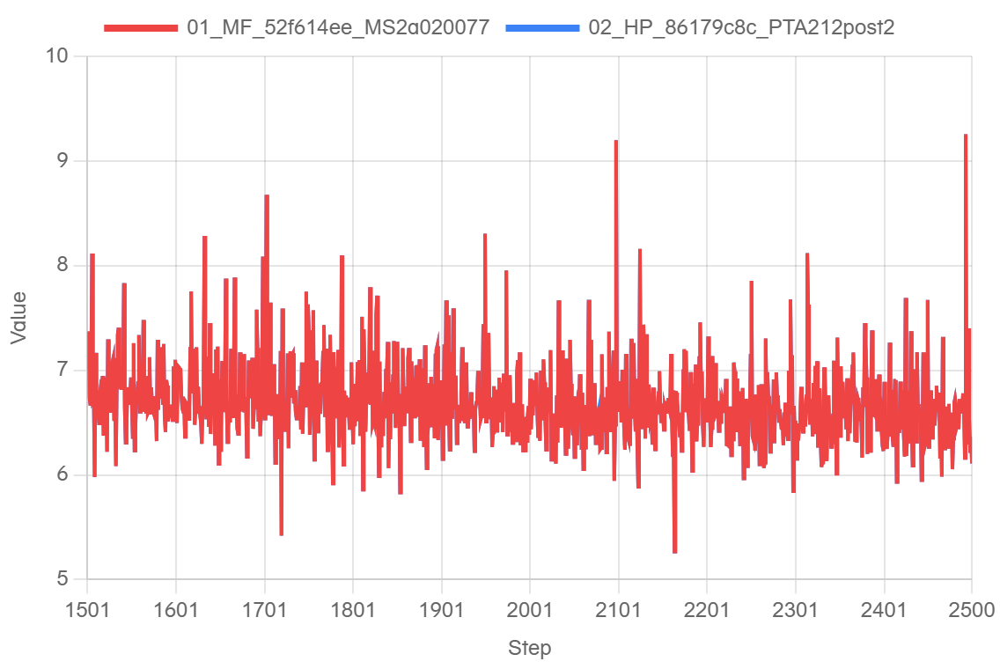
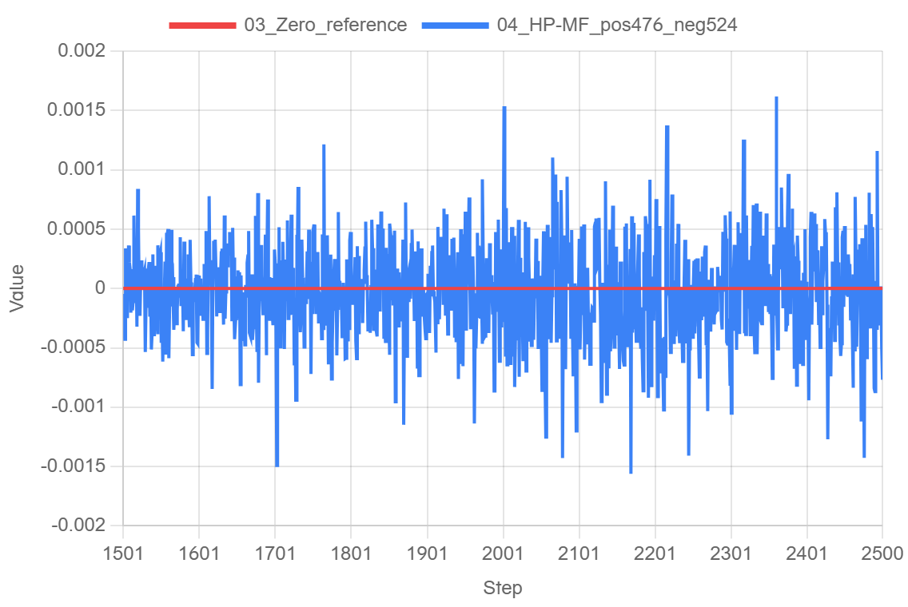
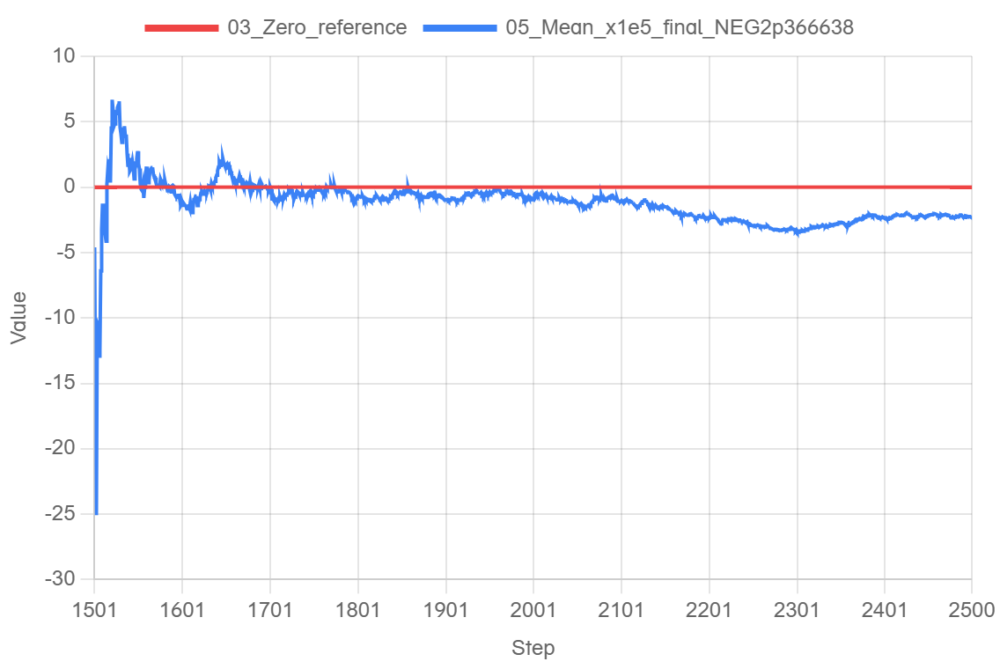

# MF r2.10 → HP 单卡完整窗口精度

本报告比较连续 MF 第 1501–2500 步与 HP 从 MF 第 1500 步完整训练状态转换并接续的同一步数。数据来自本次真实运行；完整窗口和最终审计状态：通过本轮完整窗口验收；两侧完整终态、源/数据guard、恢复状态和1000步实际输入对应均经过独立复核。

## 版本与设置

- MF 源码 `52f614eeb91c6e873d37bdbb5b880c82926ae9f6`；MF 侧 HP r1.0.0 分支 `c69f8f70317268337314285f62d81bd5970c791a`。
- MindSpore 官方 r2.10 构建 `2a0200772404851a42e2ee4ecce9445d52725b19`，wheel SHA256 `61780cc006097884b6a75420c81fe061bad1776597ad6a5974c641ce34563408`；该分支构建与最初 PyPI 稳定包不是同一字节产物。
- 待测 HP 业务 `86179c8cc09901b87e2508ca75deea455c905e06`，示例 `c77d33cbe19ea09ac6951ee0cf294f5f5015b103`；CANN `9.1.0`、PTA `2.12.0.post2`、PyTorch `2.12.0+cpu`。
- 3 层（2 Dense + 1 MoE）、GBS 2 / LBS 1、序列长度 4096，MTP 关闭，MTP LOSS 为 N/A。

## 完整 1000 步结果

MF 使用原生 pre-update accumulated LOSS 并核对 callback LOSS；HP 使用实际 result.loss。差值为 HP−MF，阈值 0.005 约束的是完整窗口 `abs(mean(HP−MF))`，不是逐步阈值。

| 指标 | 实测 |
|---|---|
| signed mean(HP−MF) | -2.3666381835937499e-05 |
| abs(mean) | 2.3666381835937499e-05；数值满足 ≤0.005 |
| MAE | 0.00032383298873901365 |
| 最大绝对差 | 0.001617431640625 |
| 正 / 负 / 零 | 476 / 524 / 0 |
| 自然微批四字段 | 8000 / 8000 |
| MTP LOSS | N/A（关闭） |

[逐步真实数据](data/points.csv)和[精选统计与版本](data/stats-and-versions.json)包含本次结果及来源摘要。

## 在线网站导出图

以下图片取自真实 log.javazero.top 画布导出；范围、平滑和点数由最终证据确认：Microsoft Edge真实在线会话；每条曲线1000个原始步骤，X=1501–2500，未平滑、未抽样，网站CSV已逐点反查。图中红线是数学零线；0.005约束完整窗口的均值，不作为单步误差限。

MTP依既定配置关闭，未制作虚构的零MTP曲线。aux日志的微批聚合口径不同，因此不加到主LOSS。

原始日志、关键checkpoint、准确版本和复现命令已保留；CSV包含原始ledger的SHA和行号。数学零参照的相对误差不参与验收。现场Edge会话保留打开，网站普通首页URL不携带本轮数据；本报告、图片与CSV提供固定分享快照。该结果仅覆盖本轮单卡设置。旧版参考链不同，旧数值不用于直接排名；本次没有改变训练公式或固定算子/规约顺序。

累计均值图的单位为 **1e-5 LOSS**，图中数值是原累计均值乘100000，以避免小数刻度截断。最终原始 signed mean为−0.0000236663818359375，abs(mean)为0.0000236663818359375；统计表和逐步CSV始终使用未缩放值。

网站输入是从已审核的原始ledger提取的LOSS及派生差值/累计均值日志，并非直接解析整份stdout；每点来源的原始SHA、行号和值已保留。累计图的显示倍率明确记录，原始CSV及完整窗口验收使用未缩放数值。
