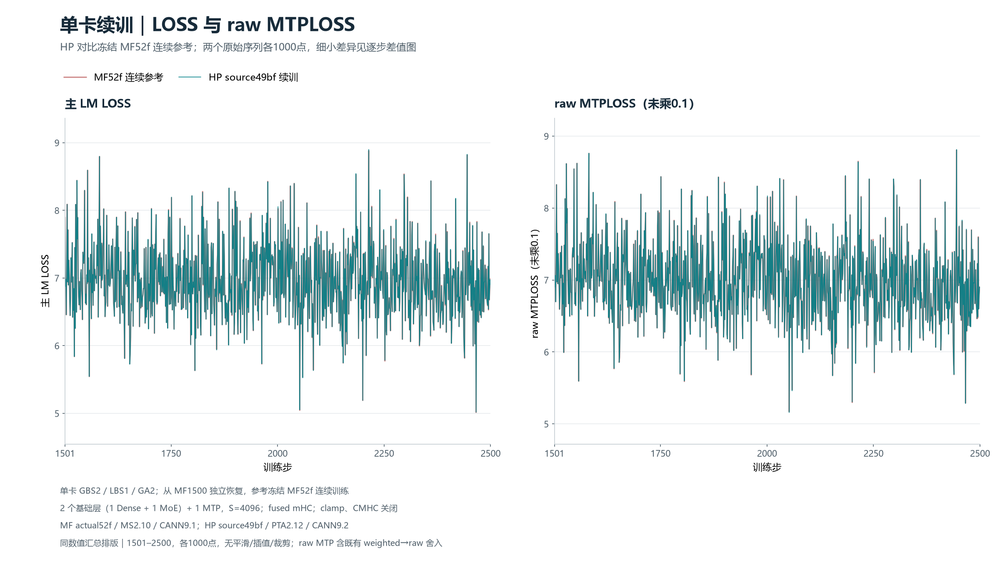
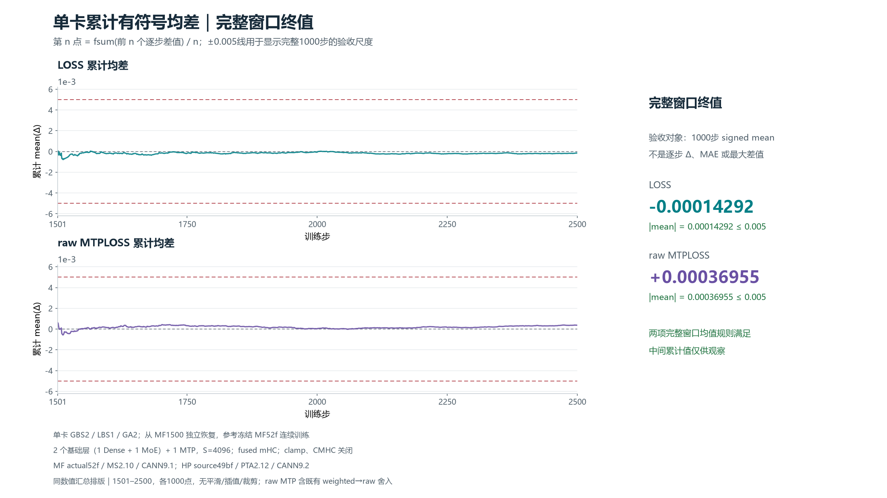
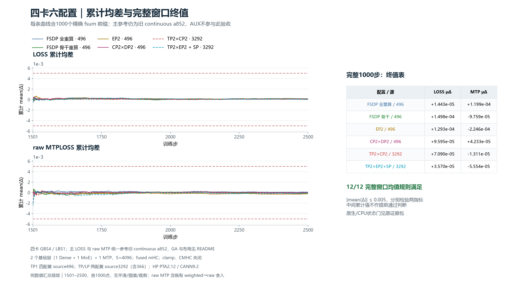

# PR1477：单卡MF→HP及六组四卡完整精度验收

单卡和六种四卡布局均完成**1501–2500的1000次独立续训更新**、实际样本比对、原生2500 checkpoint保存和独立CPU全状态读回。LOSS与raw MTPLOSS分别按abs(mean(目标−参考))≤0.005验收，14项规则均通过；逐步正负数、MAE、最大绝对差和位置保留在原CSV／统计中，未为这些诊断另设阈值。AUX只观察，不设阈值。

## 必要PR与全部检视

当前合入顺序、触发边界和未完成外部CI详见[中文总issue362](https://github.com/hf1s/hyper-parallel/issues/362)。单卡采用1470→1477→1441；四卡采用1470→1477→1453（替代1441），并按router统计域／TP loss_parallel范围叠加独立Draft364／366。非空SwiGLU策略Draft363是条件项，不混入本轮精度源码。1477／364／366分别是模型接入、统计域、LP显式副本倍率，不重复造Muon或改变规约顺序。

已重新核对#1439全部44线程／82inline、50review、16讨论，共148项，无新增、删除或内容变化；原提交、review状态及旧#304／#353未修改。[逐项历史矩阵](numerical/review-disposition.md)与[最终后续处置](numerical/review-followup-final.md)分开，原head已落实与独立新修复不混写。三份新增修复PR都保持Draft；[实际CI快照](numerical/current-pr-ci.json)仍为外部通过标签未回写导致label-check失败，不能宣称可直接合入。

## 完整窗口结果

| 对比／布局 | signed mean LOSS差 | signed mean rawMTP差 | 完整1000步 |
|---|---:|---:|---|
| MF→HP 单卡 | -0.000142918 | +0.000369553 | 两项均通过；样本／状态闭合 |
| 四卡FSDP／全重算 | +0.000014426 | +0.000119917 | 两项均通过；样本／状态闭合 |
| 四卡FSDP／主干重算 | +0.000149780 | -0.000097594 | 两项均通过；样本／状态闭合 |
| 四卡EP2 | +0.000129285 | -0.000224590 | 两项均通过；样本／状态闭合 |
| 四卡CP2DP2 | +0.000095946 | +0.000042325 | 两项均通过；样本／状态闭合 |
| 四卡TP2CP2 | +0.000070899 | -0.000013108 | 两项均通过；样本／状态闭合 |
| 四卡TP2EP2/SP | +0.000035704 | -0.000055535 | 两项均通过；样本／状态闭合 |

数值显示仅按9位小数排版，[全部原逐步值与统计](numerical/README.md)保留完整浮点数。单卡方向HP−MF、GBS2/LBS1/GA2，参考是实际MF52f连续2500；HP从MF1500完整训练状态独立恢复。四卡GBS4/LBS1，GA按DP1/2/4适配，方向为本轮配置−旧连续FSDP a852，全部从同一旧FSDP1500恢复；新FSDP重放只补同源码诊断／完整global AUX参考，不替换旧连续主基线。样本、归一化、数据进度和TP reader／nonreader真实游标分别核验。

FSDP全重算／主干重算的原wrapper尾部多余barrier失败，以及TPCP原parent AUX副本bitexact采集要求失败，均保留原false终态并通过各自精确有界审计和独立CPU读回，不冒称clean exit；EP、CP、SP原wrapper clean0。数值通过不等同于所有wrapper原始退出正常。

## 图表与网站原始导出

图中每条序列保留全部1000点，不平滑、插值、裁剪或改符号。下面是从同数值制作的清晰汇总排版，**不是网站原始PNG**；[网站原始36 PNG／36 CSV](website/README.md)、[全部七张汇总图及可编辑SVG](figures/README.md)均保留。网站在线Edge后台实际核对88000点后原生导出。普通Edge工具因无法可靠核验当前URL停止，尚未交付经可见页面验证的交互会话或可复现分享链接；不能把普通网站地址当数据分享。12份重载标量日志、解析配置和逐源映射均在website内。

±0.005只约束完整1000步的有符号均值绝对值；早期prefix和单步差值不是该门禁，MAE/max亦不设新门槛。AUX没有±0.005验收线。单卡raw MTP含原有weighted→raw舍入；四卡AUX只能对新完整global FSDP观察，不能对旧rank0末micro AUX。网站的零基线相对误差百分比不具验收意义，使用有符号原值／均值。

## 固定版本与配置边界

减层为1Dense＋1MoE＋1MTP，MLA4096，两侧融合mHC，clamp／CMHC关闭；模型、优化器和训练超参数沿用issue12，短门未压缩原LR7500／warmup1500。数据bin／idx和实际4096样本分别核验，不把可变长原文档说成每条4096。

实际HP源码manifest：单卡49bffc、四个TP1布局496788、两个TP/LP布局3292a5，三者不能混称裸1477。HP Python3.12.14、Torch2.12.0+cpu配torch_npu2.12.0.post3、Transformers5.21.0、CANN9.2 B237、Ascend910B3；MF实际52f内容、MS2.10.0 build20261104091850／6b7c4b、CANN9.1 B243，HP-MS源c69f。editable元数据MF1.9.0／HP1.0.1与MS版本单列；扩展9.2构建工具链与MF9.1运行环境单列。完整版本／并行度见[numerical/source-version-parallelism.json](numerical/source-version-parallelism.json)。

[MF新master62ab有限审查](numerical/mf-upstream-semantic-probe.md)包含精确六文件调用合同与三案原生两步：同源同卡重复本身亦不逐位稳定，未据小loss接近证明正确或归因GMM。没有已确认数学变更使52f长基线失效，因此保留该冻结参考。**不宣称62ab完成新的长窗口**，不扩展到未测reentrant／MC2路径。

**私有YAML：[MF／HP单卡](https://github.com/xingleixu123/mindformers-private/blob/9d69301e0c3d15a0cb8cf09760a015bfd817966b/archives/pr1477-single-precision-20261106/README.md) · [六四卡最终实际配方](https://github.com/xingleixu123/mindformers-private/blob/7002b9abf7bbb91bdd62dec01e53d58c97b2cc6e/archives/pr1477-fourcard-precision-20261106/README.md)**。只在仓主个人private仓归档，权限重查为仅仓主直接协作者；八份四卡YAML原blob保留，只更新两索引。公开包不含YAML、完整配置字段映射、真实tokens、模型／优化器载荷、原生RNG、凭据或全环境dump。

## 复核与保留

执行python -B verify_delivery.py可核整个包的SHA、七个1000步统计和历史review覆盖。网站CSV、来源与图册完整值可独立复算；CPU验证不替代已实际执行的NPU训练。关键共同1500／各新2500、原日志／命令与私有配置在原任务归档只读保留，冗余运输包和已验证重复载荷已按归属与无FD条件清理，未动其他任务。

本轮图中带完整样本hash插桩的耗时不作统一稳态性能／显存收益结论；性能测试须另按统一预热／并发干扰控制测量。重复阅读、状态回执和CPU整理已委派；GPT-6.1 Terra额度不可用，实际使用可用的gpt-6.1-sol代理，没有可切换的Fast模式，不冒称已按Terra/Fast运行。

本报告确认数值／状态验收完成，保留普通Edge可见交互与外部CI限制；不宣称所有项目goal或合入门禁已完成。
