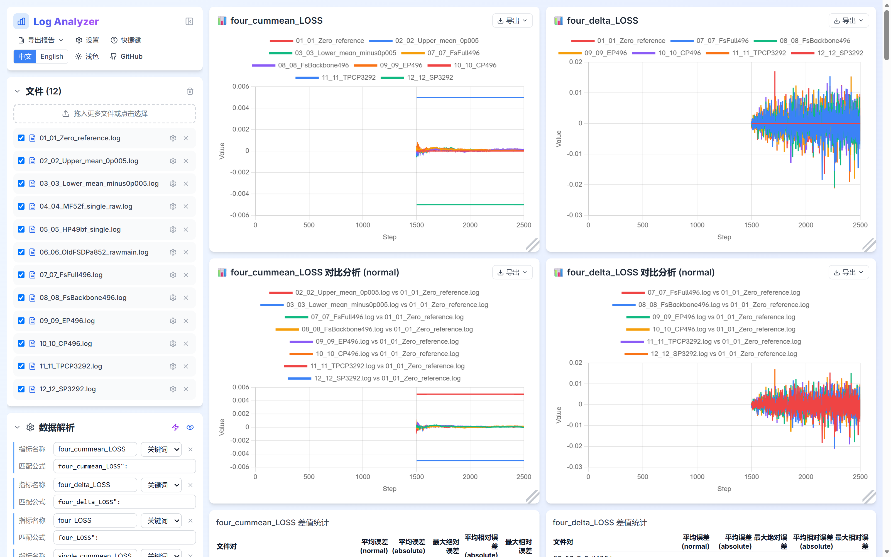

# 完整精度状态与网站载入补充

原[33de完整报告](https://github.com/xingleixu123/hyper-parallel/blob/33de64333f4dd790a9315929973292d375a1034b/reports/pr1477-final-acceptance-20261107/README.md)是冻结快照。本补充只公开最终本地审计的显式投影和随后独立Edge载入状态，不改变七个完整1000步的数值／状态验收，也不改变PR的Draft或外部CI状态。没有重新训练、读回checkpoint内容、计算数值或重画图。

[精度与状态投影](precision-state-audit.json)覆盖单卡及六组四卡1501–2500：单卡实际2000样本，四卡各4000样本；全部65模型张量／91优化器槽及643原生optimizer选项均有独立CPU闭合。两FSDP原wrapper尾barrier失败和TPCP原parent AUX bitexact采集失败保持false，分别绑定原有专属有界完成审计，不改写为clean0。LOSS只取主LM分支，MTP取raw分支；仅完整1000步的abs(mean delta)≤0.005为两项数值门，AUX只观察。

保留范围明确区分：**六份四卡新2500为0400只读封印；单卡新2500保持原0600／0644权限**，当前四文件stat与原CPU／闭合身份连续、观察到FD0。本次没有对单卡重新计算内容SHA，也没有修改权限，不将全部七份写成0400。

[网站载入摘要](website-live-prepared-summary.json)记录既有helper以`--view`实际在线解析12文件、18指标、88000点，与原headless的输入SHA、序列和匹配规则一致。**独立Edge已载入，当前锁屏待可见核验**：独立桌面观察为Windows锁屏，因此`visible_user_desktop_verified=false`；CLI headed成功不等于用户桌面已解锁可见，没有分享URL。下图只复制现有的公开标量页面截图，不包含锁屏截图，亦不是可见桌面验收证明。

官方参考保留为2026-11-06读取快照：[Megatron-LM45eec611的sequence AUX与运行时统计组](https://github.com/NVIDIA/Megatron-LM/blob/45eec611cc9d1fd89a590c93e034c2f468ec1486/megatron/core/transformer/moe/router.py#L641)要求按实际序列分区重组，不能把独立DP或dispatch域直接当序列统计组；[TorchTitanf782e30的DP-local microbatch目标](https://github.com/pytorch/torchtitan/blob/f782e30c1aaf1965c851abeaa6b73d29d35270b6/torchtitan/models/common/moe/moe.py#L512)及[实际TP输入转换](https://github.com/pytorch/torchtitan/blob/f782e30c1aaf1965c851abeaa6b73d29d35270b6/torchtitan/models/common/moe/moe.py#L859)有其自身布局／分母契约，不能直接替代本轮sequence AUX或搬用系数。固定提交与文件Git blob见[官方来源快照](reference-source-provenance.json)，这里只引用适用条件，不作执行／性能横评；旧注记末段的“尚未真实FSDP”仅描述当日早期探针范围，本轮后续已有独立原生CP／SP倍率及整网1000步闭合，不能作为当前未完成状态。MF62ab有限审查沿用[冻结报告中的独立说明](https://github.com/xingleixu123/hyper-parallel/blob/33de64333f4dd790a9315929973292d375a1034b/reports/pr1477-final-acceptance-20261107/numerical/mf-upstream-semantic-probe.md)，不宣称62ab新的长窗口通过。

本补充不含私有配置、原生tensor逐项hash、权重、数据内容、原生RNG、机器路径或凭据。文件完整性见[manifest](manifest.json)；原33de快照与既有数值freeze保持不变。
