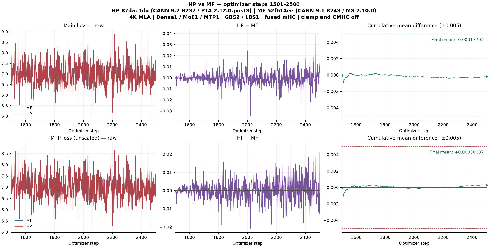

# Xing4 单卡训练精度

MF 从第 1 步连续训练到 2500。HP 在另一张独占的 910B3 从 MF 第 1500 步更新后的完整状态恢复，独立训练 1501–2500。两项指标均通过完整窗口 0.005 的均差绝对值要求。

| 指标 | mean(HP−MF) | abs(mean) | 正 / 负 / 零 | MAE | 最大绝对差（步） |
|---|---:|---:|---:|---:|---:|
| LOSS | -0.00017792 | 0.00017792 | 470 / 529 / 1 | 0.00396514 | 0.03958893（2471） |
| MTPLOSS（未加权） | +0.00030087 | 0.00030087 | 517 / 483 / 0 | 0.00381167 | 0.02425450（2301） |

每个点是一次优化器更新。LOSS 使用主 LM 项，MTPLOSS 使用 MTP 深度 1 的原始损失。左列为 MF/HP 原始曲线，中列为逐步 HP−MF 及零线，右列为从第 1501 步起的累计有符号均值。右列的虚线标示完整窗口的验收界限。全部 1000 点均保留，图中不做平滑。

| 项 | 版本或核验范围 |
|---|---|
| HP | 模型 PR `ce2dbe84`，组合代码 `87dac1da`，PTA 2.12.0.post3，Torch 2.12.0+cpu，CANN 9.2.0 B237，129 卡 7 |
| MF | formal master `52f614ee`，HP-MS r1.0.0 `c69f8f70`，MindSpore 2.10.0，CANN 9.1.0 B243，125 卡 6 |
| 配方 | 4096 MLA，1 Dense + 1 MoE + 1 MTP，GBS2/LBS1，融合 mHC 开，clamp 和 CMHC 关 |
| 恢复 | 65 项模型状态、91 项优化器槽、61 个 FP32 主权重别名、调度器、数据游标和下一批样本 |
| 逐步核验 | 2000 个微批的 8000 项输入指纹逐一匹配。HP 的终态经独立 CPU 读回 |
| 运行归属 | 实际 HP 完整账本 SHA256 `d749619b3ac03d40dfc048a7eaa651bb6ab23399934f9c8e3f7a1318c98d8fc8`。MF 完整账本 SHA256 `74a58b792d59c6a934c6030c12675c6f0dd79b746ecf6c0157817ce37a055c44` |
| 归一化 | 单卡冻结运行沿用 MF 的微批等权口径。主仓 #1453 的整步有效 token 加权在另行标识的四卡运行验证 |

[总 issue #353](https://github.com/hf1s/hyper-parallel/issues/353) · [原 Draft PR #1439](https://github.com/mindspore-ai/hyper-parallel/pull/1439) · [MF 和 HP 实跑配方私有归档](https://github.com/xingleixu123/mindformers-private/blob/97e3e5caa0d5e824226e1b4d328fe11af6c36180/archives/xing4-ce2dbe84-87dac1da-singlecard/README.md)
