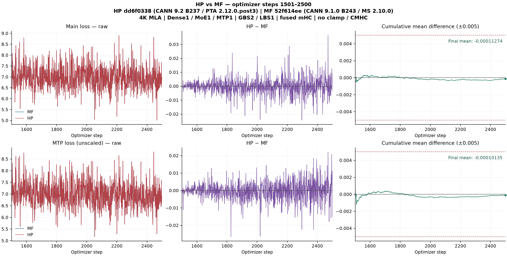

# 本地官方 Xing4 源码版单卡精度

HP 从 MF 第 1500 步 checkpoint 恢复，独立完成 1501–2500 步。完整窗口验收通过，`abs(mean(HP−MF))` 阈值 0.005。

| 指标 | 有符号均差 HP−MF | 正 / 负 / 零 | MAE | 最大绝对差（步） |
|---|---:|---:|---:|---:|
| LOSS | -0.00011274 | 497 / 503 / 0 | 0.00394889 | 0.03655362（2471） |
| MTPLOSS（未加权） | -0.00010135 | 513 / 487 / 0 | 0.00387490 | 0.02656591（1826） |

HP `dd6f033849a693b190c6dea32fb0e8c5514a66c2`，CANN 9.2 B237 / PTA 2.12.0.post3 / Transformers 5.21.0。MF `52f614eeb91c6e873d37bdbb5b880c82926ae9f6`，CANN 9.1.0 B243 / MS 2.10.0。双方 4K MLA，1 Dense + 1 MoE + 1 MTP，GBS2/LBS1，融合 mHC 开、clamp 和 CMHC 关。

