# 网站生成的真实精度曲线

图源为实际 https://log.javazero.top/ 在线渲染和导出；展示窗口1501–2500、无平滑。每份输入的两项指标均1000个点，网站解析器和导出的CSV逐点核对。原始数值、输入日志与统计在上级目录。

single/parallel 为原始 LOSS 与 raw MTPLOSS 叠加；delta 为带零线的有符号差值；cumulative 为累计有符号均值与 ±0.005 参考。±0.005 **仅约束1000步终点均值**，不是单步或每个前缀窗口的硬阈值。单卡方向 HP−MF；并行方向待测−同版本 fdce FSDP replay。主要连续 FSDP 基线验收另见报告统计表。

网站在零基准下的相对误差会显示0，不能据此判断；此处只使用绝对单位的原值及有符号差值。所有统计均在原始数值上计算，图片不承担数值计算。

现有用户Edge页面留有20份历史数据，因此使用独立Edge会话，保留旧页数据。单卡和四卡两个在线窗口已创建并由网站解析器核验、保留打开；最终桌面可见性核验遇到Windows锁屏，未跨越锁屏继续操作。可解锁后查看。网站普通URL不保存这次数据，无可复现的专属分享链接；随包日志、解析规则、逐点来源和导出图片可用于重新导入。

## MF/HP原值

| LOSS | MTPLOSS |
|---|---|
| 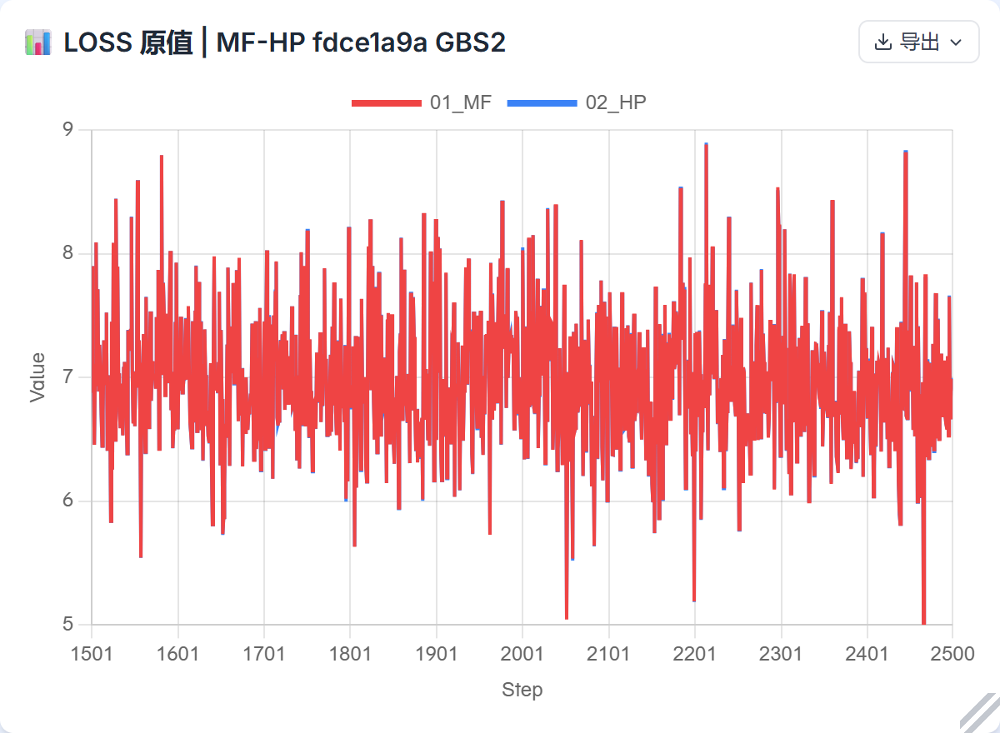 | 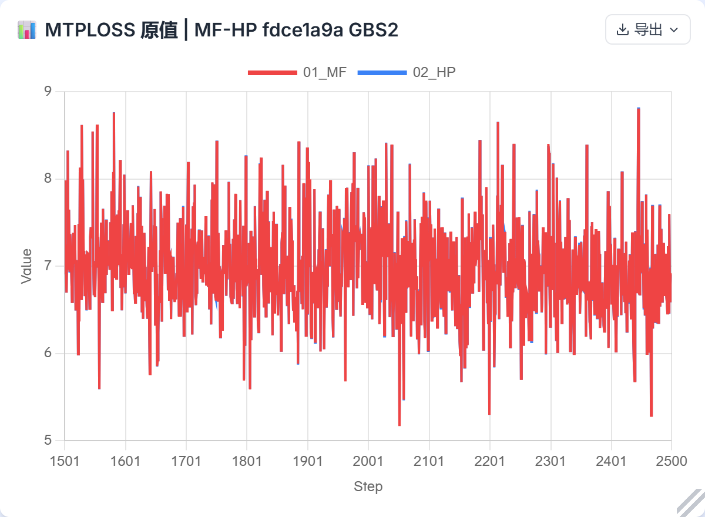 |

[网站解析配置与输入来源](single/analysis.json) · [逐点数值](single/source-points.csv) · [网站完整导出](single/website-report.png)

## HP−MF有符号差值

| LOSS | MTPLOSS |
|---|---|
| 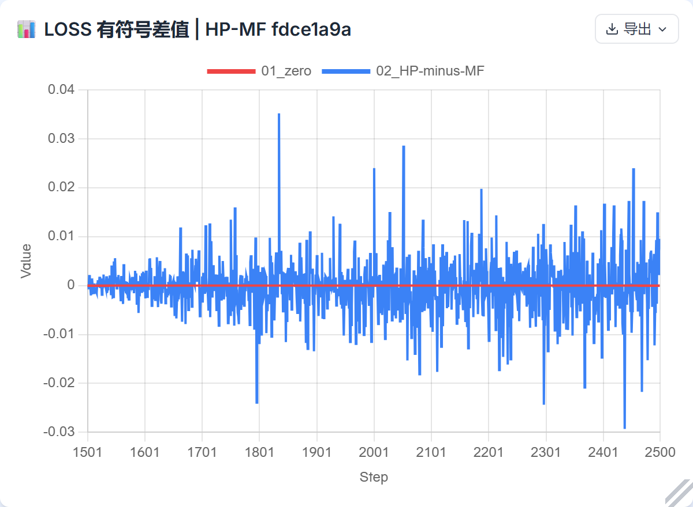 | 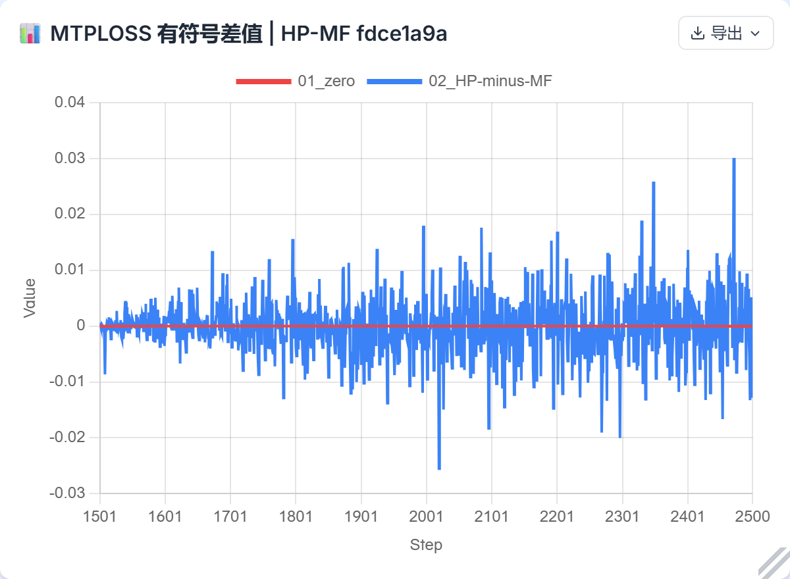 |

[网站解析配置与输入来源](single_delta/analysis.json) · [逐点数值](single_delta/source-points.csv) · [网站完整导出](single_delta/website-report.png)

## HP−MF累计有符号均值

| LOSS | MTPLOSS |
|---|---|
| 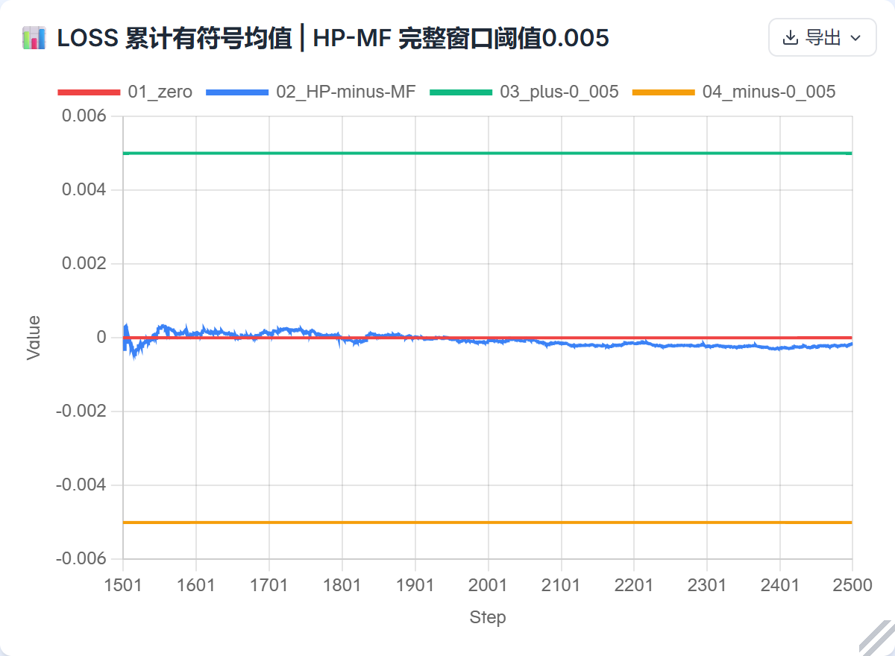 | 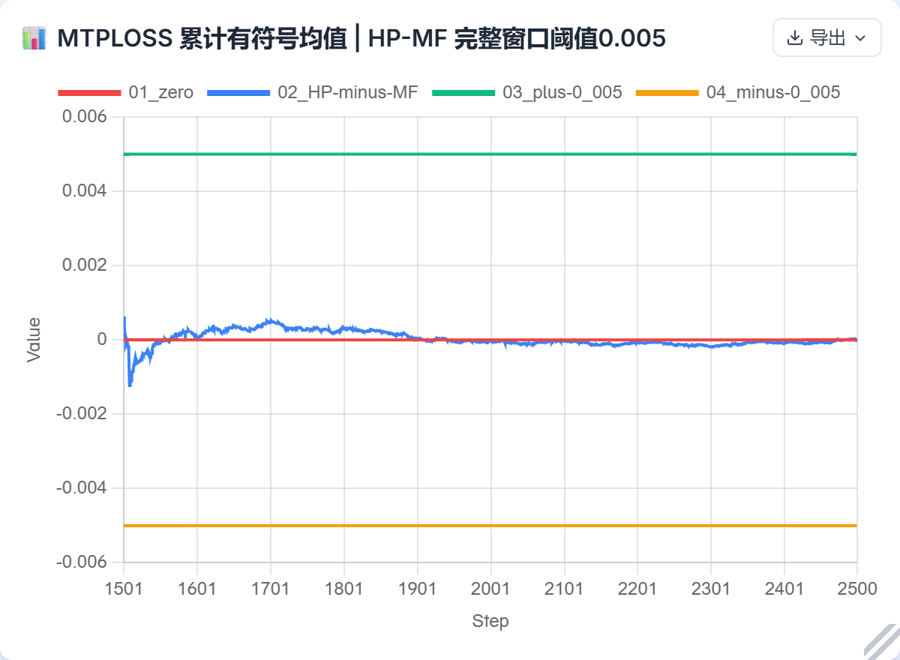 |

[网站解析配置与输入来源](single_cumulative/analysis.json) · [逐点数值](single_cumulative/source-points.csv) · [网站完整导出](single_cumulative/website-report.png)

## 四卡同版本原值

| LOSS | MTPLOSS |
|---|---|
| 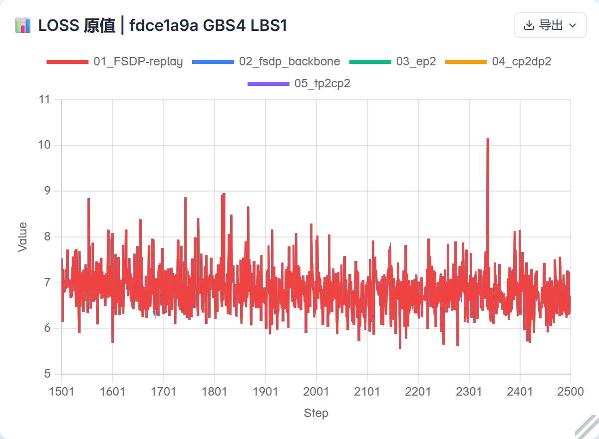 | 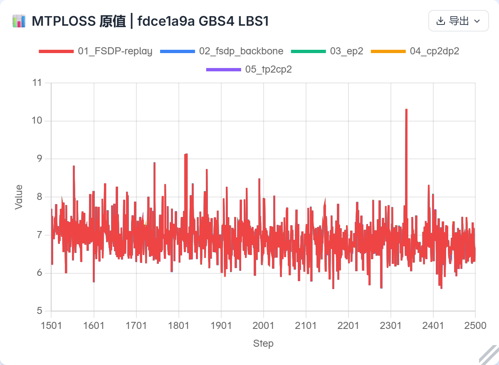 |

[网站解析配置与输入来源](parallel/analysis.json) · [逐点数值](parallel/source-points.csv) · [网站完整导出](parallel/website-report.png)

## 待测−FSDP replay有符号差值

| LOSS | MTPLOSS |
|---|---|
| 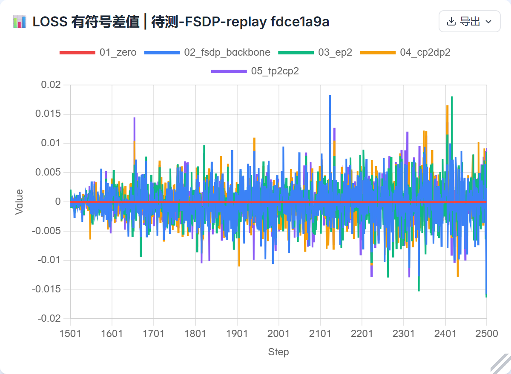 | 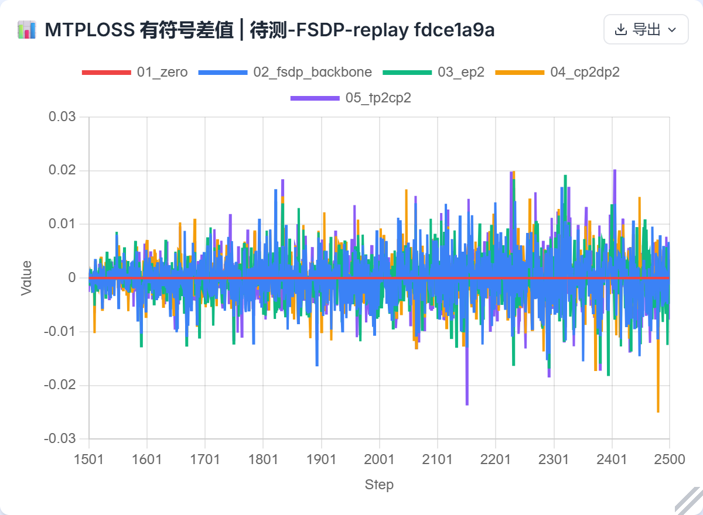 |

[网站解析配置与输入来源](parallel_delta/analysis.json) · [逐点数值](parallel_delta/source-points.csv) · [网站完整导出](parallel_delta/website-report.png)

## 待测−FSDP replay累计有符号均值

| LOSS | MTPLOSS |
|---|---|
| 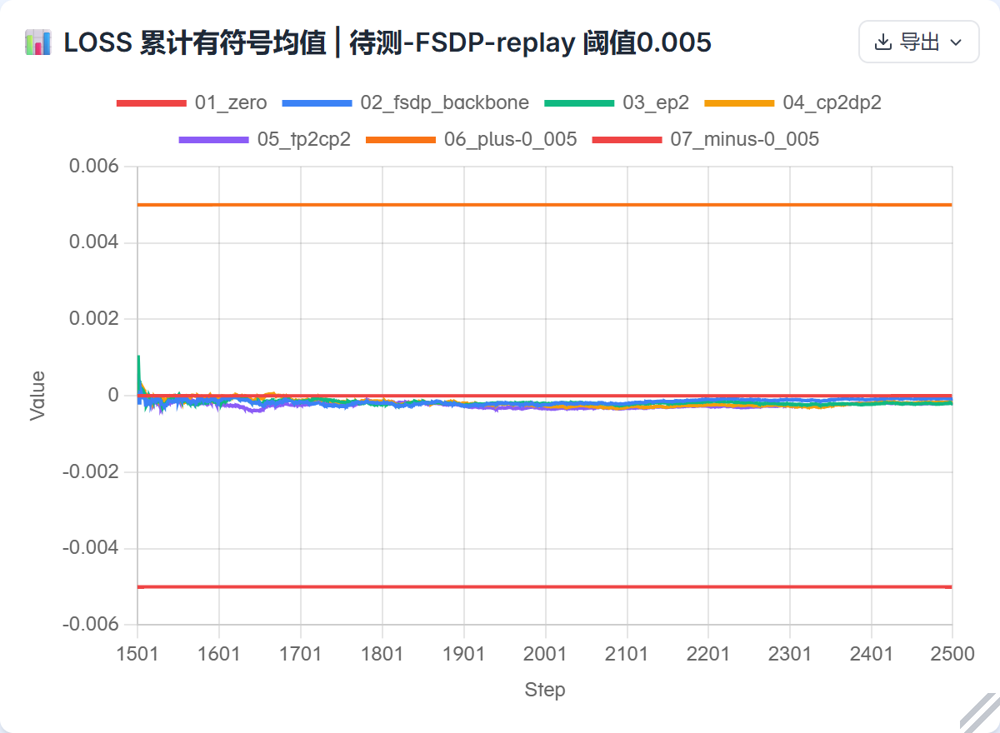 | 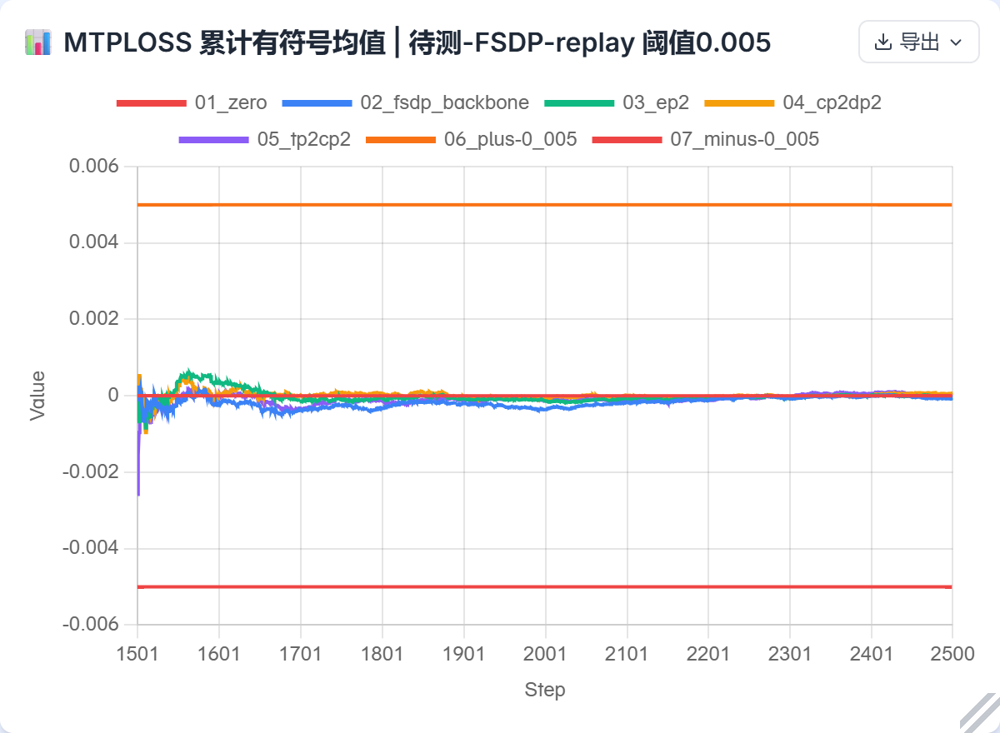 |

[网站解析配置与输入来源](parallel_cumulative/analysis.json) · [逐点数值](parallel_cumulative/source-points.csv) · [网站完整导出](parallel_cumulative/website-report.png)

