<!-- XING4-FOLLOWUP-E4013CFB -->
## 置顶 · 当前需要合入的 PR / issue

**最新模型head e4013cfb，共6提交；原5提交及检视保留。新增初始化问题#1466随#1439修复；公共loader问题#1467由独立Draft PR #1468修复。公共MTP #1386已合入。**

| 优先级 / 条件 | PR / issue | 合入与去重 |
|---|---|---|
| 已合入基础 | [公共 MTP #1386](https://github.com/mindspore-ai/hyper-parallel/pull/1386) / [#1390](https://github.com/mindspore-ai/hyper-parallel/issues/1390) | master 6c8ccfac已合入，生产文件与冻结组合一致，不重复cherry-pick。 |
| 1 · P0 | [SwiGLU导出 #1420](https://github.com/mindspore-ai/hyper-parallel/pull/1420) / [#1326](https://github.com/mindspore-ai/hyper-parallel/issues/1326) | 本轮公共模块导出依赖；不是额外clamp/dtype策略实现。 |
| 2 · P0 | [Trainer辅助梯度 #1441](https://github.com/mindspore-ai/hyper-parallel/pull/1441) / [hf1s#355](https://github.com/hf1s/hyper-parallel/issues/355) | 单卡LM/MTP辅助反向正确性，保留MF微批等权口径。 |
| 3 · P0 | [Xing4 #1439](https://github.com/mindspore-ai/hyper-parallel/pull/1439) / [#1466](https://github.com/mindspore-ai/hyper-parallel/issues/1466)、[#1464](https://github.com/mindspore-ai/hyper-parallel/issues/1464)、[#1456](https://github.com/mindspore-ai/hyper-parallel/issues/1456)、[#1395](https://github.com/mindspore-ai/hyper-parallel/issues/1395)、[#1397](https://github.com/mindspore-ai/hyper-parallel/issues/1397)、[#1459](https://github.com/mindspore-ai/hyper-parallel/issues/1459) | 当前模型、路由精度与契约修复；公共CP已包含#1425，不带旧xing40；QKClip使用框架Muon leaf hook。 |
| 4 · 四卡 | [整步token归一化 #1453](https://github.com/mindspore-ai/hyper-parallel/pull/1453) / [#1418](https://github.com/mindspore-ai/hyper-parallel/issues/1418) | 与#1441整合时去重；四卡按已验证整步token口径，单卡继续保留MF微批等权语义。 |
| P1 · HF部分加载 | [公共初始化 #1468](https://github.com/mindspore-ai/hyper-parallel/pull/1468) / [#1467](https://github.com/mindspore-ai/hyper-parallel/issues/1467) | 初始化被忽略的实际缺失项；独立公共修复。完整MF/DCP续训当前不依赖这个新入口，不等于官方HF冷启动全支持。 |
| 条件 | [SwiGLU策略 hf1s#356](https://github.com/hf1s/hyper-parallel/pull/356) / [hf1s#354](https://github.com/hf1s/hyper-parallel/issues/354) | 非空clamp/compute dtype时需要完整functional+GroupedExperts能力。本轮配方两项为空。 |
| 条件 | [专家反向映射 #1442](https://github.com/mindspore-ai/hyper-parallel/pull/1442) | 单例维度反向导出；普通尺寸不自动要求。 |
| 条件 | [MLA mask #1461](https://github.com/mindspore-ai/hyper-parallel/pull/1461) / [#1460](https://github.com/mindspore-ai/hyper-parallel/issues/1460) | 公共二维pairwise mask修复；当前Xing4不接收外部mask，不列为本轮训练前置。 |
| 不再单独合入 | [#1425](https://github.com/mindspore-ai/hyper-parallel/pull/1425)、[#1455](https://github.com/mindspore-ai/hyper-parallel/pull/1455) | #1425已由#1439带入并关闭；#1455仍是独立chain提案，当前Xing4不依赖。 |

## 置顶 · 最新检视、验证与配置归档

[**1105更新检视的完整报告**](https://github.com/xingleixu123/hyper-parallel/blob/7d12f0f85a1d90ce6faf2781480eaaceb6e7fd1c/reports/xing4-readme-followup-20261105/README.md) · [**MF/HP YAML私有归档**](https://github.com/xingleixu123/mindformers-private/blob/97e3e5caa0d5e824226e1b4d328fe11af6c36180/archives/xing4-ce2dbe84-87dac1da-singlecard/README.md)

本轮修复部分加载时已载router/mHC状态被覆盖，并将HF缺失项初始化从告警过滤中分离。持久计数不改nonpersistent；既有#356继续复用，不重复提激活PR。模型CPU24项/14子测试、受控NPU22项；公共loader16项/18子测试、真实HP DTensor/tied边界和真实NPU before/after通过。5文件lint前后24条、新增0，但不是lint全绿。门禁按当前head另查。

**本轮未重跑完整训练，不将旧曲线改标为新head。** 当前模型初始化使用相同seed与旧版逐项一致；已提供的完整状态保持。最近7f4a版训练回归：HP−MF1501–1505的abs(mean)为LOSS 0.000511884689331、MTPLOSS 0.000293707847595；四布局6–105共100步见下方历史报告。旧571d完整1000步保留原身份，四卡1500→2500仍未完成。

公共修复基于master c108cf94；本轮NPU为固定组合+4文件，非裸最新master训练。原始日志中旧控制器展示SHA字段的限制、实际source/worker/test hash及物理卡5核验已在报告披露。#304不修改，YAML不公开。

此前版本的报告与依赖记录（保留原文）

<!-- XING4-README-REVIEW-7F4A3FD7 -->
## 置顶 · 需要合入的 PR / issue（按优先级）

**公共MTP #1386已合入。单卡依次提供#1420、#1441，再合入#1439。当前#1439追加7f4a3fd7，共5提交，旧4提交和检视记录保留。**

| 优先级 / 条件 | PR / issue | 合入与去重 |
|---|---|---|
| 已合入基础 | [公共 MTP #1386](https://github.com/mindspore-ai/hyper-parallel/pull/1386) / [#1390](https://github.com/mindspore-ai/hyper-parallel/issues/1390) | master 6c8ccfac已合入，生产文件与冻结组合一致，不重复cherry-pick。 |
| 1 · P0 | [SwiGLU导出 #1420](https://github.com/mindspore-ai/hyper-parallel/pull/1420) / [#1326](https://github.com/mindspore-ai/hyper-parallel/issues/1326) | 本轮公共模块导出依赖；不是额外clamp/dtype策略实现。 |
| 2 · P0 | [Trainer辅助梯度 #1441](https://github.com/mindspore-ai/hyper-parallel/pull/1441) / [hf1s#355](https://github.com/hf1s/hyper-parallel/issues/355) | 单卡LM/MTP辅助反向正确性，保留MF微批等权口径。 |
| 3 · P0 | [Xing4 #1439](https://github.com/mindspore-ai/hyper-parallel/pull/1439) / [#1464](https://github.com/mindspore-ai/hyper-parallel/issues/1464)、[#1456](https://github.com/mindspore-ai/hyper-parallel/issues/1456)、[#1395](https://github.com/mindspore-ai/hyper-parallel/issues/1395)、[#1397](https://github.com/mindspore-ai/hyper-parallel/issues/1397)、[#1459](https://github.com/mindspore-ai/hyper-parallel/issues/1459) | 当前模型、路由精度与契约修复；公共CP已包含#1425，不带旧xing40；QKClip使用框架Muon leaf hook。 |
| 4 · 四卡 | [整步token归一化 #1453](https://github.com/mindspore-ai/hyper-parallel/pull/1453) / [#1418](https://github.com/mindspore-ai/hyper-parallel/issues/1418) | 覆盖#1441，整合时去重；当前不提供单卡等权切换，不能直接改变MF对照口径。 |
| 条件 | [SwiGLU策略 hf1s#356](https://github.com/hf1s/hyper-parallel/pull/356) / [hf1s#354](https://github.com/hf1s/hyper-parallel/issues/354) | 非空clamp/compute dtype时需要完整functional+GroupedExperts能力。本轮配方两项为空。 |
| 条件 | [专家反向映射 #1442](https://github.com/mindspore-ai/hyper-parallel/pull/1442) | 单例维度反向导出；普通尺寸不自动要求。 |
| 条件 | [MLA mask #1461](https://github.com/mindspore-ai/hyper-parallel/pull/1461) / [#1460](https://github.com/mindspore-ai/hyper-parallel/issues/1460) | 公共二维pairwise mask修复；当前Xing4不接收外部mask，不列为本轮训练前置。 |
| 不再单独合入 | [#1425](https://github.com/mindspore-ai/hyper-parallel/pull/1425)、[#1455](https://github.com/mindspore-ai/hyper-parallel/pull/1455) | #1425已由#1439带入并关闭；#1455仍是独立chain提案，当前Xing4不依赖。 |

## 置顶 · 最新增量精度报告与私有YAML

[**本次完整报告、逐项检视、原值与复现**](https://github.com/xingleixu123/hyper-parallel/blob/c7f67b63abcdd3a9b0c00bf2f3876aa634cce73a/reports/xing4-readme-review-20261105/README.md) · [**MF / HP YAML私有归档**](https://github.com/xingleixu123/mindformers-private/blob/97e3e5caa0d5e824226e1b4d328fe11af6c36180/archives/xing4-ce2dbe84-87dac1da-singlecard/README.md)

| 对照 | 窗口 | abs(mean LOSS差) | abs(mean MTPLOSS差) |
|---|---|---:|---:|
| HP−MF | 1501–1505 | 0.000511884689331 | 0.000293707847595 |
| EP2−FSDP | 6–105 | 1.08641043189e-05 | 2.0559696966e-05 |
| CP2×DP2−FSDP | 6–105 | 5.70883669137e-05 | 5.37919951143e-05 |
| TP2×CP2−FSDP | 6–105 | 7.31548303816e-05 | 3.0973489035e-05 |

本次是单卡5步及四布局各100步增量回归，两指标自然有正有负，完整MAE/maxabs等见报告；**不是新的1000步验收**。MF1500完整恢复与实际样本、四卡step5重分片及全局DCP均核验。配置和LR日程不变，clamp/CMHC关。

本轮修复路由整数计数、FP32偏置buffer及配置/替换契约；官方HF三文件未改。透明forward由真实构建反例证明必须保留。20项NPU专项通过，BF16四逻辑rank功能结果保留物理隔离限制。无新增lint诊断，但既有21项不能称全绿。性能/逐卡显存见报告，TP×CP rank0 reserved增加186MiB，未作因果归因。

最新master7b1ea07e的MTP/图模式/日志变化已审查，实际运行时以1514文件manifest为准。#1425已包含于#1439，#1455不再是当前依赖；#304不动。

此前版本报告与历史证据（保留原文）

<!-- XING4-CP-INTEGRATION-1CAF044A -->
## 置顶 · 需要合入的 PR、问题单与顺序

**单卡先提供 #1386、#1420、#1441，再合入 #1439。#1425 的公共 CP 能力现已包含于 #1439，不再单独合入；#1455 已从 Xing4 必需依赖移除。** 原三个提交保留，#1439 只追加 [1caf044a](https://github.com/mindspore-ai/hyper-parallel/commit/1caf044aa35f4e69ade9938039f587281f14a3be)，共4 commits；仍为 Draft。

| 顺序 / 优先级 | 范围 | PR · head / 状态 | 关联 issue | 合入与去重要求 |
|---|---|---|---|---|
| 1A · P0 | 单卡公共 MTP | [#1386](https://github.com/mindspore-ai/hyper-parallel/pull/1386) 4ae71e39 · Open | [#1390](https://github.com/mindspore-ai/hyper-parallel/issues/1390) | 提供 MTPLayer/build_mtp；模型直接复用。 |
| 1B · P0 | 单卡 SwiGLU 导出 | [#1420](https://github.com/mindspore-ai/hyper-parallel/pull/1420) bab14d2c · Open | [#1326](https://github.com/mindspore-ai/hyper-parallel/issues/1326) | 消除同名模块遮蔽；不包含额外 clipped/dtype API。可与1A/1C并行评审。 |
| 1C · P0 | 单卡 LM/MTP 辅助梯度 | [#1441](https://github.com/mindspore-ai/hyper-parallel/pull/1441) b4d464e9 · Draft | [hf1s#355](https://github.com/hf1s/hyper-parallel/issues/355) | GBS2/LBS1的外部倍率传给两类辅助反向分支，保留MF微批等权口径。 |
| 2 · P0 | 官方 Xing4、公共CP回调、QKClip | [#1439](https://github.com/mindspore-ai/hyper-parallel/pull/1439) 1caf044a · Draft | [#1456](https://github.com/mindspore-ai/hyper-parallel/issues/1456)、[#1395](https://github.com/mindspore-ai/hyper-parallel/issues/1395)、[#1397](https://github.com/mindspore-ai/hyper-parallel/issues/1397)、[#1459](https://github.com/mindspore-ai/hyper-parallel/issues/1459)、[hf1s#359](https://github.com/hf1s/hyper-parallel/issues/359)、[hf1s#360](https://github.com/hf1s/hyper-parallel/issues/360) | 依赖1A及单卡配方1B/1C。包含#1425公共部分，现有Xing4承接模型差异；不复制旧xing40。QKClip改用Muon原生hook，校验归属并拒绝已有hook的swap组合。 |
| 3 · P1 | 四卡不同GA的归一化 | [#1453](https://github.com/mindspore-ai/hyper-parallel/pull/1453) ac4aea64 · Open | [#1418](https://github.com/mindspore-ai/hyper-parallel/issues/1418)、[hf1s#355](https://github.com/hf1s/hyper-parallel/issues/355) | 四卡按整步有效token归一化；已覆盖#1441，不能重复应用。最新head仅测试变化，生产文件与冻结四卡组合相同。 |
| 条件 · P1 | 公共 MLA CP 显式二维pairwise mask | [#1461](https://github.com/mindspore-ai/hyper-parallel/pull/1461) 26bf902e · Draft | [#1460](https://github.com/mindspore-ai/hyper-parallel/issues/1460) | 独立三行修复[ S,S ]到[1,1,S,S]语义；旧/新NPU因果对照通过。当前Xing4入口不接受外部mask，因此不列为本轮训练必需前置。 |
| 不再单独合入 | 旧 CP 整合 | [#1425](https://github.com/mindspore-ai/hyper-parallel/pull/1425) 2fde9655 · 被#1439替代 | [#1397](https://github.com/mindspore-ai/hyper-parallel/issues/1397) | 公共callback已带入；不再叠加旧#1413模型适配，保留原PR记录。 |
| 非当前依赖 | 通用chain hook提案 | [#1455](https://github.com/mindspore-ai/hyper-parallel/pull/1455) 455edbda · Draft | [#1454](https://github.com/mindspore-ai/hyper-parallel/issues/1454) | Xing4现在调用Muon leaf原生接口，此项不再阻塞。保持原PR状态，不混入#1439。 |

公共swap完整hook支持继续由#1459跟踪；#1439只提供构造期已有hook保护，不宣称late/global hook或HSDP支持。单卡使用MF微批等权，四卡使用#1453整步token口径；#1453当前没有单卡等权切换项，不能直接改变单卡基线。

## 置顶 · 本轮单卡与并行精度回归

[**逐步数据、全部统计、性能显存、源码身份和复现入口**](https://github.com/xingleixu123/hyper-parallel/blob/470a3a56385b366a63b26b4fcb353a81f764bafc/reports/xing4-cp-integration-20261105/README.md) · [**MF / HP YAML 私有归档**](https://github.com/xingleixu123/mindformers-private/blob/97e3e5caa0d5e824226e1b4d328fe11af6c36180/archives/xing4-ce2dbe84-87dac1da-singlecard/README.md)

本轮增量6个逻辑文件，+122/−60；HF三份官方Python文件和此前检视修复保留。CPU既有用例、NPU模块和真实训练回归分别归档。最新master c75f5f9相对原base仅CODEOWNERS变化。原26条inline、18份review、7条讨论及15个线程的旧内容/状态已在推送后逐项核验保留，不删除或自动resolve。

| 本轮对照 | 窗口 | abs(mean LOSS差) | abs(mean MTPLOSS差) | 结果范围 |
|---|---|---:|---:|---|
| MF1500 → HP，HP−MF | 1501–1505 | 0.000512695313 | 0.0000241160393 | 5步恢复/集成回归 |
| EP2−同版FSDP4 | 6–105 | 0.0000577339908 | 0.0000823393603 | 100步并行回归 |
| CP2×DP2−同版FSDP4 | 6–105 | 0.0000570461457 | 0.0000843603728 | 100步并行回归 |
| TP2×CP2−同版FSDP4 | 6–105 | 0.0000198904280 | 0.0000186270310 | 100步并行回归 |

差值保留正负，以上对照均出现正负波动；报告附正/负/零步数、MAE及maxabs。LOSS为主LM，MTPLOSS为未乘0.1的原始MTP。0.005约束完整窗口的abs(mean)，不限制单步。**本次5/100步不是新版本完整1000步验收**；[此前571d单卡完整1000步报告](https://github.com/xingleixu123/hyper-parallel/blob/dd24a3d85b620af36ae60d6ea036e76bd444f7c4/reports/xing4-reuse-precision-20261105/README.md)保持原版本归属。四卡1500→2500长程仍未完成。

单卡真实MF完整checkpoint恢复覆盖65模型项、91优化器槽、61主权重别名、scheduler1500及sampler3000；40项实际样本字段与MF及旧HP相同。四卡从同一FSDP step5状态恢复，核验每配置400个全局样本、CP4096覆盖、TP副本和逐rank指标；完整恢复证据见报告。

配置继续为4096 MLA、1 Dense+1 MoE+1 MTP、融合mHC、clamp/CMHC关。单卡GBS2/LBS1；四卡GBS4/LBS1，GA1/1/2/4。FSDP重计算主干及MTP，其他布局重计算主干。短跑不压缩horizon7500/warmup1500。MF formal52f614ee / HP-MS r1 c69f8f70 / MS2.10 / CANN9.1 B243；HP Python3.12.14 / Torch2.12+cpu / PTA2.12.post3 / CANN9.2 B237 / 910B3。

隔离串行性能回归：各5步预热+15步统计，逐步同步并取最慢rank。FSDP旧/新0.832080/0.832285秒（+0.025%），CP2×DP2旧/新1.231914/1.227035秒（−0.396%）；最大reserved分别20.779/21.789GiB且旧新一致，逐卡峰值和波动见报告。旧控制为冻结d780，时间包含样本验证开销；仅证明此短窗口未见明显回归，不宣称稳定提速或纯模型benchmark。

按实际触发条件追加的依赖

| 条件 | PR / issue | 边界 |
|---|---|---|
| 多rank Muon checkpoint非owner状态清理 | [#1431](https://github.com/mindspore-ai/hyper-parallel/pull/1431) / [#1430](https://github.com/mindspore-ai/hyper-parallel/issues/1430) | 单卡无非owner rank，四卡持久化按实际状态生命周期核验。 |
| 显式SwiGLU截断/激活dtype | [hf1s#356](https://github.com/hf1s/hyper-parallel/pull/356) / [hf1s#354](https://github.com/hf1s/hyper-parallel/issues/354) | 当前两项为空；启用需functional与GroupedExperts成套能力。 |
| 专家反向导出单例轴 | [#1442](https://github.com/mindspore-ai/hyper-parallel/pull/1442) / [hf1s#357](https://github.com/hf1s/hyper-parallel/issues/357) | 普通形状不触发。 |
| SAC匹配PTA原生overload | [#1358](https://github.com/mindspore-ai/hyper-parallel/pull/1358) / [#1357](https://github.com/mindspore-ai/hyper-parallel/issues/1357) | 当前分层重计算不自动要求SAC补丁。 |
| GMM传Python整数list/tuple | [#1362](https://github.com/mindspore-ai/hyper-parallel/pull/1362) / [#1361](https://github.com/mindspore-ai/hyper-parallel/issues/1361) | 按实际group_list类型决定。 |

#1171已在master；#1413/#1435属于其他模型路线，不重复叠加。本地完整词表CE与TP loss parallel不以#1402/#1423/#1426为前置。CI按实际head另行检查，不把本地NPU通过等同于外部门禁已绿。

当前提交门禁：已核实 label-check 的失败来自推送后等待新流水线通过标签；不等同于代码测试失败。#1439 的 license/cla 与 reviewer approval 在请求前为 pending，作者/committer 邮箱均正确。已为当前 head/body 请求 [check-pr](https://github.com/mindspore-ai/hyper-parallel/pull/1439#issuecomment-6650833066) 和 [check-cla](https://github.com/mindspore-ai/hyper-parallel/pull/1439#issuecomment-6650833529)，#1461 也已请求 check-pr；外部流水线最终结果尚未回写，不能宣称门禁已绿。

历史版本的置顶表格、图表和完整验收记录（按各自提交归属）

<!-- XING4-REVIEW-F96DD5B0 -->
## 置顶 · 需要合入的 PR 与顺序

**单卡先合入公共前置 #1386、#1420、#1441、#1455，再合入模型 #1439。** 前置之间可并行评审；#1425、#1453 属于后续四卡阶段。下表同时列出关联问题单和去重要求。

| 顺序 | 范围 | 待合入 PR · 当前 head / 状态 | 关联 issue | 依赖与合入动作 |
|---|---|---|---|---|
| 1A · P0 | 单卡 · 公共 MTP | [#1386](https://github.com/mindspore-ai/hyper-parallel/pull/1386) 4ae71e39 · Open | [#1390](https://github.com/mindspore-ai/hyper-parallel/issues/1390) | 先提供 `MTPLayer/build_mtp`，供 #1439 直接导入。当前 PR 的 MTP 模块与单卡长跑版本逐字节一致。 |
| 1B · P0 | 单卡 · 公共 SwiGLU | [#1420](https://github.com/mindspore-ai/hyper-parallel/pull/1420) bab14d2c · Open | [#1326](https://github.com/mindspore-ai/hyper-parallel/issues/1326) | 消除公共函数被同名模块遮蔽的导入顺序问题。冻结配方使用公共SwiGLU替换；整体模型仍需1A，#1420仅改名不提供clipped/dtype扩展。 |
| 1C · P0 | 单卡 · LM/MTP 辅助梯度 | [#1441](https://github.com/mindspore-ai/hyper-parallel/pull/1441) b4d464e9 · Draft | [hf1s#355](https://github.com/hf1s/hyper-parallel/issues/355) | GBS2/LBS1 时，两个微批的外部倍率都要传给 LM 和 MTP 的辅助反向分支。保留 MF 的微批等权口径，与 1A、1B 可并行。 |
| 1D · P0 | 单卡 · QKClip公共更新钩子 | [#1455](https://github.com/mindspore-ai/hyper-parallel/pull/1455) 455edbda · Draft | [#1454](https://github.com/mindspore-ai/hyper-parallel/issues/1454) | ChainedOptimizer补标准post-step hook；Xing不再改写step。启用QKClip时必须先合入，公共文件未混入#1439。最终NPU主权重/closure/异常回归通过。 |
| 2 · P0 | 单卡 · 官方 Xing4 接入 | [#1439](https://github.com/mindspore-ai/hyper-parallel/pull/1439) f96dd5b0 · Draft | [#1456](https://github.com/mindspore-ai/hyper-parallel/issues/1456) · [#1395](https://github.com/mindspore-ai/hyper-parallel/issues/1395) · [hf1s#359](https://github.com/hf1s/hyper-parallel/issues/359) · [hf1s#360](https://github.com/hf1s/hyper-parallel/issues/360) | 1A是模型导入前置，1B/1C用于配方，1D用于QKClip。修复专家自定义forward/异构策略被静默打包的问题；EP透传公共benchmark fix_router，默认关闭。此 PR 承接 mHC 残差矩阵方向、MTP 的 FSDP 包裹和 Muon 逻辑分块。 |
| 3A · P1 | 四卡 · CP / TP×CP | [#1425](https://github.com/mindspore-ai/hyper-parallel/pull/1425) 2fde9655 · Draft | [#1397](https://github.com/mindspore-ai/hyper-parallel/issues/1397) | 在启用 CP 前集成通用 MLA 的 `rotary_fn`、`attention_interface` 回调。当前 PR 另带依赖 #1413 的旧 `xing40` 适配，官方 `xing_4` 路线应拆出或单独合入公共部分。#1401 的提交已在 #1425 内。 |
| 3B · P1 | 四卡 · 不同梯度累积次数 | [#1453](https://github.com/mindspore-ai/hyper-parallel/pull/1453) eead893c · Open | [#1418](https://github.com/mindspore-ai/hyper-parallel/issues/1418) · [hf1s#355](https://github.com/hf1s/hyper-parallel/issues/355) | FSDP4、CP2×DP2、TP2×CP2 按整步有效 token 归一化，可与 3A 并行。第二个提交已覆盖 1C 的辅助梯度修复，整合时只保留一份。 |

单卡组合 `571d9cb9` 保留 MF 微批等权口径，四卡组合 `d7802906` 使用 #1453 整步有效 token 归一化并与同版纯 FSDP 比较。#1453 当前没有切回单卡等权的配置项，后续合并组合需复核所选口径。CP 使用 #1425 的公共 rotary/attention 回调，不能只叠加 #1439 后跳过该依赖。

## 最新检视整改与单卡精度报告

更新于 2026-11-05 08:56（北京时间）。[PR #1439](https://github.com/mindspore-ai/hyper-parallel/pull/1439) 为 Draft，当前 [f96dd5b0](https://github.com/mindspore-ai/hyper-parallel/commit/f96dd5b091f75ba4ec827f73e079b3b21e9174db)，前两个47cd46ca/e792b6c1不变，仍为**3 commits**。0854496d本地MD的1088行已全文逐项复核；原20条行内意见、14份review、5条讨论及10个检视线程保留，不自动解决线程。[完整复核与本轮原始数据](https://github.com/xingleixu123/hyper-parallel/blob/38e15663f80add490bcd322b5788ba9bae24a8a3/reports/xing4-review-0854496d-20261105/README.md)。

[本轮完整逐步原值、均值及差值 CSV](https://github.com/xingleixu123/hyper-parallel/blob/dd24a3d85b620af36ae60d6ea036e76bd444f7c4/reports/xing4-reuse-precision-20261105/README.md) · [MF 和 HP 实跑 YAML 私有归档](https://github.com/xingleixu123/mindformers-private/blob/97e3e5caa0d5e824226e1b4d328fe11af6c36180/archives/xing4-ce2dbe84-87dac1da-singlecard/README.md)

MF/HP YAML 的 SHA256 仍分别为 ac4ab375…、22d933b6…，与本轮启动配置一致。当前两侧为 4096 MLA、1 Dense + 1 MoE + 1 MTP、GBS2/LBS1，融合 mHC 开、clamp/CMHC 关。既有571d单卡1000步、d780四卡100步保留原版本归属；本次最终源从MF1500独立恢复1501–1505，65模型/91槽/61主权重别名和40项实际样本字段核验通过。未重跑MF、未压缩学习率日程。五步仅为集成回归，原四卡1500→2500长程仍待完成。

按使用条件决定的 PR、关联 issue 及已合入项

| 触发条件 | PR · 当前 head / 状态 | 关联 issue | 本轮处理 |
|---|---|---|---|
| 显式指定 SwiGLU 截断或激活计算 dtype | [hf1s#356](https://github.com/hf1s/hyper-parallel/pull/356) `ccbd40db` · Draft | [hf1s#354](https://github.com/hf1s/hyper-parallel/issues/354) | 本轮两项均为空。启用时必须成套集成functional与GroupedExperts消费；#1420只改名不足以提供该能力。 |
| 专家反向导出遇到单例轴 | [#1442](https://github.com/mindspore-ai/hyper-parallel/pull/1442) `5fef2cf8` · Draft | [hf1s#357](https://github.com/hf1s/hyper-parallel/issues/357) | 保留隐藏维度或专家中间维度为 1 的轴。本轮普通形状可走标准转换。 |
| 多 rank 原生 Muon checkpoint 保存或恢复后的非 owner 状态清理 | [#1431](https://github.com/mindspore-ai/hyper-parallel/pull/1431) `e5978afd` · Draft | [#1430](https://github.com/mindspore-ai/hyper-parallel/issues/1430) | 影响持久化后的状态生命周期。单卡没有非 owner rank。 |
| 选择性重计算按 PTA 原生 Attention/GMM overload 匹配 | [#1358](https://github.com/mindspore-ai/hyper-parallel/pull/1358) `8104a78a` · Draft | [#1357](https://github.com/mindspore-ai/hyper-parallel/issues/1357) | 采用该 SAC 策略时核验，普通分层重计算不自动引入此项。 |
| grouped matmul 传入 Python 整数 list/tuple | [#1362](https://github.com/mindspore-ai/hyper-parallel/pull/1362) `6066caa7` · Draft | [#1361](https://github.com/mindspore-ai/hyper-parallel/issues/1361) | 使用 GMM 并不能证明触发该分支，按实际 group_list 类型决定。 |

混精策略 [#1171](https://github.com/mindspore-ai/hyper-parallel/pull/1171) 已进入上述 master。[#1413](https://github.com/mindspore-ai/hyper-parallel/pull/1413)、[#1435](https://github.com/mindspore-ai/hyper-parallel/pull/1435) 属于其他模型接入路线，当前选择 [#1439](https://github.com/mindspore-ai/hyper-parallel/pull/1439)。当前本地词表 chunk CE 与 TP loss parallel 均不要求叠加 [#1402](https://github.com/mindspore-ai/hyper-parallel/pull/1402)、[#1423](https://github.com/mindspore-ai/hyper-parallel/pull/1423) 或 [#1426](https://github.com/mindspore-ai/hyper-parallel/pull/1426)。

### 已有冻结版本的完整窗口结果

下表单卡对应571d9cb9、四卡对应d7802906，不将本次f96dd5b五步结果替代完整窗口。单卡1501–2500共1000步，差值为HP−MF。四卡从原生 FSDP 第 5 步状态恢复，6–105 共 100 步，差值为待测−同版 FSDP4。新 FSDP 控制组另与既有 #1453 控制组比较。0.005 约束完整窗口的均差绝对值。LOSS 为主 LM 项，MTPLOSS 为未乘 0.1 的原始 MTP 项。正负号全程保留。

| 对照与窗口 | 指标 | mean(待测−基准) | abs(mean) | 正 / 负 / 零 | MAE | 最大绝对差（步） |
|---|---|---:|---:|---:|---:|---:|
| 单卡 HP−MF，1501–2500 | LOSS | +0.00002269 | 0.00002269 | 493 / 507 / 0 | 0.00405751 | 0.06450033（2471） |
| 单卡 HP−MF，1501–2500 | MTPLOSS | -0.00008995 | 0.00008995 | 508 / 492 / 0 | 0.00396902 | 0.02799159（2375） |
| 新 FSDP4−既有 #1453 控制，6–105 | LOSS | +0.00004290 | 0.00004290 | 49 / 50 / 1 | 0.00033039 | 0.00113988（94） |
| 新 FSDP4−既有 #1453 控制，6–105 | MTPLOSS | +0.00003531 | 0.00003531 | 56 / 43 / 1 | 0.00042675 | 0.00178641（17） |
| EP2−本轮 FSDP4，6–105 | LOSS | -0.00010937 | 0.00010937 | 41 / 59 / 0 | 0.00033103 | 0.00101852（28） |
| EP2−本轮 FSDP4，6–105 | MTPLOSS | -0.00002048 | 0.00002048 | 48 / 51 / 1 | 0.00039465 | 0.00146434（8） |
| CP2×DP2−本轮 FSDP4，6–105 | LOSS | -0.00009696 | 0.00009696 | 40 / 60 / 0 | 0.00032135 | 0.00102796（52） |
| CP2×DP2−本轮 FSDP4，6–105 | MTPLOSS | -0.00003399 | 0.00003399 | 49 / 51 / 0 | 0.00043780 | 0.00135796（79） |
| TP2×CP2−本轮 FSDP4，6–105 | LOSS | -0.00001294 | 0.00001294 | 47 / 53 / 0 | 0.00032381 | 0.00097454（21） |
| TP2×CP2−本轮 FSDP4，6–105 | MTPLOSS | +0.00000047 | 0.00000047 | 50 / 50 / 0 | 0.00045106 | 0.00124206（40） |

每步原值、差值和累计有符号均值保留在上方 CSV。四卡四个 rank 的记录指标逐步一致且分别核验。旧图和旧版本统计归入下方历史区，来源提交各自标明。

### 恢复、样本与环境

- MF 原连续 2500 步基线来自 formal master 52f614ee、HP-MS r1.0.0 c69f8f70、MS2.10.0、CANN9.1.0 B243。HP 使用 Python3.12.14、Torch2.12.0+cpu、PTA2.12.0.post3、CANN9.2.0 B237，硬件为 910B3。
- 单卡在 129 卡7 从真实 MF1500 状态恢复并完成 1501–2500。65 项模型状态、91 项优化器槽、61 个 FP32 主权重别名、调度器、采样游标及下一批输入已核验。2000 个实际微批的 8000 项字段摘要与原始 MF ledger 相符。
- HP2500 原生 checkpoint 经独立 CPU 读回，65 项模型、91 项槽、734 项 optimizer metadata、521 项 static leaf 与最终 live 记录一致，张量有限，采样游标5000。Torch CPU/device、Python RNG 保存值与 live 一致。stock checkpoint 未保存 NumPy RNG；本轮主进程6000个已观测快照摘要一致，观测范围仅限该随机源和记录边界。
- LR 保留 horizon7500、warmup1500。MF 优化器更新时实测 LR，与按 HP 恢复值和前一步 scheduler 推导的更新 LR 具有相同日程和 step 索引。映射 FP32 后645步相同、355步不同，最大原值绝对差4.975399236e-12、相对差1.247339859e-7；保留框架自身 cosine 求值。
- 四卡在129卡0–3，以同一原生 FSDP step5 状态分别重分片续训6–105。GBS4/LBS1，FSDP4、EP2、CP2×DP2、TP2×CP2 的 GA 为1、1、2、4。TP 使用 loss parallel。FSDP 重计算主干和MTP，其他配置重计算主干两层。四rank恢复、样本、LR均核验，CP结合采集器的实际片段检查、完整区间覆盖和TP副本摘要。
- 单卡与四卡训练重叠，本轮记录用于数值回归。独占端到端性能与显存收益测量另行开展。

### 本次改动与检视取舍（完整结论见上方报告）

| 范围 | 本次处理 |
|---|---|
| MLA | 从公共模块提取 KV 展开并复用；构造时直接写入 QKV 参数，减少全量 cat 临时张量；RoPE 在边界按实际 Q/K 输出 dtype 转换。 |
| Router | 直接接入公共 MoE monitor，删除父 MoE 的转发属性；计数的 checkpoint 键、aux、bias 更新和CP归约语义保留。 |
| mHC | 融合替换直接使用公共 NPU pre，post 保留官方矩阵方向及 residual 梯度链；直建类参考接口与融合 recipe 的职责分别核验。 |
| Muon | 继续使用框架更新。保留逻辑矩阵和可逆映射、全局头 maxima 及 FP32 主权重 QKClip 时序。DS4 逐 head 与本次跨 head 分组的定义不同。 |
| 检视纠偏 | MF 实际 MTP→Transformer→MoE→router 链包含尾部补零的 counts/aux；已有调用链和探针支持当前处理。三次 post_init 不能直接推导完整模型初始化三次。 |

本轮相对0854496d仅改三个Xing文件，+44/−16行；第三个commit累计9文件+182/−312。框架hook独立#1455仅一个文件+18/−1。mHC转置经非对称公共pair与独立公式验证，不能全局翻转；Qwen别名来自base，Muon两条分组规则会被公共SwiGLU替换触发，aux Top-K不能复用带bias路由indices，clamp不能按有限样本静默忽略。官方三文件原字节保留。

官方三个Python源文件字节校验一致，PR范围保留逻辑代码，测试、配置与原始日志独立归档。正常目标入口为本次fused NPU recipe；公开HF权重缺少训练MTP的6项mHC参数，完整训练恢复使用已核验的MF checkpoint映射。

### 本轮最终源的验证

- 129卡5已完成真实MF1500→HP1501–1505，恢复65模型项、91槽、61主权重别名、scheduler1500、sampler3000；10微批×4字段与MF及旧HP逐一相等。
- 最终专家源NPU42项固定输入/输出/梯度逐位相同；最终公共hook三步BF16模型/FP32主权重逐位相同，独立QKClip公式通过。主代理已读取原始Tensor和ledger复算。
- 配方SHA不变，train_iters=2500、LR horizon7500/warmup1500不变。HP更新LR仍明确为恢复值/前一scheduler推导，与MF直接记录对照，未伪称直接采集。
- CPU反例覆盖自定义forward、专家/投影/激活伪装子类、异构策略；同环境四文件lint没有新增诊断，保留已有两项。产品PR不包含本轮UT/ST/配方，外部证据可复核但不等于CI已绿。
- 卡5与本轮容器已释放；清理已结束的可重建目录49,889,280字节。MF1500原checkpoint及关键原始证据保留；删除hardlink wrapper没有按逻辑23GiB虚报空间释放。

---

历史版本、图表与检视记录

## 置顶 · 官方 Xing4 单卡精度及合入顺序

[原 Draft PR #1439](https://github.com/mindspore-ai/hyper-parallel/pull/1439) [`e792b6c1`](https://github.com/mindspore-ai/hyper-parallel/commit/e792b6c10d36d150648d0fa7cd933207358a31f2)。完整单卡和四卡实跑使用搬迁前的模型提交 `ce2dbe84`，基于 HP master `a9fa47d6`。单卡组合运行时 `87dac1da`，MF formal master `52f614ee`，HP-MS r1.0.0 `c69f8f70`。两侧采用 4K MLA、1 Dense + 1 MoE + 1 MTP、GBS2/LBS1，融合 mHC 开，clamp 与 CMHC 关。[MF 和 HP 实跑 YAML 私有归档](https://github.com/xingleixu123/mindformers-private/blob/97e3e5caa0d5e824226e1b4d328fe11af6c36180/archives/xing4-ce2dbe84-87dac1da-singlecard/README.md)

### 当前合入顺序

以主仓 `master@a9fa47d6` 为准，更新于 2026-11-04 23:31（北京时间）。同一批次可并行评审。后文的旧表仅用于复现对应历史版本。

| 顺序 | 范围 | 待合入 PR · 当前 head / 状态 | 关联 issue | 依赖与合入动作 |
|---|---|---|---|---|
| 1A · P0 | 单卡 · 公共 MTP | [#1386](https://github.com/mindspore-ai/hyper-parallel/pull/1386) `4ae71e39` · Open | [#1390](https://github.com/mindspore-ai/hyper-parallel/issues/1390) | 先提供 `MTPLayer/build_mtp`，供 #1439 直接导入。当前 PR 的 MTP 模块与单卡长跑版本逐字节一致。 |
| 1B · P0 | 单卡 · 公共 SwiGLU | [#1420](https://github.com/mindspore-ai/hyper-parallel/pull/1420) `bab14d2c` · Open | [#1326](https://github.com/mindspore-ai/hyper-parallel/issues/1326) | 消除公共函数被同名模块遮蔽的导入顺序问题。冻结配方使用公共 SwiGLU 替换，#1439 的默认模型导入可以独立执行。 |
| 1C · P0 | 单卡 · LM/MTP 辅助梯度 | [#1441](https://github.com/mindspore-ai/hyper-parallel/pull/1441) `b4d464e9` · Draft | [hf1s#355](https://github.com/hf1s/hyper-parallel/issues/355) | GBS2/LBS1 时，两个微批的外部倍率都要传给 LM 和 MTP 的辅助反向分支。保留 MF 的微批等权口径，与 1A、1B 可并行。 |
| 2 · P0 | 单卡 · 官方 Xing4 接入 | [#1439](https://github.com/mindspore-ai/hyper-parallel/pull/1439) `e792b6c1` · Draft | [#1395](https://github.com/mindspore-ai/hyper-parallel/issues/1395) · [hf1s#359](https://github.com/hf1s/hyper-parallel/issues/359) · [hf1s#360](https://github.com/hf1s/hyper-parallel/issues/360) | 1A 是模型导入前置，1B、1C 用于冻结配方的公共算子和梯度正确性。此 PR 承接 mHC 残差矩阵方向、MTP 的 FSDP 包裹和 Muon 逻辑分块。 |
| 3A · P1 | 四卡 · CP / TP×CP | [#1425](https://github.com/mindspore-ai/hyper-parallel/pull/1425) `2fde9655` · Draft | [#1397](https://github.com/mindspore-ai/hyper-parallel/issues/1397) | 在启用 CP 前集成通用 MLA 的 `rotary_fn`、`attention_interface` 回调。当前 PR 另带依赖 #1413 的旧 `xing40` 适配，官方 `xing_4` 路线应拆出或单独合入公共部分。#1401 的提交已在 #1425 内。 |
| 3B · P1 | 四卡 · 不同梯度累积次数 | [#1453](https://github.com/mindspore-ai/hyper-parallel/pull/1453) `eead893c` · Open | [#1418](https://github.com/mindspore-ai/hyper-parallel/issues/1418) · [hf1s#355](https://github.com/hf1s/hyper-parallel/issues/355) | FSDP4、CP2×DP2、TP2×CP2 按整步有效 token 归一化，可与 3A 并行。第二个提交已覆盖 1C 的辅助梯度修复，整合时只保留一份。 |

**验收口径。** 单卡 1000 步使用 `87dac1da`，按 MF 的微批等权计算。仅含上述四个单卡 PR 的精简组合尚无独立 1000 步结果。#1453 当前没有切回等权的配置项，四卡带 #1453 的对照使用同版纯 FSDP4 基线。合入后若要复现原单卡数字，须保留冻结组合，或先验证显式等权路径。

按使用条件决定的 PR、关联 issue 及已合入项

| 触发条件 | PR · 当前 head / 状态 | 关联 issue | 本轮处理 |
|---|---|---|---|
| 显式指定 SwiGLU 截断或激活计算 dtype | [hf1s#356](https://github.com/hf1s/hyper-parallel/pull/356) `ccbd40db` · Draft | [hf1s#354](https://github.com/hf1s/hyper-parallel/issues/354) | 本轮两项均为空。fork 草稿基于 #1420，在相应配方需要时再向主仓集成。 |
| 专家反向导出遇到单例轴 | [#1442](https://github.com/mindspore-ai/hyper-parallel/pull/1442) `5fef2cf8` · Draft | [hf1s#357](https://github.com/hf1s/hyper-parallel/issues/357) | 保留隐藏维度或专家中间维度为 1 的轴。本轮普通形状可走标准转换。 |
| 多 rank 原生 Muon checkpoint 保存或恢复后的非 owner 状态清理 | [#1431](https://github.com/mindspore-ai/hyper-parallel/pull/1431) `e5978afd` · Draft | [#1430](https://github.com/mindspore-ai/hyper-parallel/issues/1430) | 影响持久化后的状态生命周期。单卡没有非 owner rank。 |
| 选择性重计算按 PTA 原生 Attention/GMM overload 匹配 | [#1358](https://github.com/mindspore-ai/hyper-parallel/pull/1358) `8104a78a` · Draft | [#1357](https://github.com/mindspore-ai/hyper-parallel/issues/1357) | 采用该 SAC 策略时核验，普通分层重计算不自动引入此项。 |
| grouped matmul 传入 Python 整数 list/tuple | [#1362](https://github.com/mindspore-ai/hyper-parallel/pull/1362) `6066caa7` · Draft | [#1361](https://github.com/mindspore-ai/hyper-parallel/issues/1361) | 使用 GMM 并不能证明触发该分支，按实际 group_list 类型决定。 |

混精策略 [#1171](https://github.com/mindspore-ai/hyper-parallel/pull/1171) 已进入上述 master。[#1413](https://github.com/mindspore-ai/hyper-parallel/pull/1413)、[#1435](https://github.com/mindspore-ai/hyper-parallel/pull/1435) 属于其他模型接入路线，当前选择 [#1439](https://github.com/mindspore-ai/hyper-parallel/pull/1439)。当前本地词表 chunk CE 与 TP loss parallel 均不要求叠加 [#1402](https://github.com/mindspore-ai/hyper-parallel/pull/1402)、[#1423](https://github.com/mindspore-ai/hyper-parallel/pull/1423) 或 [#1426](https://github.com/mindspore-ai/hyper-parallel/pull/1426)。

**单卡验收通过。** MF 在 125 卡 6 连续训练 2500 步。129 卡 7 从 MF 第 1500 次更新后的完整 checkpoint 独立续训 1501–2500。65 项模型状态、91 项优化器槽、61 个 FP32 主权重别名和采样游标核验通过。2000 个实际微批的 8000 项数据字段一致，HP 第 2500 步状态已独立 CPU 读回。

| 指标 | 有符号均差 | 均差绝对值 | 正 / 负 / 零步数 | MAE | 最大绝对差（步） |
|---|---:|---:|---:|---:|---:|
| LOSS | -0.00017792 | 0.00017792 | 470 / 529 / 1 | 0.00396514 | 0.03958893（2471） |
| MTPLOSS（原始） | +0.00030087 | 0.00030087 | 517 / 483 / 0 | 0.00381167 | 0.02425450（2301） |

差值为 HP−MF。0.005 约束完整窗口的均差绝对值。两端的 LOSS 取主 LM 项，MTPLOSS 取未乘 0.1 的 MTP 项。

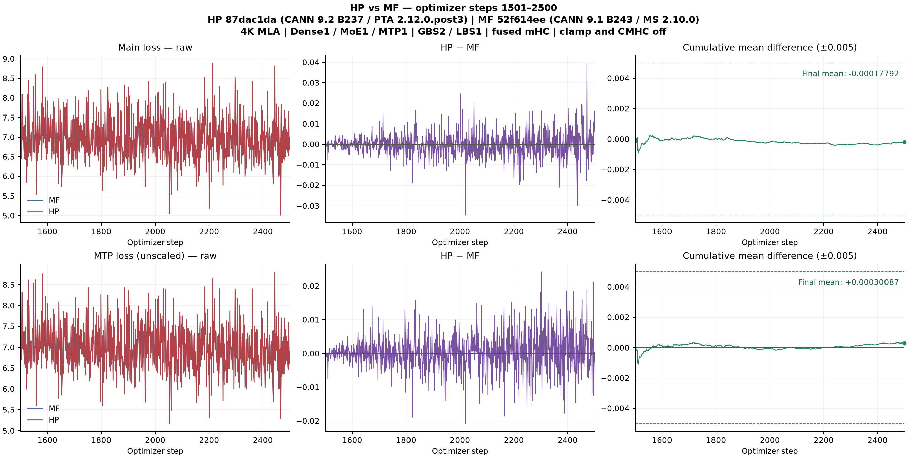

[公开对比图、统计与作图说明](https://github.com/xingleixu123/hyper-parallel/blob/286d913bff843d9aaf05f7881ae60263b0985c6e/reports/xing4-87dac1da-precision-20261104/README.md)

<!-- XING4-DOC-REVIEW-E792B6C1 -->
**本轮检视与回归 · [新增提交 e792b6c1](https://github.com/mindspore-ai/hyper-parallel/commit/e792b6c10d36d150648d0fa7cd933207358a31f2)。** 按文档的 21 项行动逐项对照官方 Xing、HP 与实跑 MF 源码。修复 LM/MTP 强制 BF16、eval 累加专家计数，以及 QKClip 的列分片缩放。专家转换复用公共分段接口，CP RoPE 复用库中单张量实现。非对称权重与真实 910B 前反向支持现有 mHC 组合矩阵方向。官方三个文件保持原始字节。

| 本次验证 | 固定版本、窗口和结果 |
|---|---|
| 单卡 MF→HP | 单卡组合 `b5ac1873` 从 MF 第 5 次更新后恢复，独立续训第 6–10 步，10 个微批的 40 项字段一致。LOSS、原始 MTPLOSS 的 HP−MF 有符号均差分别为 +0.00003700、-0.00000632，正/负均为 3/2。 |
| 四卡恢复 | 四卡组合 `5790a6f7` 含 #1453，TP2×CP2、EP2 依次从同一 FSDP4 第 5 步状态恢复，均完成第 6–7 步。四个 rank 的模型、优化器、调度器、随机状态、样本字段与学习率通过核验。以下差值相对同版归一化的 FSDP4 对照，采用未加权 MTPLOSS。 |
| TP2×CP2，第 6 / 7 步 | LOSS +0.00044054 / +0.00037718，MTPLOSS +0.00029301 / −0.00049055。 |
| EP2，第 6 / 7 步 | LOSS 0 / +0.00023651，MTPLOSS 0 / −0.00000477。 |

当前提交做了以上短程回归。上方单卡 1000 步及下方四卡 100 步保留各自的实跑提交。

**上一轮目录调整（`47cd46ca`）。** 训练子类、损失与 MTP 位于 `adapter/training.py`，训练 MoE 位于 `adapter/moe.py`。三个官方文件保留原名和原始字节。目录调整含两次文件移动与四处导入或注册路径修改。同权重 CPU 的 364 项张量逐位一致。调整后的单卡运行时 `6eaa4e41` 从真实 MF5 完整状态续训 6–10，40 项实际输入字段匹配，LOSS 与原始 MTPLOSS 均差绝对值为 0.00010815、0.00002611。四份实跑 YAML 在迁移后的 CPU/meta 模型上各命中 24 个模块替换、35 个规划边界，CP/EP 调用与重计算范围已核对。四卡 NPU 100 步属于上文标明的迁移前运行时。[对应检视](https://github.com/mindspore-ai/hyper-parallel/pull/1439#issuecomment-6631926480)

### 四卡 100 步阶段

四卡纯 FSDP 连续至 105 步。EP2（数据并行度 4、GA1）从同一第 5 步状态续训 6–105，四 rank 的输入和学习率一致。rank 0 的 LOSS 有符号均差 +0.00005010，MTPLOSS 有符号均差 +0.00007658。四个 rank 分别按完整 100 步核验通过。FSDP/EP 使用运行时 `87dac1da`。

**归一化与比较基准。** 主仓 [#1453](https://github.com/mindspore-ai/hyper-parallel/pull/1453) 以 master 为合入目标，目前仍在评审。四卡分支 `304b8df5` 直接复用其整步有效 token 归一化。四卡固定 GBS4/LBS1。纯 FSDP4、CP2 × DP2、TP2 × CP2 的梯度累积次数分别为 1、2、4。原连续基线与加入 #1453 的同布局对照都从第 5 步状态验证第 6–105 步，表中每行按相应基线计算。四个 rank 分别验收，表中展示 rank 0 的全局指标。

| 配置与基准 | 指标 | mean(待测−基准) | 正 / 负 / 零 | MAE | 最大绝对差（步） |
|---|---|---:|---:|---:|---:|
| 纯 FSDP4，复用 #1453，相对原连续基线 | LOSS | +0.00002839 | 54 / 46 / 0 | 0.00029835 | 0.00095463（15） |
| 纯 FSDP4，复用 #1453，相对原连续基线 | MTPLOSS | +0.00004352 | 50 / 50 / 0 | 0.00045609 | 0.00149172（71） |
| EP2、主干部分重计算，相对原连续基线 | LOSS | +0.00005010 | 59 / 41 / 0 | 0.00034678 | 0.00115299（10） |
| EP2、主干部分重计算，相对原连续基线 | MTPLOSS | +0.00007658 | 56 / 44 / 0 | 0.00036960 | 0.00130057（88） |
| CP2 × DP2，相对同版纯 FSDP4 | LOSS | -0.00001860 | 50 / 50 / 0 | 0.00028489 | 0.00131901（94） |
| CP2 × DP2，相对同版纯 FSDP4 | MTPLOSS | +0.00001191 | 51 / 49 / 0 | 0.00044084 | 0.00134585（93） |
| TP2 × CP2、loss parallel，相对同版纯 FSDP4 | LOSS | +0.00007882 | 59 / 41 / 0 | 0.00032147 | 0.00115590（80） |
| TP2 × CP2、loss parallel，相对同版纯 FSDP4 | MTPLOSS | +0.00004800 | 53 / 47 / 0 | 0.00042197 | 0.00139786（51） |

TP2 × CP2 已完成 4 rank 的恢复与 100 步逐步核验，完整窗口两项通过。

单卡冻结配方采用微批等权。以 MF 第 1501 步为例，两个微批有 93、740 个有效标签，主损失为 8.50564289、7.29226303，记录值为等权均值 7.89895296。按 #1453 的 token 权重把这两个原值重新加权得到 7.42773041，仅为算术对照。上方 MF/HP 单卡 1000 步结果属于 `87dac1da`。

[四卡原始曲线、逐步差值和累计均差](https://github.com/xingleixu123/hyper-parallel/blob/b6873d0bc39f2fb52771f026253e9d2af4112ee3/reports/xing4-fourcard-304b8df5-100-20261104/README.md)

EP2 与部分重计算 的 100 步对比图

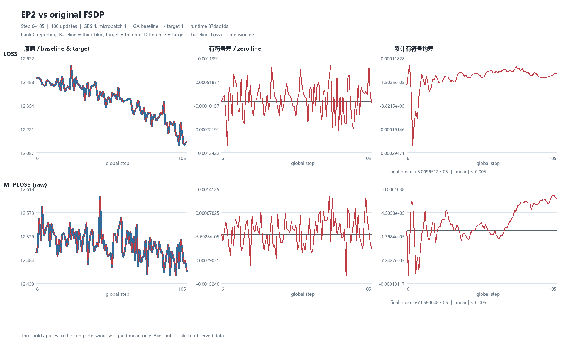

CP2 × DP2 的 100 步对比图

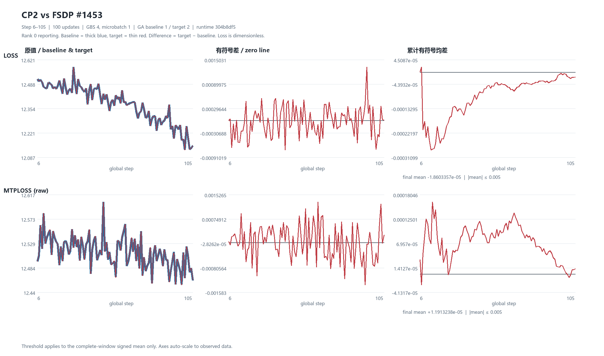

TP2 × CP2 与 loss parallel 的 100 步对比图

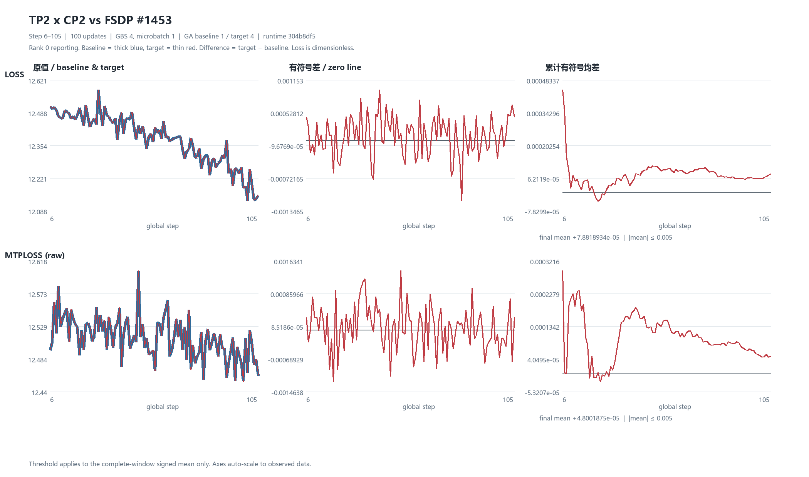

<!-- XING4-CE2DBE84-ACTIVE-END -->

## 上一版检视记录 · 14d9ccce

[Draft PR #1439](https://github.com/mindspore-ai/hyper-parallel/pull/1439) head `14d9ccce`，基于 master `a9fa47d6`，组合运行时 `518ad155`。模型训练逻辑集中在模型目录，MLA/GMM 替换与权重转换统一，EP 保留 distributed；删除额外包装和非业务改动，26→17 文件，净删 264 行。官方三个 Python 文件仍为原名、原字节；具体 config.json 移出代码仓。

两组 CPU 前后向 364 项张量逐位一致；61 个参数、65 项模型状态、优化器角色和 18 个替换目标相同。复用测试 18 tests / 20 subtests 通过。125 卡 5 从真实 MF5 恢复，核验 65 项模型值、91 项优化器槽和 10 个实际微批，完成 HP6–10；融合 mHC 开，clamp/CMHC 关。与精简前相同 checkpoint 短跑的 LOSS/MTPLOSS 最大绝对差为 0.00034046/0.00017047，未逐位一致。本轮为恢复与集成回归，下方 1000 步曲线仍对应原 `3d013f23` / `dd6f0338`，未重跑 MF 基线，四卡仍暂缓。

[本轮 HP YAML、外部 config.json 与未变 MF 基线的私有归档](https://github.com/xingleixu123/mindformers-private/blob/518eac56caf9f3b6af1c01f4bcbdb76aac5db843/archives/xing4-review-consolidated-20261104/README.md)。已核验私有仓库仅本人访问。原 PR 的 10 条行内检视、2 条讨论和 4 次 review 全部保留，逐条回复，未自动解决线程。

### 单卡待合入与验收顺序

| 优先级 | 项目 | PR / Issue |
|---|---|---|
| P0 · 前置 | 公共 MTP 层和 SwiGLU 导出 | [#1386](https://github.com/mindspore-ai/hyper-parallel/pull/1386) · [#1420](https://github.com/mindspore-ai/hyper-parallel/pull/1420) |
| P0 · 前置 | GBS2/LBS1 的 LM 与 MTP 辅助反向倍率 | [hf1s#355](https://github.com/hf1s/hyper-parallel/issues/355) · [Draft #1441](https://github.com/mindspore-ai/hyper-parallel/pull/1441) |
| P0 · 模型 | Xing4 训练适配、mHC post 矩阵方向、MTP 的 FSDP 包装单元 | [Draft #1439](https://github.com/mindspore-ai/hyper-parallel/pull/1439) · [hf1s#359](https://github.com/hf1s/hyper-parallel/issues/359) · [hf1s#360](https://github.com/hf1s/hyper-parallel/issues/360) |
| P0 · 验收 | MF1500 → HP 原生恢复及完整 1000 步精度 | 前版 dd6f0338 完整 1000 步通过；本轮 518ad155 完成 MF5→HP6–10 恢复回归。 |
| P1 · 条件性 | 专家权重反向转换及 checkpoint 生命周期 | [hf1s#357](https://github.com/hf1s/hyper-parallel/issues/357) / [Draft #1442](https://github.com/mindspore-ai/hyper-parallel/pull/1442) · [Draft #1431](https://github.com/mindspore-ai/hyper-parallel/pull/1431) |
| P1 · 独立环境项 | 启用 clamp 所需的融合算子支持 | [hf1s#358](https://github.com/hf1s/hyper-parallel/issues/358) |

<!-- XING4-CONSOLIDATED-REVIEW-20261104 -->

## 最近一次完整验收 · 本地官方 Xing4 源码版（检视收敛前）

[Draft PR #1439](https://github.com/mindspore-ai/hyper-parallel/pull/1439) head `3d013f23`。官方三个文件及建模依赖 `configuration_xing4_0.py` 原样放在模型目录，HP 训练适配按能力分目录。

| 指标 | 有符号均差 HP−MF | 正 / 负 / 零 | MAE | 最大绝对差（步） |
|---|---:|---:|---:|---:|
| LOSS | -0.00011274 | 497 / 503 / 0 | 0.00394889 | 0.03655362（2471） |
| MTPLOSS（未加权） | -0.00010135 | 513 / 487 / 0 | 0.00387490 | 0.02656591（1826） |

两边关闭 clamp 与 CMHC，启用融合 mHC。125 卡 5 在无网络、无 HF 缓存挂载的容器里，从真实 MF1500 状态恢复，独立跑完 1501–2500。模型、优化器槽、采样游标及实际微批均核验，HP2500 独立 CPU 读回通过。

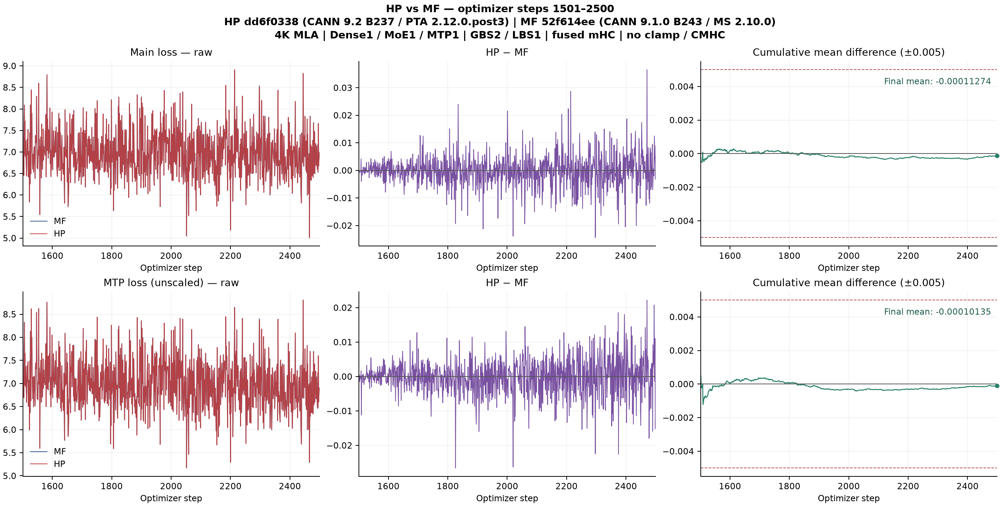

[公开图与统计](https://github.com/xingleixu123/hyper-parallel/blob/dcb732667a381a2ee5366e20888384670ba83a53/reports/xing4-bundled-dd6f0338-precision-20261104/README.md) · [MF 与 HP 实跑 YAML 私有归档](https://github.com/xingleixu123/mindformers-private/blob/ed997344ce3037fc2ed7ad417a84d24780aa5e7e/archives/xing4-bundled-dd6f0338-precision-20261104/README.md)

<!-- XING4-LOCAL-BUNDLE-RUN -->

## 置顶 · Xing4 / MF 单卡完整 1000 步通过

**MF 在 125 卡 6 连续训练至第 2500 步。HP 在 125 卡 4 从 MF 第 1500 步完整状态独立续训第 1501–2500 步。**

| 指标 | mean(HP−MF) | abs(mean) | 正 / 负 / 零 | MAE | 最大绝对差（步） |
|---|---:|---:|---:|---:|---:|
| LOSS | +0.00012373 | 0.00012373 | 492 / 508 / 0 | 0.00386420 | 0.02714729（2468） |
| MTPLOSS（未加权） | -0.00014666 | 0.00014666 | 494 / 506 / 0 | 0.00386080 | 0.02828252（2495） |

阈值 0.005 约束整个窗口的 `abs(mean(HP−MF))`。每步差值保留符号。MAE 与最大绝对差用于诊断。图中保留全部 1000 步。

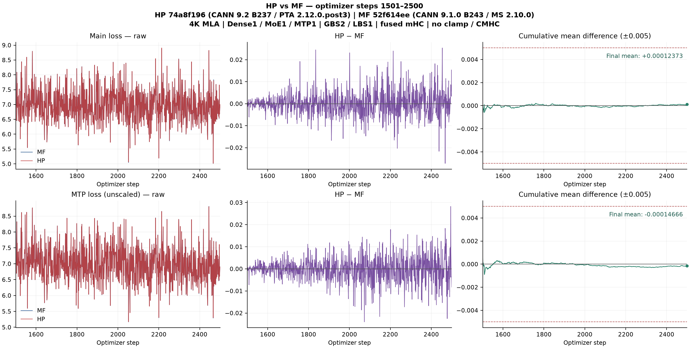

- 4K MLA、1 Dense + 1 MoE + 1 MTP、GBS2/LBS1、原 7500 步学习率日程。两边启用融合 mHC，clamp 与 CMHC 关闭。MF `52f614ee` / HP-MS r1.0.0 / MS 2.10.0 / CANN 9.1.0 B243，HP `74a8f196` / CANN 9.2 B237 / PTA 2.12.0.post3 / Torch 2.12.0 / Transformers 5.21.0。两边 Python 3.12.14。
- MF1500 离线转换及 HP 原生恢复逐项核验 65 项模型值、91 项优化器槽、61 项 FP32 主权重别名。第 1501 步起核对全部 2000 个实际微批，每个微批四项数据指纹一致，且 MF 记录的样本边界符合 4K 审计。HP2500 原生终态另由 CPU 逐项读回验证。
- MF 监督器终态 verifier 误读了引用对象的步数字段，原生 runner 已成功返回，完整日志和模型、优化器、随机状态回执通过独立复核。HP 恢复回执的步数字段也有笔误，实际 1500 步由加载日志、组计数、调度器和游标交叉证实。原始回执均已保留。
- [公开精度报告与原图](https://github.com/xingleixu123/hyper-parallel/blob/705e30f95373a9f2455b195e0262e90e11b25062/reports/xing4-issue12-noclamp-formal-20261104/README.md) · [MF / HP 私有 YAML 归档](https://github.com/xingleixu123/mindformers-private/blob/362043e252820d950b87f3e83499540134d196a3/archives/xing4-issue12-20261104-noclamp/README.md)

## 前一版带 clamp 的记录

<!-- XING-ISSUE12-PINNED-START -->
## 置顶 · 11 月 4 日更新配置的单卡精度

**当前 MLA 配置已完成 CPU 解析，已实跑的同语义配置在首个训练前向受 CANN 入口阻塞。** [配置源 issue #12](https://gitcode.com/xuxinglei/mindformers-private/issues/12) 更新于 11 月 4 日 10:25:41（UTC+8）。两侧 4K MLA、1 Dense + 1 MoE + 1 MTP、GBS=2/LBS=1、融合 mHC 开、CMHC 关。原生 MF 解析确认 hash 层数和 router jitter 为 0，MTP 启用 mHC，两处 HC head 均关闭，学习率 warmup 1500、原日程 7500。MF `52f614ee`、HP-MS `r1.0.0`、MS 2.10.0 `6b7c4b02`。MS 2.10 与 CANN 9.2 按已确认的实验组合验证。

已完成原生 CPU 样本审计。前 5000 条实际样本均构造 4096 个训练位置，记录五字段哈希，其中第 1501 步对应顺序样本 3000/3001；审计窗口无内部 EOD 边界。HP 原生 sampler 与现有 adapter/collator 的 CPU 对照也覆盖了这 5000 条。已对照单卡 TextTrainer 的等权微批聚合与 MTP 未缩放日志口径。129 卡 5 已构造最小 MF 模型，首次前向在 `aclnnMhcPreClampSinkhornGetWorkspaceSize` 解析处退出，完成的优化器更新为 0。已锁定 B237 并在 PTA 做符号解析正对照，详见 [hf1s#358](https://github.com/hf1s/hyper-parallel/issues/358)。按最新安排，MF 单独切到 CANN 9.1.x 验证，HP 维持 CANN 9.2.x 与 PTA 2.12。129 卡 5 用官方 CANN 9.1.0 B243 实际重跑，同一首前向报缺 `aclnnMhcPreClampSinkhornGetWorkspaceSize`，完成更新为 0。官方 CANN 9.1.1 910B transformer 与 legacy 包也经 SHA256 和动态符号表核验，均缺该入口。已记录真实运行与包扫描的不同范围，下一步需要实际提供对应前反向的 910B 工具链或配套算子包。

[最新 MF MLA YAML 与 HP 模板私有归档](https://github.com/xingleixu123/mindformers-private/blob/b5b8704dfec3379f8125f6cdc2aab4faad9654cf/archives/xing4-issue12-20261104-mla/README.md)。新配置原生解析对比 237 个字段，差异限六个 DSA 配置字段。进一步检查发现 `dsa_indexer_use_sparse_loss` 同时参与 MF GPT 的 TND 压缩掩码分支，129 卡 5 用 CANN 9.1.0 B243 独立跑了真实 4K V4 前后向。空 mask 的首 token 对全序列参考误差约 3.40e-5，对因果参考差约 0.902。新配置显式压缩 mask 对因果参考误差为 0。当前配置已走显式因果分支。[MF 问题](https://gitcode.com/mindspore/mindformers/issues/2624) · [MF Draft PR](https://gitcode.com/mindspore/mindformers/merge_requests/8893)。此前 9.1.0 实跑已经关闭 DSA，融合 clamp 缺符号发生在注意力前。新版复现清单已绑定最新 YAML，在配套算子通过前后向验证后启用。

离线转换入口已补齐当前清单覆盖及有序 mHC alpha、BF16 主权重与槽的 CPU 合成检查。新配置的实际收据须提供独立可信哈希，验收仍须等待真实 checkpoint。

HP master 新增了 sampler 透传、checkpoint 定时/轮转和 HF 导出。本轮有序单卡采样保留原行为。组合树已核对保存与恢复、异步写入后回收 Muon 临时副本和 HF 导出。本轮环境是 MF CANN 9.1.x、HP CANN 9.2.x / PTA 2.12。当前配置的 MF 正式训练在首个融合 mHC 前向的算子入口解析处停止，尚无第 1500 步完整 checkpoint。

125 CPU 用当前组合树 `1db359fb` 跑原生 TextTrainer 数据路径。恢复第 1500 步的数据游标 3000 后，首步对应样本 3000/3001、有效标签 93/740。第 1501–2500 步覆盖的全部 2000 条实际 4096 样本与 MF 原生读取记录核对通过，包括输入、有效标签、loss mask、位置及无内部 EOD 的整段边界。历史转换 checkpoint 中的数据游标也通过了同一首批验证。这两项仅验证数据状态，当前 MF 的权重、优化器及正式续训仍待实际 checkpoint。

### 待合入 PR 与关联 issue（按优先级和依赖排序）

| 优先级 | 能力 | 关联 issue | PR | 进展 |
|---|---|---|---|---|
| P0 · 前置 | SwiGLU 公开导入 | [#1326](https://github.com/mindspore-ai/hyper-parallel/issues/1326) | [#1420](https://github.com/mindspore-ai/hyper-parallel/pull/1420) | 提供公共激活入口。 |
| P0 · 前置 | 公共 MTP 层 | [#1390](https://github.com/mindspore-ai/hyper-parallel/issues/1390) | [#1386](https://github.com/mindspore-ai/hyper-parallel/pull/1386) | Xing4 复用 `MTPLayer`。 |
| P0 · 前置 | GBS2/LBS1 微批次下 LM/MTP 辅助分支梯度倍率 | [hf1s#355](https://github.com/hf1s/hyper-parallel/issues/355) | [Draft #1441](https://github.com/mindspore-ai/hyper-parallel/pull/1441) | 复用 Trainer 梯度入口。 |
| P0 · 前置 | 专家 checkpoint 反向转换保留单例轴 | [hf1s#357](https://github.com/hf1s/hyper-parallel/issues/357) | [Draft #1442](https://github.com/mindspore-ai/hyper-parallel/pull/1442) | 复用 HF 转换的薄兼容层，关联 [Transformers #49773](https://github.com/huggingface/transformers/pull/49773)。 |
| P0 · 集成 | 官方 Xing4 与公共训练组件 | [#1395](https://github.com/mindspore-ai/hyper-parallel/issues/1395) | [Draft #1439](https://github.com/mindspore-ai/hyper-parallel/pull/1439) | `bdef8fae`，基于 master `2f590a14`，单提交、15 个 Python 逻辑文件，目录 `models/xing_4`。本地组合树 `1db359fb` 通过 107 项 CPU 测试和 65 个子测试。 |
| P0 · 环境阻塞 | 已核验 CANN 9.1.0、9.2 B237 缺融合 mHC clamp 入口 | [草稿 hf1s#358](https://github.com/hf1s/hyper-parallel/issues/358) | 核查配套算子包 | MF 真实首前向复现，PTA 同环境符号查询确认。分别核验 MF 9.1.x 和 HP 9.2.x 所需的前后向入口与 910B kernel。 |
| P1 · 条件性 | MF MLA TND 被 DSA 标志误判并省略因果 mask | [MF #2624](https://gitcode.com/mindspore/mindformers/issues/2624) | [MF Draft #8893](https://gitcode.com/mindspore/mindformers/merge_requests/8893) | 旧显式 DSA 标志时真实复现，当前 YAML 已走正确分支。上游草稿将省略 mask 的分支限定到 DSA。 |
| P1 · 条件性 | Muon checkpoint 生命周期 | [#1430](https://github.com/mindspore-ai/hyper-parallel/issues/1430) | [Draft #1431](https://github.com/mindspore-ai/hyper-parallel/pull/1431) | 按实际保存和恢复路径确认。 |
| 历史配置 | SwiGLU clamp10 和激活精度适配 | [hf1s#354](https://github.com/hf1s/hyper-parallel/issues/354) | [Draft hf1s#356](https://github.com/hf1s/hyper-parallel/pull/356) | 新 MF 原生配置的激活 clamp 为 `None`，其计算 dtype 仍核对实际路径。 |

#1439 前版 `885a3114` 的组合树以同一输入完成重构前后各两次 NPU 组件前后向。6 组比较各有 37/39 张量逐位一致，其余为两项 FP32 MLA 归一化权重梯度，同版本复跑也出现同量级差异。对应 125 卡 4、CANN 9.2、PTA 2.12.0.post3，范围为融合 mHC、MLA 和 GMM 组件。新版独立 4K MLA 在 125 卡 4 完成前后向，CANN 9.2 B237 / PTA 2.12.0.post3，公共融合 RoPE 使用 FP32 旋转。Q/K `[4096,32,192]`、V `[4096,32,128]`，TND 实际边界 `[4096]`，输出和全部输入/参数梯度有限。该结果覆盖随机输入的单层执行。 四卡阶段按当前安排暂缓。

---
<!-- XING-ISSUE12-PINNED-END -->

## 历史配置的合入依赖与记录
### 历史组合的 PR / issue

### P0：单卡对齐与续训自洽需要合入的项

按“阻断影响 + 依赖关系”排序。**1/2/3可并行推进，4依赖1，5汇合集成1–4。** 下表是本轮单卡配置所需能力，不把完整组合栈通过误写成每个PR单独验收或最小依赖剔除实验。

| 顺序 / 优先级 | 要解决的问题 | Issue | 待合入 PR / 当前 head | 依赖、合入动作与当前状态 |
|---|---|---|---|---|
| 1 · P0 | SwiGLU包导出被同名模块覆盖，按导入顺序可能构造/前向失败；也是后续激活适配的API前置。 | [mindspore-ai#1326](https://github.com/mindspore-ai/hyper-parallel/issues/1326) | [mindspore-ai#1420](https://github.com/mindspore-ai/hyper-parallel/pull/1420) · `bab14d2c` | 主仓open、非Draft。先提供`activation_swiglu`公共导入；与2、3无相互依赖。 |
| 2 · P0 | 本轮MTP=1需要公共MTPLayer，主干尚缺该组件；模型只负责Xing特有接线。 | [mindspore-ai#1390](https://github.com/mindspore-ai/hyper-parallel/issues/1390) | [mindspore-ai#1386](https://github.com/mindspore-ai/hyper-parallel/pull/1386) · `973d24bb` | 主仓open、非Draft。公共组件前置，可与1、3并行；不将该PR表述成完整自动训练/并行接入。 |
| 3 · P0 | GBS2/LBS1且LM/MTP各含辅助分支时，外部微批倍率需覆盖所有foundation-family反向边。 | [hf1s#355](https://github.com/hf1s/hyper-parallel/issues/355) | [mindspore-ai#1441](https://github.com/mindspore-ai/hyper-parallel/pull/1441) · `b4d464e9` | 主仓Draft、单提交、1个逻辑文件。复用已有hook，不依赖#1410；可与1、2并行，不能因可见CE接近而省略此梯度语义修复。 |
| 4 · P0 | 模块替换需保留本轮源SwiGLU的clamp10及FP32激活语义，避免将不同函数当作舍入差异。 | [hf1s#354](https://github.com/hf1s/hyper-parallel/issues/354) | [hf1s#356](https://github.com/hf1s/hyper-parallel/pull/356) · `ccbd40db` | 当前是fork Draft，单提交、3个逻辑文件，base为**#1420 head**。待1合入后向最新主仓重放/核验并提交；不能将此fork PR称作主仓已可直接合入。 |
| 5 · P0 | 官方Xing4底座与HP训练适配：路由/权重布局、mHC/MTP、mask/损失、Muon模型逻辑矩阵及注册发现。 | [mindspore-ai#1395](https://github.com/mindspore-ai/hyper-parallel/issues/1395) | [mindspore-ai#1439](https://github.com/mindspore-ai/hyper-parallel/pull/1439) · `284f79b0` | 主仓Draft、单提交、18个Python逻辑文件。**待1–4能力齐备后集成**；目录/文件/类名为xing4/Xing4，官方Xing4_0外部身份保留。不是与#1413/#1435叠加的第二套模型。 |

建议合入路径：先推进**#1420、#1386、#1441**；#1420到位后处理**hf1s#356的主仓重放**；四项汇合后集成**#1439**。评审可并行，合入应遵守这些依赖。

### P1：恢复生命周期相关，按触发条件处理

| 优先级 | Issue / PR | 范围与处理条件 |
|---|---|---|
| P1 · 条件性 | [mindspore-ai#1430](https://github.com/mindspore-ai/hyper-parallel/issues/1430) / [Draft #1431](https://github.com/mindspore-ai/hyper-parallel/pull/1431) · `e5978afd` | 解决原生Muon checkpoint成功I/O后的非owner状态清理及writer生命周期，仍待设计/接口评审。本轮验收组合树包含它的三份相互调用的生产文件，提取callback时需一起保留对应共享接口；**world1不能证明非owner清理是单卡数值的硬前置**，异步保护是否触发也依保存模式。不将其与上表P0混成无条件必需。 |

### 暂不列入本轮单卡必需合入项

| 分类 | 关联 issue / PR | 判定依据 |
|---|---|---|
| 条件分支尚未证实命中 | [#1361](https://github.com/mindspore-ai/hyper-parallel/issues/1361) / [#1362](https://github.com/mindspore-ai/hyper-parallel/pull/1362) | 适用于grouped matmul的list/tuple分组。本轮启用GMM，但实际参数类型命中该修复分支的证据尚未补齐；不因同处运行栈就列为必需。 |
| 特定重计算策略 | [#1357](https://github.com/mindspore-ai/hyper-parallel/issues/1357) / [#1358](https://github.com/mindspore-ai/hyper-parallel/pull/1358) | selective checkpoint相关，当前运行文件也非该PR完整同一blob；是否需要由实际策略决定。 |
| 后续并行阶段 | [#1397](https://github.com/mindspore-ai/hyper-parallel/issues/1397) / [#1425](https://github.com/mindspore-ai/hyper-parallel/pull/1425) | CP不属于当前单卡路径；四卡按最新指示暂不开展。 |
| 已在主干 / 已由模型适配承接 | [#1318](https://github.com/mindspore-ai/hyper-parallel/issues/1318)、[#1399](https://github.com/mindspore-ai/hyper-parallel/issues/1399) / [#1171](https://github.com/mindspore-ai/hyper-parallel/pull/1171)；[hf1s#318](https://github.com/hf1s/hyper-parallel/issues/318) / [#319](https://github.com/hf1s/hyper-parallel/pull/319) | #1171已在冻结master；Muon核心回调已在主干，Xing模型布局由#1439调用已有接口，不重复叠加整个#319。 |
| 其他路线 / 未采用 | [#1418](https://github.com/mindspore-ai/hyper-parallel/issues/1418) / [#1410](https://github.com/mindspore-ai/hyper-parallel/pull/1410)；[#1398](https://github.com/mindspore-ai/hyper-parallel/issues/1398) / [#1426](https://github.com/mindspore-ai/hyper-parallel/pull/1426)；[#1413](https://github.com/mindspore-ai/hyper-parallel/pull/1413)、[#1435](https://github.com/mindspore-ai/hyper-parallel/pull/1435) | #1410未用于本轮；#1426是其他模型CE路线；#1413/#1435为替代模型路线，不能全部叠加进新Xing4底座。 |

本轮三份自有PR（#1439、#1441、hf1s#356）均仅提交逻辑代码，UT/ST及历史验证证据保留本地。其Draft状态和当前head未改变；Issue关联不等于问题已关闭。完整1000步结果仍对应下方标注的冻结组合树，不外推当前各独立PR的CI或合入状态。

---

### 历史配置已完成的完整单卡精度与归档

**MF 连续1–2500、HP 从 MF1500 完整状态独立续训1501–2500均已完成；完整1000步精度、恢复门、实际样本及终态 checkpoint 核验通过。图表公开，YAML归档在仅所有者具有协作权限的私仓；代码PR保持Draft。** 本轮配置来源为[MF issue12](https://gitcode.com/xuxinglei/mindformers-private/issues/12)，3层主干（2 Dense + 1 hash MoE）+1 MTP，GBS2/LBS1，序列4096，两侧融合mHC开、CMHC关、MTP HC保持关。历史总单[#304](https://github.com/hf1s/hyper-parallel/issues/304)未修改；四卡按最新指示暂不开展。

| 完整窗口1501–2500，差值HP−MF | 有符号均值 | abs(mean) | 正 / 负 / 零 | MAE | 最大绝对差（step） |
|---|---:|---:|---:|---:|---:|
| LOSS | -0.00004177260398864746 | 0.00004177260398864746 | 475 / 525 / 0 | 0.0006145534515380859 | 0.0040798187255859375（2471） |
| 未缩放 MTPLOSS | -0.00018161049485206605 | 0.00018161049485206605 | 469 / 531 / 0 | 0.0012427420914173125 | 0.009748399257659912（2200） |

两项均满足 `abs(mean(HP−MF)) ≤ 0.005`，差值自然出现正负。0.005约束完整窗口的有符号均值，MAE、maxabs和单步差不另设阈值；MTP第2200步约0.009748的差值完整保留。梯度范数仅诊断：signed mean −0.001055332660675049、MAE 0.018071582317352296、正/负/零504/496/0、maxabs 0.1361370086669922（2445）。

**历史命名与范围整理（2026-11-04，旧 head）**：#1439 当时为`models/xing4/modeling_xing4.py`及`Xing4ForCausalLM`。本轮不附UT/ST、README、示例YAML，测试和实际配置仍保留独立归档；本地更名用例16 tests/2 subtests、四类身份新进程冷启动、pylint、语法/diff检查通过。注册表新增的是现有目录alias映射，官方`model_type=xing4_0`不改写。本轮没有重新运行2500步或改写上方历史精度结论：完整窗口仍对应冻结c99；归档原始YAML里的旧代码路径也保留原字节，用于历史复现。当前新head外部CI另行观察，不沿用A92旧head的门禁结论。

**本轮三份PR提交范围已统一**：模型#1439仅18个Python逻辑文件；Trainer#1441仅`trainer/base.py`；SwiGLU hf1s#356仅三个组件逻辑文件。均不带UT/ST、README或示例YAML，保持单提交Draft。只移出本轮测试差异，不删除库中已有测试；已运行测试源码、结果与旧head保留本地归档。#1441/#356生产blob与移出测试前完全相同，因此复用既有功能/数值/成本证据，本轮不重跑训练或制造新结果。

PR仍是Draft，未合并。旧配置记录的三份 PR head 分别为#1439 `284f79b0`、#1441 `b4d464e9`、hf1s#356 `ccbd40db`。CI/CLA/评审以各自新head的真实状态为准，旧head的通过项不能沿用；标签门禁与历史完整精度验收分别记录，不手工制造通过标签。

### 私有 YAML 归档（只公开链接，不公开内容）

[归档说明](https://github.com/xingleixu123/mindformers-private/blob/12fbcbbf06adf7c9e2d24eaf6778fe7b8f44a8cb/archives/xing40-issue12-20261104/README.md) · [原始issue12 YAML](https://github.com/xingleixu123/mindformers-private/blob/12fbcbbf06adf7c9e2d24eaf6778fe7b8f44a8cb/archives/xing40-issue12-20261104/source/issue12-original.yaml) · [MF实际YAML](https://github.com/xingleixu123/mindformers-private/blob/12fbcbbf06adf7c9e2d24eaf6778fe7b8f44a8cb/archives/xing40-issue12-20261104/configs/mf-config-actual.yaml) · [HP实际YAML](https://github.com/xingleixu123/mindformers-private/blob/12fbcbbf06adf7c9e2d24eaf6778fe7b8f44a8cb/archives/xing40-issue12-20261104/configs/hp-config-actual.yaml) · [HP base YAML](https://github.com/xingleixu123/mindformers-private/blob/12fbcbbf06adf7c9e2d24eaf6778fe7b8f44a8cb/archives/xing40-issue12-20261104/configs/hp-config-base.yaml)

提交前后均用真实REST核验：仓库private，协作者仅`xingleixu123`，pending invitations=0；这是所记录时点的仓库权限快照，未来权限及已授权安装应用另计。归档20个小文件均读回核SHA，原始YAML及MF/HP实际YAML字节未改；不含权重、checkpoint、样本或凭据。

### 精度图与完整原始数值

[公开六图与逐步CSV归档](https://github.com/xingleixu123/hyper-parallel/blob/ce6603bc046f1b16fbb8c89f2cc453b13efe83be/reports/xing40-issue12-20261104/README.md)。图来自[log.javazero.top](https://log.javazero.top/)真实在线会话，逐点核验12000点（含零线），固定1501–2500，无平滑/抽样。普通站点URL不携带数据，当前没有可复现的站点分享链接；归档CSV/图片使用不可变commit链接，可直接复核。两侧原值高度重合，差值另绘，不偏移原曲线。

**LOSS：MF / HP**

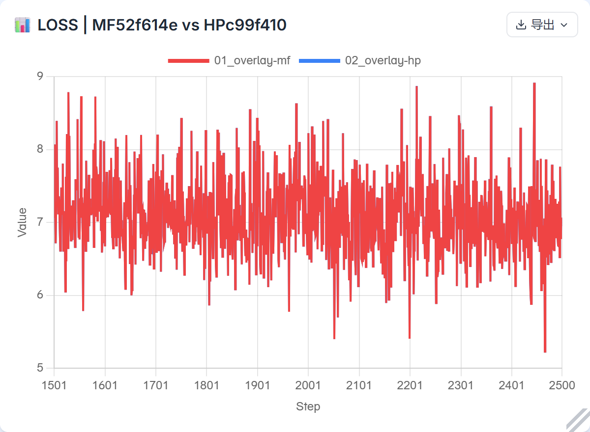

**未缩放 MTPLOSS：MF / HP**

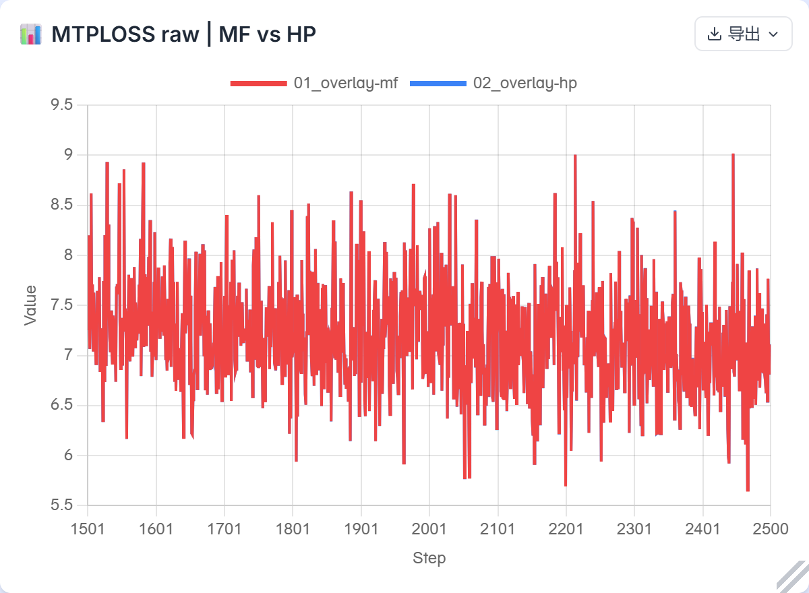

**LOSS：有符号差 HP−MF 与零线**

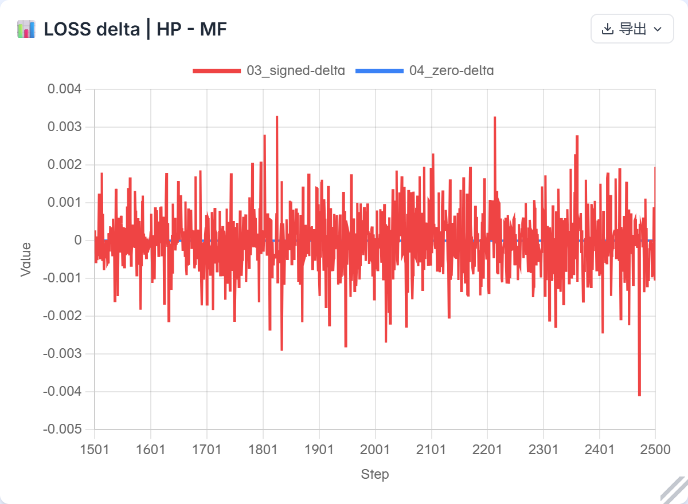

**MTPLOSS：有符号差 HP−MF 与零线**

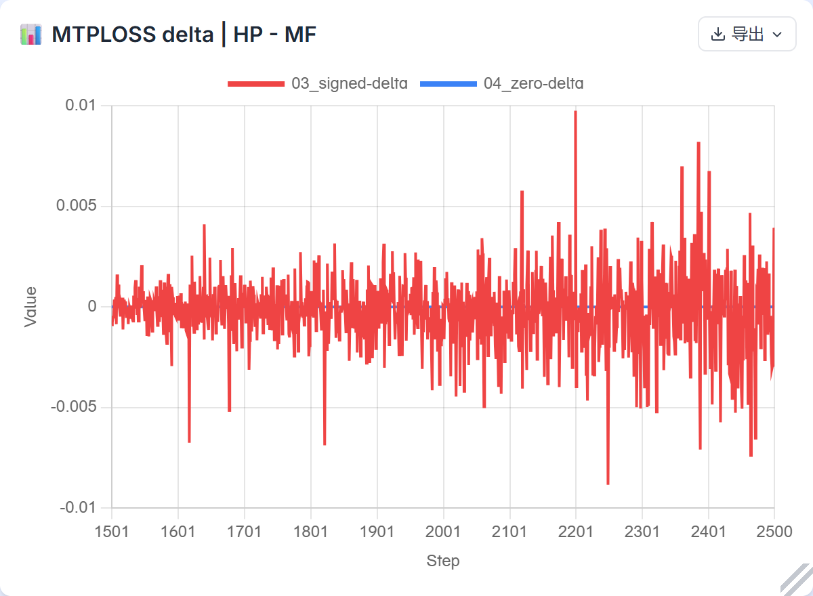

**LOSS：从1501起累计有符号均值，最终abs(mean)=0.00004177**

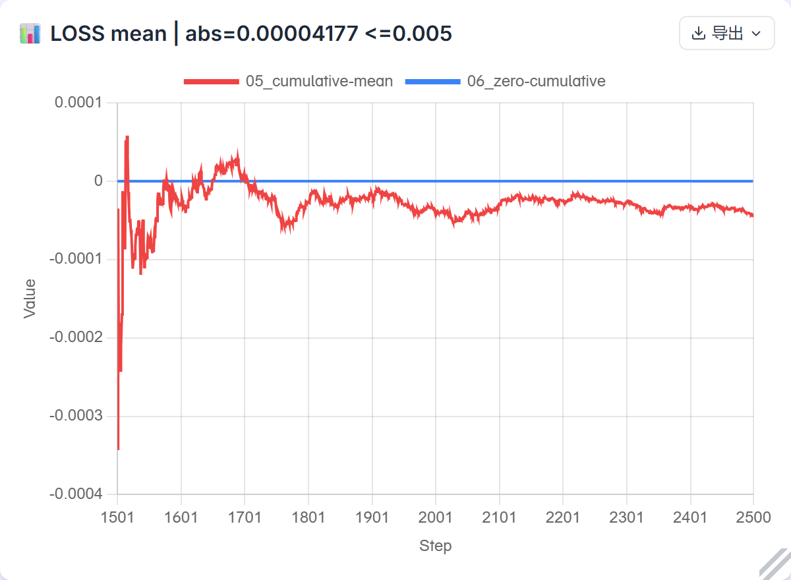

**MTPLOSS：从1501起累计有符号均值，最终abs(mean)=0.00018161**

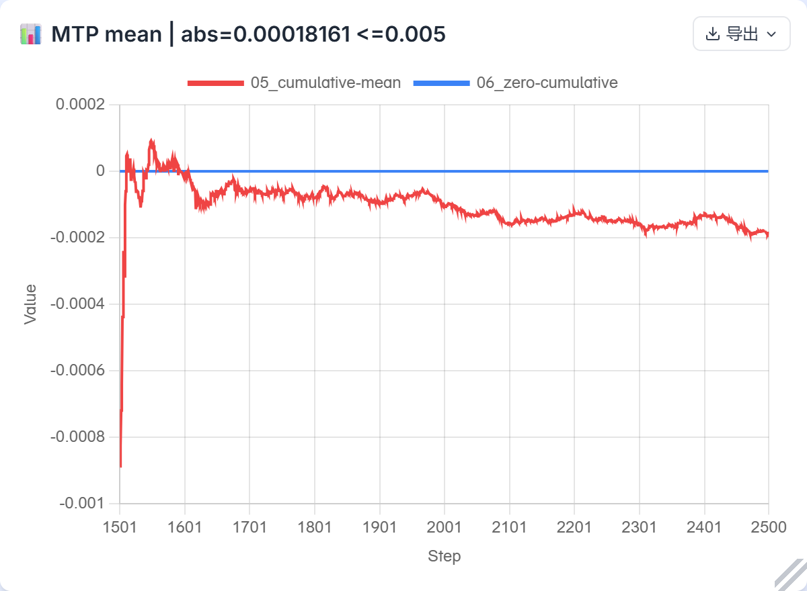

### 恢复、样本与口径证据

MF1500保存完成后独立CPU读回、离线转换，再由HP原生TextTrainer/Checkpointer fresh-load。核验78模型项、110 optimizer slots、74 FP32主权重别名及FSDP精度策略；scheduler与optimizer step1500、sampler3000、适用RNG及实际下一批一致后才放行。HP2500原生DCP独立CPU读回核78模型、110 slots、892 optimizer metadata leaves、三组参数、scheduler2500与sampler5000；保存的Torch CPU、device、Python RNG与live相同。

完整窗口2000个micro四字段共8000/8000一致，实际形状[1,4096]；device/Python/NumPy摘要12000/12000一致。HP after含前向+反向，MF after仅前向，不外推全部随机kernel。HP原生checkpoint不保存NumPy global状态，本轮以经校验完整侧车恢复；全窗记录边界及终态摘要未变，侧车不是原生最终状态直接捕获。损失保持实际micro等权口径，不因有效token数不同改为另一种统计。HP实际更新LR由恢复参数组和前一步scheduler状态推导，对照MF optimizer的step−1调用；最大表示差2.5134161143688678e−12，没有模拟对方舍入。ConstantWarmUpLR的warmup2000/峰值3e−5不压缩，MF保留的total165000对constant阶段不参与计算。

原始MF/HP ledger SHA分别 `4b1d3610c54447cd7ff1685528a6ab61aac9cfd99db08882edd14060b98cda72` / `056c7656ba765a6ee4667b543cccd7b7c58516b55b3e351b216b22b3e630a89d`；HP2500独立回读result SHA `66790234cff814d1b44f3b2d5845f402ae2166c8303c12f5b2683b3322290594`。本地完整证据 `config-issue12/full-window-acceptance-v1/`、`hp-resume1500-evidence-complete-v2/`、`hp2500-cpu-readback-evidence-v1/`、`final-acceptance-v1/`；关键checkpoint和完整复现命令仍保留。
<!-- XING-ISSUE12-HISTORICAL-END -->

## 历史短程诊断（完整验收前的证据）

展开 MF5 / HP6–10 与1501–1550诊断；不替代上方完整1000步

| 项目 | 当前结果 | 边界与本地证据 |
|---|---|---|
| MF5 非零 RNG 跨框架 | MS 与 PTA 分别恢复实际 MF5 default generator 状态；真实 router F32 `[4096,3584]` 连续两次 `rand_like`，两次完整输出 SHA、三时点状态均一致，各自重置重放通过。 | 仅覆盖指定状态、形状和两次调用；不证明训练、重算顺序或通用 RNG 等价。`config-issue12/mf5-rng-cross-framework-probe-v1/comparison.json` 及该目录运行证据。 |
| MF 更新5后自恢复 | 完整恢复门通过，续跑6–10并与连续运行对比：LOSS 最大绝对差 `5.531311e-5`，未缩放 MTPLOSS 最大绝对差 `5.912781e-5`；数据字段 40/40、LR 5/5、RNG 5/5 一致。 | 终态261项中242项摘要不同；hash 只能说明字节不同，不能量化张量误差。仅为 MF 自恢复，不是 HP 对比。`config-issue12/mf-selfresume5-v1/evidence/audit-summary.json`、`micro-fields.csv`、`end-state-fqns.csv`。 |
| MF 连续2500 | 129 卡0、B231新基线的 step1500 完整收据 SHA `ce1938298db8f613946bc92e325dbd3c43992fe51ab613df78242440d6c62570`；独立源 payload 审计 SHA `2940fa1c8728e7bd58ac0124d42fcfbb5a84bd0942273152d0be5dd42698be68` 已通过。连续1–2500更新、consumed_samples 5000 已完成；controller exit0且容器移除。 | 1500、2500源 checkpoint 独立审计通过；证据 `config-issue12/mf-full2500-candidate-v1/evidence-complete-129-v1/`，125 中断尝试不拼接。 |
| HP MF5→6–10真实诊断 | 原生 restore 到step5，78模型项、110 slot、74 FP32主权重别名及FSDP策略通过，10 micro 的40个数据字段与 MF ledger 一致；worker/controller 正常退出、容器移除。 | 125设备上五步诊断，融合库实际映射及hash见 `config-issue12/hp-resume5-diagnostic-v3/evidence-base-v4/`；不能替代1501–2500完整窗口验收。 |
| MF1500 → HP 续训 | 129 上完成1500转换、CPU DCP回读和真实HP fresh-load；恢复门核78模型项、110 slot、74 alias和cursor3000。HP实际续训1501–2500共1000步完成，worker/controller正常退出。 | 完整窗口统计与终态CPU回读已通过；前50步保留为历史诊断，完整证据见 `config-issue12/hp-resume1500-evidence-complete-v2/`。 |

### 五步诊断统计（HP−MF）

| 指标 | 有符号均值 | abs(mean) | MAE | maxabs | 正 / 负 / 零步数 |
|---|---:|---:|---:|---:|---:|
| LOSS | -1.764297e-5 | 1.764297e-5 | 1.764297e-5 | 3.719330e-5 | 0 / 5 / 0 |
| 未缩放 MTPLOSS | +6.866455e-6 | 6.866455e-6 | 3.628731e-5 | 9.608269e-5 | 2 / 3 / 0 |

五步中 device/Python/NumPy RNG 在20个比较点各20/20摘要一致；HP after含前向加反向，MF after仅前向，范围不能推广到所有随机 kernel 或完整训练。逐步曲线 `config-issue12/hp-resume5-diagnostic-v3/evidence-base-v4/diagnostic-curve.csv`、随机比较 `rng-comparison.csv`、独立统计 `independent-diagnostic.json`，以及同目录 `maps-after-inventory.json` 提供证据。完整1000步阈值不能由这五步代替。

### 1501–1550 前缀诊断（HP−MF）

| 指标 | 有符号均值 | MAE | maxabs | 正 / 负 / 零 |
|---|---:|---:|---:|---:|
| LOSS | −7.295609e-5 | 4.871559e-4 | 0.001797676 | 19 / 31 / 0 |
| 未缩放 MTPLOSS | +8.536220e-5 | 4.991329e-4 | 0.002084613 | 26 / 24 / 0 |
| 梯度范数 | +0.003130922 | 0.011362314 | 0.038980484 | 31 / 19 / 0 |

400/400输入字段、600/600个 device/Python/NumPy 摘要比较一致；HP after含前向和反向，MF after仅前向。三项 signed 差和绝对差均非逐步单调增长，不新增验收阈值。证据 `config-issue12/hp-resume1500-prefix50-v1/{summary.json,curves.csv,rng-edges.csv}`；这是50步，不代表完整窗口。

## 历史配置的目标与配置

HP 直接复用官方 Transformers-compatible Xing4 custom code 的模型主体，并在必要处适配训练语义；通过标准 Hub auto_map/缓存加载，不在公共 Python 代码硬编码仓库 ID、revision 或 SHA 白名单。MF 从头连续训练2500步，更新1500后保存完整状态；HP 独立从该状态续训1501–2500，与 MF 同窗口比较 LOSS 和未缩放 MTPLOSS。

唯一配置源 issue12 原 body SHA256 `3934ca655e5422120977d0b8a370d5077bafa237ce01ea618dae2aad46ec64d9`，提取 YAML SHA256 `36d493aa79eacdfa4804ec32963f978a45dfb90442e4743b5a1b5a6947708894`。用户明确要求 GBS=2、LBS=1、序列4096；主干最少保留 Dense 和 MoE，MTP=1。MF 约束 `moe_n_hash_layers=3` 不允许主干2层，因此两端均采用3主干层（2 Dense、1 hash MoE）加1 MTP。两端 `use_fused_mhc=true`、`enable_cmhc=false`，MTP 独立 HC 保持关闭；三者是不同开关。保留原优化器、混精及 ConstantWarmUpLR 语义：warmup2000、峰值3e-5。MF保留原total165000字段；该constant调度不使用total，HP以等价原生日程映射，不虚构未消费字段。只提前在2500停止，不压缩日程。

MF 原生解析实证 raw `intermediate_size`、`scoring_func`、`router_jitter_noise` 未自动映射到实际消费字段；显式绑定对应原意的 `ffn_hidden_size=9216`、`moe_router_score_function=sigmoid`、`moe_input_jitter_eps=0.3` 并核 resolved 配置。原生有效 SwiGLU 默认 clamp 为10。配置解析与别名证据见 `config-issue12/yarn-router-semantics-audit.md` 及 MF 诊断运行包；不能以旧错误配置作为基线。

## 历史配置的证据和后续记录

- MF 十步诊断使用固定 runtime v3、原 LR horizon，更新5后完整保存，1–10正常结束。MF5 模型和优化器约30.26 GB 已完整独立读回，模型 SHA `019142150f8293d020b0429de2047c22e1f2148686281f2c6979fc301af4a70f`，optimizer SHA `ae8059251ac5bb831c6e6efc4780a7a53039bf5520a6ec3bfbee5424ef899a97`；live 与实际 serialized step5 一致。该源检查、上方 MF 自恢复和 RNG 探针各有各自范围。
- YaRN 频率、QK scale、旋转格式及 hash 路由已做源码、CPU语义核对及本轮完整设备训练验证。专家 W1 `[64,3584,2048]`（前 gate 后 up）及 W2 `[64,1024,3584]` 到 HP packed 存储采用 identity；本轮完整payload、slot和world1 FSDP目标状态已实测，不将shape或本轮数值接近单独作为正确性依据。
- 样本和损失对比使用用户指定单 prefix、原有效 mask，按未缩放 MTP CE 报告，反向保留原倍率。先前 CPU 四字段逐元素比较为12个选定索引；13是该数据中原始长度恰为4097的记录数，不能误写为13个对比样本。证据 `config-issue12/data-preparation/data-parity.json`；原 YAML 的生产目录身份不同，不能以替代数据文件 SHA 证明两者相同。此前小 fixture 与模块结果只支持相应范围，不代表整模型精度。
- MF5→HP 离线转换与全量 CPU 回读覆盖261源值、78模型项和110 slots；后续真实 NPU 恢复门与6–10诊断已通过，范围及证据见置顶。更早 strict planner 的 EH 未覆盖是任务配置漏掉仓库现有 `train.yaml:209–212` replicate 声明，复用后74/74通过，不新增库问题。先前 runtime v2 在原生加载到step5后，因 `on_train_begin` 早于 StatefulDataLoader 惰性恢复而误报 sampler cursor；CPU真实extra state证实创建迭代器后恢复游标，修正后真实五步完成。历史失败未做前向或更新，记录在 `config-issue12/hp-resume5-diagnostic-v2/evidence-failed-base-v3/` 与 `sampler-lifecycle-audit/`。
- MF1500 checkpoint 已独立核验并转换，129 HP 已真实 fresh-load 并完成1501–2500；MF full2500 已完成并独立核验源终态。HP2500原生DCP的CPU完整读回已通过；129 c99源码、既有 Omni 和 HF 小文件已核身份并复用，长窗口两侧实际使用129 B231；见 `config-issue12/conversion-preparation-v4/first-1501-data-lr-and-129-readiness.md`。

129 正式入口首次在构建期失败：Windows 长路径导致任务封存器漏枚举两份官方 Python 源码，尚未加载训练状态或更新。活动目录缩短后复用完整三文件 Hub 缓存，生产镜像无设备、无网络 CPU 类加载预检通过，再启动 NPU；未修改公共模型加载器。活动 runtime manifest `602500775dd25ed52a77c1a538366ba9f74a01047e673f7021cb9dbe5f03d308`，controller manifest `8f532ecd73e8a09f7887769e4eadfba1ba5d5682c1e4319ca1ed9558ee546d7f`，见 `config-issue12/hp-r1500-v2/` 及 `hp-resume1500-offline-preflight-v1/`。

已清理125失败132步尝试的两个非现行checkpoint payload，共逻辑30,261,220,232字节；小证据及有效MF5、MF1500/2500、转换产物保留。清理回执 `config-issue12/mf-full2500-candidate-v1/evidence-start-v2/checkpoint-payload-cleanup-receipt.json`。此前401/403发布阻塞已通过现有专用凭据解决；实际PR、图像与私有YAML链接和发布状态见置顶。

**最终增量 head 核验（2026-11-04）**：主仓 master `8abb8e93d17f668117eaf09595acb1cddf1a74c6`、JT_dev `8d1e0d513e40ac64dea4b28db898c1f19ef8d906`、#1386 `973d24bb59911c9b3d95515d0ba00f426bce283a`、#1420 `bab14d2c57b269f3571fd39f55088d1fe80926f0`、#1431 `e5978afd2817f83eaedf41c609226cd4242bab7c` 均与此前记录相同；后三项仍 open，未推断合并或门禁通过。

## 环境和源码身份

| 部分 | 身份 | 限制 |
|---|---|---|
| HP 主仓 master | `8abb8e93d17f668117eaf09595acb1cddf1a74c6` | 本次 fresh 核验；每次实际运行仍需冻结完整文件与配置。 |
| 官方 Xing | `a32a2e99b5877c6b7ad16e9954ec08488bcc5fa2` | 本次实验锁定；为 custom code，不等于 Transformers 内置模型。 |
| #1439 公开 head | `284f79b0290202f2931672f6d476fa95ab773e3b` | 单提交逻辑代码；本轮只做命名/注册发现和提交范围整理，完整精度实验仍引用冻结c99。 |
| HP 本地整合底座 | `c99f4106293cd7c974149406083abe1fb930989a` | 后续设备运行以前重新冻结源码与参数清单。 |
| MF / MF侧 HP | MF `52f614eeb91c6e873d37bdbb5b880c82926ae9f6`；HP r1.0.0 `c69f8f70317268337314285f62d81bd5970c791a` | 与 Torch 训练侧 HP 区分。 |
| 环境 | MS2.10 构建 `2a020077…`，PTA2.12.post3，CANN9.2 B237，910B3；125 driver B208 证据仅作诊断；长窗口 MF/HP 比较实际均在129 B231 环境执行。 | 这是本次实际组合，不宣称官方配套；不同 host 的性能不直接比较。 |

## 历史配置的验收

- [x] 私有YAML权限快照核验并归档；原始及实际配置的不可变链接见置顶。
- [x] MF5 完整恢复门及 MF 6–10 自恢复对照；按上表保留数值与终态 hash 的限制。
- [x] MF 连续1–2500，更新1500后完整 checkpoint 可独立读回。
- [x] 完整转换与真实 fresh-load 覆盖模型、主权重、优化器、调度器、步数、数据进度及适用 RNG，并验证下一批实际样本；范围为本轮MF1500→HP1501，完整窗口另验。
- [x] HP 独立1501–2500完整1000步；LOSS、MTPLOSS 分别以有符号差 HP−MF 的 `abs(mean) ≤ 0.005` 验收，另报逐步原值、正负零步数、MAE、maxabs 和曲线；该阈值约束窗口均值而非每步。
- [x] 私有YAML归档、六张公开图及完整逐步CSV已发布并读回核验。
- [x] 必要模型和独立修复均以Draft提交，当前依赖和CI边界见置顶；不代表已合入。
- [ ] 四卡阶段：按最新指示暂不开展，未验收。

本轮复用现有模型、通用 MTP 和既有 placement 声明，没有新增重复模型或优化器实现。旧配置 MTP0 与旧短跑仅为历史证据，不计入本次验收。不固定算子或规约顺序以模仿某次数值轨迹，不将本轮单卡通过外推为外部 CI 通过、PR 合并或多卡验收。

