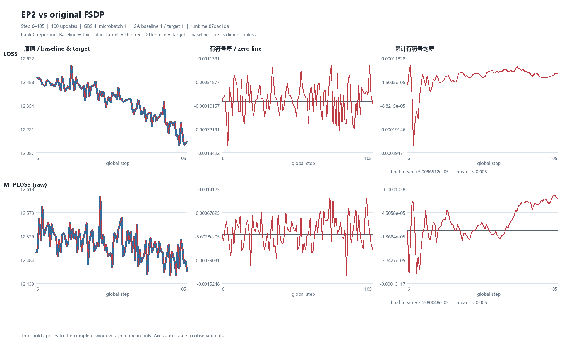
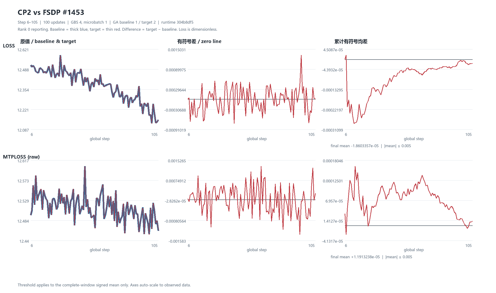
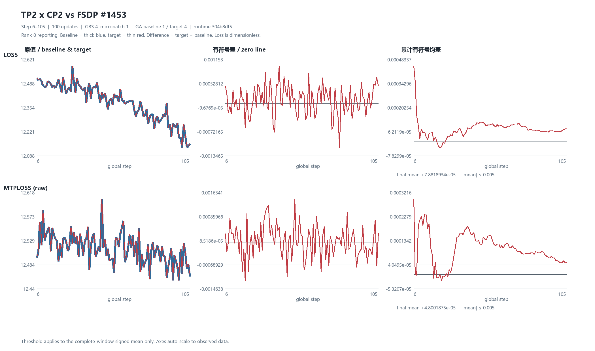

# 四卡精度比较

四卡展示 global reporting rank 0。6–105 共 100 次更新，GBS 4、microbatch 1。原值、target−baseline 和累计有符号均差均为无量纲 loss。零线是差值参考。门槛仅作用于完整 100 步均差，图中坐标随数据自动缩放。

- [EP2 vs original FSDP](ep2-comparison.png)
- [CP2 vs FSDP #1453](cp2dp2-comparison.png)
- [TP2 x CP2 vs FSDP #1453](tp2cp2-comparison.png)

## EP2 vs original FSDP

运行时 87dac1da。GA 基线 1、目标 1。LOSS 有符号均差 +5.00965118408e-05。raw MTP 有符号均差 +7.65800476074e-05。

## CP2 vs FSDP #1453

运行时 304b8df5。GA 基线 1、目标 2。LOSS 有符号均差 -1.86033565372e-05。raw MTP 有符号均差 +1.19132375847e-05。

## TP2 x CP2 vs FSDP #1453

运行时 304b8df5。GA 基线 1、目标 4。LOSS 有符号均差 +7.88189336913e-05。raw MTP 有符号均差 +4.80018751065e-05。

各比较另经四 rank 的完整数值门禁。这些图只展示 rank 0，不替代恢复、数据身份和多卡验收证据。
