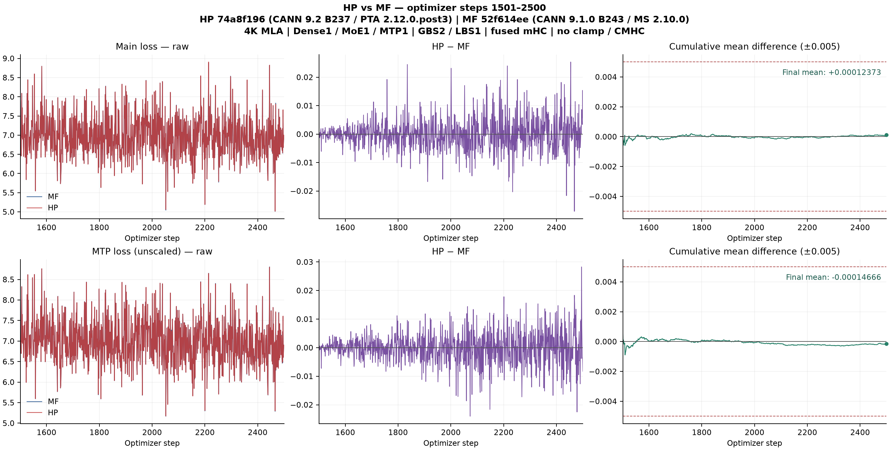

# Xing4 与 MF 单卡续训精度

完整第 1501–2500 步验收通过。HP 独立恢复 MF 第 1500 步完整训练状态。比较口径为逐步 HP−MF，完整窗口的 abs(mean) 阈值为 0.005。

| 指标 | mean(HP−MF) | abs(mean) | 正 / 负 / 零 | MAE | 最大绝对差（步） |
|---|---:|---:|---:|---:|---:|
| LOSS | +0.00012373 | 0.00012373 | 492 / 508 / 0 | 0.00386420 | 0.02714729（2468） |
| MTPLOSS（未加权） | -0.00014666 | 0.00014666 | 494 / 506 / 0 | 0.00386080 | 0.02828252（2495） |

HP 运行树 `74a8f196764e0c98fba959ccddc6b3c15fb112ba`，CANN 9.2 B237，PTA 2.12.0.post3。MF `52f614eeb91c6e873d37bdbb5b880c82926ae9f6`，CANN 9.1.0 B243，MS 2.10.0。4K MLA，1 Dense + 1 MoE + 1 MTP，GBS2/LBS1，融合 mHC 开，clamp 和 CMHC 关。

[总 issue #353](https://github.com/hf1s/hyper-parallel/issues/353) · [模型 Draft PR #1439](https://github.com/mindspore-ai/hyper-parallel/pull/1439)
