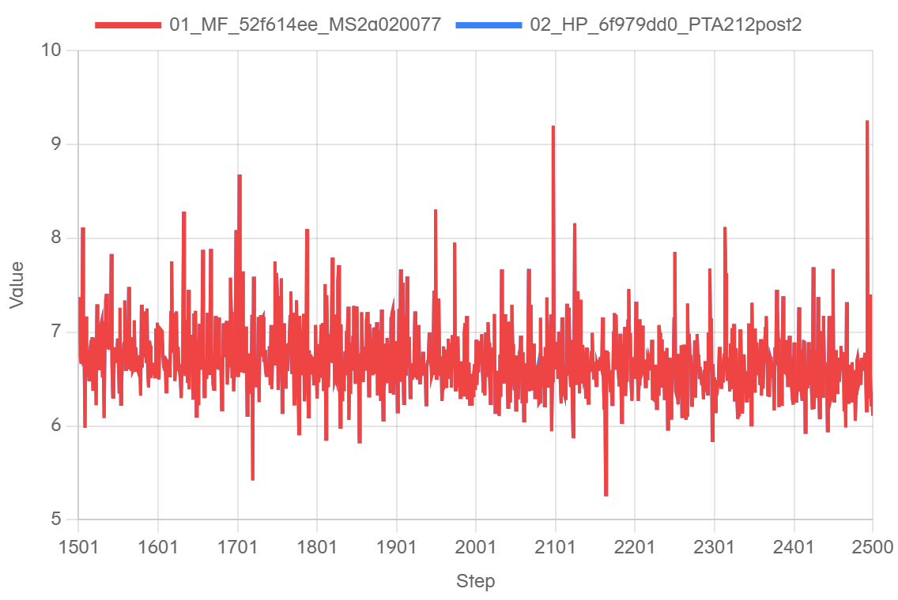
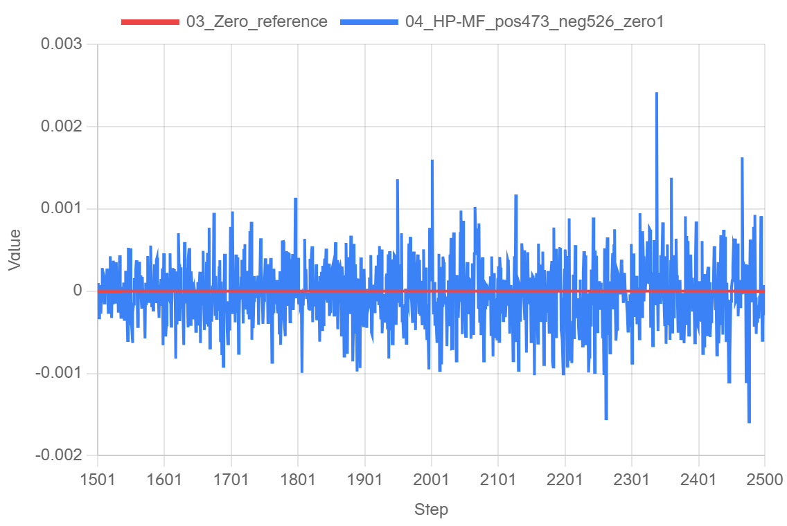
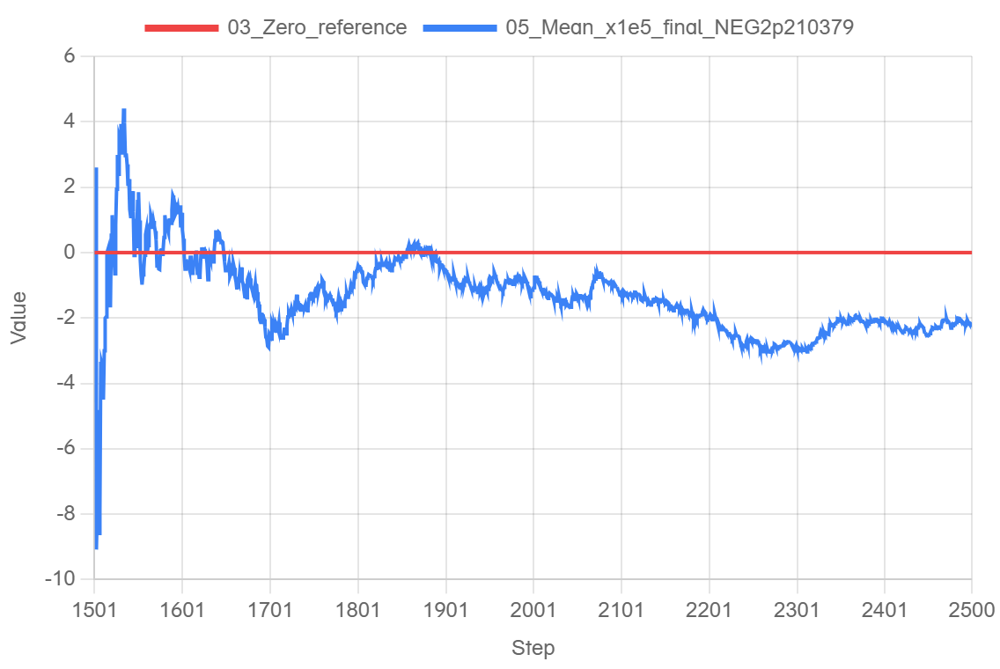
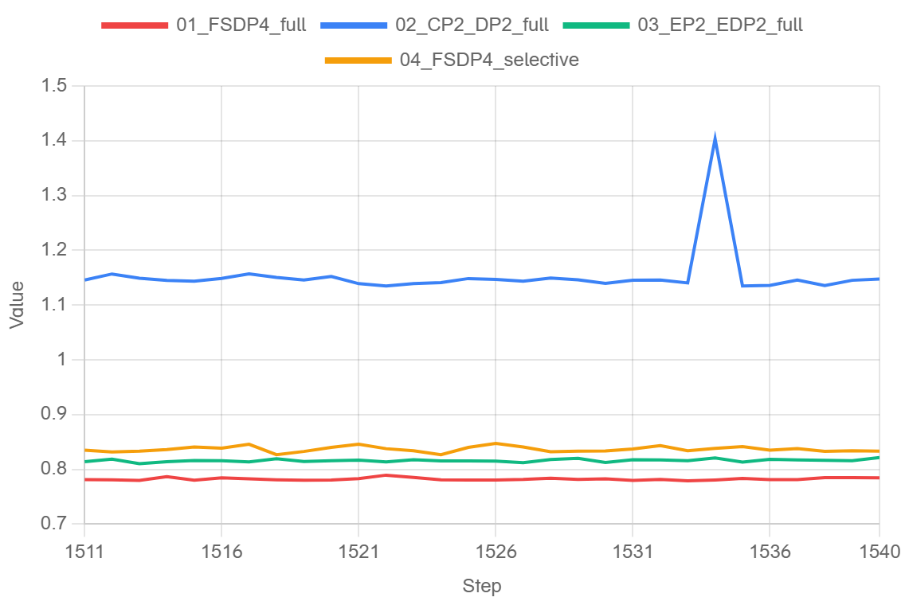
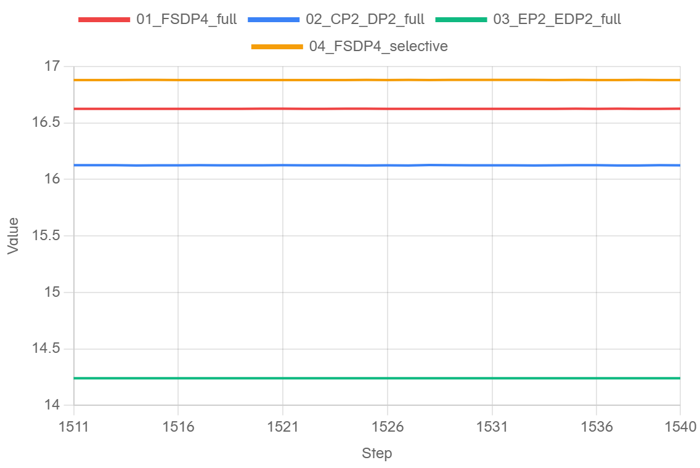

# Xing40 特性拆分与单卡恢复训练复测

以官方 master `d586665915709ef058de8d15e7b8db16e68caf60` 为固定基线拆分模型和框架功能。汇总验证提交 [#1404](https://github.com/mindspore-ai/hyper-parallel/pull/1404) `6f979dd07a2ef37fc1e4d11705747f586cfdd350`（tree `073695db11a3fe8f82866ecdcc06120d48d11f87`）在指定三层单卡配置下，从真实 MF 第 1500 步状态恢复并独立训练 1501–2500，完成 **1000 个更新**。整个窗口的 `abs(mean(HP−MF)) = 0.000022103786468505858 ≤ 0.005`，满足本次约定阈值。

此结论仅覆盖该组合树、配置和单卡恢复窗口；不能将它称为每个独立特性 head、任意配置或四卡的验收。所有新特性 PR 与 #1404 均为 Draft，上游合入状态以实际页面为准。

## 特性与依赖

| 特性 | Issue | PR | PR head |
|---|---|---|---|
| Xing40 模型接入 | [#1395](https://github.com/mindspore-ai/hyper-parallel/issues/1395) | [#1367](https://github.com/mindspore-ai/hyper-parallel/pull/1367) | `3e764f97` |
| portable mHC | [#1396](https://github.com/mindspore-ai/hyper-parallel/issues/1396) | [#1400](https://github.com/mindspore-ai/hyper-parallel/pull/1400) | `c24512a9` |
| MLA/MoE CP | [#1397](https://github.com/mindspore-ai/hyper-parallel/issues/1397) | [#1401](https://github.com/mindspore-ai/hyper-parallel/pull/1401) | `8f4244be` |
| 完整本地词表 CE sum | [#1398](https://github.com/mindspore-ai/hyper-parallel/issues/1398) | [#1402](https://github.com/mindspore-ai/hyper-parallel/pull/1402) | `1264b47f` |
| FSDP 参数名模式 | [#1399](https://github.com/mindspore-ai/hyper-parallel/issues/1399) | [#1403](https://github.com/mindspore-ai/hyper-parallel/pull/1403) | `badd6d27` |

- [#1367](https://github.com/mindspore-ai/hyper-parallel/pull/1367) 保留模型主体、标准 recipe 及模型内 logical matrix、QK global-head、CP aux 和 CE 接线；[示例/共享测试 #1376](https://github.com/mindspore-ai/hyper-parallel/pull/1376) head `19535c07`，依赖组合功能。
- [@mxysfive 的 #1171](https://github.com/mindspore-ai/hyper-parallel/pull/1171) 是 [#1403](https://github.com/mindspore-ai/hyper-parallel/pull/1403) 的逐参数 FSDP 混精前置；#1403 是名称模式增量，前置未合时其 master 页面会显示两层提交。
- 既有框架修复复用 [#1319](https://github.com/mindspore-ai/hyper-parallel/pull/1319)、[#1323](https://github.com/mindspore-ai/hyper-parallel/pull/1323)、[#1325](https://github.com/mindspore-ai/hyper-parallel/pull/1325)、[#1327](https://github.com/mindspore-ai/hyper-parallel/pull/1327)、[#1358](https://github.com/mindspore-ai/hyper-parallel/pull/1358)、[#1362](https://github.com/mindspore-ai/hyper-parallel/pull/1362)、[#1366](https://github.com/mindspore-ai/hyper-parallel/pull/1366)。[#1344](https://github.com/mindspore-ai/hyper-parallel/pull/1344) 已合入基线，避免重复旧 [#1321](https://github.com/mindspore-ai/hyper-parallel/pull/1321) 方案。
- [#1369](https://github.com/mindspore-ai/hyper-parallel/pull/1369) 是外部关联，**不在**本次组合。保留原 [TP 四卡 1a+219 千步与性能报告](https://github.com/hf1s/hyper-parallel/issues/304#issuecomment-6521684889) 的源码和实验边界，不将其改称本次 #1404 的结果。
- [#1404](https://github.com/mindspore-ai/hyper-parallel/pull/1404) 仅供组合审阅与验证；独立特性按依赖单独合入，汇总不作为第二份业务变更重复合入。总跟踪：[hf1s #304](https://github.com/hf1s/hyper-parallel/issues/304)。

## 环境、输入和恢复来源

| 项目 | 实际身份 |
|---|---|
| MF 源码 | `52f614eeb91c6e873d37bdbb5b880c82926ae9f6` |
| MF 侧 HP r1.0.0 分支 | `c69f8f70317268337314285f62d81bd5970c791a` |
| MindSpore | r2.10 构建 `2a0200772404851a42e2ee4ecce9445d52725b19`，wheel SHA256 `61780cc006097884b6a75420c81fe061bad1776597ad6a5974c641ce34563408` |
| HP 组合源码 | `6f979dd07a2ef37fc1e4d11705747f586cfdd350`，tree `073695db11a3fe8f82866ecdcc06120d48d11f87` |
| 软件环境 | CANN 9.1.0、Python 3.12.14、Torch 2.12.0+cpu、torch_npu 2.12.0.post2 |
| 配置范围 | 3 层（2 Dense + 1 MoE）、GBS 2 / LBS 1、序列 4096；MTP 关闭，MTP LOSS 为 **N/A** |

MF 连续训练到 2500 步；以真实 post-update 1500 的模型与优化器状态为源，离线转换为 HP 原生 checkpoint，导出期间 **0 次 optimizer 更新**。该 checkpoint 的实际导出源码为旧 HP `86179c8cc09901b87e2508ca75deea455c905e06`，由新组合 `6f979dd0` 恢复；不把生产者身份改写成新 head。

恢复时 144 项张量摘要全部匹配，model/main 绑定、optimizer 参数组与超参匹配，optimizer 和 scheduler 步数为 1500、sampler 为 3000；HP 自身 CPU/Ascend/Python RNG 状态已恢复。MF RNG 位流未被翻译，当前配置 dropout 为 0、强制路由为 false；此证据不证明两框架随机流相同。执行完成后源码/数据 guard 通过。

1000 步逐步比较两个真实微批的 `input_ids`、`labels`、`loss_mask`、`position_ids`，合计 **8000 个字段摘要一致**（每个字段 shape `[1,4096]`、int32），进度按实际全局 step 校验；这些检查不等于任意输入或后续步骤均一致。

本次 MF 正式运行 YAML 和 HP 实际 resolved YAML 与前次 r2.10 私有归档逐字节一致，不在此公开配置内容：[MF 运行配置（私仓）](https://github.com/xingleixu123/mindformers-private/blob/579bc5531f0c65df02dd24eb57463efb799d0c5f/private_review/archives/mf-r210-single-20261030/mf-formal.yaml)、[HP 运行配置（私仓）](https://github.com/xingleixu123/mindformers-private/blob/579bc5531f0c65df02dd24eb57463efb799d0c5f/private_review/archives/mf-r210-single-20261030/hp-1500-resume-resolved-config.yaml)。MF YAML SHA256 `7a72c8d170acabbc4419250a5158ee26c182471e22f63becda074c6623382469`，HP YAML SHA256 `cb88ca6012bd3262331c3a895286aaf081f30139ec89ba6a3807b6e5f882d784`。

## 单卡数值结果

比较方向为 **HP LOSS − MF LOSS**；MF 使用更新前 native accumulated loss，已与 callback LOSS 核对，HP 使用 step result.loss。只对完整 1501–2500 共 1000 步的有符号差值求平均，再取绝对值：

| 指标 | 真实结果 |
|---|---:|
| mean(HP−MF) | −0.000022103786468505858 |
| abs(mean(HP−MF)) | **0.000022103786468505858** |
| 阈值 | **≤ 0.005，通过** |
| 每步绝对差均值 MAE（诊断） | 0.00031804895401000975 |
| 最大单步绝对差（诊断） | 0.002418041229248047 |
| 正 / 负 / 零步数 | 473 / 526 / 1 |

`0.005` 是完整窗口 `abs(mean)` 的门限，不是逐步误差、MAE 或最大差的门限。此结果不表示权重或 LOSS 逐位一致。

旧 `86179c8c` 与新 `6f979dd0` 的 HP LOSS 在同窗口另作诊断：new−old 有符号均值 `1.5625953674316407e-06`、逐步绝对差均值 `0.00032061052322387697`、最大绝对差 `0.0024590492248535156`，正/负/零为 491/509/0。该对照只描述轨迹差异，不用于版本优劣排名。

### 单卡图与原值

[原始逐步数值](data/single-points.csv) · [验收与版本](data/single-acceptance.json) · [绘图配置和校验](data/plot-config.json)

以下图来自真实 log.javazero.top 网站导出，步号1501–2500。输入为原生ledger的逐点可追溯数值导出，未平滑、未降采样。普通Edge控制超时后采用独立可见Edge会话，页面已填入数据并保留；普通网站URL不携带本次数据，没有伪造分享链接。复用逐步CSV和匹配规则可以重建图。

两曲线几乎重合。纵轴为native LOSS。

纵轴为HP−MF LOSS。473步正、526步负、1步零，零基准的网页相对百分比不用于验收。

累计均值图纵轴单位为1e-5，最终值−2.210378646850586，即原值−0.000022103786468505858。0.005只约束完整1000步均值的绝对值；中间点、单步、MAE和最大值不另设阈值。

## CPU 与四卡状态

- 同一 tree `073695db` 的 CPU 组合回归运行 26 个测试文件，结果 **334 passed、107 subtests passed、40 warnings**，退出码 0，已检查实际 editable 导入。两组四进程 Gloo 在该组合范围内；不能据此声称 NPU 或每个特性单独通过。
- `custom_params` 单卡交叉路径的独立定向测试：保留修复时 1 passed；在不改源码文件的故障对照中移除该条件后，测试按预期失败，不能把预期红当作产品通过的额外用例数。

### 四卡拆分回归与短程测量

四组均从同一FSDP4 post-update1500状态恢复，258项状态/分片和原生恢复元数据已核验，运行1501–1540并正常exit0。统一GBS4/LBS1、4096、三层、原2500步学习率日程；CP为DP2×CP2且每rank两微批，其余一微批。FSDP覆盖四rank，EP专家为[edp_shard,ep]=[2,2]；具体mesh、分组和重计算范围见实际配置与证据。

| 配置 | 平均步时 ± 样本SD（秒） | 稳态合并吞吐（token/s） | 各rank峰值allocated（GiB） | 40步abs(mean ΔLOSS)（诊断） |
|---|---:|---:|---|---:|
| fsdp4 | 0.782272 ± 0.002370 | 20944.12 | 16.627/16.624/16.625/16.625 | 0.00000000 |
| fsdp4-cp2 | 1.153356 ± 0.047571 | 14205.50 | 16.087/16.127/16.086/16.127 | 0.00002450 |
| fsdp4-ep2 | 0.816102 ± 0.002614 | 20075.92 | 14.241/14.241/14.241/14.241 | 0.00002680 |
| fsdp4-selective | 0.836647 ± 0.005124 | 19582.93 | 16.882/16.881/16.881/16.881 | 0.00005978 |

预热1501–1510，测量1511–1540，共30步。每步耗时取同主机可比单调时钟的max(rank end)−min(rank start)，含同步后的原生train_step数据准备、前后向、优化器、调度器和callback；不含恢复和区间外证据写入。吞吐=30×16384/总时长。显存为逐步reset后的allocator峰值，reserved、全部40步峰值及中位数/min/max另见原值；不等同物理卡总内存。各方案顺序使用同一组四卡，离散采样未观察到外部设备PID，但不能据此保证采样间绝无干扰。

这些是单次短程回归和测量，不能归因为某个拆分PR带来净性能提升，也不代表新组合四卡1000步精度验收。LOSS诊断统一取rank0原生loss，相对本轮FSDP4；各rank的微小规约差也保留。首两步核实际四字段及CP切片，后38步核索引和游标；GBS4的6000样本游标与单卡GBS2的3000游标不同，不跨阶段按相同步号对比LOSS。

原fsdp4-v1的四份40步rank报告写出后，退出阶段设备采样发现缺PID，监管脚本随后标为failed；由于未取得torchrun退出码，保留其failed记录，不把它计作通过。实验工具v2仅调整收尾判断，并要求取得真实零退出码；训练worker/配置/计时代码逐字节不变，上述四组是新的exit0运行。

[四卡逐步数据](data/fourcard-points.csv) · [各rank峰值、波动、状态与样本范围](data/fourcard-summary.json) · [四份实跑配置及四rank哈希映射（私仓）](https://github.com/xingleixu123/mindformers-private/tree/b9b7bc8761a0bb8f2e20b1c4bd2f22e89f5b1083/private_review/archives/xing40-feature-split-20261031)

## 证据与复现范围

完整数值由两侧原生逐步 ledger 和比较摘要生成，保存每步原值与输入摘要。可公开标识如下；它们用于识别文件，并不代替独立检查其内容：

| 证据 | SHA256 |
|---|---|
| MF 原始 step ledger | `689b4d7b70fbde18636cfef840378f266933cef512f7d5255d1a4a1264d784a6` |
| HP 原始 step ledger | `a26002c7ffaf3523382bad6a27c3383570c771b627be618daf9036929563208d` |
| 比较摘要 | `21a16f56d16cbc7d52d4da704bbefe8cafd5b36a54ab53ca7dd5f046eb0c154d` |
| 汇总源码 manifest | `267c6fbd16d26e0d215844ffb2ae46dc24035ce011475c9d25fc4e67fe31d1c8` |

重现时应固定上述源码/环境和实际数据索引、已授权的真实运行 YAML 与 MF1500 状态，先核 checkpoint 生产者、144 张量、优化器/scheduler、native RNG、sampler 与数据游标，再在独立输出下续训并比较全部 1000 步。运行入口与必要依赖见 [#1376](https://github.com/mindspore-ai/hyper-parallel/pull/1376) 示例说明和 [#1404](https://github.com/mindspore-ai/hyper-parallel/pull/1404) 的测试清单。没有受控重放记录的其他环境或配置不自动适用本结果。

本次实际基线固定 `d5866659`。报告准备时官方 master 已前进至 `cb5d7142`；[上游增量](https://github.com/mindspore-ai/hyper-parallel/pull/1263)静态涉及 KDA/GDN 与 Kimi/Qwen CP，未发现对本次 Xing40/MLA 路径的直接改动。未在新 master 上 rebase 或重跑，因此验收仍只属于原组合树。

### 四卡稳态曲线（1511–1540）

上述来自实际网站导出，四方案统一30步窗口，无平滑或抽样。显存图取每步四rank峰值allocated的最大值；全部rank原值保留在逐步CSV中。纯FSDP/CP/EP三组采用full重计算；selective组仅改变同四处wrapper的选择性重计算策略。CP约少0.50GiB但更慢，EP约少2.39GiB、略慢；selective本轮略慢且峰值更高，未显示收益。这些是本配置的短程观测，不据此断言策略普遍优劣或根因。
